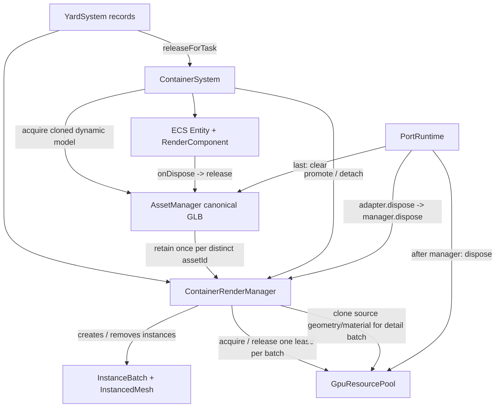

# JavaScript → TypeScript 迁移审计与计划

## 1. 迁移基线

- 审计对象：`vue+three` 港口数字孪生项目。
- 基线提交：`221f3b0 增加 Node.js：接入港口后端服务`。
- 前端：Vue 3 + Vite + Pinia + Three.js，源码此前全部使用 JavaScript；Vue SFC 的脚本也未声明 TypeScript。
- 后端：`server/` 为独立 Node.js + Express + PostgreSQL 适配层，当前保持 JavaScript，不与浏览器端类型迁移混合。
- 通信：前端使用 `fetch` 封装的 HTTP API（`src/api/request.js`），Vite 将 `/api` 代理到 Node.js；遥测当前使用随机数据源，未发现 WebSocket 实现。
- 当前没有 Router；Pinia Store 已存在，Axios 未使用。

## 2. 目录与架构

| 层 | 实际目录 | 职责 |
| --- | --- | --- |
| Vue 集成 | `src/App.vue`, `src/components`, `src/main.js` | 生命周期、面板和 UI 事件转发 |
| 运行时装配 | `src/app/PortRuntime.js` | 创建场景、资产、ECS、世界系统和帧调度 |
| 核心基础设施 | `src/core` | Clock、EventBus、FrameObserver |
| ECS | `src/ecs`, `src/factories` | Entity、Component、业务 System、实体工厂 |
| 世界与业务 | `src/world`, `src/ecs/systems`, `src/tasks` | 道路、堆场、运动、任务、岸桥和集装箱 |
| Three.js | `src/scene`, `src/assets`, `src/rendering`, `src/loaders` | 场景、GLB 资源、渲染和性能 |
| 数据/API | `src/api`, `src/stores`, `src/viewmodels`, `server` | HTTP DTO、Pinia 状态、后端 Repository 和路由 |

## 3. 待迁移清单与风险分类

- 基础纯逻辑：`src/core`、`src/domain`、`src/tasks/TaskCatalog.js`、配置模块。
- 数据/API：`src/api`、`src/stores`、`src/viewmodels`、`src/tasks/TaskExecutionBridge.js`。
- Three.js 基础设施：`src/scene/MainScene.js`、`src/assets/*`、`src/loaders/*`、`src/rendering/*`。
- ECS/构建：`src/ecs/*`、`src/factories/*`、`src/builders/*`、`src/managers/*`。
- 业务系统：`src/world/*`、`src/ecs/systems/*`、`src/systems/*`。
- 集成层：`src/app/PortRuntime.js`、`src/App.vue`、各 Vue SFC。
- 后端暂列独立批次：`server/src` 的 Express 路由、Repository 和数据库边界，不能与前端场景类型混为一谈。

主要风险：Three.js 对象所有权与销毁、GLTF 异步结果、ECS 可选组件、运行时装配顺序、业务 ID/数据库 ID/Entity ID 的区分、API 外部数据缺少运行时校验、Vue SFC props/emits 类型、动态模型 URL 和 JS/TS 混合解析。

## 4. 类型支持审计

- Vue 3、Pinia、Vite 提供可用的 TypeScript 声明；当前安装的 `three@0.185.0` 包及 `three/examples` 未提供足够声明，因此第三阶段增加了 `src/three-ambient.d.ts` 的最小实际 API 声明。
- GLB `?url` 由 `src/vite-env.d.ts` 提供最小声明。
- Axios 未安装且未使用；HTTP 边界应继续围绕现有 `fetch` 协议建立 DTO。
- Node/Express/pg 后端暂不纳入本轮浏览器端类型检查，后续可单独增加 Node tsconfig。

## 5. 已实施的第一阶段基础配置

- 新增严格模式的 `tsconfig.json`：`strict: true`、`allowJs: true`、`checkJs: false`、`noEmit: true`，保留 JS/TS 共存。
- 新增 `src/vite-env.d.ts`，声明 Vite 客户端类型和 GLB URL 导入。
- 安装 `typescript` 与 `vue-tsc`，新增 `npm run type-check`，保留原有脚本。
- 新增根 `.gitignore`，忽略依赖、缓存、环境变量、日志和本地工具配置。
- 迁移 `src/core/Clock.js` → `Clock.ts`：明确时钟配置、时间结果和取时函数契约。
- 迁移 `src/core/EventBus.js` → `EventBus.ts`：增加基于事件映射的泛型 payload 契约。
- 迁移 `src/domain/AlarmCatalog.js`、`src/tasks/TaskCatalog.js`、`src/telemetry/TelemetryTopics.js`，为告警、任务和遥测有限集合建立字面量联合类型。
- 仅修正直接调用方导入路径；没有批量改名或修改业务规则。

## 6. 分阶段迁移顺序与验收条件

1. **阶段 A：基础与纯逻辑**：Clock/EventBus/Catalog 已完成；下一批为配置和 DTO 类型。验收：type-check、构建、纯逻辑行为测试。
2. **阶段 B：API 与 Store**：保持 HTTP 路径、方法、参数和返回协议；增加请求/响应 DTO 与边界转换。验收：后端健康、任务、设备、集装箱接口回归。
3. **阶段 C：Three.js 资源与场景**：先 AssetLoader/Normalizer/Manager，再 MainScene 和渲染系统。验收：模型加载、克隆、释放、生产构建。
4. **阶段 D：ECS/Factory/Builder**：按 Entity → Component → Manager → Factory → Builder 迁移。验收：实体查询、组件生命周期、设备创建。
5. **阶段 E：World/System/FrameObserver**：保持系统顺序、deltaTime 单位和任务语义。验收：道路、AGV、岸桥、集装箱和性能监控回归。
6. **阶段 F：PortRuntime/Vue**：最后迁移组合根和 SFC。验收：启动、卸载、重复初始化、UI 状态同步。

每批只迁移一个边界清晰的模块组；调用方和依赖全部迁移并验证后，才删除旧 JS 文件。

## 7. 迁移前基线检查

- `npm run build`：基线可执行；当前第一阶段后仍通过。
- `npm run type-check`：基线不存在；第一阶段新增并通过。
- 后端 `node --check server/src/**/*.js` 等价逐文件检查：第一阶段后 15 个后端 JS 文件通过。
- Git 工作区基线包含 Node/Vite 缓存和日志变化；这些变化未作为迁移内容提交，已由 `.gitignore` 防止新增。

## 8. 错误区分规则

- 迁移前已有的业务运行时错误、API 数据错误、模型布局问题单独记录，不借 TypeScript 迁移修复。
- 新增类型错误必须定位到本批迁移模块或其直接调用方；不得用 `any`、`@ts-ignore` 或关闭 strict 掩盖。
- 每批记录实际命令和结果；未执行的浏览器交互、数据库连接或 WebSocket 验证不宣称通过。

## 9. 第二阶段迁移清单（API 与 Pinia Store）

### 9.1 已核对的实际协议与范围

- 前端通信实际使用原生 `fetch`（不是 Axios），入口为 `src/api/request.js`；保留 `/api` 相对路径、Vite 代理、`Accept: application/json`、HTTP 状态错误和网络错误包装。项目中未发现登录、Token、鉴权或 Axios 拦截器。
- 后端实际路由位于 `server/src/routes`，由 `server/src/app.js` 挂载；后端继续保持 JavaScript。本阶段只迁移浏览器端 API 与 Store。
- `GET /api/health` 返回健康状态、服务名和 ISO 时间；`GET /api/db/health` 返回连接状态，失败为 HTTP 503。
- `GET /api/devices?type=` 返回 `{ items, total }`；`GET /api/devices/:id` 返回单个 `{ id, entityId, name, type }` 设备档案。
- `POST /api/containers/sync` 接收最多 10000 个纯数据项（前端分 200 项批次发送），返回同步统计；`GET /api/containers` 返回 `{ items, total, page, pageSize }`；两个按 ID 查询路由分别用业务箱号和数据库 ID，返回单个容器档案。数据库 ID、businessId 和场景 entityId 是不同字段。
- `POST /api/tasks` 接收 `{ clientRequestId, type, parameters }`，成功返回任务 JSON（新建为 201，幂等重放为 200）；`GET /api/tasks` 返回分页对象；`GET /api/tasks/:id` 和 `POST /api/tasks/:id/execution-events` 返回任务 JSON。列表状态、页码范围和事件验证规则以 Express 路由为准。
- 尚无 HTTP 遥测接口；遥测仍由本地随机数据源生成。设备档案 DTO 不等于 DeviceStore 中保存的 ECS Entity。

### 9.2 本阶段迁移清单与顺序

1. 新增 API DTO/请求类型：区分健康检查、设备档案、容器同步/查询、后端任务和执行事件；仅按后端真实响应建立分页类型，不将其视为场景实体。
2. 迁移 `src/api/request.js`、`health.js`、`devices.js`、`containers.js`、`tasks.js` 到 `.ts`；原有 `.js` 导入路径在 Vite/TypeScript 混合解析下继续服务旧调用方，逐项保留路径、方法、查询参数和错误行为。
3. 按低耦合到高耦合迁移 Store：PerformanceStore、TaskStore、AlarmStore、DeviceStore、AssetStore。保持 Store ID、公开 state/action 和 Composition API 实现方式。
4. API 调用方仍是 `App.vue`、`DeviceListPanel.vue`、`TaskPanel.vue`、`PortRuntime.js`、`TaskExecutionBridge.js`；Store 调用方还包括 ECS、渲染系统、资产管理器和 Vue 面板。本批只在类型边界必要时修正调用导入，不迁移这些调用方模块。
5. 完成后更新本计划与阶段报告，执行 type-check、build、diff 检查及现有相关 smoke tests。

### 9.3 Store 数据与依赖边界

- `TaskStore` 保存前端运行时任务（含步骤、当前步骤索引和本地/服务端映射字段），并非 HTTP Task DTO；`TaskExecutionBridge` 负责在本地任务与服务端任务间传递命令和状态。
- `AlarmStore` 保存由 AlarmSystem 产生的告警工作流状态，不是后端数据库模型。
- `DeviceStore` 保存 ECS Entity、独立设备档案 DTO 和派生视图；`AssetStore` 保存资产目录数据、实体引用和遥测状态，并依赖 `AlarmStore` 生成告警关联视图。
- `PerformanceStore` 保存 PerformanceSystem 的帧/渲染性能快照，不涉及 HTTP。
- 本阶段不把 DTO 映射成 Three.js Mesh，不改变 ECS、System、Runtime 的职责或数据流。

### 9.4 第二阶段实施状态

- [x] 建立真实 API DTO 与请求选项类型。
- [x] 迁移 fetch 请求封装及健康、设备、集装箱、任务 API；保留 JS 兼容桥接。
- [x] 迁移五个 Pinia Store 及 Store 内部状态边界；保留 Store ID、公开字段和 action。
- [x] 完成 `npm run type-check`、`npm run build`、`git diff --check`；相关 smoke test 脚本缺失情况已记录在阶段报告。
- [ ] 运行时 schema 校验、ViewModel 类型化、Three.js/ECS/System/PortRuntime 迁移留待后续阶段。

## 10. 第三阶段迁移清单（Three.js 基础设施与资源管理）

### 10.1 实际审计结果

- 场景入口为 `src/scene/MainScene.js`，实际包含 `Scene`、`PerspectiveCamera`、`WebGLRenderer`、`CSS2DRenderer`、灯光、`Sky` 和巡航曲线；项目没有独立的后处理模块目录，但 `src/rendering/RenderSystem.js` 实际创建 `OrbitControls`、`EffectComposer`、`RenderPass`、`UnrealBloomPass` 和 `OutputPass`。
- 模型加载与资源管理实际位于 `src/assets/AssetLoader.js`、`AssetNormalizer.js`、`AssetManager.js`；`src/loaders/GLTFFactory.js` 是另一条 GLTF 工具路径，包含可选加载、克隆、归一化和岸桥占位模型。
- `src/assets/ModelMetadata.js` 提供归一化元数据；没有独立 AnimationMixer、CSS2D 以外标签设施或 OutlinePass。标签更新由 `src/rendering/LabelSystem.js` 调用，不在本阶段扩展。
- 当前 `three@0.185.0` npm 包未携带声明文件，且 `three/examples/jsm` 模块也没有可被 `vue-tsc` 使用的类型；本阶段新增最小、与实际使用 API 对齐的 `src/three-ambient.d.ts`，没有升级 Three.js 或将模块声明为 `any`。

### 10.2 本阶段实施清单

1. [x] 迁移 `AssetLoader`、`AssetNormalizer`、`ModelMetadata`，明确 GLTF、包围盒、归一化元数据和进度回调类型。
2. [x] 迁移 `AssetManager`，保留 manifest/cache/pending/refCount/idle dispose、模型克隆和共享资源释放行为。
3. [x] 迁移 `MainScene`，保留相机、渲染器、标签、灯光、天空、巡航曲线、resize 和 destroy 行为。
4. [x] 迁移 `RenderSystem` 与 `GLTFFactory`；保留控制器、EffectComposer、Bloom、动画/模型工具原有接口。项目当前没有 AnimationMixer 实现，因此未新增动画循环。
5. [x] 为旧 JS 调用方保留同名 `.js` 兼容桥接；迁移后的原文件顶部中文说明完整保留在对应 `.ts` 文件最开始，未删除或下移用户注释。
6. [ ] 不迁移 ECS、Builder/Factory、业务 System、PortRuntime、App.vue 或 Vue 页面；这些留待下一阶段。

### 10.3 第三阶段验收记录

- [x] `npm run type-check`：通过。
- [x] `npm run build`：通过；仍有约 960 KB 的既有大 chunk 警告。
- [x] `git diff --check`：通过。
- [x] 旧 JS 入口保留兼容桥接，且现有扁平模型 manifest 与嵌套 options 两种资源配置形状均可接受。
- [ ] `npm run test:assets`：脚本目标 `tests/asset-manager.smoke.mjs` 缺失，未能运行。
- [ ] 浏览器模型加载、WebGL 交互、数据库和前后端集成测试：本阶段未运行，不作通过声明。

## 11. 第四阶段迁移清单（ECS、Manager、Builder 与 Factory）

### 11.1 实际范围

- 本阶段按 Entity → Component → EntityManager/EquipmentManager → Factory → Builder 的依赖顺序迁移。
- 已迁移 `src/ecs/Entity.ts`、`src/ecs/EntityManager.ts`、ECS Component 类型文件、5 个实体工厂、`EquipmentManager.ts`、`PortEquipmentBuilder.ts` 和 `PortSceneBuilder.ts`。
- `AssetManager.attach` 增加 ECS `ComponentValue` 边界，避免组件写入接口退化为 `unknown`；缓存、引用计数和释放行为未重写。
- 未迁移业务 System、World、`src/app/PortRuntime.js`、Vue 页面或后端。

### 11.2 类型与生命周期边界

- `EntityId` 为字符串；ECS Entity ID、业务 ID、数据库 ID、资产键和 Three.js 场景对象没有互相复用。
- Entity 只持有 EntityManager 引用；组件仍集中存放在 EntityManager 的按类型 Map 中。
- `TransformComponent` 持有 `Object3D` wrapper 和 `Box3`，`RenderComponent` 只负责模型引用与一次性释放回调；它们不是后端 DTO 或 Pinia Store 状态。
- `ComponentValue` 使用实际组件联合类型约束组件边界，没有用 `any` 或 `@ts-ignore` 逃避严格检查。
- Factory 保留原有 `create()` 静态入口、组件装配顺序、节点重挂载/包围盒计算和释放回调；Builder 保留原有布局参数、批量编号、场景挂载和 AssetManager attach 行为。

### 11.3 兼容策略与注释

- 每个旧 `.js` 入口保留同名导出桥接到 `.ts`，现有 JavaScript 调用方可以继续按旧路径导入。
- 迁移前 `.js` 文件中的中文职责、术语和算法说明已保留在对应 `.ts` 文件最开始；没有把用户注释移动到文件末尾或删除。
- 旧 JS 实现包在注释中，不会与 TypeScript 实现重复执行；未改变公开类名、工厂方法名或 Builder 导出名。

### 11.4 第四阶段验收条件

1. `npm run type-check` 必须通过。
2. `npm run build` 必须通过；既有大 chunk 警告单独记录，不作为类型错误。
3. `git diff --check` 必须通过。
4. 仅运行仓库中实际存在的 ECS/Factory/Builder 测试；缺失测试不得伪造通过。

下一阶段可在保持兼容边界的前提下迁移业务 System、World 和 PortRuntime；不建议在同一批次继续大规模改动 Vue 页面。

## 12. 第五阶段迁移清单（业务 System 与统一帧调度）

### 12.1 审计现状与真实运行链

- PortRuntime 创建一个 `FrameObserver`，把帧任务注册到该实例；`RenderSystem` 持有唯一的场景 `requestAnimationFrame` 循环，并用 `Clock.tick()` 产出秒为单位的 `deltaTime` 和 `elapsedTime`，每帧调用 observer 更新、渲染前钩子、composer 渲染、渲染后钩子。
- FrameObserver 任务按 `priority` 数字升序、同优先级按注册序号稳定执行；interval 以毫秒配置、内部换算秒累计。FrameListener 分 `beginFrame/beforeRender/afterRender` 三钩子，错误按任务/监听器隔离。
- 业务运动链是 TaskSystem 发起命令 → PathManager 规划 route → MotionSystem 累积 `speed * dt` 距离并按路线更新 TransformComponent → 到达时发出 `AGV_ARRIVED` → TaskSystem 事件回调推进状态。任务创建和启动分离，TaskSystem 无每帧 update。
- TelemetrySystem 通过 TelemetryGateway 订阅当前随机模拟源，回调只覆盖 assetId 缓冲，帧任务再平滑运动速度并更新 AssetStore。PortRuntime 当前注释掉 `_startTelemetry()` 调用，因此默认场景没有启动模拟遥测；没有真实 WebSocket。
- RoadSystem/YardSystem/PathManager、MotionSystem、TaskSystem、AGVSystem、ContainerSystem、QuayCraneSystem 仍是 JS。PerformanceSystem 与 AdaptiveQualitySystem 也仍是 JS；`RenderSystem.ts` 已迁移，本阶段只将其 FrameObserver 类型边界对齐。
- 多个其他渲染/空间优化系统本身可有内部更新方法，但 PortRuntime 把它们注册到同一 FrameObserver，而非自建 RAF。RenderSystem 的场景循环外没有发现第二个 RAF 调度入口；遥测数据源使用 `setInterval`（非帧循环）。

### 12.2 本次可验证迁移边界（已实施）

1. [x] 迁移 `src/core/FrameObserver.js` → `.ts`，保持任务排序、interval、异常隔离、生命周期/幂等注销和帧钩子语义；旧 JS 保留导出桥接。
2. [x] 迁移 `src/ecs/systems/TelemetrySystem.js` → `.ts`，保留 start/stop 幂等、缓冲合并、每帧应用、资产 Store 更新和速度平滑；旧 JS 调用方路径不变。
3. [x] 迁移 `src/rendering/PerformanceSystem.js` 与 `AdaptiveQualitySystem.js` → `.ts`，保留快照窗口、可见性监听、P95 统计、性能阈值和质量切换策略。
4. [x] RenderSystem 使用 FrameObserver 的真实结构类型；MotionComponent 增加来自真实调用方的 route/command/phase 字段契约，不修改运动算法。
5. MotionSystem、TaskSystem、RoadSystem、YardSystem、PathManager 仍未迁移。它们是本阶段重点且体量/耦合较高；本次没有将旧 JS 包装层冒充为迁移完成，也没有改变其业务逻辑。阶段报告明确这是一段已验证的迁移边界，未宣称完整完成第五阶段。

### 12.3 本次验证结果

- [x] `npm run type-check`：通过。
- [x] `npm run build`：通过；仍有约 962 KB 的压缩 JS 大 chunk 警告。
- [x] `git diff --check`：通过。
- [x] `node --check` 检查 FrameObserver、TelemetrySystem、PerformanceSystem、AdaptiveQualitySystem 四个 JS 桥接：通过。
- [ ] `npm run test:frame-observer`、`npm run test:performance`：未能运行，脚本对应的 `tests/frame-observer.smoke.mjs`、`tests/performance-system.smoke.mjs` 不存在；没有创建空测试。
- [ ] 浏览器/WebGL、AGV 运动、任务流程、遥测和前后端集成回归：未执行，生产构建不代表这些运行时行为已验证。

### 12.4 测试与后续范围

- package.json 声明的多个 smoke-test 脚本指向 tests/ 下文件，但当前仓库没有 `tests/` 目录；不得将这些测试记录为通过。
- 后续先按真实路由/数据契约迁移 MotionSystem 与 PathManager，再迁移 TaskSystem；保持 AGV_ARRIVED 与 TaskStore 的事件驱动关系，然后评估 RoadSystem/YardSystem 是否值得单独 TypeScript 化。不可同时扩大到 PortRuntime 或 Vue。

### 12.5 第五阶段第二批：PathManager + MotionSystem

- [x] 审计真实调用链：PortRuntime 注入同一个 JS RoadSystem；TaskSystem/AGVSystem 通过 `createYardRoute`、`getBerthParkingPoint` 和 `moveAGV` 使用两者；PortRuntime 将 MotionSystem 注册为 priority 1 的 FrameObserver 任务。
- [x] 迁移 `src/world/PathManager.js` → `PathManager.ts`，保留环线投影、堆场局部图接入、Dijkstra、路线采样、泊位停车点和失败消息。
- [x] 迁移 `src/ecs/systems/MotionSystem.js` → `MotionSystem.ts`，保留自由巡航、跟车减速、命令路线累计 `speed * deltaTime`、TransformComponent 更新和 `AGV_ARRIVED` 事件。
- [x] 为仍为 JS 的 RoadSystem 建立最小 `RoadSystemPathApi` / `MotionRoadApi` 兼容边界；不迁移 RoadSystem、TaskSystem、YardSystem 或 PortRuntime。
- [x] 旧 JS 文件改为桥接到 TS；导入路径和公开类名/方法名保持兼容。
- [ ] 针对性 PathManager/MotionSystem smoke test：当前 package.json 没有对应脚本和可执行测试文件，不创建空测试。

### 12.6 第五阶段第三批：TaskSystem 事件与任务编排

- [x] 审计 `TaskSystem.js` 当前构造注入、任务创建/启动、`AGV_ARRIVED` 订阅、状态更新、任务路线调用及相关协作系统接口。
- [x] 迁移 TaskSystem 实现为 TS，保持任务状态值、任务创建/启动分离、事件驱动流转和兼容调用签名。
- [x] 保留旧 JS 调用路径桥接；不迁移 AGVSystem、ContainerSystem、QuayCraneSystem、Store、PortRuntime 或 Vue。
- [x] 完成类型检查、构建、JS 桥接语法与 diff 检查；没有可执行 TaskSystem smoke 测试时如实记录。
## 第五阶段最后一批：RoadSystem 与 YardSystem

本批次按“运行时实现单一来源、TS 提供公开契约、旧 JS 保持兼容”的顺序处理：

1. 审计道路注册表、车道/交叉口查询、临时路线生命周期及 Yard 路网生成，并核对 PathManager、MotionSystem、TaskSystem 的实际调用面。
2. 为 RoadSystem 建立道路、车道、交叉口、YardNetwork 和 transient route DTO；不把导航数据与 Three.js 场景实体混为一谈。
3. 为 YardSystem 建立箱区、箱位、集装箱记录和释放选项类型；保留原文件头注释及纯数据台账职责。
4. 将原始 JS 实现移至 `RoadSystem.impl.js` / `YardSystem.impl.js` 作为唯一算法来源，由 `RoadSystem.ts` / `YardSystem.ts` 提供类型化外观，旧 `.js` 入口转发到 TS 外观。
5. 验证类型检查、构建、diff 空白检查，并如实尝试实际存在的道路/堆场 smoke test。

范围明确不包括 PortRuntime、Vue 页面、ECS、Builder、Factory 及既有 PathManager/MotionSystem/TaskSystem 的重写。

## 13. 第六阶段迁移清单（PortRuntime）

本阶段将 `src/app/PortRuntime.js` 迁移为 `src/app/PortRuntime.ts`，并保留
`src/app/PortRuntime.js` 作为旧调用方兼容桥接。迁移范围仅限运行时组合根的
类型契约、生命周期字段和调用边界，不扩展到 Vue、后端或剩余 JavaScript 系统。

- [x] 审计 PortRuntime 的真实装配顺序、异步模型预加载、FrameObserver 所有权和销毁顺序。
- [x] 保留原文件头中文注释及 `start/destroy`、聚焦、任务命令入口的公开语义。
- [x] 为构造参数、性能快照回调、帧任务和空间登记参数建立明确类型。
- [x] 为尚未迁移的 JS 系统设置集中兼容边界，避免重复实现业务算法或第二套依赖注入容器。
- [x] 增加 `PortRuntime.js` → `PortRuntime.ts` 的命名/默认导出桥接。
- [ ] 不在本阶段迁移 GroundSystem、设备/渲染适配器、Vue 页面或后端模块。

下一阶段应优先收窄 PortRuntime 当前兼容边界中的 JS 系统接口，并补充真实运行时
生命周期测试；在有测试保护前不要批量改写空间优化和设备系统。

## 14. 第七阶段迁移清单（Vue 集成层与全项目验收）

- [x] 审计当前所有 9 个 Vue SFC、PortRuntime 入口、Pinia/API 调用和生命周期钩子。
- [x] 将 9 个 Vue SFC 的 `<script setup>` 纳入 `lang="ts"`，为 Runtime、DOM 引用、Props/Emits、API DTO、AbortController、错误对象和性能指标补充类型。
- [x] 将 `src/main.js` 的应用入口实现迁移到 `src/main.ts`；旧 `main.js` 保留为单一导入桥接，index.html 现有入口无需改变。
- [x] 核对 91 个 `src` JavaScript 文件，区分 53 个 TS 兼容桥接、配置/资源定义、仍有业务实现的 JS 以及 `.impl.js` 文件。
- [x] 更新最终覆盖与风险清单；不删除仍被运行时依赖的桥接，不修改 UI 样式和业务算法。
- [ ] GroundSystem、空间优化/渲染适配器、设备系统、TaskExecutionBridge、ViewModel 及 Road/Yard `.impl.js` 仍需后续独立迁移；本阶段不在无回归测试保护下批量改写这些高耦合模块。

## 15. 第八阶段第一批迁移清单（RoadSystem 与 YardSystem 实现）

- [x] 审计道路/堆场旧实现、公开调用方及 `.impl.js` 直接引用；确认旧调用方继续通过兼容入口工作。
- [x] 将 `RoadSystem.impl.js` 的道路、车道、曲线、临时路线、视觉网格和 YardNetwork 实现迁入 `RoadSystem.ts`。
- [x] 将 `YardSystem.impl.js` 的箱区/箱位/容器台账、编号、布局、包围盒和顶层释放规则迁入 `YardSystem.ts`，保留文件开头中文职责说明。
- [x] 将两个 `.impl.js` 降为兼容转发文件，不再由其承载可执行核心实现。
- [x] RoadSystem 几何内部已移除文件级 `@ts-nocheck`，并完成严格类型检查；下一批仍应在真实几何 smoke test 保护下补充运行时验证。
- [ ] 不迁移 PortRuntime、Vue、GroundSystem、其他业务 System 或剩余 JS。

## 16. 第八阶段第二批迁移清单（RoadSystem 严格类型化）

本批只收窄 `RoadSystem.ts` 的类型边界，不扩大到 YardSystem、PathManager、MotionSystem、TaskSystem、PortRuntime、Vue 或其他业务 JS。

- [x] 审计 RoadSystem 对外 API 及 PathManager 的实际调用面：道路/车道查询、路径采样、最近点、临时路线创建和道路删除接口保持兼容。
- [x] 移除 `src/world/RoadSystem.ts` 文件级 `@ts-nocheck`，为道路、车道、交叉口、YardNetwork、渲染片段、几何缓冲和道路分带建立明确类型。
- [x] 为 `_createPathCurve`、路径可视化采样、YardNetwork 构建、路网注册 ID 建立空数组/可选字段保护；不改变道路拓扑、坐标、车道 ID、节点 ID、边 ID 或临时道路生命周期。
- [x] 保留 `src/world/RoadSystem.js` 与 `src/world/RoadSystem.impl.js` 兼容入口；未删除用户已有工作区改动，未提交或推送 Git。
- [x] 第八阶段第三批审计确认 YardSystem 已无文件级 `@ts-nocheck`；本批完成其余必要公开类型收窄。
- [ ] 不将缺失的道路 smoke test 补写为空测试；待真实测试文件存在后再增加几何/路网运行时回归。

## 17. 第八阶段第三批迁移清单（YardSystem 严格类型审计与道路—堆场接口验收）

本批只审计并收窄 `YardSystem.ts` 及其与 RoadSystem、PathManager、ContainerSystem 的真实数据边界，不迁移其他业务 JS、PortRuntime 或 Vue。

- [x] 核对 `YardSystem.ts`、JS 兼容入口和 `.impl.js`：TS 是唯一可执行实现，旧 JS 文件只转发；未发现 YardSystem 仍有文件级 `@ts-nocheck`。
- [x] 审计堆场箱区、箱位、集装箱记录、布局、堆叠检查和出库接口；保持编号、坐标、堆叠顺序、顶层出库和状态更新规则不变。
- [x] 收窄箱位占用记录、动态实体世界坐标可空值、实例化渲染绑定以及箱子 owner/state 的公开类型；不使用 `any`、非空断言或新的文件级豁免。
- [x] 验收道路—堆场边界：GroundSystem 从 YardSystem 的 `block.containers` 映射为 RoadSystem 所需的 `{ id, bounds }` 箱位输入；RoadSystem 独立生成 `YardNetwork`，PathManager 读取网络节点、边和接驳点，不由 YardSystem 重复实现路径规划。
- [x] 核对 ContainerSystem、PortSceneBuilder、Entity/Factory 和 TaskSystem 的既有调用兼容性；不修改这些模块的业务行为。
- [ ] YardSystem 的真实 smoke test 仍待补齐；当前 `tests/` 目录没有可执行的 `yard-scale.smoke.mjs` 或 `road-system.smoke.mjs`，不创建空测试。

## 18. 第八阶段第四批迁移清单（PathManager、MotionSystem、TaskSystem 类型安全专项）

本批只处理路径规划、车辆运动和任务编排三条已经迁移到 TypeScript 的核心边界；不修改 PortRuntime、Vue 页面或其他业务 JavaScript。

- [x] 复核 `PathManager.ts`、`MotionSystem.ts`、`TaskSystem.ts` 的完整实现、JS 兼容入口、RoadSystem/YardSystem/ECS/Store 的真实调用链，以及 `strict: true` 的实际检查结果。
- [x] 审计三个模块的 `@ts-nocheck`、`@ts-ignore`、`any`、非空断言和 Map/数组访问；三个目标文件均无文件级豁免、`any` 或忽略指令。
- [x] 将 `RoadSystemPathApi` 的点/切线查询返回值对齐 RoadSystem 的真实 `Vector3 | null` 契约，并在车道投影、采样、堆场接入、Dijkstra 回溯和路线生成边界增加空值保护。
- [x] 在 `MotionSystem` 中保留路线、速度、距离和 `AGV_ARRIVED` 语义；对 RoadSystem 的车道/道路查询采用非空 ID 契约，并在 Transform 更新时处理切线查询失败。
- [x] 核对 `TaskSystem` 的创建/启动分离、搬箱/卸船/充电分支、`AGV_ARRIVED` 事件负载、TaskStore 状态更新及 ECS 组件边界；未发现需要改变业务语义的类型错误，因此不重写该文件。
- [x] 不改变 Dijkstra 拓扑、`speed * deltaTime` 运动计算、跟车减速、临时道路清理、任务状态值或事件名称；保留中文文件头注释和 JS 兼容桥接。
- [ ] PathManager/MotionSystem/TaskSystem 专用 smoke test 仍不存在；不创建空测试，运行时 AGV 全链路仍需后续真实测试覆盖。
- [ ] 本批完成后停止，不继续迁移其他业务 JS、PortRuntime 或 Vue。

## 第八阶段第六批：基于依赖图迁移下一组低耦合业务 JavaScript 模块

### 最新扫描结果

本批重新读取迁移文档、`package.json`、`tsconfig.json` 并扫描实际源码。当前 `src` 下仍有 **91 个 `.js` 文件**，分类为：

- **A 兼容桥接：58 个**，包括已迁移模块的 JS 转发入口和 `src/main.js` 的入口转发。
- **B 配置/工具脚本：2 个**：`src/config/PortSceneConfig.js`、`src/config/PortSpatialConfig.js`。
- **C 仍含业务或运行时实现：31 个**：GroundSystem、遥测源/网关、TaskExecutionBridge、设备 ECS 系统、空间渲染/适配器、LOD/chunk、材质和渲染辅助模块，完整清单记录于阶段报告。
- **D 权威实现或依赖不明确：0 个**。当前未发现仍被调用的 JS/TS 双份核心算法；迁移后的 JS 入口均只转发。

根目录 `vite.config.js`、`scan-fffd.cjs` 仍按构建/工具脚本保留，不计入 `src` 统计。`strict: true`、`allowJs: true`、`checkJs: false` 保持不变。

### 依赖排序与本批选择

1. **本批迁移 `src/domain/AssetCatalog.js`**：仅提供资产枚举、展示标签和确定性的资产目录工厂；被 `PortSceneBuilder.ts`、`PortEquipmentBuilder.ts`、`AssetViewModel.ts` 及旧 JS 调用方使用，不依赖 Three.js、PortRuntime、System、定时器或网络。
2. `src/tasks/TaskExecutionBridge.js`：下一候选，依赖 TaskStore、任务 API、定时器和异步重试，需要先补 DTO/事件状态断言。
3. `src/telemetry/RandomTelemetrySource.js`、`TelemetryGateway.js`：涉及订阅和定时器生命周期，应先补 start/stop 行为测试。
4. `src/world/GroundSystem.js`：依赖 Road/Yard、ECS、渲染对象和场景布局，风险较高。
5. 设备 ECS 系统及渲染/LOD/chunk 模块：跨多个运行时边界，继续逐模块迁移。

### 本批实施

- [x] 新增 `src/domain/AssetCatalog.ts`，迁入所有真实枚举、标签常量及 `createAGVAsset`、`createCraneAsset`、`createYardAsset`、`createContainerAsset`、`createRoadAsset`、`createBerthAsset`、`createAsset` 实现。
- [x] 新增 `AssetTypeValue`、状态联合类型和 `AssetCatalogRecord`，并与已有 `AssetState` 对齐；堆场输入仅声明实际需要的 `count` 字段。
- [x] `src/domain/AssetCatalog.js` 改为首行注释保留的纯兼容转发；已迁移的三个 TS 调用方改为解析同名 TS 权威模块，其他 JS 调用方继续使用兼容路径。
- [x] 保留资产 ID、编号、状态、标签、指标和默认 `entityId: null` 行为；未修改场景布局、资产规则或数据库协议。
- [x] 未迁移 `TaskExecutionBridge`、遥测、GroundSystem、PortRuntime、Vue、ECS 或渲染系统。

### 验证与边界

- [x] `npm run type-check`：通过。
- [x] `npm run build`：通过，Vite 转换 201 个模块；保留既有大 chunk 警告。
- [x] `git diff --check`：通过。
- [x] `node --check src/domain/AssetCatalog.js`：通过，确认 JS 兼容入口语法有效。
- [ ] 资产目录没有现成测试脚本；不创建空测试。生产构建通过也不代表浏览器/WebGL 和完整港口场景回归通过。

本批只迁移低耦合资产目录模块；下一批优先处理 `TaskExecutionBridge`，但应先建立真实任务 DTO/Store 映射测试，不扩大迁移范围。

## 第八阶段第七批：TaskExecutionBridge 渐进式迁移

### 审计结论与边界

- 实际调用链为 `App.vue → PortRuntime.createTask() → TaskExecutionBridge.createAndStart() → createTask API`；`PortRuntime` 提供 `TaskStore` 和调用 `TaskSystem.createTask(type)`/`startTask(id)` 的本地工厂。`PortRuntime.dispose()` 调用 `taskBridge.stop()`。本批不改 PortRuntime、TaskSystem 或 Vue。
- Bridge 将本地任务状态转成后端执行事件，并轮询服务端任务状态；不承担运动算法或任务状态机。它没有 `AGV_ARRIVED` 事件订阅、timeout、AbortController 或额外事件监听器。
- 创建失败时，服务端任务记录已先创建；本地创建抛错或返回空时，Bridge 上报 `sequence=1/status=failed/stage=startup/LOCAL_START_FAILED`，然后传播原异常或“本地任务执行器未就绪”异常。若失败事件请求本身失败，API 异常仍会向调用方传播（保持原控制流）。
- 本地 WAITING 映射为 pending 且不发送执行事件；RUNNING/COMPLETED/其他状态分别映射 running/completed/failed。事件字段和去重键沿用旧实现。POST 事件失败时回滚 sequence 并清空去重键以便下一轮重试。
- `start()` 使用 250ms flush、1000ms query 且不重复注册；`stop()` 清理两组 interval、不清空映射。针对已发现的运行时销毁竞争，增加生命周期版本检查：stop 后已在途的 query 响应不再 patch Store，也不会在 stop 后重启时解除新 query 的 in-flight 标记；网络请求仍无法取消。

### 迁移与验收

- [x] 新增 `src/tasks/TaskExecutionBridge.ts` 为权威实现；`TaskExecutionBridge.js` 仅保留首行兼容说明并重新导出类。
- [x] 复用 `BackendTaskStatus`、`ExecutionEventRequest`、`TaskDto`、`TaskState` 和 `TaskTypeValue`；在 Bridge 局部明确服务端映射字段及 Store patch 边界，不修改 TaskStore 的通用 patch 契约。
- [x] 新增真实实现驱动的 `tests/task-execution-bridge.smoke.mjs` 与 `npm run test:task-bridge`，借 Vite SSR 加载 TS，并通过 fetch 边界注入 API 响应。
- [x] 测试断言创建 DTO、pending 事件抑制、执行事件字段/序列及 POST 失败重试、启动失败补偿及异常传播、服务端 terminal 状态映射、重复 start/stop 定时器管理、stop 后迟到 query 不改 Store。
- [ ] 未验证真实后端/浏览器全链路和真实网络故障下的时序；测试使用真实 Bridge/API 代码，但 mock HTTP fetch。GET 失败被原有 catch 吞掉，专项测试未覆盖每一种网络异常。

### 当前 JS 分类更新

- 本批后重新扫描得到 `src/**/*.js` 共 91 个：A 兼容桥接 59 个、B 配置 2 个、C 含业务/运行时实现 30 个、D 权威实现不明 0 个。文件总数不变，是 `TaskExecutionBridge.js` 从 C 转为 A。C 类完整清单和验证结果见阶段报告。
- 下一批建议优先审计 `RandomTelemetrySource.js` 与 `TelemetryGateway.js` 的拆分边界；只有能分别覆盖定时器和订阅清理时再联合迁移。GroundSystem 及设备/渲染系统与场景、ECS、资源生命周期耦合更高，暂后置。

## 第八阶段第五批：剩余业务 JavaScript 盘点与首批模块迁移

### 当前审计基线

本批重新检查迁移文档、`package.json`、`tsconfig.json`、Git 工作区及 `src` 文件系统。`rg --files src -g '*.js'` 实际返回 **91 个文件**：

- **A 兼容桥接：57 个**，含 56 个转发到 TS 的模块和转交 `main.ts` 的 `main.js`。
- **B 配置/静态配置：2 个**：`src/config/PortSceneConfig.js`、`src/config/PortSpatialConfig.js`。
- **C 仍含业务/运行时实现：32 个**，完整清单在迁移报告中；`AssetCatalog.js` 含被运行时调用的资产工厂函数，因此归入 C。
- **D 双份可执行实现或权威实现不明：0 个**。包括 Road/Yard `.impl.js` 在内的已迁移入口均只转发到 TS；注释留档不算可执行副本。

根目录 `vite.config.js`、`scan-fffd.cjs` 属于项目构建/独立工具脚本，不纳入 `src` 统计且本批保留 JS。`tsconfig.json` 仍为 `strict: true`、`allowJs: true`、`checkJs: false`。

### 依赖排序与本批选择

1. **已迁移 `DeviceViewModel`、`AssetViewModel`**：纯展示映射，分别由 `DeviceStore`、`AssetStore` 直接调用，无场景副作用或异步生命周期，不需要改 Vue、Runtime 或业务 System。
2. `TaskExecutionBridge`：连接 TaskStore 与真实任务 API，迁移前需收窄/验证 `TaskPatch` 到 API DTO 的映射。
3. `RandomTelemetrySource`、`TelemetryGateway`：涉及定时器、事件订阅与 start/stop 生命周期，应先建立行为测试。
4. `GroundSystem`：耦合 Road/Yard、场景、渲染资源和空间布局，风险较高。
5. AGV/Container/QuayCrane/Pick/Selection/Alarm ECS 系统及渲染/LOD/chunk 模块：依赖 Entity、Store、Three.js 资源和统一帧循环，应分模块迁移。

### 本批实施记录

- [x] 新增 `src/viewmodels/DeviceViewModel.ts`、`src/viewmodels/AssetViewModel.ts` 为权威实现；同名 JS 文件改成纯转发兼容入口，Store 保留旧 `.js` 导入路径。
- [x] 新增 ViewModel 数据契约，明确区分 SceneEntity、AssetState、TelemetryState、活动告警展示数据与 UI ViewModel，不复用数据库模型或 Three.js 对象。
- [x] 保留公开字段、getter、静态工厂、标签和状态映射。Device 世界坐标缺失时使用原构造默认值；Asset 告警等级用有限值守卫，不用断言接受未知输入。
- [x] 资产位置 X/Y/Z 不完整时格式化为 `--`，避免对 null 调用 `toFixed()`。
- [x] 两个旧 JS 文件没有中文文件头注释；兼容说明在文件第一行。

### 验收与停止

- [x] `npm run type-check`：通过。
- [x] `npm run build`：通过，Vite 转换 200 个模块，保留既有大 chunk 警告。
- [x] `git diff --check`：通过。
- [x] 两个 ViewModel JS 兼容文件 `node --check` 通过；构建验证旧调用路径解析。
- [ ] `npm run test:roads`、`npm run test:yard-scale`：引用的测试文件不存在，`MODULE_NOT_FOUND`；没有 ViewModel 专项测试或已配置测试运行器，未伪造通过。
- 未执行浏览器/WebGL、完整港口场景、数据库或前后端集成回归。

本批在两个低风险 ViewModel 模块处停止。下批建议迁移 `TaskExecutionBridge`，先建立真实 DTO/Store 转换断言；不扩大至 PortRuntime、Vue 页面或大批设备/渲染系统。

## 第八阶段第八批：遥测源与网关渐进式迁移

本批重新扫描后仍有 91 个 `src/**/*.js`：A 兼容桥接 61 个、B 配置 2 个、C 仍含业务/运行时实现 28 个、D 权威实现不明 0 个。`RandomTelemetrySource` 只依赖已迁移的资产目录常量、TelemetryTopics、AssetManager、EntityManager 和 Motion 组件；`TelemetryGateway` 只负责 mock 通道选择和 JSON 归一化。两者由已迁移 `TelemetrySystem.ts` 调用，边界清晰，未修改 PortRuntime、TaskSystem、MotionSystem 或 PathManager。

- [x] 新增 `src/telemetry/RandomTelemetrySource.ts`，迁入真实随机遥测、状态缓存、订阅集合和 interval 生命周期。
- [x] 新增 `src/telemetry/TelemetryGateway.ts`，迁入 mock-websocket/mock-mqtt 选择和 `normalizeIncomingTelemetry`。
- [x] 两个 JS 文件改为纯兼容桥接，保留旧 `.js` 导入路径；新增 `tests/telemetry-source.smoke.mjs` 和 `npm run test:telemetry`，使用 Vite SSR 加载真实 TS 实现并验证发布、订阅、计时器、通道与归一化行为。
- [ ] 未验证真实 WebSocket/MQTT、浏览器 Three.js 世界坐标或后端集成；外部 JSON 仍无 schema 校验，保持原协议行为。

下一批建议审计 `GroundSystem.js` 的资源/数据边界；若无法独立验证，再处理低耦合渲染辅助模块，不批量迁移核心 ECS/渲染系统。

## 第八阶段第九批：遥测传输边界审计与画质控制器迁移

- 遥测审计确认当前不存在真实 WebSocket/MQTT 客户端、连接地址、重连、认证、主题订阅或消息传输模块。`mock-websocket` 与 `mock-mqtt` 仅是 `RandomTelemetrySource` 的通道标签；真实数据流为 `RandomTelemetrySource → TelemetryGateway → TelemetrySystem → AssetStore`，不应虚构真实传输实现。
- 本批从剩余业务实现中选择 `src/rendering/QualityController.js`：它只依赖 renderer/composer/renderSystem/lodSystem 的小型公开边界，由 `PortRuntime` 构造且由 `AdaptiveQualitySystem` 调用 `apply()`，无需改 Runtime 或核心系统。
- [x] 新增 `src/rendering/QualityController.ts`，保留 high/medium/low 档位、像素比覆盖、Bloom、EffectComposer 尺寸同步与 LOD 设置行为；JS 文件改为纯兼容桥接。
- [x] 新增真实模块测试 `tests/quality-controller.smoke.mjs` 与 `npm run test:quality-controller`，覆盖档位映射、重复档位去重、无效档位忽略及渲染/Composer/LOD 协调。
- [ ] 未验证真实 WebSocket/MQTT、浏览器 WebGL、后端或完整 Runtime 回归；遥测模拟协议仍无运行时 schema 校验。

## 第八阶段第十批：剩余前端 JS 盘点与 GpuResourcePool 迁移

重新扫描前端 `src`（不计入独立后端目录）得到 91 个 JS 文件：A 兼容桥接 63 个、B 配置 2 个、C 仍含业务/运行时实现 26 个、D 权威实现不明 0 个。通过同名 TS 文件、实际导出和调用方核对，未将后端文件计入统计。

本批未重复迁移已完成的遥测、TaskExecutionBridge 或 QualityController。候选中 `GpuResourcePool` 的输入输出和资源所有权最清楚：被 `ContainerRenderManager`、`RenderResourceSystem` 及渲染适配器调用，负责派生资源的 acquire/release/sweep/dispose；不拥有原始 GLB，不涉及网络、Store、Vue 或独立帧循环，因此选为本批唯一迁移模块。

- [x] 新增 `src/rendering/GpuResourcePool.ts`，保留引用计数、15 秒默认宽限期、估算字节、资源重建和强制释放行为，并为资源工厂/销毁/估算边界建立类型。
- [x] `GpuResourcePool.js` 改为纯 JS 兼容桥接，现有旧导入路径继续解析 TS 权威实现。
- [x] 新增 `tests/gpu-resource-pool.smoke.mjs` 与 `npm run test:gpu-pool`，覆盖共享、租约计数、宽限期清扫、重建、强制释放和回调稳定性。
- [ ] 未执行浏览器 WebGL、GPU 驱动显存、后端、真实 Runtime 回归；Three.js 资源销毁仍需真实场景验证。

剩余 C 类模块主要是 ECS 设备系统、GroundSystem、LOD/chunk、RenderResourceSystem、RenderSystem、六个渲染适配器、ContainerRenderManager、LowDetailFactory、ProxyFactory、材质和交互系统；下一批优先审计 `ProxyFactory`/`LowDetailFactory` 是否可在 Three.js 受控对象边界下联合迁移，否则继续拆分高耦合渲染模块。

## 第八阶段第十一批：GroundSystem 审计与 Three.js 辅助模块迁移

### 最新盘点（以当前文件系统为准）

本批重新扫描 `src` 得到 91 个 `.js` 文件：A 兼容桥接 63 个，B 配置 2 个，C 仍含业务/运行时实现 26 个，D 权威实现不明 0 个。C 类完整清单为：`src/world/GroundSystem.js`、`src/world/RoadSystem.impl.js`、`src/world/YardSystem.impl.js`、`src/systems/chunk/ChunkSystem.js`、`src/systems/lod/LODSystem.js`、`src/ecs/systems/AGVSystem.js`、`AlarmSystem.js`、`ContainerSystem.js`、`PickSystem.js`、`QuayCraneSystem.js`、`SelectionSystem.js`、`src/rendering/AlarmVisualSystem.js`、`ContainerRenderManager.js`、`HighlightSystem.js`、`InstanceBatch.js`、`LabelSystem.js`、`UISystem.js`、`src/materials/CraneHarbourMaterials.js`、`src/systems/render/RenderSystem.js`、`RenderResourceSystem.js` 及六个 render adapter。`src/config/PortSceneConfig.js`、`src/config/PortSpatialConfig.js` 为 B 类；`ProxyFactory.js` 与 `LowDetailFactory.js` 已转为 A 类兼容桥接。`RoadSystem.impl.js` 与 `YardSystem.impl.js` 是既有 TS 权威实现的业务兼容实现文件例外，不能按同名 TS 判断为桥接。

### 审计与选型

`GroundSystem.js` 同时创建 Water、Canvas 程序化纹理、CSS2D 标签、浮标动画、码头地坪、堆场和道路，并依赖 RoadSystem/YardSystem、相机和布局配置；没有独立的可执行测试，属于高耦合场景总装配，本批只记录审计结论，不迁移其实现。依赖清楚且可用真实 Three.js 对象验证的 `ProxyFactory` 与 `LowDetailFactory` 被选为一组低风险辅助模块；它们不改变业务 ID、场景布局或资源池所有权。

### 实施边界

- [x] 新增 `src/rendering/ProxyFactory.ts` 和 `LowDetailFactory.ts`，保留原算法、默认参数、校验、代理尺寸/位置、简模失败时盒状回退和资源不主动释放行为。
- [x] `ProxyFactory.js`、`LowDetailFactory.js` 改为纯兼容桥接，旧 JS 调用方继续按原路径导入；用户原有说明在权威 TS 文件顶部保留。
- [x] 新增 `tests/three-factories.smoke.mjs` 与 `npm run test:three-factories`，使用真实 Three.js 对象覆盖代理尺寸、attach 开关、非法输入、低模边界和回退。
- [ ] GroundSystem、ECS、LOD/chunk、RenderSystem、适配器及其余 C 类模块留待后续批次。

## 第八阶段第十二批：LOD、Chunk 与场景优化辅助模块审计

### 当前扫描与分类

本批重新扫描当前 `src`，得到 91 个 JS 文件：A 兼容桥接 64 个、B 配置 2 个、C 仍含真实业务/运行时实现 25 个、D 权威实现不明 0 个。`InstanceBatch.js` 已转为 A 类桥接；`PortSceneConfig.js` 与 `PortSpatialConfig.js` 为 B 类。C 类仍包括 `GroundSystem.js`、`RoadSystem.impl.js`、`YardSystem.impl.js`、`ChunkSystem.js`、`LODSystem.js`、六个 ECS 设备/选择系统、`ContainerRenderManager.js`、其余渲染/材质/适配器模块。`RoadSystem.impl.js` 与 `YardSystem.impl.js` 继续按既有权威 TS 实现例外处理。

### 依赖审计与本批选型

- `LODSystem.js`：纯档位决策，依赖 ChunkSystem 的 chunk 结构和渲染层消费 dirty 通知；公开行为包括滞回、防抖、成员版本变化和档位统计。暂无当前可执行测试，后续需与 ChunkSystem 的共享类型边界一起迁移。
- `ChunkSystem.js`：负责 XZ 分区、动态句柄同步、激活/休眠滞回和监听通知；不拥有 GPU 资源。其 `Chunk`、`SpatialHandle` 和监听事件会被 LOD、ContainerRenderManager 与运行时共同使用，单独迁移会产生临时重复结构类型。
- `InstanceBatch.js`：只负责 InstancedMesh 的实例矩阵/颜色写入、尾部紧凑删除和可选几何/材质释放；依赖边界明确，可使用真实 Three.js 对象独立验证。

因此本批实际迁移 `InstanceBatch.js` 一个低风险场景优化辅助模块；LOD/Chunk 完成审计和排序，不在没有现成回归测试的情况下扩大到跨模块迁移。

### 实施清单

- [x] 新增 `src/rendering/InstanceBatch.ts`，建立场景、几何、材质、实例记录、绑定和元数据类型。
- [x] `InstanceBatch.js` 改为纯 JS 兼容桥接，保留原导出和调用路径。
- [x] 新增 `tests/instance-batch.smoke.mjs`；复用已有 `npm run test:instance-batch` 脚本，覆盖实例追加、颜色、容量边界、尾部紧凑删除、绑定索引更新和 dispose。
- [ ] LODSystem、ChunkSystem、GroundSystem 和 ContainerRenderManager 留待下一批按共享类型边界与真实测试迁移。

## 第八阶段第十三批：LODSystem 渐进式迁移与 ChunkSystem 兼容验收

本批重新扫描 `src` 得到 91 个 JavaScript 文件：A 兼容桥接 67 个、B 配置/工具 2 个、C 仍含业务实现 22 个、D 权威实现不明 0 个。C 类仍包含 ChunkSystem、GroundSystem、ContainerRenderManager、ECS 业务系统、材质、渲染系统及适配器；统计未包含 `server/`。

依赖审计确认 LODSystem 只消费 ChunkSystem 的最小结构（`key`、`bounds`、可选 `distance/visible/revision`），输出 dirty 通知，不创建 Three.js 对象或拥有资源。因此本批仅迁移 `LODSystem.js` 一个低耦合核心模块，ChunkSystem、GroundSystem、PortRuntime、Vue 页面和渲染适配器保持不变。

- [x] 新增 `src/systems/lod/LODSystem.ts`，保留原文件开头中文注释、公开 API、滞回、防抖、成员变更、inactive 隐藏和配置校验行为。
- [x] 建立 `LODLevelDefinition`、`LODChunkLike`、`LODDirtyChunk`、`LODUpdateInput`、`LODMetrics` 等最小边界类型。
- [x] `LODSystem.js` 改为纯兼容桥接，旧 `.js` 导入路径继续解析 TS 权威实现。
- [x] 新增 `tests/lod-system.smoke.mjs`，覆盖初始分档、exit 滞回、防抖提交、dirty peek/consume、revision 通知、inactive 隐藏、非法配置、clear 与输入校验。

ChunkSystem 仍为 JavaScript 业务实现，未复制其完整类型或改变生命周期；浏览器/WebGL、完整 Runtime、GPU 资源释放及后端集成仍未验证。本批在 LOD 边界停止。

## 第八阶段第十四批：ChunkSystem 渐进式迁移与 LOD 集成契约验证

本批将上一批审计的 ChunkSystem 作为唯一迁移核心。其依赖仅为 Three.js `Box3/Vector3/MathUtils`，对外向 PortRuntime、LODSystem 和渲染层提供注册、激活、快照、事件及指标边界。新增 `ChunkRecord`、`SpatialHandle`、`ChunkEvent`、`ChunkSnapshot`、`ChunkMetrics` 和更新/登记参数类型；保留中文注释在 TS 文件开头。

- [x] 新增 `src/systems/chunk/ChunkSystem.ts`，保留分块、滞回、动态句柄同步、视锥可见性、事件顺序和清理行为。
- [x] `ChunkSystem.js` 改为纯兼容桥接，旧导入路径不变。
- [x] 新增 `tests/chunk-system.smoke.mjs`，验证分区边界、激活/休眠事件、动态跨格、负坐标、注销、清理和非法输入。
- [x] 使用既有 LOD smoke test 验证 ChunkSystem 迁移没有破坏 LOD 契约入口；未修改 LODSystem、PortRuntime 或渲染模块。

本批不迁移 GroundSystem、ContainerRenderManager、ECS 或渲染适配器。

## 第八阶段第十六批：LabelSystem 类型迁移与剩余 JS 盘点

最新扫描 `src` 得到 91 个 JS 文件：A 兼容桥接 68 个、B 配置/工具 2 个、C 仍含业务实现 21 个、D 权威实现不明 0 个。

审计确认 `LabelSystem` 是稳定的协调器：PortRuntime 创建它，`update()` 先调用 GroundSystem 的公开 `updateLabels()`，再调用 CSS2DRenderer 的 `render(scene, camera)`。标签 DOM、CSS2DObject、投影和销毁仍由 GroundSystem/CSS2DRenderer 负责；LabelSystem 不创建标签、不持有 GPU 资源、不启动渲染循环、不访问 GroundSystem 私有字段。

- [x] 新增 `src/rendering/LabelSystem.ts`，建立 Scene、Camera、CSS2DRenderer 和 GroundSystem 最小接口类型。
- [x] `LabelSystem.js` 改为纯兼容桥接，保持原 `update()` 调用顺序和旧导入路径。
- [x] 新增 `tests/label-system.smoke.mjs` 与 `npm run test:labels`，验证 GroundSystem 更新先于 CSS2D 渲染。

GroundSystem 本身仍暂缓迁移；其 Canvas/CSS2D/Water/布局生命周期未被改变。下一批优先审计 `HighlightSystem` 或 `UISystem` 是否存在可独立验证边界。

## 第八阶段第十七批：剩余业务 JS 审计与 HighlightSystem 迁移

最新扫描 `src` 得到 91 个 JS 文件：A 兼容桥接 69 个、B 配置/工具 2 个、C 仍含业务实现 20 个、D 权威实现不明确 0 个。

LabelSystem 已完成，未重复迁移。GroundSystem 继续保留 JS 权威实现。候选审计显示 `HighlightSystem` 只依赖 Scene、SelectionSystem 的 `getSelected()`、Entity 的 `getComponent()` 和已迁移 TransformComponent；它创建一个 Box3Helper，逐帧读取选中实体包围盒，不管理 DOM、Canvas、定时器或 GPU 资源所有权，具有明确可测试边界。UISystem 依赖真实 DOM、selection entity 业务字段和按钮事件，需浏览器环境，暂缓。

- [x] 新增 `src/rendering/HighlightSystem.ts`，保持构造参数、update 行为、Box3Helper 可见性和包围盒更新语义。
- [x] `HighlightSystem.js` 改为纯兼容桥接。
- [x] 新增 `tests/highlight-system.smoke.mjs` 与 `npm run test:highlight`。
- [x] 未修改 GroundSystem、LabelSystem、PortRuntime 或后端。

下一批候选按风险排序：`AlarmVisualSystem.js`（需审计材质/颜色和实体组件边界）、`SelectionSystem.js`（Pinia Store 依赖）、`UISystem.js`（DOM 生命周期，需浏览器验证）；GroundSystem、ContainerRenderManager、RenderResourceSystem、渲染适配器和 ECS 业务系统继续后置。

## 第八阶段第十八批：剩余 JS 业务模块盘点与 AlarmVisualSystem 迁移

本批重新检查文档、工程配置、Git 工作区和 `src` 实际源码。按实际导出和调用内容重新分类后，91 个 JavaScript 文件为 A 兼容桥接 71 个、B 配置/工具 2 个、C 仍含业务实现 18 个、D 权威实现不明确 0 个，合计 91 个。统计不包含 `server/`，并保留用户已有未提交修改。

依赖审计确认 `AlarmVisualSystem` 只由 `PortRuntime.ts` 创建并逐帧调用，读取 EntityManager 的 Transform 实体、AlarmStore 的最高活动告警，并修改实体模型材质；它不创建 DOM、Canvas、定时器或共享资源池，材质克隆和恢复边界可用真实 Three.js Mesh 独立验证，因此选为本批唯一迁移模块。

- [x] 新增 `src/rendering/AlarmVisualSystem.ts`，保留构造参数、`update(dt, elapsedTime)`、告警脉冲、材质隔离和无告警恢复语义。
- [x] `AlarmVisualSystem.js` 改为纯 JS 兼容桥接。
- [x] 新增 `tests/alarm-visual-system.smoke.mjs` 与 `npm run test:alarm-visual`。
- [x] 未修改 `SelectionSystem`、`UISystem`、`GroundSystem`、PortRuntime 或后端。

`SelectionSystem` 仍同时写入两个 Pinia Store，`UISystem` 依赖 DOM 生命周期，`GroundSystem` 负责 Canvas/Water/CSS2D/Road/Yard 场景总装配，均暂缓。

## 第八阶段第十九批：剩余业务 JS 深度审计与 AGVRenderAdapter 迁移

本批重新检查实际源码、调用链和测试脚本。完成迁移后，`src` 下 91 个 JS 文件按内容分类为 A 兼容桥接 72 个、B 配置/工具 2 个、C 仍含业务实现 17 个、D 权威实现不明确 0 个，合计 91。

审计候选包括六个渲染适配器、ContainerRenderManager、六个 ECS 业务系统、SelectionSystem、UISystem、GroundSystem 和 CraneHarbourMaterials。最终选择 `AGVRenderAdapter.js`：它只向已存在的 `ObjectRenderAdapter` 传递 AGV 固定参数，并根据 SelectionSystem 当前实体决定 `isPinned`；不拥有独立场景/GPU 资源、不注册事件或定时器，调用者只有 PortRuntime 的构造和 RenderSystem 的继承接口，能够用真实兼容入口和共享资源池边界独立验证。

- [x] 新增 `src/systems/render/adapters/AGVRenderAdapter.ts`，保留原始中文说明、构造参数、`agv` 类别、代理颜色、0.24 简模比例和选中钉住语义。
- [x] `AGVRenderAdapter.js` 改为纯兼容桥接，避免 JS/TS 双份实现。
- [x] 新增 `tests/agv-render-adapter.smoke.mjs` 与 `npm run test:agv-adapter`。
- [x] 未修改 ObjectRenderAdapter、RenderSystem、PortRuntime、其他适配器、GroundSystem 或后端。

CraneRenderAdapter 还读取 TaskComponent；ContainerRenderManager、RoadRenderAdapter 和 ObjectRenderAdapter 涉及实例批次、整格代理或共享资源释放；SelectionSystem/UISystem/GroundSystem 分别依赖 Pinia 双 Store、DOM 和场景总装配，均暂缓。

## 第八阶段第十五批：GroundSystem 依赖边界审计

最新扫描 `src` 得到 91 个 JS 文件；其中约 70 个为兼容桥接，配置/工具文件和仍含业务实现的文件继续按源码分类，统计不包含 `server/`。`GroundSystem.js` 仍是唯一完整场景装配实现，未发现同名 TS 权威文件。

GroundSystem 的 `create()` 依次创建 Water、泡沫、浮标、码头地坪、护舷/系船柱，实例化 RoadSystem，调用 YardSystem 创建自适应堆场，再把箱位投影给 RoadSystem 建路，最后生成 AGV 环线。`update()` 修改 Water uniform、泡沫纹理偏移和浮标 Object3D；`updateLabels()` 通过相机投影更新 CSS2D 标签。纹理与法线图逻辑依赖 `document/canvas/ImageData`，标签逻辑依赖 CSS2DObject/DOM，均非 Node 可独立逻辑。

本批未抽取代码：自适应布局算术虽然局部纯函数化，但其输出立即驱动 YardSystem 建块、共享 Box3/slot 引用、标签创建和 RoadSystem 路网，拆分会引入新的跨模块契约而不能在不改变初始化时序的情况下独立验证。GroundSystem 整体仍高度耦合 Three.js、Canvas、CSS2D、RoadSystem、YardSystem 与 PortRuntime，因此保留 JS 原实现，不创建虚假 TS 抽象。

ChunkSystem/LODSystem 不被 GroundSystem 调用；PortRuntime 负责创建 GroundSystem、调用 `create()` 并注册 `update`，LabelSystem 调用 `updateLabels()`。GroundSystem 不拥有 Chunk/LOD 状态，也不负责共享 GPU 资源池释放。下一批优先考虑已有明确输入输出且不依赖 DOM 的渲染辅助模块，不扩大 GroundSystem 场景装配迁移。

## 第八阶段第二十一批：ShipRenderAdapter 迁移计划记录

选定 `ShipRenderAdapter` 作为单一低风险模块。它仅继承 `ObjectRenderAdapter`、将船舶 `detail` 字段翻译为统一 descriptor，并配置 `ship`、代理色 `0x607b8a` 和简模比例 `0.1`；不拥有 DOM、GPU、定时器或事件生命周期。`ContainerRenderAdapter` 与 `RoadRenderAdapter` 分别依赖实例化管理器和区块/资源池状态，本批暂缓。新增 TS 权威实现、JS 兼容桥接、Vite SSR smoke test 和 `test:ship-adapter`，完成后停止在适配器边界。

## 第八阶段第二十一批：剩余渲染模块依赖审计补录

本轮复核了 AGV、Crane、Ship 三个已迁移适配器，确认 JS 入口均为兼容桥接，PortRuntime 的调用链仍解析到 TS 权威实现。继续审计 `ContainerRenderAdapter`、`ContainerRenderManager`、`ObjectRenderAdapter` 和 `RoadRenderAdapter` 后，选定 `ContainerRenderAdapter`：它只有 manager 契约校验、`applyChunkLOD`、`detach`、`getMetrics`、`dispose` 五个边界行为，实例化网格、InstanceBatch、Geometry/Material、资源池和资产引用仍全部由 manager 所有。

`RoadRenderAdapter` 暂缓，因为它直接维护区块状态、道路对象原始可见性快照、代理 Mesh 和资源池；`ObjectRenderAdapter` 暂缓，因为它是多个设备适配器共享的核心父类；`ContainerRenderManager` 暂缓，因为其职责包含实例索引压缩、批次创建/销毁及 GPU 资源引用计数。

本轮将 `ContainerRenderAdapter.js` 改为 TS 兼容桥接，新增 `ContainerRenderAdapter.ts`、真实委托 smoke test 和 `test:container-adapter`，不修改 manager、RenderSystem、PortRuntime 或 server。扫描统计以源码为准：91 个 JS，其中 73 个兼容桥接、2 个配置/工具、16 个仍含业务实现、0 个权威不明确，合计 91。

## 第八阶段第二十二批：渲染适配器调用链复核与迁移统计审计

本批不新增业务迁移。重新扫描 `src` 的 91 个 JS 后，实际分类为：73 个兼容桥接、2 个配置/工具、16 个仍含业务实现、0 个权威实现不明确，合计 91。上一批报告曾记录 74/2/15；差异来自上一批在追加文档时将 `ContainerRenderAdapter.js` 的变更按“已桥接”统计，但当前文件系统扫描显示另一个此前已迁移的入口（`src/app/PortRuntime.js`）同样为兼容桥接，且本轮统一按“文件内容中实际存在 `export { ... } from ...ts`”的互斥口径重新计数。未发现文件遗漏、重复扫描或业务实现恢复；当前清单和源码证据以本批扫描为准。

四个适配器均通过 `.js → .ts` 兼容入口：`PortRuntime.ts` 导入四个 `.js` 路径，Vite 解析桥接后加载对应 TS；未发现其他调用方绕过桥接或同名独立 JS 实现。`ContainerRenderAdapter` 由 PortRuntime 包装已初始化的 `ContainerRenderManager`，manager 负责 InstanceBatch、资源池 acquire/release、模型资产 retain/release 和批次销毁，适配器不接管这些所有权。上一批 74/2/15 的历史统计与当前 73/2/16 不一致，具体误分类文件无法从当前工作区追溯，按未查明的历史统计/口径错误记录。

本批下一步仅建议为 `ContainerRenderManager` 增加更接近真实 manager 的批次/资源池生命周期测试，再评估迁移；`RoadRenderAdapter`、`ObjectRenderAdapter`、RenderSystem、GroundSystem 和 UISystem 仍不满足低风险单模块迁移条件。

## 第八阶段第二十三批：ContainerRenderManager 生命周期审计与行为测试

本批不迁移生产模块。沿真实调用链核对 `PortRuntime._createContainerRenderer()`：先创建 `RenderResourceSystem` 和共享池，再创建并初始化 `ContainerRenderManager`，随后由 `ContainerRenderAdapter` 包装并注册到 `SpatialRenderSystem`。manager 接收区块 LOD 请求，创建/复用 `InstanceBatch`，在区块重建或隐藏时销毁批次并 release 资源键，最终由 adapter 委托 dispose。

## 第八阶段第二十六批：可复现的本地环境与浏览器自动化测试接入

后端实际命令为 `server/package.json` 的 `npm run dev`，当前入口默认监听 `127.0.0.1:3002`；前端 Vite 运行在 `127.0.0.1:5173`，代理目标为 3002。新增仅开发环境的 `@playwright/test`、`playwright.config.ts`、`tests/browser/preflight.mjs` 和 `tests/browser/smoke.spec.ts`，并注册 `test:browser:preflight` 与 `test:browser:smoke`。测试优先复用系统 Chrome，不下载浏览器；视频录制未启用，避免额外 ffmpeg 依赖。

预检区分前端、后端、代理和业务 API；Smoke Test 真实访问页面、收集异常/API 失败，并断言 Canvas 与 WebGL context。未修改生产业务代码或 `server/`。

## 第八阶段第二十七批：PortRuntime 初始化与模型加载端到端验证

复用真实 `App.vue → new PortRuntime(...).start()` 入口，新增开发环境诊断事件：`runtime-initialization-started`、`assets-loaded`、`initial-entities-created`、`systems-started`、`runtime-ready`、`runtime-initialization-failed`；RenderSystem 每 30 帧低频派发 `runtime-frame`。事件仅在 `import.meta.env.DEV` 且存在 `window` 时启用，不暴露 Runtime、Scene 或实体对象，不改变正常调度。

新增 `tests/browser/runtime-initialization.spec.ts` 与 `test:browser:runtime`，真实浏览器等待初始化事件顺序、资产指标、实体数量和帧循环。未迁移新业务模块，不修改 `server/`。

## 第八阶段第二十五批：浏览器集成测试能力审计

本批暂停业务迁移，调查真实浏览器/WebGL 验证条件。项目当前没有 Playwright、Puppeteer、Vitest Browser 或其他浏览器自动化依赖；`package.json` 仅配置 Node/Vite smoke test、type-check、dev 和 build。系统中存在 Chrome、Edge 与 chromedriver 可执行文件，但没有已配置的自动化驱动接缝，不能把可执行文件存在等同于浏览器集成测试可用。

实际入口为 `index.html → src/main.js → App.vue → PortRuntime.ts`。启动 Vite 后，HTTP 页面可返回 200，但前端启动会请求 `/api/tasks`、`/api/devices` 和 `/api/db/health`，当前未启动后端时代理返回 ECONNREFUSED；因此无法在本批可靠完成 PortRuntime 初始化、模型加载、真实帧循环或道路/容器 WebGL 验证。未修改生产代码或新增浏览器依赖。

新增真实生产实现测试 `tests/container-render-manager.smoke.mjs`，注册为已有的 `test:containers`，覆盖初始化与重复初始化、批次首次创建、相同签名不重建、LOD 3 批次释放、record binding 清理、LOD 0 重建、资产 retain/release 和外部资源池不被 manager 销毁。未修改 `ContainerRenderManager.js`、InstanceBatch、资源池或 Runtime。

当前统计重新扫描仍为 91 个 JS：73 个兼容桥接、2 个配置/工具、16 个业务实现、0 个权威不明确。下一批仍应依据测试结果决定是否补足 manager 的异常路径测试，之后再评估 RoadRenderAdapter 或 ObjectRenderAdapter；不可仅为减少 JS 数量迁移高耦合模块。

## 第八阶段第二十四批：RoadRenderAdapter 深度审计与迁移决策

本批审计确认暂不迁移 `RoadRenderAdapter`。它维护 `chunkStates` 与 `originalStates`，按 LOD 0/1/2/3 修改道路碎片可见性和阴影，使用 `ProxyFactory.createAreaProxy` 创建区块代理，并通过 `GpuResourcePool.acquire/release` 管理代理生命周期。真实调用链为 `PortRuntime.ts → RoadRenderAdapter → SpatialRenderSystem/RenderSystem → applyChunkLOD()`，销毁时由 Runtime 调用 `dispose()`。由于模块同时持有局部状态、Three.js 代理对象和资源池租约，本批保留 JS 权威实现。

新增 `tests/road-render-adapter.smoke.mjs` 与 `test:road-adapter`，覆盖 LOD 可见性/阴影规则、代理创建与释放、原始状态快照、detach、dispose 及外部资源池所有权。不修改生产实现。
## 第八阶段第二十九批：PortRuntime 销毁、重复启动与资源生命周期验证

本批暂停业务模块迁移，审计并验证真实销毁链路。当前调用顺序为 `App.vue:onBeforeUnmount → PortRuntime.destroy()`；销毁内部依次停止 Pick/Telemetry/TaskBridge/UI、停止 `RenderSystem` RAF 并移除 resize 监听、注销性能指标、释放适配器和容器批次、释放共享资源系统、清空空间系统与 FrameObserver、销毁 MainScene，最后清空模型 AssetManager。初始化异常仍复用同一 `destroy()` 回滚路径。

- [x] 新增开发环境 `runtime-disposal-started` 与 `runtime-disposed` 诊断事件。
- [x] 新增 `runtime-test-dispose` 接缝，仅调用真实 `PortRuntime.destroy()`，不暴露 Runtime 或资源对象。
- [x] 新增 `tests/browser/runtime-disposal.spec.ts` 和 `npm run test:browser:disposal`。
- [x] 验证真实初始化、帧循环、销毁完成、Canvas 移除、FrameObserver 任务清空、销毁后无新帧以及重复销毁幂等。

本批未迁移 RoadRenderAdapter、ContainerRenderManager、InstanceBatch、GpuResourcePool 或其他业务模块，未修改 `server/`。当前扫描 `src` 得到 91 个 JS：兼容桥接 75、配置/工具 2、仍含业务实现 14、权威实现不明确 0，合计 91。Three.js dispose 和资源池释放通过源码链路及既有 Node smoke test 验证；GPU 驱动最终显存回收仍未验证。

## 第八阶段第三十批：剩余业务 JS 盘点、统计差异核实与迁移收尾规划

本批不迁移生产模块。重新扫描 `src/**/*.js` 得到 91 个文件，当前互斥分类为：兼容桥接 75、配置/工具 2、仍含业务实现 14、权威实现不明确 0，合计 91。

### 当前仍含业务实现的完整清单

`src/ecs/systems/AGVSystem.js`、`AlarmSystem.js`、`ContainerSystem.js`、`PickSystem.js`、`QuayCraneSystem.js`、`SelectionSystem.js`；`src/materials/CraneHarbourMaterials.js`；`src/rendering/ContainerRenderManager.js`、`UISystem.js`；`src/systems/render/RenderResourceSystem.js`、`RenderSystem.js`；`src/systems/render/adapters/ObjectRenderAdapter.js`、`RoadRenderAdapter.js`；`src/world/GroundSystem.js`。

### 收尾排序

- A（可继续低风险迁移）：`RenderResourceSystem.js`，职责单一、只驱动既有 GpuResourcePool 的 sweep/getMetrics；迁移前需补充真实 TS 兼容入口和资源池边界测试。
- B（先补测试/契约）：`CraneHarbourMaterials.js`、`SelectionSystem.js`、`UISystem.js`、六个 ECS System。它们分别涉及纹理缓存、Pinia 双 Store、DOM 生命周期或状态机/事件顺序，需先建立失败路径和重复调用测试。
- C（暂保留 JS 权威）：`GroundSystem.js`、`ContainerRenderManager.js`、`ObjectRenderAdapter.js`、`RoadRenderAdapter.js`、空间 `RenderSystem.js`。这些模块拥有场景装配、实例批次/资源池、共享适配器状态或道路代理生命周期，迁移收益不足以抵消边界风险。

上一批文档的 73/16 与当前 75/14 差异不能由当前工作区可靠重建为两个确定的历史文件变更；当前源码证据只确认桥接判据发生了两项口径/入口归类变化，而未发现重复权威实现。后续统一按“仅转发 TS 或仅导入 TS 入口即桥接，仍执行业务逻辑即业务实现”的判据统计。进入下一批的验收条件：先补 RenderResourceSystem 的真实资源池测试，再通过 type-check、build、浏览器初始化/空间/销毁回归。
## 第八阶段第三十一批：GpuResourcePool 生命周期测试补强与 RenderResourceSystem 迁移

本批完成资源池生命周期准入审计并迁移一个低风险模块。`GpuResourcePool.ts` 的真实契约为：同 key 共享资源并累加 lease；最后一次 release 进入延迟释放；`sweep()` 只释放无 lease 且达到 idleDisposeMs 的资源，`force` 忽略时间阈值；`dispose()` 释放当前 resident 资源并清空定义表，重复 dispose 安全，之后可重新 acquire 新定义。

- [x] 扩展 `tests/gpu-resource-pool.smoke.mjs`：覆盖 force sweep 后指标归零、重复 dispose、dispose 后重新 acquire。
- [x] 新增 `src/systems/render/RenderResourceSystem.ts`，保留 `RenderResourceSystem.js` 为纯兼容桥接。
- [x] 新增 `tests/render-resource-system.smoke.mjs` 与 `npm run test:render-resource-system`，验证真实 GpuResourcePool 委托、sweep 指标和 dispose 行为。
- [x] PortRuntime 原有 `.js` 导入路径无需修改，Vite 解析到 TS 权威实现；资源池、适配器和 AssetManager 所有权未改变。

当前 `src` 统计为 91 个 JS：兼容桥接 76、配置/工具 2、仍含业务实现 13、权威实现不明确 0，合计 91。下一批候选应继续依据测试覆盖选择；ContainerRenderManager、ObjectRenderAdapter、RoadRenderAdapter、GroundSystem 和 ECS/DOM 系统仍不宜仅为减少 JS 数量而迁移。
## 第八阶段第三十二批：资源测试入口修复与剩余业务模块单模块迁移

修复 `test:render-resources`：原脚本指向不存在的 `tests/render-resource-streaming.smoke.mjs`，当前资源测试范围实际由 `test:gpu-pool` 与 `test:render-resource-system` 覆盖，因此兼容入口改为串行执行这两个真实测试；两个独立脚本保留。

复核 `RenderResourceSystem.ts` 为唯一权威实现，`.js` 仅转发；PortRuntime 继续通过 `.js` 入口使用它，资源池和适配器所有权不变。重新审计剩余业务 JS 后，`CraneHarbourMaterials.js` 虽职责集中但内部拥有 Canvas 纹理缓存、随机纹理生成和共享 Texture 生命周期，缺少浏览器级资源清理测试，不满足本批安全迁移条件；本批不迁移剩余业务模块。

当前统计仍为 91 个 JS：兼容桥接 76、配置/工具 2、业务实现 13、权威不明确 0。下一批候选优先为 `CraneHarbourMaterials.js`，前置条件是补真实浏览器材质配置、缓存复用及纹理 dispose 测试；否则继续保留 JS 权威实现。
## 第八阶段第三十三批：CraneHarbourMaterials 浏览器测试与条件式迁移

新增 `tests/browser/crane-harbour-materials.spec.ts` 和 `npm run test:browser:materials`，通过真实 Playwright/Chrome 加载 `CraneHarbourMaterials.js`，创建真实 Three.js 模型，验证玻璃/轮胎/轨道材质类型、CanvasTexture 尺寸与纹理关联，并使用真实 WebGLRenderer 完成一次渲染后清理测试对象。

审计发现该模块内部懒创建并缓存 6 类 CanvasTexture，纹理内容含随机 Canvas 绘制；当前 `src` 未发现直接调用方，也没有模块级缓存清理入口或明确的最终释放者。虽然材质创建和 WebGL 渲染边界可测，但共享纹理所有权不明确，未满足安全迁移条件。本批不迁移 `CraneHarbourMaterials.js`，不新增 TS/JS 双份实现。

当前统计仍为 91 个 JS：兼容桥接 76、配置/工具 2、业务实现 13、权威实现不明确 0。下一步只有在确认真实调用方、统一纹理所有权并补充缓存清理/重复场景卸载测试后，才重新评估该模块 TS 化。

## 第八阶段第三十四批：剩余 ECS 系统审计与 SelectionSystem 单模块迁移

重新扫描当前 `src` 得到 91 个 JavaScript 文件：兼容桥接 77 个、配置/工具 2 个、仍含业务实现 12 个、权威实现不明确 0 个，分类互斥且合计 91。仍含业务实现的 ECS 系统为 `AGVSystem.js`、`AlarmSystem.js`、`ContainerSystem.js`、`PickSystem.js`、`QuayCraneSystem.js`；另有 `CraneHarbourMaterials.js`、`ContainerRenderManager.js`、`UISystem.js`、空间 `RenderSystem.js`、`ObjectRenderAdapter.js`、`RoadRenderAdapter.js`、`GroundSystem.js`。

本批选择 `SelectionSystem`：它只协调 `DeviceStore` 与 `AssetStore`，不创建或释放 Three.js/DOM/GPU 资源，不注册帧任务或事件监听，状态由 Pinia 持有，公开接口稳定且可用真实 Store 独立验证。其余 ECS 系统参与实体组件、帧调度和事件状态机；GroundSystem、渲染管理器、适配器和 UISystem 涉及场景/资源/DOM 生命周期，继续保留 JS 权威实现。`CraneHarbourMaterials.js` 仍因 CanvasTexture 共享缓存没有明确释放责任而暂缓。

迁移结果：新增 `src/ecs/systems/SelectionSystem.ts` 为唯一业务实现，保留原中文文件头；`SelectionSystem.js` 仅作为兼容桥接，原有 `.js` 调用路径不变。新增 `tests/selection-system.smoke.mjs` 与 `test:selection-system`，覆盖真实 Pinia Store 的选中同步、资产 ID、可选中状态和取消选中清理。下一批继续基于依赖和生命周期证据选择单个候选，不以减少 JS 数量强行迁移高耦合 ECS 系统。

## 第八阶段第三十五批：空间渲染测试入口修复与 AGVSystem 单模块迁移

复核发现 `test:spatial-render` 原先指向不存在的文件。本批新增 `tests/spatial-render-system.smoke.mjs`，直接加载真实 `src/systems/render/RenderSystem.js`，验证 LOD dirty transition 按 renderType 分组派发、空数据过滤、adapter update、指标累计、重复注册校验、注销和 clear 行为；脚本入口保持为 `npm run test:spatial-render`。浏览器空间测试验证的是完整 Runtime/相机链路，不能替代该 Node 级空间调度测试。

Vite SSR 测试的 `Port 24678 is already in use` 来自多个 `createServer({ middlewareMode: true })` 在并行执行时共享 Vite 默认 HMR 端口；单独顺序执行本批测试不复现业务失败，断言连接的是各自内存中的 SSR server。未发现 package 或 Playwright 配置固定复用错误实例，因此没有修改正式端口或关闭 HMR；后续批量执行应串行运行 SSR smoke，避免无意义的端口提示。

ECS 审计后选择 `AGVSystem`：状态仅由 AGVComponent 持有，系统负责分配、任务 ID 校验、阶段状态推进和 MotionSystem 命令委托，不拥有 Three.js/GPU/DOM 资源、不注册帧循环或监听器；新增真实测试覆盖分配、旧任务拒绝、派发、装箱和释放。`AlarmSystem`、`ContainerSystem`、`PickSystem`、`QuayCraneSystem` 继续保留 JS 权威实现，因依赖多组件状态机、告警/任务事件和跨系统调度；GroundSystem、ContainerRenderManager、UISystem、RenderSystem、Object/Road adapter、CraneHarbourMaterials 同样暂缓。

新增 `src/ecs/systems/AGVSystem.ts`，`AGVSystem.js` 改为兼容桥接；新增 `tests/agv-system.smoke.mjs` 与 `test:agv-system`。SelectionSystem 复核通过，未改动其实现。最新统计预计为 91 个 JS：桥接 78、配置/工具 2、仍含业务实现 11、权威不明确 0，最终以本批扫描为准。

## 第八阶段第三十六批：AlarmSystem 依赖审计与条件式迁移

本批重新确认 `AGVSystem.ts` 是唯一业务实现，`AGVSystem.js` 仅转发 TS；旧 `.js` 导入路径由 Vite 解析到 TS，`test:agv-system` 直接加载兼容入口并验证真实 TS 类。

`AlarmSystem.js` 由 PortRuntime 创建并注册到唯一 FrameObserver 的 `alarm-scan` 更新任务。它每轮读取 AssetManager 的资产快照和 AssetStore 遥测，按设备离线、AGV 低电量、AGV 卡滞、道路拥堵、起重机异常、集装箱冲突六条规则调用 AlarmStore 的 `upsertAlarm`/`clearAutoAlarm`。唯一内部持久状态是 `stalledState`（资产 ID → since/lastProgress），没有直接修改 ECS Component、Three.js 对象、DOM、GPU、事件监听器或定时器。

AlarmStore 是告警记录和状态的唯一所有者：负责告警 key 去重、ACTIVE/ACKNOWLEDGED/DISPATCHED/CLOSED 状态、时间戳和人工处置字段。AlarmVisualSystem 不产生或清除告警，只从 AlarmStore 查询实体最高级别告警并修改克隆后的材质表现；PortRuntime 分别调度两者，解除视觉由 AlarmVisualSystem 下一帧读取无活动告警后恢复。当前没有发现 AlarmSystem 与 ECS Component 同步告警状态的第二条路径。

本批未迁移 `AlarmSystem`。虽然规则输入输出可被隔离，但迁移需要一次性准确建模 AssetManager 资产记录、TelemetryState 可选字段、AlarmInput 快照字段和六条规则的时间/聚合边界；现有系统还依赖每帧更新顺序和告警 Store 的自动关闭语义。为先建立真实契约，新增 `tests/alarm-system.smoke.mjs` 与 `test:alarm-system`，直接加载生产 JS 实现，验证真实低电量告警、同一告警 key 更新和恢复后的自动关闭。待补齐完整规则矩阵（离线、卡滞防抖、拥堵、起重机、箱位冲突）及 Runtime 顺序测试后再评估 TS 化。

当前剩余业务 JS 为 `AlarmSystem.js`、`ContainerSystem.js`、`PickSystem.js`、`QuayCraneSystem.js`、`CraneHarbourMaterials.js`、`ContainerRenderManager.js`、`UISystem.js`、空间 `RenderSystem.js`、`ObjectRenderAdapter.js`、`RoadRenderAdapter.js`、`GroundSystem.js`。最新统计：91 个 JS，兼容桥接 78、配置/工具 2、仍含业务实现 11、权威实现不明确 0。

## 第八阶段第三十七批：AlarmSystem 规则覆盖、状态契约与迁移准入审计

扩展 `tests/alarm-system.smoke.mjs`，仍直接加载生产 `AlarmSystem.js` 和真实 Pinia Store，覆盖源码中的六条规则：设备离线及 ONLINE 恢复、低电量 25% 边界/缺失电量、AGV 卡滞首次/未满 3000ms/超过 3000ms/恢复、道路全体 AGV 遥测聚合及解除、起重机 WARNING 异常及 NORMAL 恢复、集装箱冲突及解除。测试同时验证告警 key 复用和 AlarmStore CLOSED 状态；未修改任何生产阈值或规则。

确认的状态契约：AlarmSystem 只读取 AssetManager/AssetStore，唯一内部状态是 `stalledState`；AlarmStore 持有告警记录、状态和时间字段，AlarmVisualSystem 只读取活动告警并恢复材质。PortRuntime 将 `alarm-visual`（priority 4）和 `alarm-scan`（priority 8）分别注册到 FrameObserver；视觉任务按现有节流/优先级运行，告警扫描不直接驱动视觉系统，本批未改变顺序。

六条规则虽已有 Node 级真实行为覆盖，但完整 Runtime 事件时序、缺失实体/组件初始化失败路径和浏览器告警面板联动仍未完全验证。AlarmSystem 暂不迁移，下一批准入条件是补齐这些边界并确认类型 DTO 不会改变现有可选字段/聚合语义。

## 第八阶段第三十八批：AlarmSystem 边界验证、Runtime 时序测试与条件式迁移

本批重新扫描 `src/**/*.js`，当前互斥分类为：总数 91，兼容桥接 78，配置/工具 2，仍含业务实现 11，权威实现不明确 0。`main.js` 仅导入 `main.ts`，按兼容入口计数。

补充审计和测试确认：空资产列表是合法 no-op；缺失遥测表示未知，不新建离线告警；缺失 `entityId` 不影响按资产和遥测扫描；资产从 `assetManager.getAll()` 移除后不会再被扫描，AlarmStore 仍保留历史记录。`clearAutoAlarm()` 将自动告警置为 CLOSED 并保留 `closedAt`，活动列表排除该记录。卡滞条件中途解除会重置计时，重新卡滞必须重新累计 3000ms。

真实 Runtime 注册保持不变：`alarm-visual` interval 100ms、priority 4；`alarm-scan` interval 500ms、priority 8。FrameObserver 按 priority 升序执行，两者独立调度，AlarmSystem 不调用 AlarmVisualSystem；视觉任务可能读取上一轮 Store 状态，不能描述为扫描后的同步刷新。

本批不迁移 AlarmSystem。规则/Store 边界虽已可独立验证，但完整浏览器告警面板联动、生产遥测波动、跨任务读写观察和缺失组件初始化失败路径尚未形成独立诊断契约，直接复制到 TS 会增加改变可选字段、时间基准、聚合和自动关闭语义的风险。下一批先评估 ContainerSystem 的状态契约，若不能隔离则继续只做审计。

## 第八阶段第三十九批：告警真实 Runtime 集成验证与道路测试入口修复

修复缺失的 `test:roads` 入口：新增 `tests/road-system.smoke.mjs`，经真实 `RoadSystem.js` 兼容入口验证权威 TS 实现中的道路/车道初始化、路径查询、交叉口、临时路线、无效输入和清理；`test:road-adapter` 仍独立保留。此测试不把 RoadRenderAdapter 当作 RoadSystem 的替代。

新增真实 Playwright 场景 `tests/browser/alarm-integration.spec.ts` / `test:browser:alarm`。受控测试输入只在开发环境下进入现有 TelemetrySystem 数据缓冲并等待 FrameObserver 正常调度；真实 PortRuntime 中 `alarm-scan` 生成低电量告警，AlarmVisualSystem 的正常任务随后表现告警，恢复输入后 AlarmStore 保留 CLOSED/closedAt 历史且视觉恢复。没有直接调用 System.update 或修改 AlarmStore。

首次真实集成测试发现 AssetManager.attach 未把已关联实体 ID 写回 RuntimeAsset，造成 AlarmSystem 的告警缺少可用于视觉关联的 `entityId`。在 `src/assets/AssetManager.ts` 作最小修复，attach 时写回注册资产的实体 ID；资产 ID 与 Entity ID 仍保持为不同标识。未调整告警规则、阈值、Store 状态语义、帧任务周期/优先级或正常调度顺序。受控输入和摘要诊断仅开发环境可启用，生产默认遥测行为不变。

AlarmSystem 仍保留 `src/ecs/systems/AlarmSystem.js` 为唯一权威实现；本批未迁移业务模块。两个任务仍独立注册（alarm-visual 100ms/priority 4，alarm-scan 500ms/priority 8）；priority 只决定同一帧内到期任务排序，周期不同不构成每个视觉周期都执行扫描的保证。真实告警测试证明受测输入下的 Runtime 产生—视觉—恢复链路，但不覆盖缺失 Entity/Component 的完整 Runtime 初始化失败路径、随机生产遥测组合或告警 UI 的逐事件联动。

重新扫描 `src/**/*.js`：91 个文件，兼容桥接 78、配置/工具 2、仍含业务实现 11、权威实现不明确 0，分类互斥且合计 91。剩余业务实现为 AlarmSystem、ContainerSystem、PickSystem、QuayCraneSystem、CraneHarbourMaterials、ContainerRenderManager、UISystem、空间 RenderSystem、ObjectRenderAdapter、RoadRenderAdapter、GroundSystem；本批未迁移这些模块。

本批已执行并通过：`npm run test:roads`、`npm run test:road-adapter`、`npm run test:alarm-system`、`npm run test:alarm-visual`、`npm run test:browser:preflight`、`npm run test:browser:smoke -- --workers=1`（6/6）、`npm run test:browser:runtime`、`npm run test:browser:spatial`、`npm run test:browser:disposal`、`npm run test:browser:materials`、`npm run test:browser:alarm`、`npm run type-check`、`npm run build`、`git diff --check`。生产构建成功，存在约 973KB 主 chunk 的大小警告。未运行数据库集成测试；preflight 仅确认本机前端、API/代理与 3002 健康路由可访问。真实 WebGL 材质测试不等于 GPU 驱动最终显存回收验证。

下一批迁移准入仍以独立契约为准。可审计 ContainerSystem 的状态/事件依赖，或补缺失 Entity/Component 的真实 Runtime 失败路径；AlarmSystem 不因本批成功而自动判定适合迁移。

## 第八阶段第四十批：AlarmSystem 最终迁移准入与条件式 TypeScript 迁移

### AssetManager 关联契约与回归

AssetManager 的 RuntimeAsset 来自场景构建/资产注册数据，经 `AssetManager.add()` 注册到 `runtimeAssets` 和 AssetStore；场景构建器在拥有真实 Entity 后调用 `attach(entity, asset)`。关联使用 `entity.id`，写回 canonical `RuntimeAsset.entityId`，并同步调用 `AssetStore.attachEntity(assetId, entity)`；Entity wrapper 另记录 `userData.assetId`。AssetStore 的 `getEntityByAssetId()` 以该字段反查实体；AlarmSystem 将同一 `asset.entityId` 快照进 AlarmStore，AlarmVisualSystem 再按 Entity ID 查询活动告警。资产业务 ID 与 ECS Entity ID 不互换。复测发现旧实现对同 ID 的重复 manifest 对象会改写传入对象而非 `runtimeAssets` 中的 canonical 记录；现改为按 ID 复用 canonical RuntimeAsset，并保留当前 Entity 关联的一致性。

新增 `tests/asset-manager-attach.smoke.mjs` / `test:asset-manager-attach`，通过真实 AssetManager、EntityManager、Pinia Store 和 AlarmSystem 验证运行时资产字段、Store 实际反查、告警下游映射与重复关联无重复资产记录。缺失 Entity 不属于 `attach` 的合法输入（签名要求实体，方法也没有 null 分支）；本批不扩大其错误/回滚语义。AssetManager attach 的历史修复通过独立回归测试确认。

### AlarmSystem 边界与迁移

六条规则继续通过真实 AlarmSystem 和真实 Pinia Store 覆盖：设备离线/恢复、低电量 25% 边界及 15% 以下严重级别、卡滞 3000ms 防抖与恢复、全体已注册 AGV 的道路聚合与解除、起重机 WARNING/CRITICAL 及恢复、集装箱冲突及解除；还检查告警 key 复用和 Store 自动 CLOSED/closedAt。现有缺遥测行为也受测试保护：没有遥测不按离线处理；低电量缺字段不触发也不主动清除既有低电量记录；缺失 Entity/Component 不阻止规则按资产和遥测运行，因为 AlarmSystem 当前不查询 EntityManager 或 ECS Component；道路聚合仅使用有遥测的已注册 AGV。

发现并补齐卡滞状态卸载边界：原 stalledState 以业务资产 ID 持有状态，资产离开 AssetManager 后不会再被扫描，旧 debounce 起始时间此前会残留；若同一 ID 后续重新加入，会继承旧计时。本批在单资产扫描结束时删除不再注册的资产 ID 对应状态，并测试卸载后同 ID 重载会从新的 3000ms 窗口开始。正在注册但 Entity 暂时不存在的资产仍按资产/遥测规则处理，Entity 本身不是卡滞状态键。

上述契约和第三十九批真实 Runtime 告警联动、AssetManager 回归、FrameObserver 周期/priority/异常隔离测试满足本批准入条件。因此将真实实现迁入 `src/ecs/systems/AlarmSystem.ts`，`AlarmSystem.js` 保留一行 TS re-export 兼容入口。保持构造参数、公开字段（包括 stalledState）、原有更新/规则方法名与调用顺序；TS 没有新增 any、`@ts-ignore` 或 `@ts-nocheck`。AlarmStore 仍唯一持有告警状态，AlarmVisualSystem 仍独立负责视觉表现。唯一针对性行为修正是清理已卸载业务资产的卡滞计时；阈值、告警 ID、级别、恢复和 Store 生命周期规则未改变。

### FrameObserver 与 Runtime 顺序

PortRuntime 当前注册 `alarm-visual` 100ms/priority 4、`alarm-scan` 500ms/priority 8；遥测 Store 更新由其自己的 TelemetrySystem task 负责（开发诊断任务同为 100ms/priority 4）。FrameObserver 对每帧累加各任务时间，只有自身 interval 到期才执行，再按 priority 升序、同 priority 按注册序执行；所以视觉任务每约 100ms 到期，而扫描约 500ms 才到期，不能把 priority 解释为每 100ms 都先扫描。任务异常通过 onError 隔离并继续执行；removeTask/clear 停止后续调度。PortRuntime.destroy 最终 clear 整个 FrameObserver，第三十九批浏览器销毁测试也确认帧任务停止。恢复遥测先由 TelemetrySystem 更新 AssetStore，之后到期的 AlarmSystem 扫描写 Store CLOSED，后续到期的 AlarmVisualSystem 读取无活动告警并恢复材质；不是同帧同步承诺。

补上缺失的 `tests/frame-observer.smoke.mjs`，恢复原有 `test:frame-observer` 入口，真实断言独立周期、同帧 priority、任务异常隔离、移除和 clear。曾运行原入口时因文件缺失失败；补测后脚本通过。

当前仍未覆盖的边界：AssetManager.attach 被传入 null/undefined Entity 不受支持；实体从 EntityManager 移除但业务资产仍注册时，AlarmSystem 继续基于该资产和遥测评估并把原 entityId 作为告警快照；运行时代码不将缺失 Component 视为阻断规则的条件。未对这类契约添加自动造 Entity/Component 或改规则的行为。

## 第八阶段第四十一批：资产测试入口修复与 ContainerSystem 单模块迁移

### 资产测试入口与覆盖边界

`test:assets` 原指向不存在的 `tests/asset-manager.smoke.mjs`。本批新增该文件，直接通过 Vite SSR 装载真实 `AssetManager.ts`，用受控 Loader 提供真实 Three.js Group/Geometry/Material，验证 manifest 注册/preload、Normalizer 尺寸归一化、canonical cache 记录、几何/材质统计、acquireAsync 克隆与引用计数、release/dispose 及未知 manifest 错误。它是 AssetManager 行为测试，不覆盖真实网络 GLTF 下载或浏览器 preload。

`test:asset-manager-attach` 仍是独立回归，验证 canonical RuntimeAsset.entityId、AssetStore 反查、AlarmSystem 下游映射和重复关联；不替代加载/规范化/释放测试。AssetLoader 本身没有独立测试脚本；Normalizer 经 AssetManager 的受控输入执行。真实浏览器模型 preload 和 PortRuntime 初始化仍由 `test:browser:runtime` 覆盖。

### ContainerSystem 依赖审计及迁移决策

选择 `ContainerSystem` 作为本批唯一业务迁移模块。它由 `PortRuntime._createTaskSystems()` 构造并传给 TaskSystem；不注册 FrameObserver 任务。TaskSystem 在启动任务时依次调用候选选择、预留、出库、取箱/送箱事件处理；`AGV_ARRIVED` 由 MotionSystem 事件订阅进入 TaskSystem，再委托 ContainerSystem。ContainerSystem 与 YardSystem 共享同一 `Map<string, YardContainerRecord>`，YardSystem 持有箱位/owner/state 台账；动态实体的组件由 EntityManager 持有，ContainerComponent 保存业务 record，TaskStore 持有任务状态。

`releaseForTask` 负责顶层验证、YardSystem 出库、ContainerRenderManager 批次 promote、ModelAssetManager acquire、ContainerFactory 实体创建与 scene 挂载，并写入 RELEASED/DYNAMIC 与任务字段。PICKUP 使用 `Object3D.attach` 挂到 AGV、更新 TransformComponent 包围盒和运输状态；DELIVERY attach 回 Scene、设定规划目标位置并清除任务/AGV 归属。共享批次几何/材质仍归 ContainerRenderManager/GpuResourcePool；ContainerSystem 只 promote。动态模型借用由 ModelAssetManager.acquire 创建，Entity 的 RenderComponent dispose 回调归还。Node 测试验证 Entity dispose 回调，但不代表完整 Runtime 资源集成测试。

`ContainerSystem.ts` 是唯一业务实现；旧 `ContainerSystem.js` 仅 re-export TS。保持公开状态常量、构造注入项、方法名、轮询选择、reserve/release 状态规则、promote/acquire 次序、状态字段更新、父节点 attach 与资源释放委托。ContainerSystem 没有自身事件监听器、定时器或动画帧。TaskSystem 与 PortRuntime 仍通过 JS 兼容路径导入；构建及通过该 JS 路径加载的测试确认 Vite 将调用解析到 TS。YardSystem 记录类型明确包含动态 Entity 接口，未混淆业务容器 ID、Entity ID 与资产 ID。

迁移准入依据：YardSystem 记录接口已有 TS 类型，调用方只有 PortRuntime 装配和 TaskSystem 门面；状态转换可用真实 ContainerSystem、YardSystem、EntityManager 和 Three.js Scene 独立验证。暂缓 PickSystem/QuayCraneSystem（任务事件和设备状态机）、ContainerRenderManager/适配器（共享 GPU 资源所有权）、GroundSystem（场景初始化协作）、UI 与材料/空间渲染模块（DOM/WebGL/生命周期耦合）。

本批结束扫描 `src/**/*.js` 共 91 个：兼容桥接 80、配置/工具 2（PortSceneConfig、PortSpatialConfig）、仍含业务实现 9、权威实现不明确 0，合计 91。剩余业务实现：PickSystem、QuayCraneSystem、CraneHarbourMaterials、ContainerRenderManager、UISystem、空间 RenderSystem、ObjectRenderAdapter、RoadRenderAdapter、GroundSystem。下一批可审计 PickSystem 的事件监听注册/销毁及 SelectionSystem 边界；只有事件解绑测试可独立验证时再迁移。

## 第八阶段第四十二批：PickSystem 监听生命周期与迁移

### 审计与决策

`PortRuntime._createInteractionSystem()` 创建唯一 PickSystem 实例，构造参数为主相机、`mainScene.renderer.domElement` 和 EntityManager。PickSystem 只在 canvas 上监听 `click`，按 canvas `getBoundingClientRect()` 将 client 坐标转换为 NDC，经 Three.js Raycaster 对 EntityManager 返回的 selectable wrapper 递归求交，过滤自身或任一祖先 `visible === false` 的命中，再通过 `resolveEntity()` 映射 ECS Entity，并向所有 `onPick` 回调传 Entity 或 `null`。没有命中时仍回调 `null`。

PortRuntime 将结果交给 SelectionSystem；PickSystem 不直接写 Store、Entity 或 SelectableComponent，也不持有选择缓存。SelectionSystem 协调 DeviceStore 当前 Entity、AssetStore 关联资产选择及组件选择标记；空白点击沿同一入口清除选择。两者没有重复处理同一 canvas 输入。

监听契约：构造时调用一次 `addEventListener("click", boundHandler)`；绑定后的回调引用保存在实例属性中；`destroy()` 用同一引用调用 `removeEventListener`。重复 destroy 会重复调用 DOM remove，移除行为幂等。模块没有 start/stop/restart 状态，也没有 RAF、计时器、EventBus/Store 订阅或异步回调。PortRuntime 在停止遥测、UI 和 RenderSystem 之前先调用 `pickSystem.destroy()`，随后停止 RAF，再销毁场景。注销事件不等于显式释放 PickSystem 对 camera、canvas、EntityManager、Raycaster、callbacks 的引用；实例由 Runtime 释放其拥有关系。

准入条件满足后迁移唯一实现至 `src/ecs/systems/PickSystem.ts`，原中文职责说明保留在 TS 文件顶部；`PickSystem.js` 仅 re-export TS。PortRuntime 保留 JS 导入路径，Vite SSR 测试与生产构建确认兼容路径可解析。

### 测试及销毁帧调查

新增 `tests/pick-system.smoke.mjs` / `test:pick-system`，通过 Vite SSR 加载 JS 兼容入口并执行真实 TS PickSystem、Three.js Raycaster、EntityManager、SelectionSystem 和 Pinia Store。验证中心射线命中实体、空白点击清空选择、隐藏祖先过滤、Entity 移除后不可选、构造仅注册一个监听、destroy 精确移除同一回调、重复 destroy 以及销毁后点击无业务回调。

RenderSystem 在 RAF 回调开头排入下一帧，再执行 FrameObserver、beforeRender、composer render、afterRender，最后递增 frameCount；每 30 个已渲染帧同步派发 `runtime-frame`。PortRuntime 销毁先同步派发 `runtime-disposal-started`，调用 PickSystem.destroy，随后调用 RenderSystem.stop；stop 对当前 rafId 调用 `cancelAnimationFrame` 并置空。`runtime-disposed` 在后续清理完成后同步派发。诊断事件是 window 同步 CustomEvent，不存在独立消息队列派发路径；Playwright 暴露函数记录器则通过跨进程异步回调写入 Node 侧数组，因此 Node 侧事件记录与 RAF 执行时间并非同一时钟观测。若取消失败，之后 RAF 仍会渲染并在达到 30 帧边界时再次发事件。

第四十一批 smoke 首轮曾观察到一次 disposal 帧计数变化。本批 `npm run test:browser:disposal -- --workers=1 --repeat-each=3` 串行 3/3 通过；随后全串行 smoke 6/6、单独 disposal 1/1 通过，未通过重试掩盖失败。当前没有销毁后再次执行 renderer.render、FrameObserver.update 或 System 更新的观测证据。有限次数通过只能说明本轮未复现，不能证明间歇性问题不可能发生；测试固定 250ms 观察窗口和浏览器/Playwright 事件采样仍是边界。未改生产帧调度或测试断言。

### 当前扫描与后续

本批结束重扫 `src/**/*.js` 共 91 个：兼容桥接 81、配置/工具 2、仍含业务实现 8、权威实现不明确 0，互斥合计 91。剩余业务 JS：`src/ecs/systems/QuayCraneSystem.js`、`src/materials/CraneHarbourMaterials.js`、`src/rendering/ContainerRenderManager.js`、`src/rendering/UISystem.js`、`src/systems/render/RenderSystem.js`、`src/systems/render/adapters/ObjectRenderAdapter.js`、`src/systems/render/adapters/RoadRenderAdapter.js`、`src/world/GroundSystem.js`。下批可先审计 QuayCraneSystem 的 Runtime 调度、任务/运动回调和设备状态契约；若耦合无法由独立测试证明，则继续保留 JS。渲染器、场景组装和 GPU 资源所有者风险更高，不按文件大小优先。

## 第八阶段第四十三批：QuayCraneSystem 审计与旧测试入口治理

### 七个旧测试入口逐项处理

| 入口 | 当前真实测试 | 覆盖范围和边界 |
| --- | --- | --- |
| `test:performance` | 新增 `tests/performance-system.smoke.mjs`，直接执行 PerformanceSystem | 帧统计、耗时聚合/p95、metrics provider、renderer 配置恢复；确定性 renderer/time，不是 WebGL 性能基准 |
| `test:yard-scale` | 新增 `tests/yard-scale.smoke.mjs`，YardSystem 创建 10,000 条记录 | 大量数据生成、容量、堆叠释放规则；不是全港场景加载基准 |
| `test:layout` | `test:yard-scale` + `test:roads` | 堆场数据布局及道路曲线/路径/交叉点；不是浏览器布局截图比较 |
| `test:spatial-scale` | `test:spatial-render` + `test:chunks` + `test:lod` | 空间分发、区块、LOD 行为；不是 GPU 上限压力测试 |
| `test:dynamic-spatial` | `test:chunks` + `test:spatial-render` + `test:lod` | 动态 bounds 移动及空间/LOD 更新；不等价完整 Runtime 大规模动态压力 |
| `test:asset-streaming` | `test:assets` + `test:browser:runtime` | manifest preload/cache/引用释放和浏览器初始资产加载；不覆盖相机距离驱动的渐进远程流送 |
| `test:container-streaming` | `test:containers` + `test:instance-batch` + `test:chunks` | 容器批次、实例容量、区块状态；不是长时全场任务流送或 GPU 压测 |

七个入口全部实际执行通过。两个新测试补足真实缺失的性能采样和大规模堆场数据行为；其他入口组合的是职责对应的真实测试，未以一个弱 smoke 替代多种覆盖。`test:asset-streaming` 需要 Playwright/Vite 浏览器测试环境。

### QuayCraneSystem 调度与状态审计

`QuayCraneSystem.js` 为 437 行，仍是唯一业务实现。PortRuntime 在 `_createTaskSystems()` 构造它并注册 FrameObserver `quay-crane` 每帧任务，priority 1。MotionSystem 同为 priority 1 且先登记；FrameObserver 实际按 priority 升序、同优先级按登记序执行。因此同帧 MotionSystem 同步派发 `AGV_ARRIVED` 后，TaskSystem 可处理到达并启动岸桥，随后 QuayCraneSystem 在该帧推进机构。

QuayCraneSystem 没有直接依赖 MotionSystem、AGVSystem、ContainerSystem、TaskStore 或 EventBus；不注册事件、计时器或 RAF，也无自有销毁资源。它持有 `shipContainers: Map`，`acquireShipContainer(taskId)` 按无 taskId 且 `state === "ON_SHIP"` 选择并锁定船箱。岸桥机械状态和 operation 引用由 Entity 的 TaskComponent 持有；UI 步骤通过 `onStateChange` 回 TaskSystem 写 TaskStore；容器 `state/location/taskId` 写入共享业务 record，形成多个协作状态持有处。

`start` 要求岸桥 TaskComponent 存在且 IDLE、集装箱有 Entity、AGV 有携带 cargoSlot 的 AGVComponent。之后保存 operation 并按 `MOVE_TO_CONTAINER → LOWER_SPREADER_TO_CONTAINER → ATTACH_CONTAINER → LIFT_CONTAINER → MOVE_TO_AGV → LOWER_SPREADER_TO_AGV → DETACH_CONTAINER → LIFT_SPREADER → IDLE` 推进，回调步骤号为 1–8。小车/吊具动画由 QuayCraneSystem 每帧调用 TrolleyComponent/HoistComponent 更新，而不是 MotionSystem。锁箱和解锁用 `Object3D.attach` 分别将箱子挂到 spreader 和 cargoSlot，并更新业务状态、位置和 bbox。完成回调先于 `TaskComponent.clear()`，之后才清空 operation 和更新岸桥 bbox；TaskSystem 回调同步更新 AGV 与 Pinia TaskStore。

新增 `test:quay-crane-system`，真实加载 JS 权威实现，结合真实 EntityManager、Task/AGV/Crane/Trolley/Hoist/Transform 组件和 Three.js 节点验证：船箱不能被重复预留、忙碌岸桥拒单、八阶段回调与 1–8 步骤、箱体父节点交接、`ON_AGV`/location 更新、完成回调早于 clear、最终回 IDLE。它是确定性 Node 正常路径测试，不是完整 PortRuntime/TaskSystem/AGV 路由集成。

### 迁移决定与后续验证

本批不迁移 QuayCraneSystem。准入缺口有具体证据：没有作业中 Entity/Component 丢失、调用方拒绝受理后的回滚、回调抛错、取消/恢复等边界测试（系统当前也没有取消/恢复 API）。尤其 `onComplete` 在 `TaskComponent.clear()` 之前同步调用，若回调抛错，清理会中断，后续帧可能重复进入完成分支。还需真实 TaskSystem+FrameObserver 覆盖 arrival→启动→机构 update 的同帧顺序及 TaskComponent、TaskStore、容器 record 的状态交接。保留 JS 权威实现，不改变算法或 Runtime。

本批七个入口、QuayCraneSystem、资产/Container/Alarm/AGV/Selection/Pick/FrameObserver、Spatial/道路、告警视觉/高亮/标签、资源池/RenderResourceSystem、容器/渲染适配器、TaskExecutionBridge、Telemetry、QualityController、Three.js 工厂、InstanceBatch、LOD、Chunk 回归均通过。浏览器 preflight、串行 smoke 6/6、runtime/spatial/disposal/materials/alarm 均通过；type-check、build、git diff --check 通过。build 仍有约 974KB 主 chunk 大于 500KB 的建议阈值警告。

销毁“多一帧”现象本批 Runtime/Disposal 回归未复现，但有限次通过不证明永不重现，本批未修改帧循环。重新扫描 `src/**/*.js` 仍为 91 个：兼容桥接 81、配置/工具 2、业务实现 8、权威不明 0。QuayCraneSystem 仍保留在业务实现清单。第四十四批可先补齐 Quay 的失败/异常及真实同帧 TaskSystem 集成契约，再评估迁移，或审计 UISystem DOM/监听生命周期；不能因正常路径测试通过就直接认定迁移准入。

## 第八阶段第四十四批：UISystem 审计、生命周期测试与条件式 TypeScript 迁移

### 实际行为契约

- 唯一生产创建点为 `PortRuntime._createOverlayUI()`；Runtime 在核心系统、静态世界、任务系统、空间优化之后构造 UI，再注册 `overlay-ui` FrameObserver 任务（interval 100ms、priority 6），随后启动 RenderSystem。UI 构造时立即向 Runtime 容器 append 一个 `.dock-ui` 根节点。
- 公共接口为构造参数 `{ mount, selectionSystem, stats, onToggleCruise }`、公开的 `mount/selectionSystem/stats/onToggleCruise/root/cruising` 状态、`update()` 和 `destroy()`。选择信息通过 `SelectionSystem.getSelected()` 读取；无选择/无资产时显示占位，选中资产时显示编号、区域、任务或速度及世界坐标。
- 巡航按钮仅在 UI 根节点内注册一个 `click` 监听；点击时先翻转 `cruising` 并同步调用 Runtime 的 `renderSystem.setCruising(enabled)`，再更新按钮文字和 `is-active` class。没有全局 DOM 监听、Store/EventBus 订阅、定时器或自建 RAF。
- Runtime 正常销毁与启动失败回滚均调用 `uiSystem?.destroy()`；Runtime 自身通过 `destroyed` 标志保证只清理一次。UI 的 `update()` 由 FrameObserver 同步调度，Runtime 先移除 UI DOM，再停止 RenderSystem，最后清空 observer。构造或帧任务注册抛错会进入 Runtime catch，清理后重抛原始错误。
- 初次浏览器测试证明旧实现的 `destroy()` 只 `root.remove()`：对仍由调用方持有的 detached button 调用 `.click()`，仍会再次翻转巡航并调用外部回调。这是可复现的生命周期缺陷，不是仅凭 DOM 已移除推断出来的风险。
- `update()` 依赖自身模板产生的三个 data 属性节点；若外部代码删除这些子节点，旧代码访问 null 时会抛错。缺少可选 DOM 子节点不是正常输入；迁移后显式报出不完整 UI 错误，仍然中止更新。没有对已销毁 UI 调用 update 的生产调用路径；Runtime 先移除 UI、随后停止 RAF，但 JS 单线程不会在同步 destroy 中途交错执行帧回调。

### 迁移与最小行为修复

`src/rendering/UISystem.ts` 成为唯一业务实现；`src/rendering/UISystem.js` 仅 re-export TS，PortRuntime 继续使用旧 `.js` import，避免扩大调用方改动。保持构造签名、公开属性、选择 DOM 选择器、可见文案、点击时回调参数/顺序、FrameObserver 注册时机和根节点销毁行为。新增稳定的按钮回调引用，并在 `destroy()` 中先 `removeEventListener("click", sameHandler)` 再移除根节点；重复 destroy 仍安全。没有新增全局监听、计时器或资源所有者。

`SceneEntity.asset` 类型收窄原先仅声明 `{ id }` 的不完整契约，改为既有 `AssetState | null`，因为真实 Entity getter 返回 AssetState，而 UISystem 实际展示其中的 `number/area/currentTask`。该契约变更通过全项目严格类型检查。UISystem 的 `motion.speed` 和世界坐标空值边界以显式错误表达；正常可选字段路径仍按实际 UI 语义显示。

新增 `tests/browser/uisystem-lifecycle.spec.ts` / `test:browser:ui-lifecycle`，通过真实应用启动、真实 Runtime/FrameObserver 和真实 TS 实现验证初始占位 UI、巡航按钮回调引起的按钮状态更新、Runtime 销毁移除 UI，以及 detached button 不能再改变 UI 状态。直接在 detached DOM 节点上程序化触发 click 的用例是对回调解绑的针对性验证；它不表示普通用户能点击不可见节点。

### 当前 JS 扫描与后续

本批结束重扫 `src/**/*.js` 共 91 个：兼容桥接 82、配置/工具 2、业务 JS 权威实现 7、权威实现不明确 0，互斥合计 91。UISystem 的 JS 入口从业务实现转成桥接。重点余项为 QuayCraneSystem、CraneHarbourMaterials、ContainerRenderManager、空间 RenderSystem、ObjectRenderAdapter、RoadRenderAdapter、GroundSystem；本批未修改这些模块，也不把它们统一定性为不安全。QuayCraneSystem 原有异常/失败及 Runtime 同帧契约缺口仍存在；CraneHarbourMaterials 仍保留，其资源缓存/释放责任未在本批核实。下一批按最新扫描和调用链选择，不因本批 UISystem 迁移而预先指定高耦合候选。

## 第八阶段第四十七批：真实容器运输任务与 Promote 集成验证

- 业务入口已核实为 TaskPanel 的“运输”按钮 → App.vue `createTask` → PortRuntime/TaskExecutionBridge → TaskSystem 建立并启动 `TRANSPORT` → ContainerSystem `releaseForTask()` → ContainerRenderManager `promote()`/detach → 独立 ContainerFactory ECS Entity。浏览器在任务创建前等待 `runtime-ready`，避免初始化期请求被忽略。
- 新增 `tests/browser/container-promote-integration.spec.ts` 与 `test:browser:container-promote`。它通过真实页面按钮及当前可用的 3002 后端创建任务，不直接调用 promote；用仅 DEV 注册的有限数据事件记录 Promote 前的一条 YARD 静态记录，以及 Promote 后单容器状态、ECS 组件、批次实例数、AssetManager 引用和 GPU 池 lease 指标。不会暴露 Runtime、EntityManager、AssetManager 或 GpuResourcePool 对象。
- 浏览器验证包含 Promote 后独立 Entity 与 scene wrapper、Transform/Render/Container 组件一致，原批次实例减少一且其余实例继续保留，动态资产引用增加一而 GPU 池活动租约数保持不变；并等待真实运动事件把容器推进至 `TRANSPORTING` 或 `DELIVERED`，最后在同一次 Runtime 中销毁并确认画布移除、帧任务清零。
- 本批不迁移其他 JS 模块；`ContainerRenderManager.ts` 仍为唯一权威实现，`.js` 仅为兼容桥接。第四十六批部分批次创建失败回滚与重试由既有 `test:container-lifecycle` 回归。
- 最新扫描仍是 91 个 JS：兼容桥接 83、配置/工具 2、业务 JS 权威实现 6、权威归属不明确 0。剩余权威实现：`QuayCraneSystem.js`、`CraneHarbourMaterials.js`、空间 `RenderSystem.js`、`ObjectRenderAdapter.js`、`RoadRenderAdapter.js`、`GroundSystem.js`。
- 后续优先从剩余六个模块做单模块依赖与资源边界审计；真实 Promote 已覆盖，但完整 `DELIVERED` 是否在该次用例中达到由状态断言限定为 `TRANSPORTING|DELIVERED`，不得据此宣称每个任务均完成配送。真实 GPU 驱动显存回收仍不可由这些指标证明。

## 第八阶段第四十八批：RoadRenderAdapter 生命周期审计与迁移

- `PortRuntime.ts` 仍通过 `RoadRenderAdapter.js` 兼容路径创建唯一 adapter，并注入共享 `RenderResourceSystem.pool`；空间 `RenderSystem.ts` 按道路 chunk 调用 `applyChunkLOD`。ChunkSystem 持有成员关系，LODSystem 产出等级，adapter 持有道路节点快照、当前等级和代理引用；它不拥有原道路 Mesh，也不销毁 Runtime 共享池。
- 道路真实契约：LOD0 显示原本可见的全部道路碎片并按快照恢复阴影；LOD1 仅保留 surface，禁用投射、保留原接收阴影；LOD2 隐藏原碎片并挂单个 area proxy；LOD3 隐藏原碎片且不显示代理。仅 LOD2 申请 `road:<chunkId>:proxy` 池租约；切出 LOD2、adapter dispose 时归还。共享池最后租约释放后仍走其 idle grace-period，不等于立即销毁 GPU 对象。快照以 object UUID 首次记录并贯穿 adapter 生命周期，dispose 恢复最初值。
- `applyChunkLOD` 的等级入参保持 number 以兼容运行时数据；本批测试确认原 JS 对无效等级没有显式拒绝，而是隐藏细节、不创建代理。本次 TS 实现保留这一行为，没有加入新 RangeError。首次代理创建后场景挂载失败时，现在恢复本次道路节点状态、移除未完成 chunk/快照并归还 lease，保持异常传播且允许重试。
- `RoadRenderAdapter.ts` 为唯一业务实现，`.js` 是两条 re-export 的薄兼容入口；PortRuntime/RenderSystem 调用路径未改。`tests/road-render-adapter.smoke.mjs` 使用 Vite 实际加载兼容路径及真实 Three.js/GpuResourcePool，覆盖 LOD 0–3 与无效等级、快照恢复、共享资源双 lease、宽限期 dispose、重复销毁、代理挂载失败回滚和重试。
- 本批后重新扫描 `src/**/*.js`：91 个，兼容桥接 84、配置/工具 2、业务 JS 权威实现 5、权威不明 0，互斥合计 91。剩余业务实现是 QuayCraneSystem、CraneHarbourMaterials、空间 RenderSystem、ObjectRenderAdapter、GroundSystem；此列表不表示它们自动具备迁移准入。
- 已执行 Road adapter、GpuResourcePool、RenderResourceSystem、InstanceBatch、ChunkSystem、LODSystem、SpatialRenderSystem Node 测试，`type-check` 和 `git diff --check`；生产构建输出到系统 Temp 新目录以保护项目 `dist/`；串行系统 Chrome Runtime 初始化、空间渲染和销毁测试均通过。主 JS chunk 约 976.97 kB，仍超过 Vite 500 kB 提示阈值。未运行 Promote/任务写入测试。
- 仍未验证长时间 GPU 压测、驱动显存回收、道路代理的显卡实际绘制质量、分块卸载后快照移除策略（当前无 adapter chunk-unload API）和异常注入下真实 WebGL renderer 的资源状态。后续候选按实际调用及资源边界重新审计，不顺带迁移其他模块。

## 第八阶段第四十六批：ContainerRenderManager 资源所有权审计与条件式迁移

### 当前真实资源责任与调用链

- `PortRuntime._createContainerRenderer()` 创建 `RenderResourceSystem`，把其 `pool` 注入 `ContainerRenderManager`，再以 YardSystem 的 blocks 初始化 manager。随后 `ContainerRenderAdapter` 包装 manager 并注册给 `SpatialRenderSystem`；PortRuntime 生产代码及其它调用者仍通过 `ContainerRenderManager.js` 路径导入。
- manager 持有 YARD record 映射、chunk 状态、detail/simple 批次及每个批次的池租约。它通过 `InstanceBatch` 创建 `InstancedMesh`，批次显式设置 `disposeGeometry:false`、`disposeMaterial:false`，故共享 Geometry/Material 不由 InstanceBatch 直接销毁。每个成功创建的 batch 产生一份 `GpuResourcePool.acquire` 租约；LOD 重建、隐藏或 manager dispose 时 batch 被移出 scene、record binding 被清除、该租约 release 一次。
- manager 初始化时对当前 records 中每个不同 assetId retain 一次；不是按箱数 retain。详细批次从 AssetManager 的规范模型里选主 Mesh，将 geometry 和 material 克隆后归资源池管理；原始 GLB 仍属于 AssetManager。动态模型另由 `ContainerSystem.releaseForTask()` 调用 AssetManager.acquire，创建独立 ECS Entity，并把 AssetManager.release 放在 Entity `RenderComponent` 的 onDispose 中。
- 静态容器提升顺序是 YardSystem 先释放记录、随后 manager.promote/detach 从实例批次删除并压缩余下实例索引、再 acquire 动态模型及创建 Entity；manager 不负责创建或销毁动态 Entity。EntityManager.remove 调用 Entity.dispose，执行动态模型的资产 release 回调。
- 正常 Runtime 销毁顺序为：container adapter 委托 manager.dispose（适配器存在时不再直接调用 manager 第二次）→ RenderResourceSystem.dispose 销毁共享池 → 末尾 AssetManager.clear。manager 对外部传入的 pool 不调用 pool.dispose；其独立构造 pool 时才拥有并销毁该 pool。GpuResourcePool 的最后租约 release 仅进入 idle grace period；RenderResourceSystem 后续 update/sweep 或 Runtime 强制 pool dispose 才调用派生资源 disposer。

### 行为证据、失败修复与 TS 决策

新增 `tests/container-render-lifecycle.smoke.mjs` / `test:container-lifecycle`，经 Vite SSR 通过生产仍使用的 `.js` 模块路径加载当前 manager 实现。测试使用真实 AssetManager、ContainerSystem、EntityManager、YardSystem、InstanceBatch、GpuResourcePool 和 RenderResourceSystem；只将 GLTF 加载输入替换为受控 Three.js 模型，不替代任何被测业务实现。断言覆盖两容器共享一个 detail batch、实例索引映射、promote 后被选中实例摘除及剩余实例压缩、动态 Entity acquire/release、manager asset retain/release、pool 租约返还和 grace-period sweep 后派生 geometry/material 的 dispose 事件。

测试还发现原 manager 的失败回滚缺陷：LOD 0 按 asset 分组逐组创建；若前一组 batch 已成功、后一组在 `_composeMatrix` 遇到损坏 position 而失败，旧实现不登记当前失败 batch，却已将它加入 scene 并 acquire 池资源；既有成功分组也留在 state，且失败签名使相同请求无法重试。现在 `_createChunkBatch` 在原样重抛异常前清除部分 binding、移除不完整 batch 并 release 当前租约；`applyChunkLOD` 捕获失败后回收本次已成功分组、恢复可重试状态并重抛原错误。新测试验证两资产分组部分成功后的 pool activeLeases 为 0、scene 无残留实例、旧批次 mappings/bindings 清理、修正输入后两批次可正常重试。

迁移准入的关键边界已有可执行证据，故本批将唯一业务实现迁到 `src/rendering/ContainerRenderManager.ts`，`ContainerRenderManager.js` 改为只 re-export TS。PortRuntime、ContainerSystem 与空间渲染调用方未改导入路径。显式建模了 Yard record、chunk/LOD 请求、批次、资产管理器、真实 Three.js resource 和 pool 所有权；`YardRenderBinding.batch` 对齐至实际 InstanceBatch 类型，避免将绑定批次弱化为只有名字的 remover。GpuResourcePool 的资源结构接受真实 Three.js BufferGeometry/Material 与原有测试资源形状，不改其引用计数和释放行为。未引入 any、ts-ignore 或 ts-nocheck。

### 验证与本批末统计

通过：`npm run test:containers`、`npm run test:container-lifecycle`、`npm run test:container-system`、`npm run test:gpu-pool`、`npm run test:render-resource-system`、`npm run test:render-resources`、`npm run test:instance-batch`、`npm run test:chunks`、`npm run test:lod`、`npm run test:container-adapter`、`npm run test:container-streaming`；串行系统 Chrome 浏览器：`npm run test:browser:runtime -- --workers=1`、`npm run test:browser:spatial -- --workers=1`、`npm run test:browser:disposal -- --workers=1`；以及 `npm run type-check`、`npm run build`、`git diff --check`。构建转换 226 modules，主 JS chunk 为 975.09 kB，仍超过 Vite 500 kB 建议阈值但构建成功。

本批结束从 `src/**/*.js` 重新扫描 91 个文件：兼容桥接 83、配置/工具 2、业务 JS 权威实现 6、权威实现归属不明确 0，互斥合计 91。当前六个剩余业务实现为 QuayCraneSystem、CraneHarbourMaterials、空间 RenderSystem、ObjectRenderAdapter、RoadRenderAdapter 和 GroundSystem。浏览器 spatial 测试验证生产 .js→.ts 导入路径、真实相机驱动容器 LOD/实例批次与 renderer；Runtime/disposal 浏览器测试验证装配和总销毁顺序。仍未验证长时间 GPU 压测、GPU 驱动最终显存回收、浏览器中真实任务触发容器 promote 的完整端到端链路及异常注入下的真实 WebGL renderer 资源状态。下一批不预设文件，先从这六项的实际调用方/资源责任中选择候选；GroundSystem、空间 RenderSystem 和共享 ObjectRenderAdapter 仍需针对各自复杂生命周期单独准入。

## 第八阶段第四十五批：QuayCraneSystem 故障边界复核与迁移准入

### 本批决策

本批继续保留 `src/ecs/systems/QuayCraneSystem.js` 为唯一业务实现，不迁移 TS。回调异常已有更清楚的运行证据，但 Entity/Component 中途移除后的作业取消、箱体预留释放及 AGV 回滚仍没有业务级恢复协议；真实浏览器 Runtime 测试也未驱动完整卸船任务。迁移前应先确定失效恢复契约。

### 本批故障测试与最小修复

新增 `tests/quay-crane-failure-paths.smoke.mjs` / `test:quay-crane-failures`，通过 Vite SSR 调用真实 QuayCraneSystem、TaskSystem、MotionSystem、AGVSystem、FrameObserver、ECS 组件及 Three.js 节点。覆盖状态通知回调抛错后机械命令仍下达、完成回调抛错后异常仍上报但作业清理完成且不重复通知、Observer 同帧继续执行无关任务、必需组件缺失时系统静默跳过的现状，以及真实 Task/Motion/Quay 三系统借 FrameObserver 验证 AGV 到达触发岸桥启动并在同一帧后续调度项推进。

根据失败路径风险仅做两项局部修复：`_enterState` 仍先同步通知回调以保持正常路径顺序；若回调抛错，则保存错误、继续发出当前状态的 trolley/hoist 命令后再重抛。FrameObserver 仍能报告错误，下一帧也不会把未下达的动作误判为完成。`_complete` 仍先调用 `onComplete`，并在 `finally` 中清空 TaskComponent、更新岸桥 bbox；异常继续向上抛，但不再使完成回调每帧重复执行。没有吞异常或重写状态机。

### 调度与失效输入证据

PortRuntime 先注册 `motion` priority 1，后注册 `quay-crane` priority 1；FrameObserver 按同优先级登记序执行并隔离单项异常。Node 集成测试确认 MotionSystem 发出 `AGV_ARRIVED` 后，TaskSystem 实际监听器启动岸桥，随后 QuayCraneSystem 在同一轮 Observer 调度中推进机构。PortRuntime 浏览器启动/销毁测试验证实际 Runtime 装配与生命周期，但没有发起真实 DISCHARGE 任务或完整卸船交接。

`_getCranes()` 要求 QUAY_CRANE、TROLLEY、HOIST、TASK、TRANSFORM 五组件俱全；缺组件的 Entity 不进入 update，当前表现为无异常静默跳过，TaskComponent 中 operation 保留。岸桥 Entity 若被 EntityManager 移除，其组件一并删除，系统同样不再遍历；船箱 taskId、容器业务状态或 AGV 锁可能由其他对象继续持有。当前没有 Quay 级 cancel/rollback 入口，不能在迁移时推断如何补偿。箱体 Entity/wrapper 失效、TaskComponent 被移除及任务取消等路径仍需明确业务合同与测试。

### 实际验证与最新统计

本批实际运行 Quay 正常/故障测试、FrameObserver、TaskExecutionBridge、AGV、Road、Layout、Spatial Scale、Dynamic Spatial、Container Streaming、Asset Streaming、资源/空间/适配器/Alarm/Selection/Pick/Telemetry/Quality/性能/Yard Node 测试，以及串行浏览器 Runtime 初始化、销毁、UISystem 生命周期测试，均通过。`npm run type-check`、`npm run build`、`git diff --check` 通过；build 报 974.50 KB 主 JS chunk 超过 500 KB 建议值的警告。

重新扫描 `src/**/*.js`：91 个，兼容桥接 82、配置/工具 2、业务 JS 权威实现 7、权威实现不明确 0，互斥合计 91。业务实现为 QuayCraneSystem、CraneHarbourMaterials、ContainerRenderManager、空间 RenderSystem、ObjectRenderAdapter、RoadRenderAdapter、GroundSystem。下一批若继续处理 Quay，应先验证作业期间 Entity/Component/箱体丢失、失败后的 taskId/AGV 锁回收及真实浏览器卸船链路；在没有明确补偿契约前继续保留 JS 权威实现。

## 第八阶段第四十八批：RoadRenderAdapter 生命周期审计与迁移

- 调用链：`PortRuntime.ts` 通过 JS 兼容路径创建 adapter 并注入共享 `RenderResourceSystem.pool`；空间 `RenderSystem.ts` 将道路 chunk items 与 level 派发给它。ChunkSystem 持有成员，LODSystem 决策等级，adapter 保存原始节点快照与本地代理状态。
- LOD0 显示全部原本可见的道路碎片；LOD1 留 surface、禁用 castShadow 并保留原 receiveShadow；LOD2 隐藏碎片并挂一块代理；LOD3 隐藏且无代理。只有 LOD2 获取 `road:<chunkId>:proxy` 租约；退出/销毁只归还 adapter 租约，共享池负责宽限期及最终资源处置。原始 `visible/castShadow/receiveShadow` 只首次记录，dispose 时恢复。
- 迁移后 `RoadRenderAdapter.ts` 是唯一业务实现，`.js` 仅导出 TS。`level` 保持 number，且无效等级沿用旧 JS 行为（隐藏细节、不建代理、不抛错）。测试发现首次代理已 acquire 但场景挂载失败时需回滚快照、记录与 lease；实现现按原异常传播并允许重试。
- 扩展真实生产实现测试覆盖状态恢复、LOD 0–3、未知等级、共享 lease、pool grace-period、挂载失败回滚/重试与重复 dispose；Node/Vite SSR 不证明 WebGL 像素行为。通过 type-check、adapter/pool/RenderResourceSystem/InstanceBatch/Chunk/LOD/Spatial 测试，串行 Chrome Runtime/Spatial/Disposal，以及 Temp 输出生产构建和 diff check。构建主 chunk 976.97 kB，超过 500 kB 建议但成功。
- 重新扫描 `src/**/*.js`：91 个；桥接 84，配置/工具 2，业务权威 JS 5，权威不明 0，合计 91。剩余权威实现：QuayCraneSystem、CraneHarbourMaterials、空间 RenderSystem、ObjectRenderAdapter、GroundSystem。没有运行会写入后端任务的 Promote 测试，也未触碰旧测试任务。
- 遗留验证：无专用 chunk unload API，快照保留到 adapter dispose；未测独立像素断言、WebGL 失败注入、长时间 GPU 压力和驱动显存回收。下一批基于最新实际依赖审计选候选，不因本次迁移预先认定其他系统可迁移。

## 第八阶段第四十九批：ObjectRenderAdapter 职责审计与迁移

- 实际继承关系确认：`AGVRenderAdapter.ts`、`CraneRenderAdapter.ts`、`ShipRenderAdapter.ts` 直接继承 ObjectRenderAdapter；`ContainerRenderAdapter.ts` 是 manager 委托，不继承；RoadRenderAdapter 是按 chunk 管理道路而非对象 wrapper 的独立适配器。PortRuntime 将同一 `RenderResourceSystem.pool` 注入 AGV/Crane/Ship/道路适配器；Runtime 先停渲染帧，再依次销毁 road、crane、ship、agv 等适配器，最后销毁共享池。
- 基类拥有的只有每个业务 ID 的渲染状态、detail 可见性和子 Mesh 阴影快照、按 wrapper 装配的简模/代理 Mesh、以及其持有的 pool lease。它不创建/删除 ECS Entity，不拥有 wrapper/detail，不管理 AssetManager retain/release。子类仅提供 renderType/颜色/ratio/describe/isPinned，不重写生命周期方法。基类可独立构造时自建池并拥有；外部池由调用方拥有。
- ObjectRenderAdapter 迁移为 TS 唯一业务实现；`.js` 为命名和默认导出的薄桥接。AGV/Crane/Ship 直接把共享 pool 传给 `super`，删除旧 JS 类型边界迫使的构造后字段替换；运行参数、pinning、describe 和池拥有权语义不变。容器和道路实现不改。
- `test:render-adapters` 扩展为真实 Three.js、真实 GpuResourcePool 和生产 TS 基类（通过 JS 兼容入口）测试，覆盖 stable wrapper 中 LOD0/1/2 切换、原始 detail 可见性及逐 Mesh 阴影快照、同 asset 派生 geometry/material 池共享但 wrapper Mesh 独立、AGV selection pinning、Crane busy/selection pinning、共享池租约逐个返还、外部池不被子类 dispose，以及首次 wrapper.add 失败的状态恢复/lease 回滚/同实例重试。
- 本批回归脚本见第四十九批报告。重新扫描 JS：91 个；兼容桥接 85、配置/工具 2、业务权威 JS 4、权威不明 0。下一批应针对当前实际剩余的 QuayCraneSystem、CraneHarbourMaterials、空间 RenderSystem、GroundSystem 重新审计，不顺手改这些模块。
- 未验证不同浏览器/GPU 驱动的低模视觉质量、显存驱动层最终回收、长时间压力和所有真实港口实体的完整帧级视觉回归；浏览器 Runtime/Spatial/Disposal 仅证明当前页面集成路径及总体销毁顺序。

## 第八阶段第五十批：CraneHarbourMaterials 调用链与缓存生命周期复核

- 搜索 `src/`、`tests/`、`index.html` 与 Vite 配置中 `CraneHarbourMaterials` / `applyHarbourCraneMaterials`：生产定义只有 `src/materials/CraneHarbourMaterials.js`，唯一已确认调用方是 Playwright 材质测试；没有公共 barrel export、生产 re-export、动态 import 或字符串注册证据。生产岸桥链为 `PortRuntime.ts → PortEquipmentBuilder.ts → QuayCraneFactory.ts → QuayCraneComponent`，该链只装配模型层级，没有调用材质函数。静态扫描不能排除外部消费者、未纳入仓库的模块或运行时字符串解析，故结论是“仓库内当前入口未发现生产调用”，不是“模块确定不可达”。
- 以当前源码为准，模块缓存 **7** 张 CanvasTexture：1024² orange/yellow paint；512² paint roughness/normal；512² rubber color/roughness/normal。首次调用惰性创建，后续模块实例及同页面后续 Runtime 可共用；像素由 `Math.random()` 生成。玻璃不引用缓存纹理，wheel/rope、spreader、rail/default 材质分别引用相应缓存项。
- 缓存没有清理 API，也没有 AssetManager、GpuResourcePool、GroundSystem 或 PortRuntime 销毁钩子。AssetManager 的模型资源释放会遍历模型材质并 dispose 材质引用的纹理，但目前无调用链表明材质函数产生的共享纹理归它管理；将该模型释放机制用于共享缓存可能造成跨模型误释放。故本批保留 JS 唯一业务实现，不新增无人调用的 dispose API，也不宣称生命周期缺口已解决。
- 浏览器测试通过真实 JS 入口：核对七张唯一纹理及 2×1024²/5×512² 尺寸和 Canvas 像素读取、两模型间对象身份共享、同一部件名模型重应用后的材质替换及缓存身份稳定、仅释放一个模型材质后另一模型仍共享纹理，并由真实 WebGLRenderer 绘制。额外记录现有边界：若 Mesh 无名称且分类仅依赖源 Material.name，首次应用替换材质后重应用将回退至默认分支；这是现存行为，未在本批改变。
- 当前 `src/**/*.js` 重新扫描为 91 个：兼容桥接 85、配置/工具 2、业务 JS 权威实现 4、权威归属不明 0，合计 91。业务权威实现：`QuayCraneSystem.js`、`CraneHarbourMaterials.js`、空间 `RenderSystem.js`、`GroundSystem.js`。下一批应先等待岸桥模型装配明确接入材质模块，或明确共享 CanvasTexture 的模块/Runtime 所有者与 teardown 调用方后，再评估迁移；不要推断添加清理 API 即可安全解决跨 Runtime 引用。
- 未验证长期 GPU 压力、GPU 驱动最终显存回收、多浏览器/驱动行为、Runtime 多实例同时运行或场景模型真实业务是否预期使用该材质函数。
# 第八阶段第五十一批：空间 RenderSystem 生命周期审计与迁移

## 审计结论与边界

- 目标是 `src/systems/render/RenderSystem.js` 中的空间 LOD 派发系统；不能与 `src/rendering/RenderSystem.ts` 的 Renderer/EffectComposer 渲染循环混为一谈。
- 空间 RenderSystem 由 `PortRuntime.ts` 创建，注册 adapter 后由 FrameObserver 的空间更新任务调用；它消费 LODSystem 的 dirty chunks，按 `renderType` 分组并派发给 adapter，之后调用 adapter 可选的 `update()`。
- 本模块不创建或取消 RAF、不监听 resize/DOM，不创建 Renderer、Controls、Composer、Pass，也不持有 GPU 资源。帧循环属于 `src/rendering/RenderSystem.ts` / Runtime 调度链；适配器和 `RenderResourceSystem` 负责各自资源生命周期。
- PortRuntime 销毁顺序中先停止渲染和释放各 adapter/资源池，再清理空间 RenderSystem、LOD/Chunk 与 FrameObserver 状态；本批未更改 Runtime 顺序。

## 本批迁移与行为验证

- 权威实现迁入 `src/systems/render/RenderSystem.ts`；`RenderSystem.js` 保留为兼容转发入口。TS 明确了 LOD dirty transition、spatial handle、adapter context 和可选 adapter metric/update 接口。
- `LODChunkLike.members` 使用 `Map<string, SpatialHandle>` 描述实际成员结构。
- `tests/spatial-render-system.smoke.mjs` 直接加载真实 TS 实现，覆盖分组派发、空数据过滤、更新顺序、指标累计、重复注销、clear 后累计指标保持、adapter 抛错传播和 dirty queue 消费语义。
- 保持公开类名、构造参数、注册/更新/指标/清理方法、派发顺序、无 adapter 时跳过、异常传播及 clear 累计计数不归零等既有行为。

## 当前 JS 清单与后续顺序

- 重新扫描 `src/**/*.js` 共 91 个：兼容桥接 86、配置/工具 2、业务 JS 权威实现 3、归属不明 0，合计 91。桥接统计按活动代码判断；部分桥接文件保留块注释形式的历史说明/实现片段，不作为活动业务实现。
- 仍为 JS 权威实现：`src/ecs/systems/QuayCraneSystem.js`、`src/materials/CraneHarbourMaterials.js`、`src/world/GroundSystem.js`。应分别基于故障恢复契约、纹理缓存资源所有权、场景初始化及跨系统生命周期重新准入，不预设下批迁移对象。
- 本批不涉及另一套 `src/rendering/RenderSystem.ts`，也不迁移上述三个剩余业务模块。

## 第八阶段第五十二批：GroundSystem 职责与场景生命周期准入

- 本批审计对象为 `src/world/GroundSystem.js`；`src/systems/render/RenderSystem.ts` 与 `src/rendering/RenderSystem.ts` 职责不同，均不在范围内。GroundSystem 仍由 `src/app/PortRuntime.ts` 直接通过 `.js` 路径导入，因此它是生产调用链中的 JS 权威实现，而非失效的遗留文件。
- 真实装配顺序：PortRuntime 创建 MainScene、EntityManager、AssetManager、FrameObserver 并等待模型预加载；随后创建 GroundSystem 并同步调用 `create()`。GroundSystem 顺序创建水面、泡沫、浮标、码头、护舷/系船柱，再创建 RoadSystem，调用 YardSystem 生成堆场数据与 CSS2D 标签，接着由 RoadSystem 根据 slots 建堆场路网与 AGV 环线。之后 PortRuntime 把 dock/water 传给作业模型，把 yardSystem/roadSystem 交给容器、运动和任务系统；`ground-animation` 以 priority 3 进入 FrameObserver，LabelSystem 另行调用 `updateLabels()`。
- 场景根节点归 MainScene；GroundSystem 直接创建并挂接水面、泡沫、四个浮标、dock、fender、11 个 bollard 及堆场 CSS2D 标签。RoadSystem 创建自己的 `yard-road-system` Group 并拥有路网可视对象；YardSystem 是纯数据台账。GroundSystem 生成的标签挂在 Scene，但 GroundSystem 保留引用并更新可见性；其遮挡更新当前因调用方未传 `labelRenderer` 而提前返回，这是现状，不在本批改变。
- GroundSystem 没有 `destroy()`/`dispose()`，也没有记录自身全部节点/资源的集合。PortRuntime 初始化 `catch` 调用统一 `destroy()`，但该流程停帧并清理适配器、MainScene renderer/DOM、模型池，未专门移除 GroundSystem 添加的场景节点，也未处置其 CanvasTexture、Water normals/反射资源、专有 Geometry/Material。MainScene `destroy()` 只 dispose renderer 并清空容器 DOM，不递归清 Scene。RoadSystem 与 YardSystem 也没有被 Runtime 单独销毁。创建者、父节点和最终 GPU 资源释放者因此不完全一致。
- 本批真实 Chrome 页面测试直接导入生产 GroundSystem，覆盖完整正常创建结果、主场景挂接、yard/road 组合与标签数量，确认水面 time、泡沫 offset、浮标姿态更新且 update 不创建对象；另覆盖重复 `create()` 会累积节点/替换持有引用，以及在第七次 Scene.add 注入失败时异常传播、既有节点未回滚、无 teardown 方法。测试结果固定的是现存行为，不代表它是理想生命周期。
- **准入决定：本批不迁移 TS。** 重复 create 和部分初始化失败的状态回收协议尚不存在；Water 反射资源与其余几何/材质/贴图没有可靠的逐对象释放所有者。若此时只转换类型，会把未决生命周期责任固化为 TS 接口且无法满足单一实现不改变行为的准入标准。GroundSystem.js 保持唯一业务实现，不新增兼容桥接，不补虚构清理 API，不调整 Runtime 次序。
- 下一批重新审计剩余业务 JS，根据独立测试能力选择；GroundSystem 只有在建立创建清单/失败回滚与幂等或明确不支持重复 create 的合同、并为独占/共享 GPU 资源划清释放责任后才重新考虑迁移。

## 第六十二批：QuayCraneSystem TypeScript 唯一业务实现

- [x] 迁移前复核 `QuayCraneSystem.js` 完整状态机、`PortRuntime.ts` 装配点、`TaskSystem.ts` 对状态枚举/接口的依赖，以及现有正常流程和故障路径测试；保持 `CraneHarbourMaterials.js` 不动。
- [x] 将岸桥卸船状态机实现迁入 `src/ecs/systems/QuayCraneSystem.ts`，保留原文件开头中文说明、状态表、八个机械动作步骤、公共方法/命名导出及业务注释。新增局部船箱、作业 operation、启动参数和岸桥 TaskComponent 类型，复用现有 Entity、组件与 EntityManager 类型。
- [x] `src/ecs/systems/QuayCraneSystem.js` 仅重导出 TS 的既有命名导出，作为旧导入路径兼容层；`PortRuntime.ts` 与 `TaskSystem.ts` 原有 `.js` 导入未改，现有 smoke 测试通过 Vite SSR 从 JS 入口加载真实 TS 实现。
- [x] 不新增取消/回滚/重试/释放船箱预留/解锁 AGV 等补偿策略；保持状态回调先于机械指令、回调异常继续传播、完成回调 `finally` 清理和 attach/detach 业务更新顺序。
- [x] 验证：QuayCrane 正常流程与故障路径、FrameObserver、Task bridge、AGV、Container 及 Container 生命周期测试，`npm run type-check`、临时目录生产构建、`git diff --check` 均通过。构建输出写入系统临时目录，不覆盖 `dist/`；约 980.78 kB JS chunk 超过 500 kB 的 Vite 提示为 warning。
- 当前 `src/**/*.js` 重新扫描共 91 个：88 个兼容桥接、2 个配置模块、1 个 JS 业务权威实现（`src/materials/CraneHarbourMaterials.js`）、0 个归属不明，合计 91。统计口径核对了同名 TS 桥接及 `RoadSystem.impl.js`/`YardSystem.impl.js` 指向 TS 的兼容入口。
- [ ] 未验证真实 GPU 压力/驱动层回收、实际浏览器场景下完整岸桥作业视觉结果及尚未定义的故障补偿语义。下一步应审计 `CraneHarbourMaterials.js` 的外部使用与共享纹理缓存释放所有权；在边界未明前不删除、不复制或迁移该模块。

## 第八阶段第五十三批：GroundSystem 生命周期修复、失败回滚与 Runtime 清理集成

- 本批仍不迁移 `GroundSystem.js` 为 TS；先修复迁移准入所需的真实生命周期契约。新增 `created`/`destroyed` 状态和缓存的 create 结果：成功后的重复 `create()` 返回同一结果且不重复挂接节点，销毁后再次创建明确抛错。
- `create()` 以创建前的 Scene 根节点快照为边界。中途异常时移除本次新增节点、释放 GroundSystem 明确拥有的几何体/材质/纹理，并清空运行时引用后重新抛出原异常，因此同一实例可以在修复外部失败注入后重试。RoadSystem 的 Group 只移除、不处置其内部道路资源；Water 内部闭包中的反射 RenderTarget 没有通过公开 API 猜测释放。
- `destroy()` 具备幂等性，只移除 GroundSystem 直接拥有的场景根节点和本次创建的 RoadSystem 根 Group；不递归清理外部场景、不处置 YardSystem 数据或 RoadSystem 内部资源。PortRuntime 在停止帧任务、清理空间登记后、`MainScene.destroy()` 前调用它。
- 保留文件开头中文注释、公开构造参数、`create/update/updateLabels` 接口、创建顺序、道路/堆场协作和原异常传播语义。`GroundSystem.js` 仍是唯一业务实现，没有新增 `GroundSystem.ts` 或重复实现。
- `tests/browser/ground-system-lifecycle.spec.ts` 改为真实 Chrome 验证幂等 create、Scene.add 失败回滚与可重试、无关根节点保留、幂等 destroy、销毁后重建边界；不把 Water 内部 RenderTarget 的释放当作已验证事实。
- 仍未验证真实 GPU 驱动层显存回收、完整 PortRuntime GroundSystem 中途失败注入、RoadSystem 内部资源的最终 teardown，以及跨浏览器渲染像素一致性。下一批应基于剩余 `QuayCraneSystem.js`、`CraneHarbourMaterials.js` 和 GroundSystem 的实际所有权证据决定是否继续迁移。

## 第五十五批：GroundSystem TypeScript 迁移

- [x] 迁移前复核第五十三/五十四批生命周期行为与第五十四批真实 Runtime 中途失败测试；本批不重写 create、rollback、retry、destroy、异常优先级或资源所有权规则。
- [x] 将 `src/world/GroundSystem.js` 的完整实现（包括原始文件头中文说明、业务注释及历史死代码说明）迁入 `src/world/GroundSystem.ts`；以明确的 Scene、Water、RoadSystem、YardSystem、layout、创建结果、场景对象和资源类型描述实际边界。
- [x] `.js` 入口仅重导出 `.ts` 中的命名及默认 `GroundSystem`。生命周期 harness 同时导入两个入口并断言构造器身份相同；Runtime 失败 harness 继续沿原 `.js` 路径运行真实 TS 实现。
- [x] 本批没有迁移 QuayCraneSystem 或 CraneHarbourMaterials，也未更改 Water 反射 RenderTarget 的释放路径或 RoadSystem 的内部资源所有权。
- [x] 验证：GroundSystem 生命周期（2/2）、GroundSystem 中途失败的真实 PortRuntime 集成（1/1）、Runtime 初始化（1/1）、Runtime 销毁（1/1）、render-resources、layout、type-check、生产 build 和 diff-check 均通过。Build 写入本次新建的系统临时目录；chunk 大小 warning 仍存在。
- [ ] 未验证真实 GPU 驱动显存回收、Water 闭包中的反射 RenderTarget 最终释放、RoadSystem 内部资源 teardown、跨浏览器像素一致性和长时间 GPU 压力。
- 当前 `src/**/*.js` 实际统计：91 个；兼容桥接 87、配置/工具 2、业务 JS 权威实现 2、归属不明确 0，合计 91。剩余 JS 权威实现为 `src/ecs/systems/QuayCraneSystem.js` 与 `src/materials/CraneHarbourMaterials.js`。下批应分别重新审计事件/失败恢复契约和共享纹理缓存所有权，不预设迁移顺序。

## 第五十六批：QuayCraneSystem 故障补偿契约审计

- [x] 保持 `src/ecs/systems/QuayCraneSystem.js` 为唯一业务实现；本批不迁移 TS，不添加生产补偿逻辑。
- [x] 使用真实 QuayCraneSystem、ECS 组件、Three.js 对象、FrameObserver 和真实 TaskSystem/MotionSystem/AGVSystem 集成测试岸桥作业开始后 Entity 被移除，以及箱体 Entity 在锁箱前被移除的可观察状态。
- [x] 审计状态通知异常后机械指令仍被下达并继续向 FrameObserver 传播、完成回调异常后 TaskComponent 清理、必需岸桥组件缺失后查询静默跳过，以及真实 Motion → Task → QuayCrane 同帧调度顺序。
- [ ] 不自动取消任务、不释放在途船箱预留、不重置 AGV 或恢复起重动作：现有代码和产品规则没有定义这些故障后的安全落点；这些决定须先由业务确认。
- 当前调用链：TaskSystem 获取并以 `container.taskId` 预留船箱、选择空闲岸桥并绑定 AGV；MotionSystem 发出 `AGV_ARRIVED(QUAY_PICKUP)`；TaskSystem 将任务状态写为 RUNNING、锁住 AGV 并启动岸桥；QuayCraneSystem 将 operation 存在岸桥 TaskComponent，按八个通知步骤推进机械动作；attach/detach 时改容器父节点、业务状态和位置；完成回调通知 TaskSystem，后者更新 AGV、清船箱 taskId 并完成任务；QuayCraneSystem finally 清空岸桥 TaskComponent 并更新 bbox。
- 新增故障测试证明：活动岸桥 Entity 移除后，EntityManager 查询令 QuayCraneSystem 静默跳过该桥；TaskSystem 任务保持 RUNNING，船箱保持 `ON_SHIP` 且 `taskId` 仍被占用，AGV 仍绑定任务并 `taskLocked`，保留的 TaskComponent operation 停在 `MOVE_TO_CONTAINER`。箱体 Entity 在 `ATTACH_CONTAINER` 前移除时，真实 attach 抛错并由 FrameObserver 捕获；岸桥 operation/state 与船箱预留仍保留，后续帧会重复尝试。测试记录现状，不把它定义为期望恢复策略。
- [x] 已有的状态回调异常、完成回调异常、必需组件缺失与同帧集成断言继续通过；没有证据证明本批应修改生产逻辑。
- [ ] TS 迁移准入未满足：在途岸桥/箱体失效后，RUNNING 任务、operation、船箱预留及 AGV 锁的最终责任与重试/恢复/取消语义未定义；须先明确失效后安全状态及恢复责任，再考虑迁移。
- `CraneHarbourMaterials.js` 调用链和共享纹理释放责任不在本批范围内，继续保留独立 JS 实现。
## 第五十七批：TypeScript 迁移完整性审计与桥接收口

### 本批审计口径与统计修正

本批从当前 `src/` 文件系统重新扫描 JavaScript，而不是继承上一批数字。TypeScript AST 扫描共发现 91 个 `.js` 文件。按互斥类别重新核对为：**87 个兼容桥接/旧入口、2 个配置/工具、2 个仍由 JS 唯一实现的业务模块、0 个权威归属不明，合计 91。** `src/config/PortSceneConfig.js` 主动维护模型资产清单、容器资产 ID 和渲染阈值；虽然重导出 `PortSpatialConfig.js` 中的空间常量，但仍属于配置模块而不是桥接。另一个配置模块为 `src/config/PortSpatialConfig.js`。`src/main.js` 仅 side-effect 导入 `main.ts`，属于兼容启动入口。

### 兼容入口完整清单

除 `src/main.js`（只导入 `main.ts`）和 `src/world/RoadSystem.impl.js`、`src/world/YardSystem.impl.js`（重导出各自 TS 权威实现）外，以下同名 `.js` 入口均 re-export 对应同名 `.ts` 模块；`src/world/RoadSystem.js` 也转发到 `RoadSystem.ts`。扫描确认这些目标文件存在；`npm run type-check` 与生产 Vite build 检查其可解析性。分类清单：

- `src/api/`: `containers.js`, `devices.js`, `health.js`, `request.js`, `tasks.js`。
- `src/app/`: `PortRuntime.js`。
- `src/assets/`: `AssetLoader.js`, `AssetManager.js`, `AssetNormalizer.js`, `ModelMetadata.js`。
- `src/builders/`: `PortEquipmentBuilder.js`, `PortSceneBuilder.js`。
- `src/core/`: `FrameObserver.js`。
- `src/domain/`: `AssetCatalog.js`。
- `src/ecs/`: `Entity.js`, `EntityManager.js`；`src/ecs/components/`: `AGVComponent.js`, `AssetComponent.js`, `ComponentTypes.js`, `ContainerComponent.js`, `CraneComponent.js`, `HoistComponent.js`, `MotionComponent.js`, `QuayCraneComponent.js`, `RenderComponent.js`, `SelectableComponent.js`, `StaticAssetComponent.js`, `TaskComponent.js`, `TransformComponent.js`, `TrolleyComponent.js`, `TypeComponent.js`；`src/ecs/systems/`: `AGVSystem.js`, `AlarmSystem.js`, `ContainerSystem.js`, `MotionSystem.js`, `PickSystem.js`, `SelectionSystem.js`, `TaskSystem.js`, `TelemetrySystem.js`。
- `src/factories/`: `AGVFactory.js`, `ContainerFactory.js`, `CraneFactory.js`, `QuayCraneFactory.js`, `StaticAssetFactory.js`。
- `src/loaders/`: `GLTFFactory.js`；`src/managers/`: `EquipmentManager.js`。
- `src/rendering/`: `AdaptiveQualitySystem.js`, `AlarmVisualSystem.js`, `ContainerRenderManager.js`, `GpuResourcePool.js`, `HighlightSystem.js`, `InstanceBatch.js`, `LabelSystem.js`, `LowDetailFactory.js`, `PerformanceSystem.js`, `ProxyFactory.js`, `QualityController.js`, `RenderSystem.js`, `UISystem.js`。
- `src/scene/`: `MainScene.js`；`src/stores/`: `AlarmStore.js`, `AssetStore.js`, `DeviceStore.js`, `PerformanceStore.js`, `TaskStore.js`。
- `src/systems/chunk/`: `ChunkSystem.js`；`src/systems/lod/`: `LODSystem.js`；`src/systems/render/`: `RenderResourceSystem.js`, `RenderSystem.js`；`src/systems/render/adapters/`: `AGVRenderAdapter.js`, `ContainerRenderAdapter.js`, `CraneRenderAdapter.js`, `ObjectRenderAdapter.js`, `RoadRenderAdapter.js`, `ShipRenderAdapter.js`。
- `src/tasks/`: `TaskExecutionBridge.js`；`src/telemetry/`: `RandomTelemetrySource.js`, `TelemetryGateway.js`；`src/viewmodels/`: `AssetViewModel.js`, `DeviceViewModel.js`。
- `src/world/`: `GroundSystem.js`, `PathManager.js`, `RoadSystem.js`, `RoadSystem.impl.js`, `YardSystem.js`, `YardSystem.impl.js`。
- `src/main.js` 是 TS 启动入口兼容转发。配置/工具：`src/config/PortSceneConfig.js`、`src/config/PortSpatialConfig.js`。唯一 JS 业务实现：`src/ecs/systems/QuayCraneSystem.js`、`src/materials/CraneHarbourMaterials.js`。

### 桥接/调用链结论与证据边界

AST 扫描将注释块中的旧类和算法排除在活动语句之外；多个 JS 文件仍保留了原始中文说明或被注释掉的旧实现，但这些不参与运行。活动导出由 TS 桥接转发，未发现同一已迁移模块仍有第二份可达的 JS 导出实现。Vite 构建成功，且 GroundSystem 浏览器测试使用 `.js` 与 `.ts` 两条导入并核对构造器身份；Runtime、Task/Motion/Crane 故障测试经旧 JS 路径执行。针对所有 87 个入口逐一执行浏览器双路径身份测试并不现实，本批没有声称所有未被测试导入的入口均经过独立运行时身份断言；对完整公开调用链的主要证据是生产 import 图、目标文件存在、类型检查、生产构建与现有真实行为测试。

### 两个 JS 权威实现的保留准入

- `QuayCraneSystem.js` 由 `PortRuntime.ts` 装配，`TaskSystem.ts` 读取其状态枚举；故障测试覆盖真实 ECS/Three.js 与 FrameObserver。实体/组件中途消失时任务状态、岸桥 operation、船箱 taskId 预留、AGV 任务锁的目标补偿行为仍未被业务定义。继续保留 JS 是未决业务状态机契约，不是 TypeScript 技术限制；不得自行添加取消、重试、回滚或释放策略。
- `CraneHarbourMaterials.js` 被仓库内生产 `src/` 未发现调用；目前可达调用方是浏览器材质测试。模块持有 7 张模块级 CanvasTexture 缓存，单模型材质 dispose 不拥有这些共享纹理；没有公开缓存 teardown API，也未接入 AssetManager/GpuResourcePool/Runtime 销毁流程。仓库外使用者不可由仓库静态扫描确定，不能因暂无项目内生产导入而删除或迁移。

### 本批回归清单

实际命令与结果见迁移报告“第五十七批”。覆盖 Node：QuayCrane 正常/故障、FrameObserver、TaskExecutionBridge、AGV、Container、Container 生命周期、Three 工厂、AssetManager、render adapters、道路/堆场、GpuResourcePool/RenderResourceSystem、Label/Highlight；串行 Chrome：Runtime 初始化、相机驱动空间渲染、GroundSystem 生命周期与 Runtime 失败清理、Runtime 销毁、材料缓存。type-check、临时目录 Vite build 和 diff check 均通过。未运行 Promote 测试、真实后端任务或 GPU 压力测试。

## 第六十三批：CraneHarbourMaterials 唯一实现迁移

- [x] 将 `src/materials/CraneHarbourMaterials.js` 的业务实现迁入同目录 `CraneHarbourMaterials.ts`；JS 保留命名导出并仅转发至 TS。
- [x] 保持七张模块级 CanvasTexture 惰性缓存、尺寸、绘制算法、分类规则、材质替换和模型间纹理共享；没有添加缓存清理 API，也没有接入岸桥生产链或资源池。
- [x] 使用真实 Chrome/Canvas/Three.js/WebGLRenderer 浏览器测试执行 TS 实现，并比较 JS 兼容导出与 TS 函数身份；覆盖重复应用、无名 Mesh 回退分类、材质替换后共享纹理仍可用和绘制调用。
- [x] 修正迁移过程中的类型边界，以 `isMesh` 运行时标记筛选对象（保持旧 JS 判定），材质数组的旧 `undefined` 名称字符串语义也予保留。
- [x] 执行材质浏览器测试、Three.js 工厂、AssetManager、渲染适配器相关 Node 测试、严格类型检查、项目外临时目录生产构建和差异空白检查。
- [ ] 共享纹理的最终释放责任仍待确认真实生产调用方、缓存作用域和 Runtime 所有权后另行设计；本批未宣称完成该生命周期。
- 当前从文件系统重新扫描 `src/**/*.js` 共 91 个：兼容桥接 89、配置 2、业务 JS 权威实现 0、归属不明 0，互斥合计 91。未迁移桥接中的历史注释/注释块不作为活动实现计数。

## 第六十四批：配置模块迁移收尾

- [x] 扫描确认剩余两个配置权威文件为 `src/config/PortSpatialConfig.js` 与 `src/config/PortSceneConfig.js`；前者导出 7 个空间配置常量，后者导出 3 个场景/容器配置常量并原样转发空间常量。
- [x] 将配置值迁入 `PortSpatialConfig.ts`、`PortSceneConfig.ts`，保留原中文头部说明；JS 路径改为只转发导出的兼容入口。
- [x] 以只读字段接口、嵌套只读结构、LOD 阈值联合形状、模型资产和容器资产 ID 联合类型描述静态配置；`satisfies` 仅提供编译期检查，未添加新的运行时冻结/校验/转换。原有 `Object.freeze` 与对象引用保持不变。
- [x] 配置测试验证双路径导出、对象身份、代表性原值/数组次序、空间配置再导出及 PortRuntime/GroundSystem 的真实消费者加载。
- [x] type-check、yard/road/factory 测试、项目外临时目录 build、diff-check 通过。
- 本批结束 `src/**/*.js` 仍为 91 个文件，但全部为兼容桥接：91 bridge、0 配置权威实现、0 业务权威实现、0 归属不明。

## 第六十五批：移除 `src` 内 JS 兼容桥接

- [x] 执行前重新检查迁移计划/报告、`package.json`、TypeScript 配置与 Git 工作区。工作区已有大量未提交改动，尤其 `server/`、`dist/`、依赖缓存、前端源文件和文档；这些不在本批处理范围内。
- [x] 重新扫描并逐一核验 `src/**/*.js`：91 个，均为已有同名/对应 TS 实现的兼容入口（包括 `main.js` 与 Road/Yard 的历史 `.impl.js` 入口）。本批将这 91 个入口移出 `src/`；配置、构建和独立工具入口不属于 `src`，未机械删除。
- [x] 按桥接清单核对每个目标存在，并在系统临时目录保存原始字节与 SHA-256 清单，作为无桥接验证期间的恢复保障。桥接删除前没有清理该备份。
- [x] 将前端源码、测试及浏览器 harness 中仍使用项目内部桥接路径的导入改到 TS 实现，共转换 164 条导入引用；保留 Three.js 官方 `.js` 模块导入及 Vite/Node 工具对 JS 配置文件的引用。双路径身份测试改为直接验证 TS 权威配置和真实消费者。
- [x] 无桥接状态下 `npm run type-check`、34 项可执行 Node 回归脚本及 8 个串行浏览器 spec（9 项用例）通过。Vite 生产构建输出至新建系统临时目录并成功。
- [x] 浏览器测试最初复用了已有 5173 Vite 服务，该服务仍缓存并请求 `.js` 桥接路径，导致 404。未终止既有进程；改在独立 5174 服务执行浏览器回归后，Ground、Runtime 初始化/销毁、失败清理、空间渲染、材料、告警与 UI 生命周期测试均通过。
- [ ] `npm run test:core` 脚本指向不存在的 `tests/core.smoke.mjs`，未记为通过，也未修改该既有脚本。真实后端 3002 未运行；未执行会写入运输任务的 Promote 测试。
- 最新源码扫描目标：`src/**/*.js` 为 0；未发现活动的项目内部显式 `.js` 导入（Three.js 官方扩展模块不计入桥接引用）。仓库外配置、构建和独立工具 JS 不属于本批应用源码范围。
- 后续若第三方或仓库外消费者依赖旧 `src/*.js` 路径，需按实际使用情况处理；本批仅确认并更新仓库内调用链。
