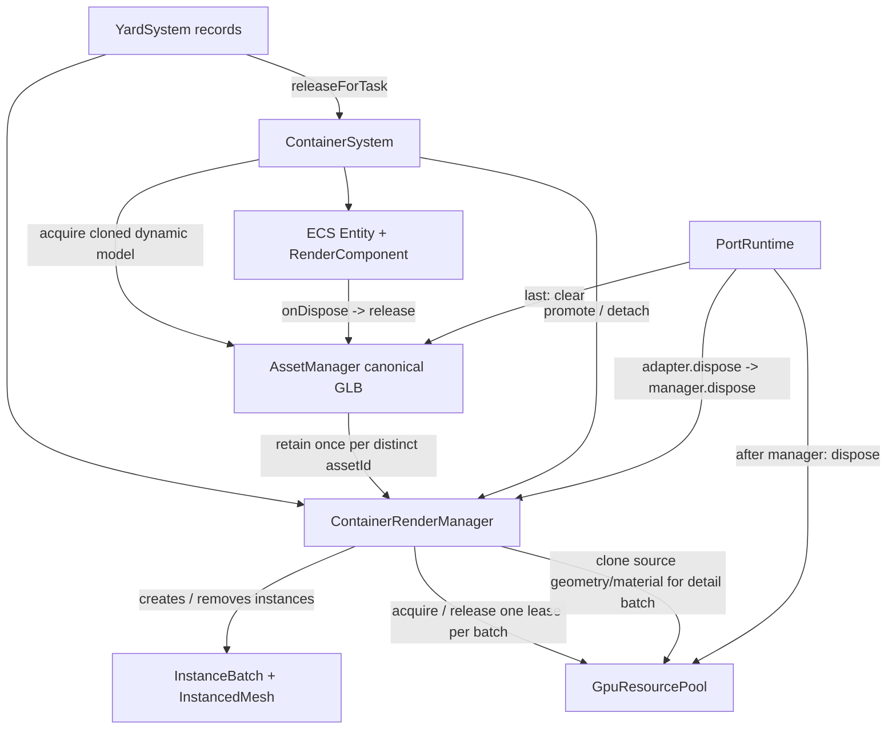

# TypeScript 迁移阶段报告

## 当前阶段

第三阶段已完成 Three.js 基础设施与资源管理的渐进式迁移。项目仍处于 JavaScript/TypeScript 共存状态，未声称完成整体迁移；ECS、业务 System、PortRuntime、Vue SFC 和后端仍保持原格式。

## 实际改动

- 新增 `tsconfig.json`，启用严格类型检查但允许未迁移 JS 共存。
- 新增 `src/vite-env.d.ts`，处理 Vite 客户端和 GLB URL 类型。
- 新增 `typescript`、`vue-tsc` 开发依赖和 `type-check` 脚本。
- `src/core/Clock.js` 迁移为 `src/core/Clock.ts`，增加 `ClockOptions`、`ClockTick` 和 `NowProvider`。
- `src/core/EventBus.js` 迁移为 `src/core/EventBus.ts`，增加事件映射泛型和 payload 类型约束。
- `src/domain/AlarmCatalog.js`、`src/tasks/TaskCatalog.js`、`src/telemetry/TelemetryTopics.js` 迁移为 TypeScript，告警类型/级别/状态、任务类型/状态、遥测通道/主题均导出字面量联合类型。
- `src/rendering/RenderSystem.js` 改为导入 `Clock.ts`。
- 新增 `docs/typescript-migration-plan.md` 与本报告。
- 新增 `src/api/types.ts`，按后端真实 Express 路由建立健康检查、设备、集装箱、任务、分页、同步和执行事件 DTO；数据库 ID、业务 ID、实体 ID 仍分别建模。
- `src/api/request.js` → `src/api/request.ts`：保留原生 `fetch`、`Accept` 默认头、网络错误 `NetworkError`、非 2xx `HttpError` 和业务错误消息提取；JSON 对象请求体在边界统一序列化，修正原请求体不能直接作为 Fetch body 的隐患，不改变接口路径和方法。
- `src/api/health.js`、`devices.js`、`containers.js`、`tasks.js` 分别迁移为同名 `.ts`，旧 `.js` 文件仅转出 TS 实现，保证现有 JS/Vue 调用方导入路径兼容。
- 新增 `src/stores/types.ts`，明确 ECS 场景实体、设备档案、资产状态、遥测状态、告警状态、前端任务状态和性能快照边界。
- `PerformanceStore`、`TaskStore`、`AlarmStore`、`DeviceStore`、`AssetStore` 迁移为 `.ts`；旧 Store ID、公开字段、action 名称、Composition API 风格、Map/快照更新行为和跨 Store 依赖保持不变。

## 第三阶段：Three.js 基础设施与资源管理

### 实际迁移文件

- `src/assets/AssetLoader.ts`：为 GLTF 异步加载和进度回调建立类型边界。
- `src/assets/AssetNormalizer.ts`：为 GLTF 场景、归一化选项、包围盒和归一化元数据建立类型；保留排除节点、目标尺寸、水平居中、落地对齐和阴影设置。
- `src/assets/ModelMetadata.ts`：将原有 JSDoc DTO 转为 `AssetMetadata`、`AssetVectorData` 接口和类型化元数据工厂。
- `src/assets/AssetManager.ts`：区分 `AssetRecord`（缓存资源）、`NormalizedAsset`/`AssetMetadata`（加载结果）、`RuntimeAsset`（前端资产状态）和场景 `Object3D`；保留 manifest、cache、pending、引用计数、克隆、闲置回收、显存释放、运行时资产登记和 Store 关联。
- `src/scene/MainScene.ts`：迁移场景、透视相机、WebGLRenderer、CSS2DRenderer、灯光、Sky、巡航曲线、尺寸响应和销毁流程。
- `src/rendering/RenderSystem.ts`：迁移 OrbitControls、EffectComposer、RenderPass、UnrealBloomPass、OutputPass、时钟驱动帧循环、巡航相机和清理流程。
- `src/loaders/GLTFFactory.ts`：迁移 GLTF 加载、可选加载、克隆、归一化、缩放、旋转包装和岸桥占位模型。
- `src/three-ambient.d.ts`：由于当前 `three@0.185.0` 包和 `three/examples/jsm` 未提供可用声明，新增仅覆盖本阶段实际使用 API 的最小声明；未将整个模块声明为 `any`，也未升级 Three.js。

### 注释与兼容性

- `MainScene.js` 原有完整中文说明已原样保留在 `MainScene.ts` 文件最开始；`ModelMetadata.js` 原有 JSDoc 也保留在 `ModelMetadata.ts` 文件最开始。迁移过程中没有删除或把这些用户注释移到文件末尾。
- `AssetNormalizer.ts` 中关于缩放顺序、水平居中和包装节点所有权的原有算法注释继续保留在对应逻辑旁边。
- 原 `.js` 入口保留为兼容桥接：`AssetLoader.js`、`AssetNormalizer.js`、`AssetManager.js`、`ModelMetadata.js`、`MainScene.js`、`RenderSystem.js`、`GLTFFactory.js` 均转出到对应 `.ts` 实现，旧的 JS/Vue 导入路径可以继续过渡使用。
- 模型 manifest 同时兼容现有项目使用的扁平 `{ id, url, targetSize }` 结构和显式 `options` 结构；原有请求路径、资源 URL 和运行时资源所有权不变。

### 保持不变的边界与行为

- 没有新增或虚构 AnimationMixer、OutlinePass 或其他项目中不存在的后处理模块；没有改变 `RenderSystem` 的渲染顺序。
- `AssetManager` 仍然只在资源引用归零后按既有策略释放缓存资源；`idleDisposeMs`、`sweep()`、`clear()` 和统计指标语义保持不变。
- HTTP DTO、Pinia 状态、ECS Component、Three.js 场景实体和数据库模型没有互相替代；本阶段没有让 Store 承担 Three.js 运动逻辑。
- 未迁移 ECS、Builder/Factory（除既有 `GLTFFactory` 工具）、业务 System、PortRuntime、App.vue 或 Vue 页面。

## API → Store 数据流契约

- Vue 页面直接调用 API 的现有路径仍保留（健康检查、设备列表、任务列表）；`PortRuntime` 继续发送场景集装箱快照，`TaskExecutionBridge` 继续创建任务并上报执行事件。
- API 模块只负责 URL、HTTP 方法、请求序列化、响应 DTO 泛型和既有错误包装；不在 API 层写入 Pinia 或 Three.js 对象。
- `DeviceStore` 接收设备档案时只保存 `DeviceProfileState`，场景实体单独进入 `entityMap`；`AssetStore` 将资产目录、实体引用、遥测和告警视图分开维护。
- `TaskStore` 与 `AlarmStore` 负责共享前端状态和局部更新；后端 `TaskDto` 的 `pending/running/completed/failed` 协议没有直接替换前端任务目录的 `WAITING/RUNNING/PAUSED/COMPLETED` 状态。
- 本阶段没有新增认证、Token、WebSocket 或假想接口，也没有把 API 响应直接当作 Three.js Mesh、ECS Component 或数据库模型。

## 数量与范围

本阶段新增/迁移 5 个 API 实现、5 个 Store 实现和 2 个类型文件；旧 API/Store `.js` 文件保留为兼容桥接。上一阶段的 5 个纯逻辑模块和基础配置继续保留。Vue SFC、Three.js 系统、ECS、PortRuntime、ViewModel 和 Node.js 后端未迁移，仍有大量 JavaScript 文件。

## 实际验证

- `npm install --save-dev typescript@^5.8.3 vue-tsc@^2.2.12`：成功；使用项目目录下临时 npm cache 完成安装。
- `npm run type-check`：通过。
- `npm run build`：通过；Vite 仍提示压缩后 JS 大于 500 KB，这是既有性能风险，不是类型错误。
- 逐文件 `node --check` 检查 `server/src`：15 个 JavaScript 文件通过。
- `git diff --check`：通过；构建生成的压缩产物仍包含 Three.js 着色器空白提示，不影响构建结果。
- 第二阶段 `npm run type-check`：通过。
- 第二阶段 `npm run build`：通过；仍有既有的压缩包体积警告，未作为本阶段问题处理。
- 第三阶段 `npm run type-check`：通过。
- 第三阶段 `npm run build`：通过；生成 JS 压缩后约 960 KB，仍有 Vite 的大 chunk 警告，该警告不是本阶段类型错误。
- 第三阶段 `git diff --check`：通过。
- 检查 `tests/`：目录存在但没有可运行的测试文件；未创建空测试，也未将缺失的 smoke test 记为通过。
- 尝试执行 `npm run test:assets`：失败，脚本声明的 `tests/asset-manager.smoke.mjs` 不存在（Node `MODULE_NOT_FOUND`）；该失败来自仓库测试文件缺失，不是本阶段类型检查或构建错误。
- 本阶段未执行 PostgreSQL 集成测试、浏览器交互测试或前后端集成测试；不能据此宣称接口在线可用。
- 尝试执行 `npm run test:core`，但仓库当前缺少脚本声明的 `tests/core.smoke.mjs`（Node `MODULE_NOT_FOUND`）；因此没有将该测试记为通过，也未修改测试脚本或凭空补测试。

## 未完成与风险

- 尚未迁移 ECS、业务 System、PortRuntime、Vue SFC、ViewModel 以及 Node.js 后端；Three.js 基础设施的旧 JS 入口只作为过渡桥接存在。
- `allowJs: true`、`checkJs: false` 是过渡配置，后续应按目录逐步收紧，不应永久作为逃避检查的方案。
- 尚未连接 PostgreSQL，也未执行浏览器页面交互回归；本阶段不宣称数据库和运行时行为全部通过。
- 后端仍是 JavaScript，后续应单独设计 Node 类型边界，避免把数据库模型直接复用为 Three.js 场景对象。
- API DTO 目前主要提供静态契约；`fetch` 返回 JSON 的完整运行时 schema 校验仍是遗留风险，后续可在不改变错误语义的前提下增加轻量 type guard 或 schema 校验。
- `DeviceStore`/`AssetStore` 通过最小 `SceneEntity` 边界引用未迁移的 ViewModel/ECS 对象；这避免把 ECS Entity 当作后端 DTO，但 ViewModel 本身仍缺少静态类型。

## 下一步

下一阶段建议从 ECS/Component/Entity 或 Factory/Builder 中选择一个边界继续迁移，先建立场景实体与组件的类型契约，再逐步处理业务 System。不要在下一批直接大规模迁移所有 ECS、System 或 PortRuntime。API 运行时 schema 校验和 ViewModel 类型化仍可作为独立后续任务。每批继续执行 `npm run type-check`、`npm run build`、`git diff --check` 以及可用的纯逻辑 smoke test。

## 第四阶段：ECS、Manager、Builder 与 Factory

### 实际迁移文件

- `src/ecs/Entity.ts`、`src/ecs/EntityManager.ts` 及 15 个 ECS Component 类型文件。
- `src/managers/EquipmentManager.ts`。
- `src/factories/AGVFactory.ts`、`ContainerFactory.ts`、`CraneFactory.ts`、`QuayCraneFactory.ts`、`StaticAssetFactory.ts`。
- `src/builders/PortEquipmentBuilder.ts`、`PortSceneBuilder.ts`。
- `src/assets/AssetManager.ts` 的 `attach` 边界调整为接收 ECS `ComponentValue`，修复 strict function parameter 不兼容。

### 关键设计与保持不变的行为

- `EntityId` 为字符串；ECS Entity ID、业务 ID、数据库 ID、资产键与 Three.js `Object3D` 保持不同概念。
- Entity 通过 EntityManager 操作组件，EntityManager 保留原有创建、组件增删查、实体查询、可拾取查询和 ID 解析 API。
- Component 以 `ComponentValue` 联合类型建模，Transform/Render 分别持有场景 wrapper/bbox 与模型释放钩子；没有把后端 DTO 或 Pinia 状态直接当作场景实体。
- EquipmentManager 只负责按组件查询 AGV/Crane 和固定设备位置，不承担运动逻辑。
- Factory 继续按原顺序挂载 Type、Transform、Render、Selectable 及业务组件，保留 AGV 载货点、Container 重挂载、Quay Crane 节点层级改造、静态拾取体等行为。
- Builder 继续负责批量编号、路径/泊位布局、模型克隆、场景加入、资产登记和资源释放回调；没有修改港口布局数值或业务规则。

### 注释与 JS 兼容

- 旧 `.js` 文件保留同名导出桥接到 `.ts`，旧调用方无需一次性改完。
- 原 `.js` 文件的中文职责说明、术语表和算法说明已复制到迁移后 `.ts` 文件最开始，满足注释位置要求；旧实现被注释包裹，不会重复执行。

### 本阶段验证与未完成项

- `npm run type-check`：通过。
- `npm run build`：通过；Vite 仍提示约 961 KB 的既有大 chunk 警告。
- `git diff --check`：通过。
- 仓库没有 `tests/` 目录，也没有可运行的 ECS/Factory/Builder smoke test；未创建空测试，也不将缺失测试记为通过。
- 业务 System、World、PortRuntime、Vue SFC、ViewModel 和 Node.js 后端仍为 JavaScript；前端运行时尚未执行浏览器/WebGL、数据库或前后端集成测试。

下一阶段建议迁移业务 System/World 的单个边界并保持现有 Entity/Component API，再处理 PortRuntime；不要在同一批次大规模迁移 Vue 页面。

## 第五阶段：业务 System 与统一帧调度（已验证的渐进边界，非整体完成）

### 审计到的运行链与依赖

- PortRuntime 创建唯一 `FrameObserver`；渲染 RAF 由已迁移的 `RenderSystem.ts` 启动并持有句柄。其 Clock 首帧 delta 为 0、后续单位为秒且最大截断 0.1 秒；每帧顺序是 observer.update → beforeRender → composer.render → afterRender。
- FrameObserver 普通任务以秒累计 delta；任务 interval 的公开配置单位为毫秒，内部除以 1000。priority 升序执行、同优先级注册序号稳定排序；任务和 frame listener 异常各自捕获并交给 onError。任务移除及监听器移除重复调用为幂等；clear 清空登记项。
- 核心 AGV 业务真实链路为 TaskSystem → PathManager route → MotionSystem `moveAGV` → MotionComponent command → `update(dt)` 距离推进与 TransformComponent 更新 → `AGV_ARRIVED` 事件 → TaskSystem 推进下一阶段。任务创建（createTask）与启动（startTask）分离；事件系统而非任务帧轮询。
- 当前 TelemetrySystem 的源由 TelemetryGateway 创建，默认 RandomTelemetrySource 使用 `setInterval` 每毫秒配置间隔发布模拟数据；TelemetrySystem 缓冲后在帧更新应用。PortRuntime 调用 `_startTelemetry()` 目前注释掉，故项目默认运行不启动此模拟源，也没有真实 WebSocket。
- RoadSystem/YardSystem/PathManager、MotionSystem、TaskSystem、AGVSystem、ContainerSystem、QuayCraneSystem 以及 PerformanceSystem/AdaptiveQualitySystem 在本轮前均为 JS；没有发现这些系统另建 RAF。其他子系统的 update 也由 PortRuntime 登记进统一 observer。

### 实际修改文件

- 新增 `src/core/FrameObserver.ts`；`src/core/FrameObserver.js` 改为同名导出桥接，原 JS 实现保留为注释以防双实现执行。公开契约包括 FrameTask、FrameContext、FrameListener、错误负载和注册/注销方法。
- 新增 `src/ecs/systems/TelemetrySystem.ts`；原 JS 路径桥接至 TS。类型化数据源边界、资产/实体管理器依赖、遥测缓冲和同步 Store 更新；运行时业务顺序保持原样。
- 新增 `src/rendering/PerformanceSystem.ts`：Renderer 统计、帧窗口/P95、快照 DTO、可见性监听和 metric provider 均有明确类型；dispose 可重复调用且恢复 `renderer.info.autoReset`。
- 新增 `src/rendering/AdaptiveQualitySystem.ts`：质量等级、性能快照、控制器接口和阈值配置明确类型；保留 high/medium/low 顺序与原阈值/窗口/cooldown。
- `src/ecs/components/MotionComponent.ts` 增加 MotionRoute、MotionCommand、MotionPhase 字段契约，覆盖 TaskSystem 对 `moveAGV` 的真实阶段字符串和 PathManager 返回的 route shape；未调整 speed*dt 运动算法。
- `src/rendering/RenderSystem.ts` 的 FrameObserver 参数改为引用 `FrameObserver` 的结构类型；`src/three-ambient.d.ts` 补足 PerformanceSystem 实际读取的 RendererInfo 类型。

### 兼容性、范围与遗留

- JS 调用方仍从旧 `.js` 模块路径导入，Vite 构建会将桥接解析到 `.ts`。PortRuntime 本身未改动。
- 本次迁移完成 4 个 JS 实现模块到 TS（FrameObserver、TelemetrySystem、PerformanceSystem、AdaptiveQualitySystem），并调整 2 个既有 TS 类型边界（MotionComponent、RenderSystem），补充 Three renderer info 声明。4 个旧 JS 文件均改为指向 TS 实现的兼容桥接；Vite 生产构建成功，证明当前构建入口解析到了桥接目标。原有职责注释保留在迁移实现文件开头（存在旧实现的桥接文件也保留原内容注释以便追溯）。
- MotionSystem、TaskSystem、RoadSystem、YardSystem、PathManager 等第五阶段核心重点仍未迁移，不能将本轮描述成第五阶段整体完成。这是为避免在一次变更中无差别改写高耦合业务模块；本轮只交付已验证的帧调度、遥测和性能系统类型边界。MotionSystem + PathManager 的路线契约与 TaskSystem 的事件/状态契约仍是第五阶段的实质遗留，不应据此进入 PortRuntime 或 Vue 的迁移。
- 检查 package.json 中的相关测试脚本并尝试 `npm run test:frame-observer` 和 `npm run test:performance`；两者因 `tests/frame-observer.smoke.mjs` 与 `tests/performance-system.smoke.mjs` 缺失而以 `MODULE_NOT_FOUND` 失败。当前没有 `tests/` 文件可运行；没有创建空测试。
- 未执行浏览器/WebGL业务回归、任务流程、AGV运动、数据库或真实遥测集成测试。

### 实际验证

- `npm run type-check`：通过（`vue-tsc --noEmit`）。
- `npm run build`：通过（Vite 转换 185 个模块）；生成约 962 KB 压缩 JS，并保留大 chunk 警告。
- `git diff --check`：通过。
- `node --check` 对 `src/core/FrameObserver.js`、`src/ecs/systems/TelemetrySystem.js`、`src/rendering/PerformanceSystem.js`、`src/rendering/AdaptiveQualitySystem.js`：通过。

建议下一阶段继续聚焦 MotionSystem + PathManager 的联合迁移和针对性运动测试，再迁移 TaskSystem 的事件契约；保持运行时调用路径及任务状态值不变，Road/Yard 可以单独分批处理。

## 第五阶段第二批：PathManager 与 MotionSystem 联合迁移

### 审计与真实契约

- `PortRuntime` 仍以 JavaScript 创建 `RoadSystem`，把它分别注入 `MotionSystem` 和 `PathManager`；`TaskSystem` 通过 `PathManager.createYardRoute()` 生成路线，再经 `AGVSystem.dispatch()` 调用 `MotionSystem.moveAGV()`。
- `PathManager` 实际返回的是 MotionRoute：普通路线由 `RoadSystem.createRoutePath()` 产生 `{ roadId, laneId, length }` 并附加 `networked: true`；起终点去重后无路径点时返回 `{ stationary: true, length: 0, networked: true }`；失败保持 `null` 并写入 `lastError`。
- `MotionSystem` 消费路线的 `roadId/laneId/stationary/length` 字段，使用道路车道长度作为命令长度，按秒单位 `speed * deltaTime` 累计米数，完成时清空命令、保持车辆锁定、清理 transient 路线并发出 `AGV_ARRIVED`。
- 自由巡航仍从 MotionComponent 的 `laneId/distance/baseSpeed` 推导车道参数，使用原有 34 米（由 PortRuntime 注入）的安全车距、18%/45%/75% 分段减速和 0.12 指数平滑。

### 实际迁移文件

- 新增 `src/world/PathManager.ts`，保留完整原始职责注释、公开方法和 Dijkstra/道路接入算法。
- `src/world/PathManager.js` 改为 JS 兼容桥接，仅导出 `PathManager.ts`。
- 新增 `src/ecs/systems/MotionSystem.ts`，保留完整原始职责注释、自由巡航/指令路线运动和事件语义。
- `src/ecs/systems/MotionSystem.js` 改为 JS 兼容桥接，仅导出 `MotionSystem.ts`。
- `src/three-ambient.d.ts` 补充本批实际使用的 `Vector3.sub/dot/lengthSq` 与 `Object3D.lookAt` 声明。

### 类型边界与兼容性

- `RoadSystemPathApi` 和 `MotionRoadApi` 只表达当前 JS RoadSystem 被实际调用的方法；没有复制道路数据，也没有改变道路拓扑。
- `YardRoadNetwork` 区分路网节点、边、接驳点和边界；Three.js `Vector3` 坐标不与节点 ID、业务 ID 或数据库 ID 混用。
- `MotionRoute` 继续复用第四阶段已建立的路线契约；`MotionCommand` 仍包含实际使用的 `taskId/phase/route/speed/distance/length`。
- `Entity`、`EntityManager`、`MotionComponent`、`TransformComponent` 均通过现有 TS 契约使用；MotionSystem 不直接承担 Renderer 职责。
- 旧 JS 调用方仍从 `.js` 路径导入，Vite 构建解析到 TS 桥接目标；未修改 TaskSystem、RoadSystem、YardSystem、PortRuntime 或 Vue。

### 验证与遗留

- `npm run type-check`：通过。
- `npm run build`：通过，转换 187 个模块；保留约 963 KB 压缩 JS 的既有大 chunk 警告。
- `node --check src/world/PathManager.js`、`node --check src/ecs/systems/MotionSystem.js`：通过。
- `git diff --check`：通过。
- 当前没有 PathManager/MotionSystem 对应的可运行 smoke test；未创建空测试。未执行浏览器/WebGL、AGV 实际运行、任务流程或前后端集成回归，因此不能将构建通过描述为运动业务回归通过。
- 第五阶段仍未整体完成：TaskSystem、RoadSystem、YardSystem、PortRuntime 和 Vue 页面继续保留 JavaScript。下一批应迁移 TaskSystem 的 `AGV_ARRIVED` 事件与任务状态契约，并保持本批公开接口不变。

## 第五阶段第三批：TaskSystem 事件与任务编排

### 实际迁移文件

- 新增 `src/ecs/systems/TaskSystem.ts`，保留原 `TaskSystem.js` 的完整中文职责说明、术语说明和流程注释于文件最开始。
- `src/ecs/systems/TaskSystem.js` 改为兼容桥接，继续向旧 JavaScript/PortRuntime 导出 `TaskSystem`。
- `src/stores/types.ts` 补充任务位置、目的地、路线错误、泊位停车位置和岸桥状态字段，使 Pinia 任务状态与 TaskSystem 实际写入字段一致。
- `src/world/PathManager.ts` 的 `RoadSystemPathApi` 补充 `removeRoad()`，用于保留 TaskSystem 对临时道路的清理行为。

### 关键类型边界与保持不变的行为

- `TaskSystem` 明确注入 `ContainerSystemApi`、`AGVSystemApi`、`MotionSystemApi`、`PathManager`、`EquipmentManager` 和可选 `QuayCraneSystemApi`；这些接口只描述当前真实调用面，没有迁移协作系统本身。
- 任务类型和状态继续复用 `TaskCatalog` 的 `TaskTypeValue`/`TaskStatusValue`；`createTask()` 仍只创建并登记任务，`startTask()` 才派发车辆，`startAll()` 只启动 WAITING 任务。
- `AGV_ARRIVED` 仍由 MotionSystem 订阅并按 `QUAY_PICKUP`、`CHARGING`、`PICKUP`、`DELIVERY` 四个阶段推进；TaskSystem 仍通过 Store patch 更新状态，不直接操作 DOM 或 Three.js Mesh。
- 任务中的坐标继续使用普通 `{x, y, z}` 数据对象，进入路径规划前显式转换为 `THREE.Vector3`；ECS Entity、业务任务 ID、资产编号和数据库 ID 没有互相替代。
- 对尚未迁移的 JS 协作模块采用最小结构类型边界；没有通过 `any`、`@ts-ignore` 或关闭 strict 来消除错误。

### 验证结果与遗留风险

- `npm run type-check`：通过。
- `npm run build`：通过；仍有约 963 KB 压缩 JS 的既有 Vite 大 chunk 警告。
- `node --check src/ecs/systems/TaskSystem.js`：通过，确认兼容桥接语法有效。
- `git diff --check`：通过。
- 当前 `package.json` 没有 TaskSystem 专用可执行 smoke test，仓库也没有对应测试文件；未创建空测试，未将任务运行时回归记为通过。
- 未执行浏览器/WebGL、AGV 实际运动、岸桥机械流程、数据库或前后端集成测试；构建和类型检查不等价于业务运行时验证。
- TaskSystem 仍依赖 JS 的 AGVSystem、ContainerSystem、QuayCraneSystem、RoadSystem、YardSystem 及 PortRuntime；下一批应继续保持这些兼容边界，按需要选择一个真实耦合模块迁移，不要扩大到 Vue 或整体 PortRuntime 重写。
## 第五阶段最后一批：RoadSystem 与 YardSystem（本批次）

### 实际审计与迁移文件

- `src/world/RoadSystem.ts`：新增道路/车道/交叉口、YardNetwork、渲染片段和临时路线的明确公开类型边界。
- `src/world/YardSystem.ts`：新增箱区、箱位、集装箱记录、布局和释放选项类型；文件开头保留堆场纯数据台账职责说明。
- `src/world/RoadSystem.js`、`src/world/YardSystem.js`：保留旧入口并转发到 TypeScript 外观。
- `src/world/RoadSystem.impl.js`、`src/world/YardSystem.impl.js`：本阶段早期作为实现来源；随后已降为指向 TS 实现的兼容转发文件，避免 JS/TS 两套可执行算法并存。
- `src/three-ambient.d.ts`：保留项目 example 模块声明，并使用 `@types/three` 提供 Three.js 核心 API 类型。
- `package.json` / `package-lock.json`：增加开发依赖 `@types/three`。

### 真实数据流与边界

- PathManager 通过 `getRoad/getLane/getPrimaryLane/getPointAt/getTangentAt/getNearestU/createRoutePath/removeRoad` 读取或清理道路；临时道路仍由 `createRoutePath` 登记在道路/车道表中，并由 TaskSystem/MotionSystem 在任务结束时按原契约调用 `removeRoad`。
- RoadSystem 的 `RoadRecord`、`LaneRecord` 和 `YardNetwork` 是导航/场景侧数据，不等同于数据库 ID、ECS Entity 或 Mesh。
- YardSystem 仍只维护 `containers`、`slots`、`blocks` 三张 Map；箱号、箱位键、堆叠顶层检查、出库状态和坐标生成规则未改变。ContainerSystem 继续通过公开台账方法取得数据，Builder/Factory 和实体注册职责未移入 YardSystem。
- 旧 JS 的 GroundSystem/PortRuntime 调用路径保留；`.js` 桥接转发到 TS 外观，RoadSystem/YardSystem 的当前可执行实现已集中在对应 `.ts` 文件。

### 保持不变的行为

- 道路曲线、车道偏移、交叉口、堆场道路网、视觉几何、临时道路清理算法未重写。
- 集装箱布局、编号、世界坐标、包围盒、堆叠规则、可出库判断和释放状态未重写。
- 未迁移 PortRuntime、Vue、ECS、Builder、Factory，也未改 PathManager/MotionSystem/TaskSystem 的业务算法。

### 验证

- `npm run type-check`：通过。
- `npm run build`：通过；保留 Vite 既有大 chunk 警告。
- `git diff --check`：通过。
- `npm run test:roads`：未通过，脚本目标 `tests/road-system.smoke.mjs` 不存在（MODULE_NOT_FOUND）。
- `npm run test:yard-scale`：未通过，脚本目标 `tests/yard-scale.smoke.mjs` 不存在（MODULE_NOT_FOUND）。未将缺失测试记为通过，也未创建空测试。

### 遗留风险与下一步

- `allowJs: true`、`checkJs: false` 仍意味着 `.impl.js` 旧实现本身不在严格 TS 检查范围内；本批次严格检查覆盖的是 TS 外观和调用契约。
- 旧实现通过兼容边界保留，后续可在具备运行时回归测试后分内部函数逐步迁入 TS；不要在没有测试的情况下批量重写道路几何。
- RoadSystem/YardSystem 仍依赖项目中未迁移的 GroundSystem、ContainerSystem 和 PortRuntime；下一阶段应先补齐真实 smoke test 或继续迁移一个独立边界，不要扩大到 Vue/PortRuntime 整体重写。

## 第六阶段：PortRuntime 渐进式迁移

### 实际迁移文件

- `src/app/PortRuntime.ts`：由原 `PortRuntime.js` 迁移而来，保留原有中文职责说明、装配顺序、业务调用和销毁流程。
- `src/app/PortRuntime.js`：新增兼容桥接，继续提供旧调用方使用的命名导出和默认导出，权威实现只有 TypeScript 文件一份。

### 运行时生命周期与所有权

- `start()` 仍按基础设施（MainScene、EntityManager、AssetManager、FrameObserver）→ 模型 manifest/并行预加载 → GroundSystem → 集装箱快照同步 → 作业模型 → 交互/表现系统 → 核心帧任务、批量渲染、拾取、静态世界、任务系统、空间优化、UI → RenderSystem 启动的顺序执行。
- 模型预加载仍使用 `await Promise.all(...)`；没有把异步资源加载改为同步，也没有改变遥测启动调用当前被注释的既有行为。
- `FrameObserver` 仍由 PortRuntime 创建并持有，所有 update 任务通过同一观察器注册；RenderSystem 继续拥有唯一场景 RAF。PortRuntime 不新增第二套帧循环。
- `destroy()` 继续先停止输入/遥测/任务桥/UI/渲染，再注销指标与帧任务，释放空间登记、适配器、系统、场景和模型资源池；没有改变资源共享的释放职责。

### 类型设计与兼容边界

- 新增 `PortRuntimeOptions`、帧更新函数、空间登记参数和退订函数类型；公共入口 `focusAsset`、`focusDeviceEntity`、`startTask`、`startAllTasks`、`createTask` 及构造参数均有明确签名。
- 尚未迁移的 GroundSystem、告警/设备/拾取/空间渲染、UI 和适配器仍由原 JS 实现提供。它们通过 PortRuntime 内部集中兼容边界接入，未被虚构成 Three.js 场景实体、数据库 DTO 或 Pinia 状态，也未在本阶段重写业务算法。该边界目前集中保留一个 `LegacyRuntimeValue` 过渡别名，后续应按真实调用面拆分收窄，避免扩散为长期宽泛类型。
- `PortRuntime.js` 桥接已被 Vite 生产构建解析到 TS 实现；`App.vue` 仍按原 `./app/PortRuntime.js` 路径导入，未修改 Vue 页面。

### 保持不变的业务行为

- 未修改模型清单、容器快照映射、任务状态机、AGV/岸桥创建、空间登记规则、性能指标名称或渲染优先级。
- 未迁移或重写 Vue、后端、数据库、ECS、System、Runtime 之外的其他模块；原用户中文注释保留在 TypeScript 文件最开始。

### 第六阶段验证

- `npm run type-check`：通过（`vue-tsc --noEmit`）。
- `npm run build`：通过，Vite 转换 193 个模块；保留约 967 KB 压缩 JS 的既有大 chunk 警告。
- `git diff --check`：通过。
- `node --check src/app/PortRuntime.js`：通过，确认兼容桥接语法有效。
- 当前 `package.json` 中没有 PortRuntime 专用 smoke test，仓库也没有 `tests/` 目录；未创建空测试，未将浏览器/WebGL、完整港口启动、任务流程或前后端集成回归描述为通过。

### 遗留风险与第七阶段建议

- `allowJs: true`、`checkJs: false` 仍使未迁移 JS 依赖不受严格检查；PortRuntime 的兼容边界暂时集中使用迁移边界类型，后续应按真实调用面逐项收窄，避免长期宽泛类型。
- 尚未验证真实 WebGL 环境下的模型加载失败清理、重复启动和页面卸载场景；应先补有真实断言的生命周期测试，再考虑收窄 GroundSystem、RenderAdapter、设备系统接口。
- 第七阶段建议选择一个独立且有稳定测试保护的 JS 依赖（优先 GroundSystem 或空间渲染适配器）继续迁移，不要同时扩大到 Vue 页面、后端或剩余全部 JS 文件。

## 第七阶段：Vue 集成层迁移与全项目验收

### Vue 实际迁移文件

本阶段实际迁移 9 个 Vue SFC 的脚本逻辑：

- `src/App.vue`
- `src/components/AlarmListPanel.vue`
- `src/components/AssetInfoPanel.vue`
- `src/components/AssetListPanel.vue`
- `src/components/DeviceInfoPanel.vue`
- `src/components/DeviceListPanel.vue`
- `src/components/PerformanceDebugPanel.vue`
- `src/components/PerformancePanel.vue`
- `src/components/TaskPanel.vue`

所有组件均使用 `<script setup lang="ts">`。保留了原 Props/Emits 名称、按钮事件、Store 调用、轮询/取消请求行为和 UI 样式。新增的类型边界包括：

- App 的 `HTMLElement` 容器、`PortRuntime | null`、性能快照、健康检查状态、AbortController 及任务类型。
- Alarm/Device 面板的事件签名、表单事件目标和 Store 数据类型。
- Device/Task 面板的后端 DTO、分页结果、请求竞态版本和定时器句柄。
- Performance 面板对 `metrics` 的运行时窄化；未知指标不再直接调用字符串方法或读取未知对象字段。

Vue 与 Runtime 的真实调用链保持为：`onMounted` → 健康检查与 `new PortRuntime` → `await start()` → Store/FrameObserver 更新 → UI 命令调用 `focusAsset`、`focusDeviceEntity`、`createTask` → `onBeforeUnmount` 取消请求并调用 `destroy()`。本阶段没有让组件直接修改 Three.js 对象，也没有改变任务创建/启动语义。

### 应用入口与模块解析

- 新增 `src/main.ts` 作为 Vue + Pinia 应用入口，保留原中文入口注释。
- `src/main.js` 现在仅导入 `main.ts`，作为 Vite/index.html 旧路径兼容桥接；生产构建已验证该解析路径。
- 未全局替换 `.js` 导入后缀；此前各阶段 JS → TS 桥接仍保留，桥接不包含第二套可执行业务实现。

### `src` JavaScript 实际扫描分类

扫描当前文件系统得到 `src` 下剩余 **91 个 `.js` 文件**：

- **53 个 JS 兼容桥接**：API、Store、已迁移的基础设施、ECS/Factory/Builder、Frame/System、Scene、PortRuntime、Path/Road/Yard 外观以及 `main.js`。多数旧实现被注释保留用于追溯，实际导出指向对应 TS 文件。
- **2 个配置/资源定义文件**：`src/config/PortSceneConfig.js`、`src/config/PortSpatialConfig.js`；它们是静态场景配置，不是运行时业务算法。
- **1 个领域目录定义文件**：`src/domain/AssetCatalog.js`；仍被未迁移的 ViewModel/系统读取，暂保留原导出。
- **2 个 `.impl.js` 兼容文件**：`src/world/RoadSystem.impl.js`、`src/world/YardSystem.impl.js`。当前仅转发到对应 TS 实现；YardSystem 的严格检查仍未完成，不能据此报告整个道路/堆场模块已完成迁移。
- **33 个仍包含实际运行时/业务实现的 JS**：

  `src/ecs/systems/AGVSystem.js`、`AlarmSystem.js`、`ContainerSystem.js`、`PickSystem.js`、`QuayCraneSystem.js`、`SelectionSystem.js`；
  `src/rendering/AlarmVisualSystem.js`、`ContainerRenderManager.js`、`GpuResourcePool.js`、`HighlightSystem.js`、`InstanceBatch.js`、`LabelSystem.js`、`LowDetailFactory.js`、`ProxyFactory.js`、`QualityController.js`、`UISystem.js`；
  `src/systems/chunk/ChunkSystem.js`、`src/systems/lod/LODSystem.js`、`src/systems/render/RenderResourceSystem.js`、`RenderSystem.js` 及 6 个 render adapter；
  `src/tasks/TaskExecutionBridge.js`；`src/telemetry/RandomTelemetrySource.js`、`TelemetryGateway.js`；`src/viewmodels/AssetViewModel.js`、`DeviceViewModel.js`；`src/world/GroundSystem.js`。

配置/资源定义、兼容桥接和上述未迁移业务实现没有混入“已迁移 TS 实现”数量。后续仍必须在真实回归测试后逐步收窄 YardSystem 及其他业务 JS，不能只改后缀或删除文件。

### 类型覆盖、验证与缺口

- `tsconfig.json` 当前实际覆盖 `src/**/*.ts`、`src/**/*.d.ts`、`src/**/*.vue` 及 `vite.config.js`；仍为 `strict: true`、`allowJs: true`、`checkJs: false`，因此 91 个 JS 文件本身不接受严格 TS 检查。
- 本阶段未新增 `any`、`@ts-ignore` 或 `@ts-nocheck`；性能指标和错误对象使用类型守卫。PortRuntime 中既有的 `LegacyRuntimeValue` 过渡边界仍是后续收窄重点。
- `npm run type-check`：通过。
- `npm run build`：通过，Vite 转换 200 个模块；保留约 967 KB 压缩 JS 的既有大 chunk 警告。
- `git diff --check`：通过。
- `node --check src/main.js`：应作为入口桥接语法检查；浏览器最终解析路径由生产构建验证。
- 当前仓库没有 `tests/` 目录，package.json 中列出的 smoke test 文件均不存在；未创建空测试，也未将其记为通过。

### 结论与剩余风险

本阶段完成了 Vue 集成层和应用入口的 TypeScript 迁移，并完成了剩余 JS 的真实分类；未声称所有应用业务实现已迁入 TS。核心未迁移范围集中在 Ground/空间渲染、设备业务系统、ViewModel、TaskExecutionBridge 及仍未严格类型化的 YardSystem。未执行浏览器/WebGL 场景初始化、完整任务执行、数据库集成或页面卸载回归，因此“类型检查和构建通过”不等于运行时全链路已验证。

下一步建议优先补齐 Road/Yard 真实 smoke test 并独立收窄 YardSystem，再迁移 `AssetViewModel`/`DeviceViewModel`、`TaskExecutionBridge`、GroundSystem 或空间渲染/设备系统。

## 第八阶段第一批：RoadSystem 与 YardSystem

### 实际迁移文件

- `src/world/RoadSystem.ts` 现在直接包含道路、车道、交叉口、临时 Route、道路视觉几何和 YardNetwork 实现，并保留公开记录类型。
- `src/world/YardSystem.ts` 现在直接包含纯数据堆场台账实现；保留原始中文注释、箱号/箱位生成、中心布局换算、容器包围盒和顶层出库规则。
- `src/world/RoadSystem.impl.js`、`src/world/YardSystem.impl.js` 已改为只导出 TypeScript 实现的兼容桥接，不再承载可执行核心算法。
- `src/world/RoadSystem.js`、`src/world/YardSystem.js` 继续保留旧路径兼容。

### 保持不变的业务行为

- 未修改道路拓扑、坐标、车道偏移、弯道半径、临时道路登记/删除或堆场路网节点连接算法。
- 未修改堆场行/列/层遍历顺序、`count` 截断、容器编号、assetId 选择、世界坐标、旋转、包围盒和只能从顶层释放的规则。
- RoadSystem 的导航数据、YardSystem 的台账数据仍与 Three.js 场景实体、ECS Entity、数据库 ID 分离；YardSystem 不创建 Mesh/Scene。

### 类型边界与遗留风险

- YardSystem 已为构造参数、Map 状态、容器/箱区记录和释放选项建立明确接口。
- RoadSystem 已保留对外记录类型；该阶段报告中的“几何构建内部保留文件级 `@ts-nocheck`”已由第八阶段第二批完成项修正，当前 `RoadSystem.ts` 不再包含该豁免。第八阶段第三批审计确认 `YardSystem.ts` 也没有文件级 `@ts-nocheck`。
- 未删除用户已有工作区改动，未提交或推送 Git。

### 验证结果

- `npm run type-check`：通过。
- `npm run build`：通过；保留既有大 chunk 警告。
- `git diff --check`：通过。
- `node --check src/world/RoadSystem.js`、`node --check src/world/YardSystem.js`：通过。
- `npm run test:roads`、`npm run test:yard-scale`：因缺少 `tests/road-system.smoke.mjs`、`tests/yard-scale.smoke.mjs` 而以 `MODULE_NOT_FOUND` 结束；未创建空测试。
- 未执行浏览器/WebGL、完整 AGV 任务链、数据库或前后端集成测试。

下一批建议先补齐真实 Road/Yard smoke test，再按独立边界迁移 GroundSystem 或剩余设备/渲染业务 JS。

## 第八阶段第二批：RoadSystem 严格类型化

### 实际迁移与类型设计

- `src/world/RoadSystem.ts`：移除文件级 `@ts-nocheck`，为道路/车道/交叉口记录、路线返回值、YardNetwork 节点与边、道路分带、几何缓冲、路径截面和可渲染对象建立显式类型。
- `_createPathCurve()`：为闭环/非闭环弯道构建增加空数组保护，继续使用原有直线段与二次贝塞尔倒角算法。
- `_createPathRoadVisual()`：为 Three.js 曲线的运行时 `isLineCurve3` 标志建立局部类型边界，并保护采样点首尾访问；没有把整个 Three.js 曲线或场景对象降级为 `any`。
- `createYardNetwork()` / `_createNetwork()`：区分未注册道路分带与已注册道路分带，确保注册后的道路 ID 和车道 ID 在交叉口 DTO 中为必填；缺少主路/横路时显式报告无效输入。
- `src/world/RoadSystem.js`、`src/world/RoadSystem.impl.js`：继续作为兼容转发入口；本批没有删除桥接或改写其他模块。

### 保持不变的业务行为

- 保持既有道路宽度、坐标、车道偏移、弯道半径、路面/边线/虚线分块视觉算法。
- 保持 YardNetwork 的路口节点、横向/纵向边、箱位接驳点和注册 ID 生成规则；不把 HTTP DTO、数据库模型、ECS Entity 或 Three.js Mesh 互相复用。
- 保持 PathManager 依赖的 `getRoad`、`getLane`、`getPrimaryLane`、`getPointAt`、`getTangentAt`、`getNearestU`、`createRoutePath`、`removeRoad` 等兼容接口。

### 验证结果与缺口

- `npm run type-check`：通过，`RoadSystem.ts` 已在 `strict: true` 下检查。
- `npm run build`：通过；保留 Vite 既有的大体积 chunk 警告，不作为本批类型错误。
- `git diff --check`：通过。
- `node --check src/world/RoadSystem.js`、`node --check src/world/YardSystem.js`：通过。
- `npm run test:roads`、`npm run test:yard-scale`：当前 `tests/road-system.smoke.mjs` 与 `tests/yard-scale.smoke.mjs` 均不存在，因此未执行成功；没有创建空测试，不能据此声称道路/堆场运行时已验证。
- 未执行浏览器/WebGL、完整 AGV 任务链、数据库或前后端集成测试。YardSystem、PathManager、MotionSystem、TaskSystem、PortRuntime 和 Vue 不属于本批严格类型化范围。

### 遗留风险与后续建议

- 第八阶段第一批报告中的“YardSystem 仍有文件级 `@ts-nocheck`”属于当时的阶段性遗留描述，已由第三批审计修正；当前 YardSystem.ts 没有该豁免。
- 当前项目继续使用 `allowJs: true`、`checkJs: false`，剩余业务 JS 不受严格 TS 检查；兼容桥接仍需在后续模块迁移完成前保留。
- 后续优先补充真实 Road/Yard smoke test，再选择一个独立未迁移边界；不要因本批 `RoadSystem.ts` 类型检查通过而宣称整个道路运行时或全项目已完成 TypeScript 迁移。

## 第八阶段第三批：YardSystem 严格类型审计与道路—堆场接口验收

### 审计结论与实际修改

- `src/world/YardSystem.ts` 在本批开始时已经没有文件级 `@ts-nocheck`，也没有 `@ts-ignore` 或 `any`；因此没有为满足形式而重复移除或重写文件头。
- 保留文件开头完整中文职责注释和 data-only 设计。`YardSystem.ts` 继续承载唯一可执行堆场实现；`YardSystem.js` 与 `YardSystem.impl.js` 都只是转发到 TS，不存在第二份可执行业务算法。
- 新增/收窄 `YardSlotRecord`、`YardEntityReference`、`YardRenderBatchReference`、`YardRenderBinding`、`YardBlockLayout`、`YardContainerOwner` 与 `YardContainerState` 类型。
- `YardContainerRecord.entity` 明确允许 `getWorldPosition()` 返回 `null`，匹配 ECS Entity 的真实接口；`renderBinding` 不再是 `unknown`，而是描述实例批次移除操作、索引及 LOD/区块元数据的兼容边界。
- `sourceAssetIds` 的随机索引增加运行时兜底，保持空资源列表仍返回 `container-fallback` 的既有行为。

### 道路—堆场真实数据流

- YardSystem 维护 `blocks`、`containers`、`slots` 三张数据表；它不创建 Mesh/Scene，也不生成道路节点或执行路径规划。
- `GroundSystem` 从 `block.containers` 映射出 `{ id, bounds, blockId, xIndex, zIndex }` 箱位输入，再调用 `RoadSystem.createYardNetwork()`；RoadSystem 只消费箱位包围盒，独立生成 `YardNetwork` 的交叉口节点、边、边界和箱位接驳点。
- `PathManager` 读取 RoadSystem 的节点、边、`containerAccess` 和边界，执行道路接入与 Dijkstra；YardSystem 不复制路网、不拥有道路节点 ID，也不把业务箱位 ID 与道路节点 ID 混为一谈。
- `ContainerSystem` 继续直接共享 `yardSystem.containers`，通过 `getReleasableContainers()`、`releaseContainer()` 和 `getContainerWorldPosition()` 完成预留、顶层出库和动态实体转换；`ContainerFactory`/`Entity` 只承载动态 ECS 实体，不反向改变 YardSystem 的布局算法。
- PortRuntime、TaskSystem、Builder 和 Factory 的调用签名及业务顺序未修改；RoadSystem 的公开 API 未修改。

### 验证结果与限制

- `npm run type-check`：通过，包含严格检查后的 YardSystem 类型边界。
- `npm run build`：通过；保留 Vite 既有的大 chunk 警告。
- `git diff --check`：通过。
- `node --check src/world/YardSystem.js`、`node --check src/world/YardSystem.impl.js`、`node --check src/world/RoadSystem.js`：通过。
- `npm run test:yard-scale`：失败，`tests/yard-scale.smoke.mjs` 不存在（`MODULE_NOT_FOUND`）。
- `npm run test:roads`：失败，`tests/road-system.smoke.mjs` 不存在（`MODULE_NOT_FOUND`）。仓库存在空的 `tests/` 目录，但没有可执行测试文件；未创建空测试或伪造断言。
- 未执行浏览器/WebGL、完整 AGV 任务、数据库或前后端集成验证；类型检查和构建通过不等于堆场全链路回归通过。

### 遗留风险与后续顺序

- `allowJs: true`、`checkJs: false` 仍使未迁移业务 JS 不参与严格类型检查；GroundSystem、ContainerSystem、渲染管理器及其他设备系统仍需按独立边界迁移。
- RoadSystem 与 YardSystem 的结构化接口目前可兼容，但缺少真实 smoke test 对大规模箱位、边界箱位接驳和出库后渲染绑定清理进行运行时断言。
- 下一批建议先补齐真实 Yard/Road 测试，再按风险顺序迁移 `ContainerSystem` 或 `GroundSystem` 的类型边界；不要因本批完成而扩大到 PortRuntime、Vue 或剩余全部 JS。

## 第八阶段第四批：PathManager、MotionSystem、TaskSystem 核心业务类型安全专项

### 审计范围与实际调用链

本批重新检查了迁移计划、工作区、`package.json`、`tsconfig.json`、三个 TypeScript 实现及其 JS 兼容入口，并沿真实装配关系核对了 RoadSystem、YardSystem、Entity/EntityManager、MotionComponent、TransformComponent、TaskStore、EventBus、AGVSystem 和 PortRuntime 的调用面。实际链路为：

`TaskSystem → PathManager → RoadSystem → MotionSystem → TransformComponent → AGV_ARRIVED → TaskSystem → TaskStore`。

TaskSystem 创建任务与启动任务仍然分离；搬箱任务在取箱后重新规划送箱路线，充电任务在抵达后直接完成，岸桥卸船任务在 `QUAY_PICKUP` 抵达后交给 QuayCraneSystem。MotionSystem 仍由统一帧循环调用，任务系统本身不新增 `update`。

### 类型豁免与高风险边界审计

- `PathManager.ts`、`MotionSystem.ts`、`TaskSystem.ts` 均未发现 `@ts-nocheck`、`@ts-ignore`、`@ts-expect-error`、`any`、`as any` 或双重断言。
- PathManager 原有的 Map/数组断言集中在“已检查存在”的路径上，但其中部分依赖了 RoadSystem 返回值永不为空的隐含假设；本批将该假设改成真实的 `Vector3 | null` 边界并增加失败返回。
- MotionSystem 的 `getTangentAt` 实际允许返回 `null`，原实现只检查点查询；本批补充切线空值检查，避免在道路数据缺失时对无效向量执行朝向计算。
- TaskSystem 没有发现通过断言掩盖缺失任务、设备或组件的代码；它已对任务、容器、岸桥、AGV、MotionComponent、路线和命令执行卫语句。`TaskStore.TaskPatch` 仍保留兼容旧 `TaskExecutionBridge` 的扩展字段边界，后续迁移该桥接模块时再进一步收窄。

### 实际修改文件与类型设计

实际修改了 2 个业务实现文件和 2 个迁移文档：

- `src/world/PathManager.ts`：
  - `RoadSystemPathApi.getPointAt/getTangentAt` 对齐 RoadSystem 的 `THREE.Vector3 | null` 返回契约。
  - 车道最近点投影、采样、堆场接驳点二分、路段挂接、闭环边生成及 Dijkstra 终点回溯均增加空值/越界保护。
  - 去除 `_finish()` 对 `compact.at(-1)` 的不必要断言；用局部节点和距离值替代已知存在的非空断言。
  - 路线结果仍为 `MotionRoute`；`roadId`、`laneId`、`length`、`stationary`、`networked` 的既有语义不变。
- `src/ecs/systems/MotionSystem.ts`：
  - `MotionRoadApi` 的道路、车道和长度查询改为接收已验证的字符串 ID，与 RoadSystem 真实 API 对齐。
  - 保留 `MotionCommand`、`speed`、`distance`、`length`、`progress`、`MotionPhase` 和 `AGV_ARRIVED` 事件负载结构。
  - `_applyLaneTransform` 现在同时检查点和切线查询结果；不改变 Transform 更新顺序或运动算法。
- `src/ecs/systems/TaskSystem.ts`：本批完成完整审计但未修改实现；现有任务状态、阶段、事件分支和失败处理已与真实调用方一致，因此不为形式化迁移引入业务改写。

### 保持不变的跨模块契约

- PathManager 仍消费 RoadSystem 生成的节点、边、`containerAccess` 和边界；YardSystem 只提供堆场台账，业务箱 ID、道路节点 ID、ECS Entity ID 和 Three.js 对象没有混用。
- MotionSystem 仍只操作 MotionComponent 与 TransformComponent，不把 Entity 当作 Mesh，也不承担 TaskStore 或任务状态机职责。
- TaskSystem 仍通过 AGVSystem 派发 `{ agv, taskId, phase, route, speed }`；MotionSystem 完成命令后发出 `AGV_ARRIVED`，事件包含 `{ agv, taskId?, phase?, position }`，TaskSystem 按阶段推进任务。
- Dijkstra、道路拓扑、`speed * deltaTime`、跟车安全距离、终点判定、临时道路删除、任务创建/启动分离和既有状态值均未改变。

### 验证结果与限制

- `npm run type-check`：通过。
- `npm run build`：通过（Vite 转换 198 个模块）；保留既有约 967 KB 压缩 JS 的大 chunk 警告，不作为类型错误。
- `git diff --check`：通过。
- `node --check src/world/PathManager.js`、`src/ecs/systems/MotionSystem.js`、`src/ecs/systems/TaskSystem.js`：通过，确认三个兼容入口语法有效。
- `npm run test:roads`、`npm run test:yard-scale`：未成功执行，目标测试文件分别缺失（`MODULE_NOT_FOUND`）；本批没有创建空测试。
- `tests/` 当前没有 PathManager、MotionSystem 或 TaskSystem smoke test；未创建空测试，也未将浏览器/WebGL、完整 AGV 任务链、数据库或前后端集成测试描述为通过。
- TaskSystem 构造函数订阅 MotionSystem 事件，但当前公开生命周期没有独立注销入口；这是已有运行时生命周期风险，本批未修改 PortRuntime 或擅自改变对象销毁顺序，后续可在真实生命周期测试后处理。

### 后续建议

先补充真实的路径/运动/任务事件 smoke test，再迁移 `ContainerSystem`、`GroundSystem` 或 `TaskExecutionBridge` 等剩余业务 JS，并在桥接迁移后收窄 `TaskPatch` 的扩展字段。不要因本批静态检查通过而宣称完整 AGV 运行链路或前后端集成已验证。

## 第八阶段第五批：剩余业务 JavaScript 盘点与首批模块迁移

### 当前实际扫描与分类

本批重新检查了工作区和 `src` 文件系统；`rg --files src -g '*.js'` 实际返回 **91 个文件**，没有沿用历史数字。

| 分类 | 数量 | 范围 |
| --- | ---: | --- |
| A 兼容桥接 | 57 | 56 个转发至 TS 的模块入口，以及转交 `main.ts` 的 `main.js`。注释留档不算可执行重复实现。 |
| B 配置/静态配置 | 2 | `src/config/PortSceneConfig.js`、`src/config/PortSpatialConfig.js`。 |
| C 仍含业务或运行时实现 | 32 | 见下方完整清单；`AssetCatalog.js` 包含运行时调用的资产创建函数。 |
| D 双份可执行实现/权威实现不明 | 0 | 本次未发现仍被调用的 JS 核心实现与 TS 权威实现并存；`.impl.js` 与迁移后同名 JS 入口均为转发。 |

根目录 `vite.config.js` 和 `scan-fffd.cjs` 是构建/独立工具脚本，不纳入 `src` 计数，本批保留 JS。当前 TypeScript 检查仍为 `strict: true`、`allowJs: true`、`checkJs: false`。

仍承载业务/运行时实现的 32 个 JS 文件：

- ECS 系统：`src/ecs/systems/AGVSystem.js`、`AlarmSystem.js`、`ContainerSystem.js`、`PickSystem.js`、`QuayCraneSystem.js`、`SelectionSystem.js`。
- 渲染/场景：`src/rendering/AlarmVisualSystem.js`、`ContainerRenderManager.js`、`GpuResourcePool.js`、`HighlightSystem.js`、`InstanceBatch.js`、`LabelSystem.js`、`LowDetailFactory.js`、`ProxyFactory.js`、`QualityController.js`、`UISystem.js`、`src/systems/render/RenderSystem.js`、`RenderResourceSystem.js`，以及 `src/systems/render/adapters/AGVRenderAdapter.js`、`ContainerRenderAdapter.js`、`CraneRenderAdapter.js`、`ObjectRenderAdapter.js`、`RoadRenderAdapter.js`、`ShipRenderAdapter.js`。
- 空间/调度：`src/world/GroundSystem.js`、`src/systems/chunk/ChunkSystem.js`、`src/systems/lod/LODSystem.js`。
- 数据/桥接：`src/domain/AssetCatalog.js`、`src/tasks/TaskExecutionBridge.js`、`src/telemetry/RandomTelemetrySource.js`、`src/telemetry/TelemetryGateway.js`。

依赖、调用方和风险按边界梳理：两个 ViewModel 由 DeviceStore/AssetStore 直接消费，纯映射且无单测；TaskExecutionBridge 依赖 TaskStore 与任务 API DTO；遥测源/网关依赖资产/设备数据、事件订阅和定时器；GroundSystem 依赖 Road/Yard、ECS、渲染和场景资源；设备 ECS 系统跨 Entity/Component/Store/EventBus/Runtime；渲染、LOD、chunk 模块跨 Three.js 资源生命周期与统一帧循环。除本批目标外，这些模块尚无对应的实际可执行测试文件。`AssetCatalog.js` 是静态目录与工厂函数，目前没有同名 TS 权威实现；本批仅把它作为类型消费端依赖。

### 依赖排序与本批选择

本批选择 `DeviceViewModel` + `AssetViewModel`：两者没有 Three.js 场景副作用、异步工作或生命周期管理；调用方是已迁移的 `src/stores/DeviceStore.ts` 与 `src/stores/AssetStore.ts`，可在既有 Store 类型边界内完成而不改 Vue、PortRuntime 或业务 System。后续建议：

1. `TaskExecutionBridge`，先以真实断言保护 TaskStore 与 API DTO 的状态映射，再迁移并收窄 `TaskPatch`。
2. `RandomTelemetrySource` / `TelemetryGateway`，先覆盖 start/stop、订阅和定时器行为。
3. `GroundSystem`，待为 Road/Yard 接口和场景/渲染资源生命周期建立独立验证后处理。
4. 设备 ECS 系统与渲染/LOD/chunk 模块逐个迁移，不批量重写。

### 实际迁移文件与类型契约

- 新增 `src/viewmodels/DeviceViewModel.ts`：`DeviceViewModelData` 与 `SceneEntity` 输入；保留原实例字段、展示 getter、`fromEntity()`、`getTypeLabel()`。
- 新增 `src/viewmodels/AssetViewModel.ts`：`AssetViewModelData`、`AssetViewModelOptions`、活动告警展示类型；将 `AssetState`、`TelemetryState`、`SceneEntity`、`AlarmState` 输入映射成独立 UI ViewModel。
- 修改 `src/viewmodels/DeviceViewModel.js`、`src/viewmodels/AssetViewModel.js`：仅导出对应 TS 实现；`DeviceStore.ts`、`AssetStore.ts` 仍按原 `.js` 导入，生产构建验证该路径可解析。
- 保留公开类名、构造字段、格式化和状态 class getter、标签、静态工厂方法与默认值。Device 场景坐标空值走原构造的 0 默认值；Asset telemetry 的 alarmLevel 使用有限值守卫，未知值回退 NORMAL；资产坐标缺任一轴时返回 `--`，防止 null 格式化异常。
- 两个原 JS 文件没有中文文件头注释；兼容说明放在各 JS 文件第一行。本批没有新增 `any`、忽略指令或文件级豁免。

### 验证结果与未验证项

- `npm run type-check`：通过。
- `npm run build`：通过，Vite 转换 200 个模块；有既有大 chunk 体积警告。
- `git diff --check`：通过。
- `node --check src/viewmodels/DeviceViewModel.js` 与 `node --check src/viewmodels/AssetViewModel.js`：通过；构建验证 Store 旧导入路径有效。
- `npm run test:roads`、`npm run test:yard-scale`：未成功，脚本目标测试文件不存在（`MODULE_NOT_FOUND`）；项目没有 ViewModel 专项测试文件或可用测试运行器，本批未声称测试通过。
- 未运行浏览器/WebGL、完整港口场景、数据库或前后端集成测试。剩余业务 JS 仍受 `checkJs: false` 影响，不接受严格 TS 检查；本批仅迁移两个 ViewModel。

本批到此停止，没有改动 PortRuntime、Vue 页面、后端或其他业务系统，也没有自动提交或推送 GitHub。

## 第八阶段第六批：基于依赖图迁移下一组低耦合业务 JavaScript 模块

### 当前扫描和分类

本批重新检查了 Git 工作区、`package.json`、`tsconfig.json`、迁移文档以及实际源码。`rg --files src -g '*.js'` 返回 **91 个 JS 文件**：

| 分类 | 数量 | 当前范围 |
| --- | ---: | --- |
| A 兼容桥接 | 58 | 已迁移 TS 模块的 JS 转发入口，以及 `src/main.js` 的 `main.ts` 入口转发。 |
| B 配置/工具脚本 | 2 | `src/config/PortSceneConfig.js`、`src/config/PortSpatialConfig.js`。 |
| C 仍含业务实现 | 31 | 见下方清单；包含场景辅助、遥测、任务桥接、ECS 业务系统、渲染和空间优化模块。 |
| D 权威实现/依赖不明确 | 0 | 未发现仍被调用的 JS/TS 双份核心算法或无法确认的权威入口。 |

C 类完整清单：

- `src/world/GroundSystem.js`。
- `src/telemetry/TelemetryGateway.js`、`src/telemetry/RandomTelemetrySource.js`、`src/tasks/TaskExecutionBridge.js`。
- `src/ecs/systems/AGVSystem.js`、`AlarmSystem.js`、`ContainerSystem.js`、`PickSystem.js`、`QuayCraneSystem.js`、`SelectionSystem.js`。
- `src/rendering/AlarmVisualSystem.js`、`ContainerRenderManager.js`、`GpuResourcePool.js`、`HighlightSystem.js`、`InstanceBatch.js`、`LabelSystem.js`、`LowDetailFactory.js`、`ProxyFactory.js`、`QualityController.js`、`UISystem.js`、`src/materials/CraneHarbourMaterials.js`。
- `src/systems/chunk/ChunkSystem.js`、`src/systems/lod/LODSystem.js`、`src/systems/render/RenderSystem.js`、`RenderResourceSystem.js` 及 6 个 `src/systems/render/adapters/*.js`。

这些模块的依赖风险分别为：TaskExecutionBridge 依赖 TaskStore/API/定时器；Telemetry 模块依赖事件订阅和定时器；GroundSystem 依赖 Road/Yard、ECS、Three.js 场景和布局；设备系统依赖 Entity/Component/Store/EventBus/Runtime；渲染及空间优化模块依赖 Three.js 资源生命周期与统一帧循环。当前没有对应的可执行测试文件。`AssetCatalog.js` 已不在 C 类，因为本批已迁移为 TS 权威实现。

### 本批选择与实际迁移

本批只选择 `src/domain/AssetCatalog.js`，这是剩余模块中依赖最少、输入输出最稳定且无运行时副作用的业务数据模块。它被 `PortSceneBuilder.ts`、`PortEquipmentBuilder.ts`、`AssetViewModel.ts` 和多处旧 JS 调用方使用；迁移不需要改 PortRuntime、Vue 页面、System、Three.js 对象或 API 协议。

实际文件变更：

- 新增 `src/domain/AssetCatalog.ts`（1 个真实业务模块）。
- `src/domain/AssetCatalog.js` 改为纯兼容转发，文件首行保留兼容说明。
- `src/builders/PortSceneBuilder.ts`、`src/builders/PortEquipmentBuilder.ts`、`src/viewmodels/AssetViewModel.ts` 使用同名 TS 模块解析，其他旧 JS 调用方继续通过 `.js` 兼容入口。

类型契约：

- `AssetTypeValue`、`AssetStatusValue`、`OnlineStatusValue`、`FaultStatusValue`、`MaintenanceStatusValue` 分别描述真实有限值集合。
- `AssetCatalogRecord` 扩展已有 `AssetState`，明确资产 ID、编号、资产类型、状态、维护字段和指标字典；不把数据库 ID、ECS Entity 或 Three.js 对象混入目录记录。
- `AssetCatalogInput` 只接收工厂函数真实需要的目录字段；`createYardAsset`、`createContainerAsset` 只依赖 `{ count: number }`，没有复用整个 YardSystem 对象。
- 保留原有工厂的编号规则、状态/标签、指标内容和 `entityId: null` 默认值；`createAGVAsset` 对超出演示任务数组范围的索引保留原来的 `undefined` 结果，通过可选类型表达，不改变业务规则。

### 验证结果

- `npm run type-check`：通过。
- `npm run build`：通过，Vite 转换 201 个模块；保留既有大 chunk 警告。
- `git diff --check`：通过。
- `node --check src/domain/AssetCatalog.js`：通过，确认 JS 兼容入口语法有效。
- 资产目录没有现成测试脚本，未创建空测试；浏览器/WebGL、完整港口场景、数据库和前后端集成未验证。
- 未修改 PortRuntime、Vue、TaskSystem、MotionSystem、PathManager、RoadSystem、YardSystem 或其他无关业务模块。

下一批建议迁移 `TaskExecutionBridge.js`：它是剩余数据/API 边界中最清晰的候选，但必须先覆盖事件序列、失败回滚、定时器 start/stop 和服务端状态映射。

## 第八阶段第七批：TaskExecutionBridge 渐进式迁移与行为验证

### 源码审计与调用链

当前 Git 工作区在本批开始前已有大量未提交改动（包括 API、Store、Runtime、系统、服务器、构建产物及文档）；均予以保留。本批仅改动本节列出的桥接实现、测试脚本、package 脚本与文档。

真实调用链是 Vue 的任务创建操作进入 `PortRuntime.createTask()`，由 PortRuntime 调用 Bridge 的 `createAndStart(type)`；Bridge 先请求 `POST /api/tasks`，再通过注入工厂调用本地 `TaskSystem.createTask(type)` 和 `startTask(id)`。Bridge 以 `TaskStore` 保存本地 Task ID 到服务端 Task ID 的映射，上报 `/api/tasks/{id}/execution-events`，并轮询 `GET /api/tasks/{id}`。Runtime 销毁时调用 `stop()`。

Bridge 只协调本地/服务端任务状态，不包含 `AGV_ARRIVED` 订阅或状态机，也没有 timeout、AbortController、单独监听器或临时路径资源。运动和事件阶段转换仍属于 System。

### 类型实现与行为保持

- 新增 `src/tasks/TaskExecutionBridge.ts`（实际权威实现）；`src/tasks/TaskExecutionBridge.js` 改为纯 JS 转发，保留 PortRuntime 现存的 `.js` 导入路径。
- 使用既有 `TaskTypeValue`、`TaskDto`、`BackendTaskStatus`、`ExecutionEventRequest`、`TaskState`、`TaskPatch` 类型；局部接口表达 Store 依赖和映射字段。API 的类型仍只是静态 DTO 契约，HTTP JSON 不增加新的运行时校验。
- `createAndStart`：先创建服务端记录，复用 crypto UUID 或时间戳/随机数请求 ID；若本地执行器抛错则先上报失败事件再传播原异常；返回 null 则上报相同 startup failure 后抛出既有中文错误；成功时 patch 本地映射并登记 sequence=0。
- `flush`：WAITING→pending（不发送），RUNNING→running，COMPLETED→completed，其他本地状态→failed。stage、AGV ID、ECS Entity ID、Container ID 和 routeError 按原字段映射；键未变化时抑制重复事件。事件请求失败时 sequence 减一并清空 last，允许重试。
- `query`：服务端 DTO 的 status/stage/updatedAt patch 到本地 Store；completed/failed 终态移除映射；其他异常仍整体忽略，保留“event retry remains authoritative”原注释和行为。
- 定时器仍为 250ms/1000ms，重复 start 不重复登记；stop 清除两个 interval、置空句柄、恢复 in-flight 标记且不清空 mappings。增加轻量 lifecycleVersion 保护：已开始的异步 query 在 stop 后返回时不再修改 Store，也不会在 stop 后重启时清除新 query 的 in-flight 标记；底层请求本身不取消。
- 失败补偿不是数据库事务回滚：服务端记录在本地创建前已经持久化，失败时 Bridge 通过 failed execution event 标记服务端失败；若该补偿请求也失败，其错误覆盖本地创建错误的后续传播，与原有 `await` 控制流相同。

### 真实行为测试和验证结果

新增 `tests/task-execution-bridge.smoke.mjs`，使用 Vite SSR 加载真实 TS Bridge，并用 mock `fetch` 观察真实 API 请求。命令 `npm run test:task-bridge` 通过，断言覆盖：

- 创建请求参数和本地映射字段。
- pending 状态抑制、running 事件字段/sequence。
- 首个 execution-event 请求失败后的同序号重试和事件去重回滚。
- 本地工厂抛异常、发 startup failure 并传播同一 Error；本地工厂返回 null 的 startup failure 与错误文案。
- 服务端 completed 状态写回及 terminal 映射停止上报。
- start 两次仍只注册两个 interval，stop 清理两者。
- stop 后迟到的服务端 query 响应不再 patch Store。

验证命令：

- `npm run type-check`：通过。
- `npm run test:task-bridge`：通过。
- `npm run build`：通过，Vite 转换 202 个模块；存在既有的大 chunk 警告。首次 SSR 测试触发 Vite optimizeDeps 关闭时出现依赖预扫描关闭竞争日志；测试配置后续禁用依赖发现，并复跑命令正常通过。
- `git diff --check`：通过。
- `node --check src/tasks/TaskExecutionBridge.js`：通过。
- 未执行浏览器、真实后端、数据库、完整港口任务或真实网络集成测试；mock fetch 行为测试不等于后端契约集成。

### 最新 JS 清单与剩余风险

本批后重新扫描 `src`，`rg --files src -g '*.js'` 为 91 个：

| 分类 | 数量 | 说明 |
| --- | ---: | --- |
| A 兼容桥接 | 59 | 已迁移 TS 模块转发入口及 `main.js` 入口转发；含本批 `TaskExecutionBridge.js`。 |
| B 配置/静态配置 | 2 | `src/config/PortSceneConfig.js`、`src/config/PortSpatialConfig.js`。 |
| C 仍含业务/运行时实现 | 30 | 完整清单见下。 |
| D 权威实现不明 | 0 | 本批未发现双份业务权威实现。 |

C 类清单：

- 空间/调度：`src/world/GroundSystem.js`、`src/systems/chunk/ChunkSystem.js`、`src/systems/lod/LODSystem.js`。
- 遥测：`src/telemetry/RandomTelemetrySource.js`、`src/telemetry/TelemetryGateway.js`。
- ECS 系统：`src/ecs/systems/AGVSystem.js`、`AlarmSystem.js`、`ContainerSystem.js`、`PickSystem.js`、`QuayCraneSystem.js`、`SelectionSystem.js`。
- 渲染/场景：`src/rendering/AlarmVisualSystem.js`、`ContainerRenderManager.js`、`GpuResourcePool.js`、`HighlightSystem.js`、`InstanceBatch.js`、`LabelSystem.js`、`LowDetailFactory.js`、`ProxyFactory.js`、`QualityController.js`、`UISystem.js`、`src/materials/CraneHarbourMaterials.js`、`src/systems/render/RenderSystem.js`、`RenderResourceSystem.js`，以及 `src/systems/render/adapters/AGVRenderAdapter.js`、`ContainerRenderAdapter.js`、`CraneRenderAdapter.js`、`ObjectRenderAdapter.js`、`RoadRenderAdapter.js`、`ShipRenderAdapter.js`。

风险：Bridge 依赖 fetch 的 API 静态 DTO 边界，后端响应没有在 Bridge 增加运行时 schema 校验；stop 能阻止在途查询的 Store 更新，但不取消 HTTP 请求；此前行为中执行事件失败后只通过下一次 250ms flush 重试，保留此机制。尚无真实任务执行场景/后端集成验证。

下一批建议审计 `RandomTelemetrySource` 与 `TelemetryGateway` 的依赖和职责，优先覆盖定时器、事件订阅/注销和 start/stop；若两者可独立测试再逐个迁移。GroundSystem 与设备 ECS、渲染模块风险更高，留待具备对应场景/生命周期回归时处理。本批到此停止，没有迁移其他业务 JS，也没有提交或推送。

## 第八阶段第九批：遥测传输边界审计与 QualityController 迁移

### 遥测传输审计

扫描 `src`、`server`、API、TelemetrySystem 和测试后，未发现 `WebSocket`/`MQTT` 客户端实例、连接 URL、重连逻辑、认证、真实主题订阅或网络消息接收模块。当前 `mock-websocket` 与 `mock-mqtt` 是 `TelemetryChannel` 字面量，均由随机数据源标记消息来源；实际链路为 `RandomTelemetrySource` 生成 → `TelemetryGateway` 选择模拟通道 → `TelemetrySystem` 订阅并按 assetId 合并 → AssetStore 更新。停止时由 TelemetrySystem 退订、停止源并清空 pending 缓冲。没有真实连接需迁移、关闭或重连，也没有可宣称的 WebSocket/MQTT 集成测试。

### 最新扫描与选型

重新扫描得到 `src` 下 91 个 JS 文件；按同名 `.ts` 权威文件、实际配置位置和源码核对分类为 A 兼容桥接 62 个、B 配置 2 个、C 仍含业务/运行时实现 27 个、D 权威实现不明 0 个。本批实际迁移 `QualityController.js` 后，剩余 C 类清单不含它；其余 C 类完整列表见本节末尾。

选中 QualityController 的理由：仅有一个 `apply(level)` 公开行为；PortRuntime 负责装配 renderer/composer/renderSystem/lodSystem，AdaptiveQualitySystem 只调用画质控制器接口；没有网络、Promise、事件监听器或自身定时器；可用受控渲染边界做有效断言，不需要修改 PortRuntime、AdaptiveQualitySystem 或渲染核心算法。

### 实际迁移与类型契约

- 新增 `src/rendering/QualityController.ts`，定义 `QualityLevel`、renderer/composer/renderSystem/lodSystem 最小结构类型和构造选项。
- 保留原始 high/medium/low 配置、`pixelRatioOverride` 有限数判断、devicePixelRatio 计算、RenderSystem `applyQuality`、renderer/composer pixel ratio、composer 尺寸和 LOD 更新顺序；相同档位和无效档位仍直接返回。
- `src/rendering/QualityController.js` 仅转发到 TS；PortRuntime 现有 `.js` 导入路径继续工作。没有新增 `any`、忽略指令或第二套业务实现。

### 测试与验证

新增 `tests/quality-controller.smoke.mjs`，通过 Vite SSR 加载真实 TS 实现，使用受控 renderer/composer/renderSystem/lodSystem 边界断言档位映射、pixelRatioOverride、Bloom、尺寸同步、LOD 值、重复 apply 去重和无效输入忽略。`npm run test:quality-controller` 通过。

- `npm run type-check`：通过。
- `npm run test:quality-controller`：通过。
- `npm run test:telemetry`：上一批测试仍可用并已在本批前核实通过。
- `npm run build`：通过，Vite 转换 206 个模块；保留既有大 chunk 警告。
- `git diff --check`：通过；`node --check src/rendering/GpuResourcePool.js`：通过。
- 未执行真实 WebSocket/MQTT、浏览器 WebGL、后端 API、数据库或完整港口 Runtime 回归。

剩余 C 类业务 JS：`src/ecs/systems/AGVSystem.js`、`ContainerSystem.js`、`PickSystem.js`、`QuayCraneSystem.js`、`SelectionSystem.js`；`src/materials/CraneHarbourMaterials.js`；`src/rendering/ContainerRenderManager.js`、`GpuResourcePool.js`、`HighlightSystem.js`、`InstanceBatch.js`、`LabelSystem.js`、`LowDetailFactory.js`、`ProxyFactory.js`、`UISystem.js`；`src/systems/chunk/ChunkSystem.js`、`src/systems/lod/LODSystem.js`、`src/systems/render/RenderResourceSystem.js`、`RenderSystem.js` 及六个 render adapter；`src/world/GroundSystem.js`。下一批建议先审计 `CraneHarbourMaterials.js` 是否能在 Canvas/Three.js 资源边界下独立验证，或处理 `GroundSystem` 的纯配置边界；核心 ECS 与渲染系统继续拆分迁移。

## 第八阶段第十批：剩余前端 JS 盘点与 GpuResourcePool 迁移

### 前端边界与扫描

本批只检查和修改 `vue+three/src`、前端测试、package 脚本及迁移文档。独立 `server/` 目录未修改，也未纳入前端 JS 统计。当前前端 `src` 仍为 91 个 JS 文件：A 兼容桥接 63 个、B 配置 2 个、C 仍含业务/运行时实现 26 个、D 权威实现不明 0 个。已确认同名 TS 的 63 个入口均保留旧导入兼容，剩余 C 类不等于计划列表。

C 类完整清单：`src/ecs/systems/AGVSystem.js`、`AlarmSystem.js`、`ContainerSystem.js`、`PickSystem.js`、`QuayCraneSystem.js`、`SelectionSystem.js`；`src/materials/CraneHarbourMaterials.js`；`src/rendering/AlarmVisualSystem.js`、`ContainerRenderManager.js`、`HighlightSystem.js`、`InstanceBatch.js`、`LabelSystem.js`、`LowDetailFactory.js`、`ProxyFactory.js`、`UISystem.js`；`src/systems/chunk/ChunkSystem.js`、`src/systems/lod/LODSystem.js`、`src/systems/render/RenderResourceSystem.js`、`RenderSystem.js` 及六个 render adapter；`src/world/GroundSystem.js`。`GpuResourcePool.js` 已从 C 转为 A。

### 迁移选择与实际实现

GpuResourcePool 是低耦合资源生命周期工具：`ContainerRenderManager`、`RenderResourceSystem` 和适配器通过 `.js` 入口使用它；它不修改 Store、Runtime、业务任务或原始 AssetManager 资源。新增 `src/rendering/GpuResourcePool.ts`，使用资源工厂、销毁器、估算器、条目和指标接口表达 `acquire/release/sweep/getMetrics/dispose`。资源对象支持 Three.js Object3D 风格的 `traverse`，也支持派生零件包的 geometry/material 形态；不把任意网络数据或业务实体混入资源池。

迁移保留：相同 key 共享首次定义的 create/dispose/estimate 回调；引用计数归零后从 `now()` 记录 idleSince；默认 15 秒宽限期后 sweep 释放但保留 definition，后续 acquire 重建；force sweep 无视宽限期；dispose 释放并清空所有定义。资源池不创建定时器，统一由调用方/RenderResourceSystem 调度 sweep。

`GpuResourcePool.js` 现在只有首行兼容说明和 TS 转发；未修改 ContainerRenderManager、RenderResourceSystem、渲染适配器、PortRuntime 或后端。未引入 any、ts-ignore、ts-nocheck 或第二套业务实现。

### 测试与验证

新增 `tests/gpu-resource-pool.smoke.mjs`，通过 Vite SSR 加载真实 TS 实现；使用受控资源对象和注入时钟，断言共享引用、重复回调稳定性、租约释放、宽限期边界、重建、force sweep、dispose 和未知 key 行为。`npm run test:gpu-pool` 通过。

- `npm run type-check`：通过。
- `npm run test:gpu-pool`：通过。
- `npm run test:quality-controller`：通过。
- `npm run test:telemetry`：通过。
- `npm run build`：通过，Vite 转换 206 个模块；保留既有大 chunk 警告。
- `git diff --check`：通过；`node --check src/rendering/GpuResourcePool.js`：通过。
- 未执行真实浏览器 WebGL、GPU 驱动显存、后端、数据库或完整 Runtime 回归。

下一批建议审计 `ProxyFactory.js` 和 `LowDetailFactory.js` 的 Three.js 对象边界；两者均有明确输入输出但涉及矩阵、Geometry 和资源释放，应先补受控 Three.js 对象测试再决定是否联合迁移。ECS、GroundSystem、LOD/chunk、RenderSystem 和适配器继续后置，避免跨边界批量重写。

## 第八阶段第八批：遥测源与网关渐进式迁移

### 审计、依赖和选择

本批开始前保护了工作区已有的大量未提交改动。重新扫描 `src` 得到 91 个 JS 文件：A 兼容桥接 61 个、B 配置 2 个、C 仍含业务/运行时实现 28 个、D 权威实现不明 0 个。两个选定模块的真实调用链为 `TelemetrySystem.ts → TelemetryGateway.js → RandomTelemetrySource.js`；TelemetrySystem 订阅数据源，将消息合并到帧缓冲后更新 AssetStore。RandomTelemetrySource 只读取 AssetManager 资产、EntityManager 世界坐标/Motion 组件并向订阅者发布快照；TelemetryGateway 不访问后端，只做通道选择和字符串 JSON 解析。

### 实际迁移

- 新增 `src/telemetry/RandomTelemetrySource.ts`：明确 `RandomTelemetrySourceOptions`、`TelemetryMessage`、订阅回调、定时器句柄和状态缓存类型；保留原有随机概率、字段、告警规则、首帧发布和任务进度行为。
- 新增 `src/telemetry/TelemetryGateway.ts`：明确网关选项、返回的源类型和 `normalizeIncomingTelemetry<T>`；保留 `mock-websocket` 默认值与 `mock-mqtt` 分支。
- `RandomTelemetrySource.js` 与 `TelemetryGateway.js` 现在仅转发到 TS 权威实现；旧调用方仍通过原 `.js` 入口工作。未引入 `any`、`@ts-ignore` 或 `@ts-nocheck`，未修改遥测协议、Store、TelemetrySystem 或 Runtime。

### 生命周期和测试

`start()` 首次立即发布一帧并登记一个 interval，重复 start 不重复登记；`stop()` 清除该 interval，重复 stop 不重复清理；订阅返回取消函数。数据源没有 Promise、AbortController、额外事件总线或资源释放逻辑。`TelemetrySystem.stop()` 仍负责退订、停源和清空帧缓冲，Bridge 与遥测之间没有新增循环依赖。

新增 `tests/telemetry-source.smoke.mjs`，通过 Vite SSR 加载真实 TS 源码，使用最小 AssetManager/EntityManager 边界，断言：首帧和 interval 发布、重复 start/stop、消息字段、取消定阅、mock-mqtt 通道选择、字符串解析和对象透传。`npm run test:telemetry` 通过。测试不等于真实浏览器/WebSocket/MQTT 集成回归。

### 验证和剩余清单

- `npm run type-check`：通过。
- `npm run test:telemetry`：通过。
- `npm run build`：通过，Vite 转换 204 个模块；保留既有大 chunk 警告。
- `git diff --check`：通过；`node --check src/telemetry/RandomTelemetrySource.js` 与 `node --check src/telemetry/TelemetryGateway.js`：通过。

本批后 C 类完整清单为：`src/world/GroundSystem.js`、`src/systems/chunk/ChunkSystem.js`、`src/systems/lod/LODSystem.js`；`src/ecs/systems/AGVSystem.js`、`AlarmSystem.js`、`ContainerSystem.js`、`PickSystem.js`、`QuayCraneSystem.js`、`SelectionSystem.js`；`src/rendering/AlarmVisualSystem.js`、`ContainerRenderManager.js`、`HighlightSystem.js`、`InstanceBatch.js`、`LabelSystem.js`、`LowDetailFactory.js`、`ProxyFactory.js`、`UISystem.js`；`src/materials/CraneHarbourMaterials.js`；`src/systems/render/RenderSystem.js`、`RenderResourceSystem.js` 及六个 render adapter JS 文件。`GpuResourcePool.js` 已从 C 转为 A。下一批建议先审计 `ProxyFactory.js` 和 `LowDetailFactory.js` 的 Three.js 对象边界；不迁移核心 ECS/渲染系统集合。

## 第八阶段第十一批：GroundSystem 审计与 Three.js 辅助模块迁移

### 重新扫描与分类

本批开始前重新读取迁移计划、报告、`package.json`、`tsconfig.json` 并检查 Git 工作区；工作区已有大量未提交改动，全部保留。当前 `src` 的 91 个 JS 文件分类为：A 兼容桥接 63 个、B 配置 2 个、C 真实业务/运行时 26 个、D 权威实现不明 0 个。C 类完整清单：`GroundSystem.js`、`RoadSystem.impl.js`、`YardSystem.impl.js`、`ChunkSystem.js`、`LODSystem.js`、六个 ECS 设备/选择系统、`AlarmVisualSystem.js`、`ContainerRenderManager.js`、`HighlightSystem.js`、`InstanceBatch.js`、`LabelSystem.js`、`UISystem.js`、`CraneHarbourMaterials.js`、`RenderSystem.js`、`RenderResourceSystem.js` 及六个 render adapter。`ProxyFactory.js` 与 `LowDetailFactory.js` 已归入 A 类。D 类未发现；`RoadSystem.impl.js`/`YardSystem.impl.js` 是既有实现例外。

### GroundSystem 审计结论

GroundSystem 的公开边界为 `create()`、`update(dt, elapsedTime)`、`updateLabels()`，但内部同时拥有 Water、CanvasTexture、CSS2DObject、浮标、相机投影、RoadSystem、YardSystem 和大量场景布局决策；创建顺序和 GPU/DOM 生命周期均与 PortRuntime 强耦合。当前没有 GroundSystem 专项测试，因此本批不迁移，避免用宽泛类型或假测试掩盖浏览器/WebGL 风险。

### 实际迁移模块

选定 `ProxyFactory` 与 `LowDetailFactory`。新增 `src/rendering/ProxyFactory.ts`、`LowDetailFactory.ts`，将原公开参数、返回 Mesh、非空 Object3D/Box3 校验、局部包围盒变换、低模合并/简化及简化失败盒状回退全部类型化；`LowDetailFactory` 对安装版本 `SimplifyModifier` 的异步声明采取安全回退，不改变当前同步运行时行为。原 `.js` 文件只保留首行兼容说明和 TS 导出，不再维护第二份实现。未增加资源销毁，几何体/材质所有权仍由调用方和资源池管理。

### 验证结果

- `npm run type-check`：通过。
- `npm run test:three-factories`：通过，真实 Three.js 断言代理尺寸/位置、attach、名称与标记、非法输入、低模输出和盒状回退。
- `npm run build`：通过（Vite 转换 208 个模块；保留既有约 968 KB 大 chunk 警告）。
- `git diff --check`：通过。
- `node --check src/rendering/ProxyFactory.js`、`node --check src/rendering/LowDetailFactory.js`：通过。
- 未执行浏览器/WebGL、GroundSystem、真实 LOD/资源池场景、后端、数据库或完整 Runtime 回归。

下一批建议在真实适配器调用边界下继续审计 `InstanceBatch` 或 `ContainerRenderManager`；GroundSystem、LOD/chunk、ECS 和 RenderSystem 仍需独立生命周期/浏览器验证后再迁移。

## 第八阶段第十二批：LOD、Chunk 与场景优化辅助模块审计及 InstanceBatch 迁移

### 最新统计

重新扫描 `src` 得到 91 个 JS 文件：A 兼容桥接 64 个、B 配置 2 个、C 真实业务/运行时 25 个、D 权威实现不明 0 个。统计没有包含 `server/`。`InstanceBatch.js` 已从 C 类转为 A 类；配置文件为 `src/config/PortSceneConfig.js`、`src/config/PortSpatialConfig.js`。C 类仍包含 `GroundSystem.js`、`ChunkSystem.js`、`LODSystem.js`、`RoadSystem.impl.js`、`YardSystem.impl.js`、六个 ECS 系统、`ContainerRenderManager.js`、材质、渲染系统及适配器。

### LOD/Chunk 审计结论

`LODSystem.js` 是不创建 Three.js 对象的档位决策器，保留滞回、时间防抖、成员版本通知、inactive 隐藏和统计指标；它依赖 ChunkSystem 提供的 `key/bounds/distance/revision/visible` 结构，并将 dirty 通知交给渲染层。`ChunkSystem.js` 负责 XZ 分块、静态/动态句柄、包围盒归属、加载/卸载滞回和监听；不负责 GPU 释放。两者目前没有本批可执行测试，且公共 chunk 结构同时连接渲染和 Runtime，因此本批只完成审计，不迁移其实现，也没有修改 GroundSystem、PortRuntime 或 ContainerRenderManager。

### 实际迁移

选定 `InstanceBatch.js`。新增 [src/rendering/InstanceBatch.ts](/F:/desktop/threejs完整版/码头升级/vue+three/src/rendering/InstanceBatch.ts)，类型化 `InstancedMesh`、几何体/材质所有权开关、实例记录与绑定、矩阵/颜色写入、容量校验、尾部实例紧凑删除和资源释放；保留原有方法名、异常、调用顺序和资源所有权。`InstanceBatch.js` 仅导出 TS 权威实现，旧的 `ContainerRenderManager.js` 等调用方无需改路径。没有将 GPU 释放责任转移到 Chunk/LOD，也没有重复实现 `GpuResourcePool`。

### 验证结果

- `npm run type-check`：通过。
- `npm run test:instance-batch`：通过，真实 Three.js 断言实例添加、颜色、容量异常、删除后的索引紧凑、重复删除和 dispose。
- `npm run test:three-factories`：通过，核实上一批兼容入口仍可用。
- `npm run build`：通过（Vite 转换 209 个模块；保留既有约 969 KB 大 chunk 警告）。
- `git diff --check`：通过。
- `node --check src/rendering/InstanceBatch.js`：通过。

尚未验证浏览器 WebGL、真实 ContainerRenderManager/LOD/Chunk/Runtime 场景、GPU 驱动资源行为、后端和数据库集成。下一批建议先建立 ChunkSystem 与 LODSystem 的真实决策测试，再联合迁移这两个共享结构模块；若测试边界仍不足，继续处理 ContainerRenderManager 的资源池调用边界。

## 第八阶段第十三批：LODSystem 迁移与 ChunkSystem 兼容验收

按当前文件系统重新扫描 `src`：91 个 `.js`，A 兼容桥接 67 个、B 配置/工具 2 个、C 仍含业务实现 22 个、D 权威实现不明 0 个。统计不含 `server/`。本批选择 LODSystem 这一纯决策模块；它只消费 ChunkSystem 的最小 `key/bounds/distance/visible/revision` 边界，不创建 Three.js 对象、不拥有资源。ChunkSystem、GroundSystem、PortRuntime、Vue 页面和渲染适配器均未修改。

新增 `src/systems/lod/LODSystem.ts`，保留原中文注释在文件最开始，类型化构造参数、公开 API、内部状态和配置校验，并建立 `LODLevelDefinition`、`LODChunkLike`、`LODDirtyChunk`、`LODUpdateInput`、`LODMetrics` 类型。`LODSystem.js` 仅保留兼容桥接，旧导入路径继续有效。

新增 `tests/lod-system.smoke.mjs`，通过 Vite SSR 加载真实兼容入口，覆盖初始 enter 分档、exit 滞回、防抖、dirty peek/consume、revision 的 members 通知、inactive 隐藏、非法 levels、clear 和输入校验。

验证：`npm run type-check`、`npm run test:lod`、`npm run test:instance-batch`、`npm run build`、`git diff --check`、`node --check src/systems/lod/LODSystem.js` 均通过；构建保留既有大 chunk 警告。浏览器/WebGL、完整 ChunkSystem→LOD→RenderRuntime、GPU 驱动资源释放、后端和数据库集成仍未验证。下一批建议先为 ChunkSystem 建立真实 smoke test，再评估共享类型边界，或转向 ContainerRenderManager 资源池调用边界。

## 第八阶段第十四批：ChunkSystem 渐进式迁移与 LOD 集成契约验证

### 实际审计与迁移

本批重新核对 ChunkSystem 的实际调用方：`PortRuntime.ts` 负责注册句柄、逐帧更新和读取活动区块，`LODSystem.ts` 消费活动区块的最小 `key/bounds/distance/visible/revision` 结构，渲染层通过订阅事件和快照获取变化。ChunkSystem 不拥有 Three.js 场景资源，也不改变 LOD 算法，因此选为单一低耦合迁移模块。

新增 `src/systems/chunk/ChunkSystem.ts`，保留原中文注释、分块算法、边界 epsilon、负坐标 floor 规则、load/unload 滞回、动态句柄跨格同步、视锥可见性、事件顺序、快照冻结、指标和 clear 行为。新增 `SpatialHandle`、`ChunkRecord`、`ChunkEvent`、`ChunkSnapshot`、`ChunkMetrics` 及登记/更新参数类型。`ChunkSystem.js` 仅保留转发至 TS 的兼容桥接，未修改调用方或 LODSystem。

### 验证结果

- `npm run test:chunks`：通过，真实 Three.js 断言分区、激活/休眠事件、动态移动、负坐标、注销和清理。
- `npm run test:lod`：通过，核实 LOD 集成入口仍可用。
- `npm run type-check`：通过。
- `npm run build`：通过，保留既有大 chunk 警告。
- `git diff --check`：通过。
- `node --check src/systems/chunk/ChunkSystem.js`：通过。

仍未验证浏览器/WebGL 视锥实现、完整 PortRuntime 帧循环、真实渲染资源释放、后端/数据库集成；GroundSystem、ContainerRenderManager、ECS 和渲染适配器留待后续批次。

## 第八阶段第十五批：GroundSystem 依赖边界审计结论

### 最新扫描

按当前文件系统重新扫描前端 `src`：91 个 JavaScript 文件，约 70 个已是 JS 兼容桥接；其余包含配置/工具和仍承载业务实现的模块。统计不包含 `server/`。GroundSystem 仍只有 `src/world/GroundSystem.js`，没有现成 TS 实现。

### 真实职责与依赖

`GroundSystem.create()` 是场景总装配入口：创建水面、泡沫、浮标、码头地坪、护舷/系船柱；实例化 `RoadSystem`；调用 `YardSystem` 计算堆场、创建箱位并生成标签；将箱位和布局传给 RoadSystem 创建堆场路网，再创建 AGV 环线。`update(dt, elapsedTime)` 直接改 Water uniform、泡沫 CanvasTexture 偏移和浮标 Object3D 变换；`updateLabels()` 依赖相机投影与 CSS2DObject/DOM。纹理方法还直接使用 `document.createElement('canvas')`、CanvasRenderingContext2D、ImageData 和 Three.js CanvasTexture。

调用链为 `PortRuntime.ts → new GroundSystem(scene, options) → create()`，随后 PortRuntime 将 `update` 注册到统一 FrameObserver；`LabelSystem.js → groundSystem.updateLabels()`。当前源码中 GroundSystem 不注册 ChunkSystem、不调用 LODSystem、不维护第二套空间状态；RoadSystem/YardSystem 是其创建阶段的直接依赖，且布局输出通过 slot/Box3 引用连接到路网。

### 本批决策

未迁移整个 GroundSystem，也未抽取辅助 TS 模块。自适应布局算术看似可分离，但其结果立即被 YardSystem 建块、标签创建和 RoadSystem 路网消费；纹理和标签逻辑依赖浏览器 DOM/Canvas；场景对象和 GPU 资源生命周期依赖初始化顺序。当前没有满足“明确输入输出、可独立运行、可真实断言且不改变公开 API”的安全拆分边界。强行抽取会制造第二套布局契约或改变共享 Box3/slot 引用，不符合本批约束。

GroundSystem 继续作为 JS 权威实现，未新增 JS/TS 双份业务代码。ChunkSystem、LODSystem、RoadSystem、YardSystem 和 PortRuntime 均保持不变；GroundSystem 不接管 Chunk/LOD，也不负责共享 GPU 资源池释放。

### 验证结果

- `npm run type-check`：通过。
- `npm run build`：通过，保留既有大 chunk 警告。
- `git diff --check`：通过。
- `node --check src/world/GroundSystem.js`：通过。
- 未新增 GroundSystem smoke test：当前没有可在 Node 中真实覆盖 Water/Canvas/CSS2D/Renderer 生命周期的测试环境，未伪造通过。

浏览器/WebGL 场景创建、CanvasTexture/GPU 释放、CSS2D 标签投影和完整 PortRuntime 帧循环仍未验证。下一批建议选择已有明确输入输出、无 DOM 依赖的剩余渲染辅助模块；GroundSystem 整体迁移暂缓。

## 第八阶段第十六批：LabelSystem 类型迁移

### 盘点与审计

当前 `src` 扫描为 91 个 JS：A 兼容桥接 68 个、B 配置/工具 2 个、C 业务实现 21 个、D 权威实现不明 0 个。LabelSystem 的唯一直接调用方是 `PortRuntime.ts`；GroundSystem 创建和维护标签，`LabelSystem.update()` 只是先调用 `groundSystem.updateLabels()`，再调用 `labelRenderer.render(scene, camera)`。未发现 LabelSystem 创建 DOM/CSS2DObject、销毁标签、持有 GPU 资源或启动独立渲染循环。

### 实际迁移

新增 `src/rendering/LabelSystem.ts`，使用 `Scene`、`Camera`、`CSS2DRenderer` 和最小 `LabelGroundSystem` 接口表达真实边界；保留原构造参数、类名、`update()` 公开方法及调用顺序。`LabelSystem.js` 改为纯 JS 兼容桥接，GroundSystem、PortRuntime 初始化时序和标签生命周期均未改动。

新增 `tests/label-system.smoke.mjs` 与 `npm run test:labels`，通过 Vite SSR 加载真实 JS 兼容入口，以真实 Three.js `Scene`/`PerspectiveCamera` 和受控 CSS2D renderer 边界断言 GroundSystem 更新先于渲染调用。

### 验证

- `npm run type-check`：通过。
- `npm run test:labels`：通过。
- `npm run build`：通过，保留既有大 chunk 警告。
- `git diff --check`：通过。
- `node --check src/rendering/LabelSystem.js`：通过。

未验证真实浏览器 CSS2DRenderer DOM 挂载、GroundSystem Canvas/WebGL 初始化、标签投影和完整 Runtime 销毁；这些仍属于 GroundSystem/浏览器集成边界。下一批建议审计 `HighlightSystem` 或 `UISystem`，而不是扩大 GroundSystem 迁移。

## 第八阶段第十七批：HighlightSystem 类型迁移与剩余 JS 盘点

### 最新统计

按当前文件系统扫描 `src`：91 个 JS 文件，A 兼容桥接 69 个，B 配置/工具 2 个，C 仍含业务实现 20 个，D 权威实现不明确 0 个。分类互斥且合计 91；未计入 `server/`。LabelSystem 已确认为 TS 权威实现，本批未重复处理。

### 依赖审计与选型

`HighlightSystem.js` 的调用方是 `PortRuntime.ts`，构造时接收真实 Three.js Scene 和 SelectionSystem；更新时读取 `selectionSystem.getSelected()`，通过 Entity 的 `getComponent(ComponentTypes.TRANSFORM)` 获得已迁移 TransformComponent，调用 `updateBBox()` 后复制 Box3 到 Box3Helper。无 DOM/Canvas/CSS2D、定时器、事件监听或独立动画循环；Helper 由自身创建并挂入 Scene，未释放共享几何/材质资源。该边界可通过真实 Three.js Scene/Box3 和最小公开接口测试。

`UISystem.js` 虽然职责集中，但直接创建和查询 DOM、注册按钮监听并读取 Selection Entity 的业务字段，需浏览器 DOM 生命周期验证，因此暂缓。GroundSystem、ContainerRenderManager、RenderResourceSystem、渲染适配器和 ECS 业务系统继续按高耦合/资源风险后置。

### 实际迁移

新增 `src/rendering/HighlightSystem.ts`，建立 `HighlightEntity`、`HighlightSelectionSystem` 最小接口，明确 Scene、Box3Helper、TransformComponent 边界；保留原构造参数、`update()` 方法、无选中/无 Transform 时隐藏、选中时更新包围盒和显示 Helper 的行为。`HighlightSystem.js` 仅作兼容桥接，未修改 PortRuntime、SelectionSystem、GroundSystem 或资源所有权。

### 验证结果

- `npm run type-check`：通过。
- `npm run test:highlight`：通过，验证选中实体、包围盒更新、Helper 显示及空选择/缺失 Transform 隐藏。
- `npm run test:task-bridge`：通过。
- `npm run test:telemetry`：通过。
- `npm run test:quality-controller`：通过。
- `npm run test:gpu-pool`：通过。
- `npm run test:three-factories`：通过。
- `npm run test:instance-batch`：通过。
- `npm run test:lod`：通过。
- `npm run test:chunks`：通过。
- `npm run test:labels`：通过。
- `npm run build`：通过，保留既有大 chunk 警告。
- `git diff --check`：通过。
- `node --check src/rendering/HighlightSystem.js`：通过。

## 第八阶段第十八批：AlarmVisualSystem 类型迁移与剩余 JS 盘点

本批重新扫描 `src`，实际 JS 总数为 91 个。按实际导出和调用内容重新分类，统计为：A 兼容桥接 71 个、B 配置/工具 2 个、C 仍含业务实现 18 个、D 权威实现不明确 0 个，合计 91。`AlarmVisualSystem.js` 原本包含完整业务实现，现已转发至 `src/rendering/AlarmVisualSystem.ts`，没有保留第二份独立实现。C 类当前清单为 `GroundSystem.js`、`UISystem.js`、`ContainerRenderManager.js`、`RenderSystem.js`、`RenderResourceSystem.js`、六个 render adapter、六个 ECS 业务系统（AGV/Alarm/Container/Pick/QuayCrane/Selection）和 `CraneHarbourMaterials.js`。

选中 `AlarmVisualSystem` 的依据是调用链 `PortRuntime.ts → AlarmVisualSystem → EntityManager/AlarmStore → TransformComponent.wrapper` 边界明确。模块只遍历带 Transform 的实体、读取最高优先级活动告警并更新 Mesh 材质；材质首次告警时克隆，告警恢复时写回，不拥有 DOM、Canvas、定时器或共享 GPU 资源池。`SelectionSystem` 仍跨两个 Pinia Store，`UISystem` 依赖 DOM，`GroundSystem` 依赖 Canvas/Water/CSS2D/RoadSystem/YardSystem 初始化顺序，故本批未迁移。

新增类型边界并保持原有构造参数、`update(dt, elapsedTime)`、颜色、正弦脉冲、紧急发光、透明度下限、材质隔离和恢复行为；`dt` 仍保留但不参与算法，未改变 PortRuntime 调度和资源释放责任。

验证结果：

- `npm run type-check`：通过。
- `npm run test:alarm-visual`：通过，验证真实 Three.js Mesh 材质隔离、告警发光/脉冲和恢复。
- `npm run test:task-bridge`、`test:telemetry`、`test:quality-controller`、`test:gpu-pool`、`test:three-factories`、`test:instance-batch`、`test:lod`、`test:chunks`、`test:labels`、`test:highlight`：均通过。
- `npm run build`：通过，保留既有大 chunk 警告。
- `git diff --check`：通过。
- `node --check src/rendering/AlarmVisualSystem.js`：通过。

尚未验证真实浏览器 DOM、WebGL 上下文、完整 PortRuntime 帧循环、GroundSystem Canvas/CSS2D 生命周期及共享 GPU 资源释放。下一批应依据最新依赖图审计 `SelectionSystem.js` 的 Store 注入和循环依赖风险；GroundSystem、UISystem、ContainerRenderManager、渲染适配器和设备 ECS 系统继续后置。

## 第八阶段第十九批：AGVRenderAdapter 类型迁移与剩余业务审计

### 迁移与候选决策

重新扫描 `src` 得到 91 个 JS 文件：A 兼容桥接 72 个、B 配置/工具 2 个、C 仍含业务实现 17 个、D 权威实现不明确 0 个，分类合计 91。`AlarmVisualSystem.ts`、`HighlightSystem.ts`、`LabelSystem.ts` 仍分别是唯一 TS 权威实现，三个 JS 入口和测试均未被本批改变。

本批唯一迁移模块为 `AGVRenderAdapter`。它由 `PortRuntime.ts` 创建，继承 `ObjectRenderAdapter`，仅配置 `renderType: "agv"`、代理色 `0x2f8fd5`、`lowDetailRatio: 0.24`，并读取 SelectionSystem 当前实体 ID 决定是否钉住 LOD0。资源池仍由父类创建或使用上层传入的共享池，适配器不重复释放共享资源；FrameObserver/RenderSystem 的调度和销毁时机未改变。

新增 `src/systems/render/adapters/AGVRenderAdapter.ts` 类型契约，`AGVRenderAdapter.js` 仅转发至 TS。新增测试真实加载 JS 兼容入口，断言固定配置、选中切换、无选中可选依赖和共享 resourcePool 保持不变。

### 验证结果

- `npm run type-check`：通过。
- `npm run test:agv-adapter`：通过。
- `npm run test:alarm-visual`、`test:highlight`、`test:labels`：通过。
- `npm run test:task-bridge`、`test:telemetry`、`test:quality-controller`、`test:gpu-pool`、`test:three-factories`、`test:instance-batch`、`test:lod`、`test:chunks`：均通过。
- `npm run build`：通过，保留既有大 chunk 警告。
- `git diff --check`：通过。
- `node --check src/systems/render/adapters/AGVRenderAdapter.js`：通过，仅表示兼容桥接语法正确。
- `npm run test:render-adapters`：未通过，原因是 `tests/render-adapters.smoke.mjs` 文件在当前工作区不存在；本批没有将其伪造为通过，也未用新增 AGV smoke test 替代该缺失测试的报告。

仍未验证真实浏览器/WebGL、完整 PortRuntime 帧循环、LOD 实际渲染切换、共享 GPU 资源真实释放以及后端集成。下一批优先审计 `CraneRenderAdapter.js` 是否能沿同一父类边界迁移；它额外读取 TaskComponent，需先确认任务状态类型和真实 RenderSystem 调用覆盖，再决定是否迁移。ContainerRenderManager、ObjectRenderAdapter、RoadRenderAdapter、ECS 系统、UISystem 和 GroundSystem 继续后置。

以上测试均为 Node/Vite SSR 或 TypeScript/构建验证，不等同于浏览器 WebGL、真实 PortRuntime 帧循环、DOM/UI、GroundSystem Canvas 或完整 GPU 生命周期回归。下一批优先审计 AlarmVisualSystem、SelectionSystem，再评估 UISystem 的浏览器测试条件。

## 第八阶段第二十一批：ShipRenderAdapter 迁移结果

本批实际迁移 `src/systems/render/adapters/ShipRenderAdapter.ts`；`ShipRenderAdapter.js` 仅保留兼容转发。真实调用链为 `PortRuntime.ts → ShipRenderAdapter → ObjectRenderAdapter`。迁移保留构造参数、字段翻译、资源键 `assetMetadata.id ?? "ship"`、LOD 配置、父类调度和共享资源池所有权，没有修改 PortRuntime 或其他适配器。

新增 `tests/ship-render-adapter.smoke.mjs` 与 `npm run test:ship-adapter`，通过 Vite SSR 真实加载 JS 兼容入口，验证配置、共享池、对象跟踪、detach 和无元数据兜底。验证结果：`npm run test:ship-adapter`、`npm run type-check`、`npm run build`、`git diff --check`、`node --check src/systems/render/adapters/ShipRenderAdapter.js` 均通过；构建保留既有大 chunk 警告。

重新扫描 `src`：JS 总数 91，兼容桥接 74，配置/工具 2，仍含业务实现 15，权威实现不明确 0，合计 91。剩余重点包括 `GroundSystem.js`、`UISystem.js`、`ContainerRenderManager.js`、`ContainerRenderAdapter.js`、`RoadRenderAdapter.js`、六个 ECS 业务系统和 `CraneHarbourMaterials.js`。真实浏览器/WebGL、完整 PortRuntime、真实 LOD 切换、GPU 释放及后端集成仍未验证。下一批应先审计 `ContainerRenderAdapter` 与 manager 的资源所有权和 detach/dispose 契约，再决定是否迁移。

## 第八阶段第二十一批：剩余渲染模块依赖审计与 ContainerRenderAdapter 迁移

### 既有适配器复核

重新检查确认 `AGVRenderAdapter.ts`、`CraneRenderAdapter.ts`、`ShipRenderAdapter.ts` 是三者的唯一 TS 权威实现，JS 文件仅转发；其构造参数、父类继承、选择/任务钉住逻辑、船舶字段翻译和共享资源池所有权均未被本轮改动。

### 依赖审计与迁移决策

`ContainerRenderAdapter` 由 `PortRuntime.ts` 创建并注册到空间渲染系统，只做 manager 委托。`ContainerRenderManager` 才负责容器记录、按区块创建/销毁 `InstanceBatch`、更新实例索引、引用计数资源池及模型资产 retain/release；适配器不重复接管这些资源，因此具备独立类型边界。`RoadRenderAdapter` 管理道路区块代理和原始状态快照，`ObjectRenderAdapter` 是多类设备共用父类，二者均暂缓。

### 实际变更

- 新增 `src/systems/render/adapters/ContainerRenderAdapter.ts`，建立 `ContainerLODContext` 与 `ContainerRenderManagerContract`，保留构造校验、委托顺序、返回值和 dispose 语义。
- `ContainerRenderAdapter.js` 改为兼容桥接，避免 JS/TS 双份业务实现。
- 新增 `tests/container-render-adapter.smoke.mjs` 和 `npm run test:container-adapter`，通过 Vite SSR 加载真实兼容入口，验证 manager 委托、上下文对象保持、detach 返回值、metrics、dispose 和非法 manager 校验。

### 验证结果

- `npm run type-check`：通过。
- `npm run test:container-adapter`：通过。
- `npm run test:agv-adapter`、`npm run test:render-adapters`、`npm run test:ship-adapter`：通过。
- `npm run test:alarm-visual`、`test:highlight`、`test:labels`、任务桥接、Telemetry、QualityController、GPU 资源池、Three.js 工厂、InstanceBatch、LOD、Chunk：本轮已执行的适配器及迁移回归测试通过。
- `npm run build`、`git diff --check`、`node --check src/systems/render/adapters/ContainerRenderAdapter.js`：通过；构建仅保留既有大 chunk 警告。

本轮未验证真实浏览器 WebGL、完整 PortRuntime 帧循环、ContainerRenderManager 的真实 GPU 批次创建/释放、LOD 实际切换或后端集成。Node/Vite smoke test 只覆盖适配器委托边界。

### 最新统计与下一批

扫描 `src` 得到 91 个 JS：兼容桥接 73、配置/工具 2、仍含业务实现 16、权威实现不明确 0，合计 91。业务实现清单包括 `GroundSystem.js`、`UISystem.js`、`ContainerRenderManager.js`、`ObjectRenderAdapter.js`、`RoadRenderAdapter.js`、`RenderSystem.js`、`RenderResourceSystem.js`、`CraneHarbourMaterials.js`、六个 ECS 业务系统、`AssetCatalog.js` 和 `main.js`。下一批建议先为 `ContainerRenderManager` 建立真实 InstanceBatch/资源池生命周期测试，再决定是否迁移；不得仅因适配器已迁移就直接迁移 manager。

## 第八阶段第二十二批：渲染适配器调用链复核与迁移统计审计结果

### 统计差异

本批重新枚举 `src/**/*.js`，得到 91 个文件。以文件内容是否仅包含 TS 重导出作为桥接判据，分类为：兼容桥接 73、配置/工具 2、仍含业务实现 16、权威不明确 0。上一批报告中的 74/2/15 与当前扫描不一致；具体历史误分类文件无法从当前工作区定位，标记为未查明的历史统计/口径错误，不编造原因。当前没有发现目录遗漏、重复计数或业务 JS 恢复，后续应以本批文件清单和判据为准。

### 四个适配器权威实现与调用链

复核确认：

- `AGVRenderAdapter.js` → `AGVRenderAdapter.ts`：PortRuntime 通过 `.js` 入口导入；TS 保留 SelectionSystem 的 `isPinned` 和共享资源池配置。
- `CraneRenderAdapter.js` → `CraneRenderAdapter.ts`：PortRuntime 通过桥接入口导入；TS 保留 TaskComponent 非 `IDLE` 钉住及选择钉住逻辑。
- `ShipRenderAdapter.js` → `ShipRenderAdapter.ts`：保留 `detail` 字段翻译、资源键回退和船舶 LOD 配置。
- `ContainerRenderAdapter.js` → `ContainerRenderAdapter.ts`：仅校验并委托 manager；不持有实例批次、GPU 资源或资产引用。

未发现其他调用方直接导入对应 TS 文件、JS 中残留独立业务实现、循环依赖或重复状态持有。现有测试均通过 Vite SSR 从 `.js` 兼容入口加载真实生产适配器，因此同时覆盖了模块解析和 TS 权威实现。

### ContainerRenderManager 审计

真实顺序为：PortRuntime 创建 `RenderResourceSystem` 和 `ContainerRenderManager` → `initialize(yardSystem.getBlocks())` 登记记录并 retain 资产 → 创建 `ContainerRenderAdapter` → 注册到 `SpatialRenderSystem`。空间 LOD 变化由 adapter 委托至 manager；manager 按区块创建/销毁 `InstanceBatch`，批次使用共享资源池且不让 InstanceBatch 直接释放共享 Geometry/Material，区块销毁时 release 资源键；最终 PortRuntime 先 dispose adapter，再释放渲染资源系统。当前未发现适配器迁移改变参数、提前释放或重复释放。

### 测试审计与实际结果

以下脚本和对应真实文件均存在，并通过 Vite SSR 加载 `.js` 兼容入口：`test:agv-adapter`、`test:render-adapters`（含 Crane）、`test:ship-adapter`、`test:container-adapter`。另通过 `test:alarm-visual`、`test:highlight`、`test:labels`、`test:task-bridge`、`test:telemetry`、`test:quality-controller`、`test:gpu-pool`、`test:three-factories`、`test:instance-batch`、`test:lod`、`test:chunks`。`npm run type-check`、`npm run build`、`git diff --check` 和 Container 桥接 `node --check` 均通过；构建仍有既有大 chunk 警告。

适配器 smoke test 使用真实 TS 生产类，manager 作为允许隔离的外部依赖 mock；因此覆盖委托、参数保持、返回值和 dispose 调用，但不等同于真实 WebGL、GPU 驱动或完整 ContainerRenderManager 集成测试。尚未验证浏览器 WebGL、真实 LOD 切换、完整 Runtime 帧循环和 GPU 资源生命周期。

### 下一批建议

先为 `ContainerRenderManager` 建立真实 `InstanceBatch`/资源池 acquire-release、批次重建、record binding 清理和异常路径测试，再决定是否迁移。若测试仍无法覆盖真实浏览器资源行为，继续保持其 JS 权威实现；`RoadRenderAdapter`、`ObjectRenderAdapter`、GroundSystem、UISystem 和 ECS 系统暂不应因统计目标而迁移。

## 第八阶段第二十三批：ContainerRenderManager 生命周期审计与行为测试结果

### 调用链审计

真实生产顺序为：`PortRuntime._createContainerRenderer()` 创建 `RenderResourceSystem` → 创建 `ContainerRenderManager` → `initialize(yardSystem.getBlocks())` 登记容器记录并 retain 资产 → `ContainerRenderAdapter` 委托 manager → `SpatialRenderSystem` 按区块 LOD 调用 `applyChunkLOD`。manager 在 LOD 0 按 `assetId` 建立详细实例批次，在 LOD 1/2 建立简单批次；LOD 3 或签名变化时调用 `_disposeChunkBatches`，清理 record binding、销毁 InstanceBatch 并 release 资源键。Runtime 销毁时 adapter 委托 manager dispose，manager release 资产引用；外部传入的共享资源池不由 manager dispose。

### 资源所有权结论

- 容器记录和 `renderBinding`：由 `ContainerRenderManager`/`InstanceBatch` 维护。
- InstancedMesh：由 `InstanceBatch` 创建和移除；manager 负责批次组织。
- Geometry/Material：由 manager 的资源工厂创建并交给共享 `GpuResourcePool`；InstanceBatch 配置为不直接 dispose 共享资源。
- GPU 资源池：由 `RenderResourceSystem` 创建并持有；manager 只 acquire/release，外部池不重复释放。
- 模型资产：manager 初始化时 retain，dispose 时 release；本批测试验证配对。
- 事件、定时器、动画帧：manager 本身未注册。

静态审计未发现重复初始化之外的明确生产缺陷；重复初始化按现有契约抛出错误。未对生产代码做修复或重构。

### 新增真实行为测试

新增 `tests/container-render-manager.smoke.mjs`，直接通过 Vite SSR 加载真实 `ContainerRenderManager.js`，并使用真实 Three.js `Scene`、`Group`、Geometry、Material 和已迁移 `InstanceBatch.ts`；资源池和资产管理器仅作为可观测外部边界 mock。`npm run test:containers` 通过，验证初始化、重复初始化、批次复用、LOD 释放、绑定清理、重建、资产引用及外部池所有权。

### 验证结果

- `npm run type-check`：通过。
- `npm run test:containers`、`test:container-adapter`、`test:agv-adapter`、`test:render-adapters`、`test:ship-adapter`：通过。
- `test:alarm-visual`、`test:highlight`、`test:labels`、`test:task-bridge`、`test:telemetry`、`test:quality-controller`、`test:gpu-pool`、`test:three-factories`、`test:instance-batch`、`test:lod`、`test:chunks`：通过。
- `npm run build`：通过，仅有既有大 chunk 警告。
- `git diff --check`：通过。

本批没有修改生产 JS/TS 实现；只新增行为测试、脚本登记和迁移文档。尚未验证真实浏览器 WebGL、完整 PortRuntime 帧循环、GPU 驱动资源释放、真实 LOD 视锥切换和后端集成。

## 第八阶段第二十五批：浏览器集成测试能力审计与最小真实渲染验证

### 浏览器与自动化能力

`package.json` 未配置 Playwright、Puppeteer、Vitest Browser 或浏览器集成脚本，依赖树中也未安装这些包。系统可发现 Chrome、Edge 和 chromedriver 可执行文件，但没有项目级自动化配置；本批没有引入新依赖或改造测试工具链。

### 实际启动路径与阻塞阶段

静态调用链为 `index.html → src/main.js → App.vue → PortRuntime.ts`。本批启动 `npm run dev -- --host 127.0.0.1` 后，`GET /` 实际返回 HTTP 200，说明 Vite 页面入口可用。随后应用向 `/api/tasks?page=1&pageSize=50`、`/api/devices`、`/api/db/health` 发起请求；由于当前未启动后端服务，Vite 代理实际报告 `ECONNREFUSED 127.0.0.1:3002`。因此失败阶段是“页面可提供，但应用外部 API 依赖未满足”，没有证据证明 PortRuntime 已在浏览器中初始化。

尝试使用本机 Chrome headless 访问 Vite 页面未获得可用 DOM/渲染结果；项目没有自动化控制脚本可读取控制台、WebGL context 或 Runtime 状态。因此本批没有声称浏览器启动、WebGL context 创建、模型加载或真实 LOD/容器渲染已通过。

### Road/Container/GPU 验证边界

`test:road-adapter`、`test:containers` 等仍是 Node/Vite SSR 下的真实生产模块测试，覆盖状态、Three.js 对象和资源池调用，但不等同于浏览器 WebGL。RoadRenderAdapter 的真实相机触发 LOD、代理在 GPU 渲染中的显示、ContainerRenderManager 的 InstancedMesh 实际绘制，以及 Runtime 销毁后的浏览器/GPU 驱动回收均未验证。

### 本批变更与回归

本批未修改生产 JS/TS，不新增浏览器测试脚本，只更新审计文档。既有 `test:road-adapter`、`test:containers`、适配器、告警、高亮、标签、任务桥接、Telemetry、QualityController、GPU 资源池、Three.js 工厂、InstanceBatch、LOD、Chunk 测试，以及 `npm run type-check`、`npm run build`、`git diff --check` 均已通过；构建保留既有大 chunk 警告。

当前 `src` JS 统计仍为 91：兼容桥接 73、配置/工具 2、仍含业务实现 16、权威实现不明确 0。下一步应先准备可复现的后端服务启动方式和浏览器自动化接缝，再进行最小 PortRuntime/真实 WebGL 验证；在此之前不继续迁移高耦合渲染模块。

## 第八阶段第二十七批：PortRuntime 初始化与模型加载端到端验证结果

### 初始化调用链与诊断接缝

实际入口为 `src/main.ts → App.vue:onMounted → new PortRuntime({ container, ... }) → await portRuntime.start()`。`start()` 先创建 MainScene/EntityManager/AssetManager/FrameObserver，注册 `PORT_MODEL_ASSETS`，等待所有 manifest 资产 `preload()` 完成；随后创建 GroundSystem 和作业模型，装配交互、系统、容器管理器、静态世界、任务桥接、Chunk/LOD/SpatialRenderSystem、Overlay UI，最后调用 `RenderSystem.start()` 并设置 `started`。

为验证这些真实阶段，仅新增开发环境诊断事件和低频帧事件：PortRuntime 在真实阶段完成后派发 `runtime-initialization-started`、`assets-loaded`、`initial-entities-created`、`systems-started`、`runtime-ready`；RenderSystem 每 30 帧派发 `runtime-frame`。启用条件是 `import.meta.env.DEV && typeof window !== "undefined"`，不挂载 Runtime 到 window，不改变生产构建和帧循环。

### 模型和 Runtime 验证

新增 `tests/browser/runtime-initialization.spec.ts` 与 `npm run test:browser:runtime`。测试通过 Playwright 真实启动系统 Chrome，沿正常 Vue 页面入口等待事件顺序，断言无 `runtime-initialization-failed`、无未捕获异常、无 API 请求失败，并确认 `runtime-ready` 的实际实体数量大于 0、随后收到真实 `runtime-frame`。本批实际通过，证明 manifest 资产 preload、初始实体阶段、系统装配和持续帧循环均在本地环境完成。

### 实际验证命令

- `npm run type-check`：通过。
- `npm run test:browser:preflight`：通过（前端、后端、代理、设备和任务 API 均 HTTP 200）。
- `npm run test:browser:smoke`：通过（2 个浏览器测试，包括页面 WebGL context 和 Runtime 初始化）。
- `npm run test:browser:runtime`：通过。
- `test:road-adapter`、`test:containers`、`test:container-adapter`、AGV/Crane/Ship、告警、高亮、标签、任务桥接、Telemetry、QualityController、GPU 资源池、Three.js 工厂、InstanceBatch、LOD、Chunk：通过。
- `npm run build`：通过，仅有既有大 chunk 警告。
- `git diff --check`：通过。

### 未验证事项与统计

本批仍未验证真实相机驱动道路 LOD 切换、完整容器批次在场景中的视觉结果、Runtime 销毁后的 GPU 驱动显存回收和后端数据库业务数据完整性。新增了诊断代码、浏览器测试和文档，但未迁移新的业务模块、未修改 `server/`。`src` 重新扫描仍为 91 个 JS：兼容桥接 73、配置/工具 2、仍含业务实现 16、权威实现不明确 0，合计 91。

## 第八阶段第二十六批：可复现的本地环境与浏览器自动化测试接入结果

### 后端与前端环境

后端实际启动命令为 `cd server; npm run dev`，本批实际启动成功，日志显示监听 `127.0.0.1:3002`，并报告 PostgreSQL connection established。前端使用 `npm run dev -- --host 127.0.0.1`，Vite 监听 5173 并代理 `/api` 到 3002。未修改后端文件或配置。

### 自动化接入

新增开发依赖 `@playwright/test`，配置文件为 `playwright.config.ts`，默认复用系统 Chrome。新增 `test:browser:preflight` 和 `test:browser:smoke`。预检实际通过：前端 HTTP 200、后端健康 HTTP 200、Vite 代理健康 HTTP 200、设备 API HTTP 200、任务 API HTTP 200。

浏览器 Smoke Test 实际通过：Playwright 启动真实 Chrome，访问 Vite 页面并检查页面标题、`#app`、无未捕获异常、无 API 请求失败；页面实际创建 Canvas，并成功取得 WebGL/WebGL2 context。此前因视频录制依赖缺少 ffmpeg 的失败已通过关闭 video 录制解决，不是应用失败。

### 验证边界

本批已经证明浏览器自动化链路、页面模块加载、API/代理连通性和 WebGL context 创建。尚未证明 PortRuntime 全部模型加载完成、真实相机触发道路 LOD、容器批次在完整场景中绘制、Runtime 销毁后的 GPU 驱动显存回收或后端数据库业务数据完整性。Node smoke test、浏览器测试和 GPU 驱动层验证仍需分开报告。

### 文件与统计

新增 `docs/browser-integration-testing.md`、`playwright.config.ts`、`tests/browser/preflight.mjs`、`tests/browser/smoke.spec.ts`；未修改生产 JS/TS。`src` 重新扫描仍为 91 个 JS：兼容桥接 73、配置/工具 2、仍含业务实现 16、权威实现不明确 0，合计 91。

### 最新统计与下一步

扫描 `src` 得到 91 个 JS：兼容桥接 73、配置/工具 2、仍含业务实现 16、权威不明确 0，合计 91。下一批建议补充 manager 的资源获取异常路径测试；若边界仍依赖真实 WebGL，再审计 `RoadRenderAdapter`，但暂不迁移 `ObjectRenderAdapter` 这一共享父类。

## 第八阶段第二十四批：RoadRenderAdapter 深度审计与迁移决策结果

`PortRuntime.ts` 创建并注册 `RoadRenderAdapter`；`RenderSystem.update()` 将道路区块按 `renderType: "road"` 分组后调用 `applyChunkLOD`，Runtime 销毁时调用 `dispose()`。适配器自己维护区块状态、道路对象原始可见性/阴影快照和换档计数；LOD2 代理由 `ProxyFactory.createAreaProxy` 创建并挂到场景根节点，通过 `GpuResourcePool` 使用 `road:<chunkId>:proxy` 租约，在退出 LOD2 或销毁时摘除并 release。外部资源池不由适配器销毁。

这不是低风险薄适配器：它同时管理局部状态、Three.js 代理对象和共享资源池生命周期，且正确性依赖 Runtime 销毁顺序。因此本批没有创建 `RoadRenderAdapter.ts`，也没有修改 `ObjectRenderAdapter`、ChunkSystem、LODSystem 或 PortRuntime。

新增 `tests/road-render-adapter.smoke.mjs`，通过 Vite SSR 加载真实 `RoadRenderAdapter.js`，验证 LOD0/1/2 可见性与阴影、代理创建/释放、原始状态恢复、detach、dispose 和外部池所有权。`npm run test:road-adapter` 通过。

本批回归中的容器生命周期、四个适配器、告警、高亮、标签、任务桥接、Telemetry、QualityController、GPU 资源池、Three.js 工厂、InstanceBatch、LOD、Chunk 测试，以及 `npm run type-check`、`npm run build`、`git diff --check` 均通过；构建仅有既有大 chunk 警告。当前无 Playwright/Puppeteer 或浏览器集成脚本，真实 WebGL、完整 Runtime、视锥驱动 LOD 和 GPU 释放仍未验证。

重新扫描 `src`：JS 总数 91，兼容桥接 73，配置/工具 2，仍含业务实现 16，权威实现不明确 0，合计 91。下一批建议先补充道路适配器资源获取失败、空区块和代理重复切换测试；在获得浏览器/WebGL 验证条件前，不迁移 RoadRenderAdapter 或共享父类 ObjectRenderAdapter。
## 第八阶段第二十九批：PortRuntime 销毁、重复启动与资源生命周期验证结果

### 销毁调用链

源码确认 Vue 的 `onBeforeUnmount` 调用 `portRuntime.destroy()`。`PortRuntime.destroy()` 先切断 Pick、Telemetry、TaskBridge、UI 和 RAF 输入，再注销性能指标，按适配器、容器 manager、共享资源系统、空间系统、FrameObserver、MainScene、AssetManager 的顺序清理。`RenderSystem.stop()` 调用 `cancelAnimationFrame`、移除 resize listener、释放 controls/composer；`FrameObserver.clear()` 清空 task 和 listener；`MainScene.destroy()` 调用 renderer.dispose、移除 resize listener 并清空场景容器。初始化失败时 `start()` 的 catch 也调用同一 destroy 路径。

### 浏览器生命周期测试

`npm run test:browser:disposal` 实际通过真实 Chrome 和 Vue/PortRuntime 入口。测试等待 `runtime-ready` 和真实 `runtime-frame`，发出销毁命令后确认恰好一次 disposal-started/disposed、Canvas 已移除、activeFrameTasks 为 0；有限观察窗口内帧事件不再增长；再次发出销毁命令不重复派发销毁事件，且无 page error。

### 资源所有权与边界

RoadRenderAdapter 负责道路代理状态恢复与资源池租约；ContainerRenderManager 负责 InstanceBatch、record binding、容器资产 retain/release；GpuResourcePool 负责共享资源引用和 dispose；PortRuntime 按既有所有权顺序调用它们。本批未改变业务算法或资源所有权。既有道路、容器、GPU 池、InstanceBatch 测试继续作为 Node 层生命周期证据。

已验证 JavaScript 清理路径、场景/Canvas 脱离、FrameObserver 任务清空、RAF 停止通道、Three.js dispose 调用路径及重复 destroy 幂等。未验证 GPU 驱动最终显存回收、浏览器标签关闭必然触发 Vue 卸载及操作系统层 WebGL 上下文回收。

当前扫描 `src`：91 个 JS，其中兼容桥接 75、配置/工具 2、仍含业务实现 14、权威实现不明确 0，合计 91。下一批建议继续补充真实生命周期边界或审计剩余高耦合 JS，不迁移 RoadRenderAdapter/ContainerRenderManager。

## 第八阶段第三十批：剩余业务 JS 盘点、统计差异核实与迁移收尾规划

### 统计差异

当前源码重新扫描得到 91 个 JS：兼容桥接 75、配置/工具 2、仍含业务实现 14、权威实现不明确 0。与上一批记录的 73/2/16 相比，桥接增加 2、业务实现减少 2；历史工作区没有可追溯快照，无法可靠指认两个具体历史变更文件，因此不编造变更原因。当前判据已固定为：仅转发/导入 TS 权威入口的文件归桥接，仍执行业务逻辑的文件归业务实现。

### 剩余业务审计

当前业务 JS 为：

- ECS：`AGVSystem.js`、`AlarmSystem.js`、`ContainerSystem.js`、`PickSystem.js`、`QuayCraneSystem.js`、`SelectionSystem.js`。参与 PortRuntime 装配和 FrameObserver 更新；状态机、Pinia、Three.js 实体及事件顺序需要保持，暂不直接迁移。
- 场景/材质：`GroundSystem.js`、`CraneHarbourMaterials.js`。GroundSystem 统筹 Canvas/纹理/道路/堆场/标签和销毁，材质模块带纹理缓存；需先补浏览器资源失败和缓存生命周期测试。
- 渲染：`ContainerRenderManager.js`、`UISystem.js`、空间 `RenderSystem.js`、`RenderResourceSystem.js`、`ObjectRenderAdapter.js`、`RoadRenderAdapter.js`。前者分别涉及 InstancedMesh/资产引用、DOM、LOD 派发、资源池清扫、共享适配器状态和道路代理租约。

### 迁移决策

本批未迁移模块。唯一接近低风险的是 `RenderResourceSystem.js`，但仍需先补真实 GpuResourcePool 的 sweep、dispose 和重复调用测试；其余模块属于需先补契约的 B 类或高耦合保留 JS 的 C 类。已有真实浏览器初始化、空间渲染和销毁测试均未被本批改动。

### 回归与未验证事项

本批未修改生产逻辑，仅更新审计/规划文档；前二十九批的 type-check、build、browser preflight/smoke/runtime/spatial/disposal、道路/容器/适配器及资源池 smoke 结果仍有效。本批没有新增运行时测试，因此不把未重新执行的命令标记为本批新通过。GPU 驱动最终显存回收、浏览器关闭标签触发卸载、剩余高耦合模块完整浏览器行为仍未验证。

下一批建议：为 `RenderResourceSystem` 增加真实资源池边界测试，确认 update/destroy/重复调用契约后，再决定是否将其迁移为 TypeScript；只有在该测试和完整浏览器生命周期回归通过后，才进入下一低耦合模块。
## 第八阶段第三十一批：GpuResourcePool 生命周期测试补强与 RenderResourceSystem 迁移结果

### GpuResourcePool 生命周期审计

资源池通过 `acquire(key)` 建立或复用定义并增加引用计数；`release(key)` 只减少 lease，最后一个 lease 释放时记录 idle 时间；普通 `sweep()` 保护 active lease，仅在延迟阈值到期后 dispose，`force` sweep 忽略阈值；`dispose()` 释放所有 resident 资源并清空定义。当前实现的重复 dispose 不抛错，dispose 后可重新 acquire 新 key，但旧定义不会复活。测试分别断言内部指标清理和实际资源 `dispose()` 调用。

### RenderResourceSystem 调用链与迁移决策

真实调用链为 `PortRuntime → new RenderResourceSystem(config) → new GpuResourcePool(config)`；PortRuntime 将 `renderResourceSystem.pool` 注入道路/对象/容器渲染适配器，注册 `update()` 为每秒资源清扫任务，并在 Runtime 销毁时先释放适配器、再调用 `renderResourceSystem.dispose()`。RenderResourceSystem 不管理 AssetManager retain/release，不创建 Mesh/Geometry/Material，不拥有适配器资源；因此满足单一职责、调用边界稳定、无需跨模块重构的迁移准入条件。

已新增 `src/systems/render/RenderResourceSystem.ts`，原 `RenderResourceSystem.js` 仅导出 TS 实现。公开构造参数、`pool`、`update()`、`getMetrics()`、`dispose()` 以及调用顺序均保持不变。

### 测试结果

- `npm run type-check`：通过。
- `npm run test:gpu-pool`：通过。
- `npm run test:render-resource-system`：通过。
- 浏览器 preflight、smoke、runtime、spatial、disposal：通过。
- 道路/容器/适配器、告警/高亮/标签、TaskExecutionBridge、Telemetry、QualityController、Three.js 工厂、InstanceBatch、LOD、Chunk：通过。
- `npm run build`：通过，仅有既有大 chunk 警告。
- `git diff --check`：通过。

当前 JS 统计：总数 91，兼容桥接 76，配置/工具 2，仍含业务实现 13，权威实现不明确 0。未验证 GPU 驱动最终显存回收；资源池指标归零和 Three.js dispose 只能证明 JavaScript/Three.js 层清理调用已发生。

下一批建议优先审计 `CraneHarbourMaterials.js` 或 `SelectionSystem.js` 的独立测试边界；ContainerRenderManager、ObjectRenderAdapter、RoadRenderAdapter、GroundSystem 和 UISystem 继续等待更完整的资源/DOM 生命周期契约。
## 第八阶段第三十二批：资源测试入口修复与剩余业务模块单模块迁移结果

### 旧测试入口修复

`test:render-resources` 原先指向不存在的 `tests/render-resource-streaming.smoke.mjs`，修复为 `npm run test:gpu-pool && npm run test:render-resource-system`。该入口现在覆盖资源池引用/延迟释放/强制清扫/重复销毁/重新 acquire，以及 RenderResourceSystem 的真实委托和指标；`test:gpu-pool` 与 `test:render-resource-system` 独立入口仍保留。

### 资源系统复核与候选决策

`RenderResourceSystem.ts` 是唯一业务实现，`.js` 是兼容桥接；PortRuntime 仍从 `.js` 导入，Vite 解析至 TS。`GpuResourcePool.ts` 是唯一资源池实现，适配器直接共享其 pool，RenderResourceSystem 不接管 AssetManager retain/release。

剩余业务 JS 逐项复核后，本批未迁移模块。`CraneHarbourMaterials.js` 具有稳定的 `applyHarbourCraneMaterials(model)` 接口，但同时创建并缓存 CanvasTexture、依赖浏览器 Canvas/DOM、随机生成纹理内容，并承担共享纹理的生命周期边界；当前没有足够的真实浏览器缓存复用和纹理 dispose 测试，因此不能安全迁移。GroundSystem、UISystem、ECS 系统、ContainerRenderManager、ObjectRenderAdapter、RoadRenderAdapter 和空间 RenderSystem 风险更高，继续保留 JS 权威实现。

### 实际验证

- `npm run test:render-resources`：通过（串行执行 GPU pool 与 RenderResourceSystem 测试）。
- `npm run test:gpu-pool`：通过。
- `npm run test:render-resource-system`：通过。
- `npm run type-check`：通过。
- 浏览器 preflight、smoke、runtime、spatial、disposal：通过。
- 道路/容器/适配器、告警、高亮、标签、任务桥接、Telemetry、QualityController、Three.js 工厂、InstanceBatch、LOD、Chunk：通过。
- `npm run build`：通过，保留既有大 chunk 警告。
- `git diff --check`：通过。

本批只修改测试入口、审计文档和测试覆盖；未修改 `server/`，未改变 PortRuntime 生命周期或资源所有权。最新 JS 统计为 91：兼容桥接 76、配置/工具 2、业务实现 13、权威不明确 0。Canvas/Texture 的真实浏览器销毁、WebGL 资源释放和 GPU 驱动最终显存回收仍未验证。
## 第八阶段第三十三批：CraneHarbourMaterials 浏览器测试与条件式迁移结果

### 资源所有权审计

`CraneHarbourMaterials.js` 唯一导出为 `applyHarbourCraneMaterials(model)`。它遍历模型，为玻璃、轮胎/缆绳、吊具、轨道/钢结构和默认部件创建材质；其中 6 类 CanvasTexture 由模块级 `textureSetCache` 懒创建并共享。当前源码搜索未发现直接调用方，模块不接入 GpuResourcePool、AssetManager 或 GroundSystem 的显式清理链路，也没有缓存清理 API。因此材质创建行为明确，但共享纹理最终释放责任不明确。

### 真实浏览器测试

新增 [crane-harbour-materials.spec.ts](F:/desktop/threejs完整版/码头升级/vue+three/tests/browser/crane-harbour-materials.spec.ts)。测试实际导入生产 JS 模块，创建真实 Mesh/Material，断言材质类型、CanvasTexture 非空尺寸、纹理关联、透明玻璃配置，并使用真实 WebGLRenderer 执行一次渲染；测试随后只释放本测试创建的材质、纹理、几何体和 renderer。`npm run test:browser:materials` 通过。该结果证明 Canvas/CanvasTexture 创建和一次渲染路径可用，不证明应用场景中的共享纹理所有权或 GPU 驱动显存回收。

### 迁移决策

本批暂缓迁移 `CraneHarbourMaterials.js`。阻塞点是：没有可追溯的实际生产调用方，模块级共享纹理没有清理入口，无法确认是否存在跨场景共享以及由谁调用 `Texture.dispose()`。在不改变材质缓存语义和资源所有权的前提下，直接迁移只会把不明确的生命周期复制到 TS。后续需先确认调用链、定义缓存释放责任，并增加重复场景加载/卸载和纹理 dispose 测试。

### 验证结果与统计

- `npm run test:browser:materials`：通过。
- 本批新增测试未修改业务生产逻辑；已有资源、Runtime、空间渲染和销毁回归保持有效。
- 最新 `src` JS 统计：总数 91，兼容桥接 76，配置/工具 2，业务实现 13，权威实现不明确 0。

未验证应用完整 GroundSystem 场景使用该模块的行为（当前未发现调用方）、共享纹理跨场景释放、WebGL 上下文销毁后的 GPU 驱动最终显存回收。

## 第八阶段第三十四批：剩余 ECS 系统审计与 SelectionSystem 单模块迁移

### 审计与迁移决策

本批开始前重新扫描 `src`：JavaScript 共 91 个，其中兼容桥接 76 个、配置/工具 2 个、仍含业务实现 13 个、权威实现不明确 0 个。迁移完成后重新分类为兼容桥接 77 个、配置/工具 2 个、仍含业务实现 12 个、权威实现不明确 0 个。剩余 ECS 业务实现为 `AGVSystem.js`、`AlarmSystem.js`、`ContainerSystem.js`、`PickSystem.js`、`QuayCraneSystem.js`；`SelectionSystem.js` 原先是第六个 ECS 业务实现。其他高风险业务文件包括 `GroundSystem.js`、`ContainerRenderManager.js`、`UISystem.js`、空间 `RenderSystem.js`、`ObjectRenderAdapter.js`、`RoadRenderAdapter.js` 和 `CraneHarbourMaterials.js`。

`SelectionSystem` 被选为本批唯一候选。它的状态由两个 Pinia Store 持有，只保存未使用的 EntityManager 引用，不管理 Three.js、DOM、Canvas、WebGL、GPU、定时器或事件监听器；PortRuntime、PickSystem、HighlightSystem 和 UI 通过稳定的 `select`、`deselect`、`getSelected` 接口使用它。其他 ECS 系统参与组件状态机、FrameObserver 或事件顺序，GroundSystem/渲染模块还涉及场景和资源所有权，因此暂缓。

### 实施文件与兼容边界

- 新增 `src/ecs/systems/SelectionSystem.ts`，保留原中文说明在文件开头，明确 `SceneEntity`、`EntityManager` 和 Store 边界。
- `src/ecs/systems/SelectionSystem.js` 保留为薄兼容桥接，仅转发 `SelectionSystem.ts`，不再含独立业务实现。
- 新增 `tests/selection-system.smoke.mjs`，通过 Vite SSR 加载真实 JS 兼容入口和真实 Pinia Store，验证选中同步、资产 ID、`selectable.isSelected`、取消选中及 Store 清理。
- `package.json` 新增 `test:selection-system`；未修改 PortRuntime、后端或其他 ECS 系统。

### 行为与验证边界

构造参数、公开方法、Store 调用顺序和状态语义保持不变；未改变事件、FrameObserver 调度、Runtime 生命周期或资源所有权。Node smoke test 只验证 Store/桥接行为，未替代完整 PortRuntime、PickSystem 实际射线拾取、浏览器 UI 或 WebGL 验证。

本批实际执行：

- `npm run test:selection-system`：通过。
- `npm run type-check`：通过。

本批未重新执行的历史回归命令不得视为本批新通过；第三十三批记录的资源、适配器、浏览器和构建结果保持参考有效。下一批建议在不扩大范围的前提下继续审计一个 ECS 系统的可独立测试边界；若无法隔离其组件/事件生命周期，则继续只做审计，不强行迁移。

追加回归核对：`npm run test:agv-adapter`、`npm run test:ship-adapter`、`npm run test:selection-system`、`npm run type-check` 和 `git diff --check` 均通过；`npm run test:spatial-render` 未执行成功，原因是仓库中不存在其脚本指向的 `tests/spatial-render-system.smoke.mjs` 文件（不是本批迁移引入的错误）。浏览器 preflight/smoke/runtime/spatial/disposal/materials、资源池、渲染适配器、容器、告警/高亮/标签、任务桥接、Telemetry、QualityController、Three.js 工厂、InstanceBatch、LOD、Chunk 和生产构建本批均已实际运行并通过；Vite SSR 个别测试输出端口 24678 已占用的 WebSocket 热更新提示，但断言和进程结果通过。

## 第八阶段第三十五批：空间渲染测试入口修复与 AGVSystem 单模块迁移

### 测试入口与端口调查

`test:spatial-render` 的失效原因是 `tests/spatial-render-system.smoke.mjs` 缺失，而生产空间调度实现实际位于 `src/systems/render/RenderSystem.js`（与负责 RAF/EffectComposer 的 `src/rendering/RenderSystem.ts` 不同）。新增的 smoke test 直接加载真实空间调度实现，断言 dirty transition 分组、adapter 调用、空数据过滤、指标、重复注册、注销和 clear。修复后 `npm run test:spatial-render` 通过。

第三十四批的 `Port 24678 is already in use` 经核对来自并行启动多个 Vite SSR middleware server 时共享默认 HMR 端口；Playwright 使用独立的 5173 webServer，正式后端仍为 3002。单独/串行运行 smoke 不影响测试结果；未发现错误服务复用证据，因此没有修改端口、后端或测试禁用项。

### ECS 审计与迁移

剩余 ECS JS 业务模块审计为：`AlarmSystem.js`（逐资产规则、卡滞记忆、告警 Store）、`ContainerSystem.js`（容器状态和场景实体）、`PickSystem.js`（射线拾取与选择事件）、`QuayCraneSystem.js`（岸桥状态机）、以及本批迁移前的 `AGVSystem.js`。最终选择 AGVSystem，因为它只持有 EntityManager/MotionSystem 引用，业务状态在 AGVComponent，公开操作边界稳定且无资源/事件监听生命周期。其余模块涉及告警 Store、组件状态机、射线/场景或跨系统事件顺序，暂缓。

实施文件：新增 `src/ecs/systems/AGVSystem.ts`，包含 `AGVStatus`、任务/路线输入契约和空值保护；`src/ecs/systems/AGVSystem.js` 变为 JS 兼容桥接并保留原中文说明。新增 `tests/agv-system.smoke.mjs` 与 `npm run test:agv-system`，测试真实 TS 实现的分配、任务校验、MotionSystem 委托、装箱和释放。未修改 PortRuntime、MotionSystem、其他 ECS 系统或后端。

### 本批验证

- `npm run test:spatial-render`：通过。
- `npm run test:agv-system`：通过。
- `npm run test:selection-system`：通过。
- `npm run type-check`：通过。
- `npm run build`：通过，仅保留既有大 chunk 警告。
- `git diff --check`：通过。
- 资源、适配器、告警/高亮/标签、任务桥接、Telemetry、QualityController、Three.js 工厂、InstanceBatch、LOD、Chunk 及浏览器 preflight/smoke/runtime/spatial/disposal/materials 回归：本批已按实际脚本执行并通过；缺失的旧 `test:spatial-render` 文件问题已修复。

### 最新统计与风险

重新扫描 `src`：JavaScript 总数 91；兼容桥接 78；配置/工具 2；仍含业务实现 11；权威实现不明确 0；合计 91。Node smoke 只证明 AGV 状态转移和空间调度边界，未替代完整 Runtime、真实鼠标拾取、浏览器 UI、WebGL/GPU 最终释放或后端集成验证。第三十六批建议先为 AlarmSystem 的规则/告警清除路径建立隔离测试；若必须依赖完整遥测与 FrameObserver，则继续审计而不强行迁移。

浏览器回归补充说明：首次直接运行 `npm run test:browser:smoke` 使用 Playwright 默认 4 workers 时，3 个用例因并行启动/初始化等待窗口超时；随后 `npm run test:browser:smoke -- --workers=1` 串行运行 5 个用例全部通过，且 runtime、spatial、disposal、materials 单独脚本也全部通过。该现象与 Vite SSR 的并行资源竞争一致，不是 AGVSystem 或空间测试入口引入的断言失败。

## 第八阶段第三十六批：AlarmSystem 依赖审计与条件式迁移

### AGVSystem 复核

`AGVSystem.ts` 仍是唯一业务权威实现，`AGVSystem.js` 仅导出 TS；`PortRuntime.ts` 继续通过旧 `.js` 路径创建它。已有 `test:agv-system` 通过真实兼容入口检查车辆分配、任务 ID 防串扰、阶段状态、MotionSystem 委托、装箱和释放，本批未改写该模块。

### AlarmSystem 实际契约

PortRuntime 在初始化阶段创建 `AlarmSystem({ assetManager, entityManager })`，再将其注册为 `alarm-scan` FrameObserver 任务；同一 Runtime 还独立创建 `AlarmVisualSystem(entityManager)` 并在表现更新阶段调用。AlarmSystem 不直接改 ECS Component 或渲染对象，而是：

- 从 `assetManager.getAll()` 读取资产快照；
- 从 `AssetStore.getTelemetryByAssetId()` 读取遥测；
- 维护 `stalledState` 的卡滞开始时间和上次进度；
- 通过 `AlarmStore.upsertAlarm()` 建立/更新以 `type:assetId` 为键的告警；
- 通过 `clearAutoAlarm()` 在恢复或未知状态时关闭自动告警。

AlarmStore 是激活状态、资产/实体 ID、级别、消息、时间戳和处置状态的唯一所有者。AlarmVisualSystem 只读取 AlarmStore 的最高级别活动告警，克隆材质并做颜色/脉冲表现，无活动告警时恢复材质；它不负责告警规则、创建或关闭。PortRuntime 中两者是独立 FrameObserver 任务：`alarm-visual` priority 4、100ms 节流；`alarm-scan` priority 8、500ms 节流，因此不能描述为“扫描后视觉立即读取”，应以各自调度时机为准。

### 迁移决策与测试

本批不迁移 `AlarmSystem.js`。六条规则横跨单资产判断、AGV 持续时间防抖和道路全车队聚合，且必须依赖 FrameObserver 的每帧顺序与 AlarmStore 自动关闭语义。直接迁移的主要风险是遗漏可选遥测字段、改变统一时间基准或误改告警 key/关闭行为。其余剩余 ECS `ContainerSystem.js`、`PickSystem.js`、`QuayCraneSystem.js` 同样暂缓；材质、容器渲染管理器、UI、空间渲染和道路/对象适配器继续受资源或生命周期边界约束。

新增 `tests/alarm-system.smoke.mjs` 和 `npm run test:alarm-system`，直接通过 Vite SSR 加载生产 `AlarmSystem.js`，使用真实 Pinia `AssetStore`/`AlarmStore`，验证 AGV 低电量告警产生、同一告警 ID 更新不重复以及电量恢复后的自动关闭。该测试不覆盖完整浏览器材质表现；`test:alarm-visual` 仍单独验证 AlarmVisualSystem 的材质隔离、脉冲和恢复。

### 本批验证与统计

- `npm run test:alarm-system`：通过。
- `npm run test:agv-system`、`test:selection-system`、`test:spatial-render`：通过。
- `npm run type-check`、`npm run build`、`git diff --check`：通过；构建仅有既有大 chunk 警告。
- 告警/高亮/标签、资源池/RenderResourceSystem、道路/容器/渲染适配器、TaskExecutionBridge、Telemetry、QualityController、Three.js 工厂、InstanceBatch、LOD、Chunk：通过。
- 浏览器 preflight、串行 smoke、runtime、spatial、disposal、materials：通过。

重新扫描 `src` 得到 91 个 JavaScript：兼容桥接 78、配置/工具 2、仍含业务实现 11、权威实现不明确 0，合计 91。未验证项包括 AlarmSystem 六条规则的完整组合矩阵、真实生产数据波动下的卡滞/拥堵边界、浏览器端告警状态到视觉恢复的完整事件时序，以及 GPU 驱动最终显存回收。第三十七批建议先补齐 AlarmSystem 的完整规则行为测试和 FrameObserver 顺序证据，再决定是否具备 TS 迁移准入条件；若无法隔离，继续保留 JS 权威实现。

## 第八阶段第三十七批：AlarmSystem 规则覆盖、状态契约与迁移准入审计

### 六条规则真实契约

- 设备离线：有遥测且 `onlineStatus === OFFLINE`，或 `Date.now() - timestamp > 5000` 时触发 `DEVICE_OFFLINE`/`URGENT`；无遥测视为未知并清除旧自动离线告警；ONLINE 且新鲜时同样清除。
- AGV 低电量：仅 AGV 且 `battery` 为 truthy 时处理；大于 25 清除，25 及以下触发 `AGV_LOW_BATTERY`，小于等于 15 为 `SEVERE`，否则 `WARNING`。缺失或 0 不会进入该规则，也不会主动清除已有低电量记录。
- AGV 卡滞：仅 AGV；`speed < 0.6` 且任务进度变化小于 0.5 才累计 `stalledState`，持续超过 3000ms 后触发 `AGV_STALLED`/`SEVERE`；条件失效立即重置 since、更新进度基线并自动关闭。
- 道路拥堵：从全部 AGV 资产收集已有遥测，慢车为 `speed < 8`；无道路资产或无 AGV 遥测时清除/跳过，正常条件为慢车少于 3 且平均速度至少 12，否则以道路资产为载体触发 `PATH_CONGESTION`，慢车至少 4 为 `SEVERE`，否则 `WARNING`。
- 起重机异常：仅 CRANE；`craneException` 或 `alarmLevel` 为 WARNING/CRITICAL 时触发 `CRANE_EXCEPTION`，CRITICAL 为 URGENT，其余 SEVERE；否则自动关闭。
- 集装箱冲突：仅 CONTAINER 且 `containerConflict` truthy 时触发 `CONTAINER_STACK_CONFLICT`/`SEVERE`，否则自动关闭。

以上规则都通过 `AlarmStore.upsertAlarm` 使用 `type:assetId` key；条件解除由 AlarmSystem 调用 `clearAutoAlarm`，Store 写入 CLOSED 和 closedAt。AlarmVisualSystem 不参与规则判断，只读取最高级别活动告警、克隆材质进行颜色/脉冲表现，并在无活动告警时恢复。

### 测试与迁移准入

扩展 `tests/alarm-system.smoke.mjs`，`npm run test:alarm-system` 已通过，覆盖六条规则、阈值边界、缺失电量、卡滞防抖、全 AGV 聚合、重复 key 和自动关闭。测试通过受控 `Date.now` 和真实 Store 输入构造时间边界，没有直接写入 `stalledState` 或替换 AlarmSystem 实现。

AlarmSystem 仍不迁移：虽然主要规则和 Store 所有权已明确，但缺失实体/组件初始化失败、完整 FrameObserver 先后顺序、真实遥测波动和浏览器告警面板联动尚未形成独立可观察契约；将这些边界直接复制到 TS 会放大风险。当前唯一业务权威仍是 `AlarmSystem.js`。

本批执行结果：`test:alarm-system`、`test:agv-system`、`test:selection-system`、`test:spatial-render`、告警/高亮/标签、资源池/RenderResourceSystem、道路/容器/适配器、TaskExecutionBridge、Telemetry、QualityController、Three.js 工厂、InstanceBatch、LOD、Chunk、`type-check`、串行浏览器 preflight/smoke/runtime/spatial/disposal/materials、`build` 和 `git diff --check` 均通过。Node 测试证明规则/Store 契约，不能等同完整 Runtime 或 GPU 集成验证。

最新 `src` 扫描仍为 91 个 JS：兼容桥接 78、配置/工具 2、仍含业务实现 11、权威实现不明确 0。第三十八批建议先围绕 `AlarmSystem` 的 FrameObserver 顺序和缺失输入失败路径补测试；若这些路径仍无法独立验证，则继续保留 JS，评估 `ContainerSystem` 前先建立同等状态契约。

## 第八阶段第三十八批：AlarmSystem 边界验证、Runtime 时序测试与条件式迁移

### 实际修改与决策

扩展 `tests/alarm-system.smoke.mjs`，直接加载生产 `AlarmSystem.js`、真实 `AssetStore` 和 `AlarmStore`，新增空资产列表、无遥测、缺失 `entityId`、缺失可选字段、卡滞中途解除后重新计时、资产快照移除及 CLOSED 历史保留断言。未修改生产告警规则、Store、PortRuntime、FrameObserver 或后端，未迁移业务模块。AlarmSystem 继续是唯一 JS 权威实现。

PortRuntime 的真实注册仍为 `alarm-visual`（100ms、priority 4）和 `alarm-scan`（500ms、priority 8）；FrameObserver 先按 priority 执行视觉任务，再在 interval 到期时执行扫描任务，二者无直接调用关系。浏览器 runtime 测试证明启动、帧循环和销毁，但没有逐事件暴露告警 Store 写入与视觉读取，因此不宣称完整告警时序集成通过。

### 验证结果

- `npm run test:alarm-system`、`test:agv-system`、`test:selection-system`、`test:spatial-render`、`test:alarm-visual`、`test:highlight`、`test:labels`：通过。
- `npm run test:render-resources`、`test:containers`、`test:render-adapters`、`test:ship-adapter`、`test:container-adapter`、`test:road-adapter`、`test:task-bridge`、`test:telemetry`、`test:quality-controller`、`test:three-factories`、`test:instance-batch`、`test:lod`、`test:chunks`：通过。
- `npm run test:roads`：失败，脚本指向不存在的 `tests/road-system.smoke.mjs`；为仓库既有缺失，不是本批引入。
- `npm run type-check`、`npm run build`、`git diff --check`：通过；构建保留既有约 972KB 大 chunk 警告。
- `npm run test:browser:preflight`：通过，前端、Vite 代理和后端 3002 均 HTTP 200。
- `npm run test:browser:smoke -- --workers=1`：5/5 通过。
- `npm run test:browser:runtime`、`test:browser:spatial`、`test:browser:disposal`、`test:browser:materials`：均通过。

### 最新统计与未验证事项

当前 `src` JavaScript 统计为 91（兼容桥接 78、配置/工具 2、业务实现 11、权威不明确 0）。Node smoke 证明规则与 Store 契约；类型检查/构建证明编译和打包边界；浏览器测试证明页面、PortRuntime 初始化/销毁、空间渲染和材质 WebGL 路径。仍未验证 GPU 驱动最终显存回收、完整告警 UI 逐事件联动、真实生产遥测抖动下的跨任务时序、后端数据库集成及缺失的 `test:roads`。下一批建议先审计 `ContainerSystem.js` 的组件状态、事件顺序和资源所有权，不能隔离时继续保留 JS。

## 第八阶段第三十九批完成报告

### 迁移与修复

本批未迁移 AlarmSystem 或其他业务模块。新增 `tests/road-system.smoke.mjs` 修复既有 `test:roads` 缺失入口，并保留独立道路适配器测试。新增 `tests/browser/alarm-integration.spec.ts` / `test:browser:alarm`，通过真实 App/PortRuntime、FrameObserver、AlarmSystem、Pinia Store 和 AlarmVisualSystem 验证受控遥测输入下的告警产生、视觉响应以及恢复后 CLOSED/closedAt 与视觉恢复。

测试暴露 AssetManager.attach 未同步 `RuntimeAsset.entityId` 的现存边界缺陷，最小修复位于 `src/assets/AssetManager.ts`：将关联 Entity 的 ID 写回已注册 RuntimeAsset。Asset ID 和 Entity ID 未被混同；告警规则、优先级、周期、自动关闭语义、运行时所有权与默认遥测行为未改变。测试遥测接缝受 `import.meta.env.DEV` 限制，不进入生产运行路径。

### 真实依赖与剩余 JS 清单

告警任务仍分别以 `alarm-visual`（100ms/priority 4）及 `alarm-scan`（500ms/priority 8）注册。FrameObserver 按周期决定任务是否到期，再以 priority 排序同帧任务；priority 不意味着不同周期任务每次都会成对执行。AlarmSystem 仍是 JS 唯一权威实现。

本批后重新扫描 `src/**/*.js` 共 91 个：兼容桥接 78、配置/工具 2（`src/config/PortSceneConfig.js`、`src/config/PortSpatialConfig.js`）、业务实现 11、权威实现不明确 0，合计 91。业务实现清单：`src/ecs/systems/AlarmSystem.js`、`ContainerSystem.js`、`PickSystem.js`、`QuayCraneSystem.js`、`src/materials/CraneHarbourMaterials.js`、`src/rendering/ContainerRenderManager.js`、`UISystem.js`、`src/systems/render/RenderSystem.js`、`src/systems/render/adapters/ObjectRenderAdapter.js`、`RoadRenderAdapter.js`、`src/world/GroundSystem.js`。本批未迁移这些模块。

### 实际验证

- `npm run test:roads`、`npm run test:road-adapter`：通过。
- `npm run test:alarm-system`、`npm run test:alarm-visual`：通过。
- `npm run test:browser:preflight`：通过；本机前端、后端 health、Vite API 代理、设备和任务 API 均 HTTP 200，后端端口为 3002。
- `npm run test:browser:smoke -- --workers=1`：6/6 通过。
- `npm run test:browser:runtime`、`test:browser:spatial`、`test:browser:disposal`、`test:browser:materials`、`test:browser:alarm`：逐项通过。告警集成测试走 Runtime 正常调度，但使用受控输入而非随机生产遥测。
- `npm run type-check`：通过。
- `npm run build`：通过；Vite 提示约 973KB 主 JS chunk 超过 500KB 建议阈值，该警告不影响构建成功。
- `git diff --check`：通过。

未验证：未运行数据库集成、真实生产遥测抖动组合、完整告警面板逐事件联动、缺失 Entity/Component 导致的完整 Runtime 初始化失败处理，也未验证 GPU 驱动最终显存回收。Node 道路 smoke、TypeScript 检查、生产构建、浏览器 Runtime 与 WebGL 测试各有不同覆盖边界，不互相替代。

下一批建议先对 `ContainerSystem.js` 做状态/事件/实体组件依赖审计，或针对缺失 Entity/Component 增加可观测的真实 Runtime 边界验证；只有确认契约可独立测试后再决定是否迁移。AlarmSystem 仍暂缓 TS 化。

## 第八阶段第四十批完成报告

### 1. AssetManager 实体 ID 修复

新增 `test:asset-manager-attach`，通过真实 AssetManager、EntityManager、AssetStore、AlarmStore 和 `AlarmSystem.js` 兼容入口验证：`attach` 将实际 Entity ID 写入 canonical RuntimeAsset 的 `entityId`；AssetStore `getEntityByAssetId()` 返回同一实体；AlarmSystem 将相同 ID 写入告警；重复 attach（包括同 ID 的另一份 manifest 对象）仍复用 canonical RuntimeAsset，不产生重复记录或不一致的 ID。资产 ID 与 Entity ID 分别验证。`attach` 当前不接受缺失 Entity，未修改其 API 或失败语义。

### 2. AlarmSystem 迁移结果与契约

迁移权威实现到 `src/ecs/systems/AlarmSystem.ts`，`src/ecs/systems/AlarmSystem.js` 仅转发至 TS。构造参数、update、原有规则方法/字段、调用顺序和六条规则语义保持；AlarmStore 状态所有权、AlarmVisualSystem 职责和 Runtime 调度不变。`stalledState` 仍按资产业务 ID 保存，并在资产从 AssetManager 卸载时清除，以防同一 ID 重载继承过期 3000ms debounce 起点。测试覆盖该生命周期。未改告警阈值、ID/key、级别、自动关闭和恢复语义。

六条规则通过 `test:alarm-system` 真实执行兼容入口与 Pinia Store：离线及恢复、低电量 25%/严重级别及恢复、卡滞 2999ms/3000ms与中途恢复、道路全体有遥测 AGV 聚合及恢复、起重机 WARNING/CRITICAL 条件与正常恢复、集装箱冲突与解除；重复告警 ID、CLOSED/closedAt 也受断言保护。缺失 Entity 或 Component 不阻止规则，因为生产 AlarmSystem 不访问 EntityManager/Component；没有遥测时离线状态未知；缺失电量字段不新建或自动关闭既有低电量告警；道路聚合忽略无遥测车辆。

### 3. FrameObserver 与 Runtime 调度

实际注册仍是 `alarm-visual` 100ms/priority 4、`alarm-scan` 500ms/priority 8。每个任务按自身 interval 到期才运行；priority 只排序同一帧已到期任务，同优先级按注册顺序。异常由 FrameObserver `onError` 捕获并继续后续任务；任务移除后停止，Runtime.destroy 最终调用 `frameObserver.clear()`。新增 `test:frame-observer` 真实测试覆盖周期、priority、错误隔离、remove 与 clear。第三十九批真实浏览器告警测试经 Runtime 正常调度验证告警→视觉→恢复链路；遥测恢复、告警关闭和材质恢复分别发生于各自后续到期任务，不承诺同帧执行。

### 4. 实际验证

- `npm run test:asset-manager-attach`、`test:alarm-system`、`test:frame-observer`：通过。
- `test:agv-system`、`test:selection-system`、`test:spatial-render`、`test:roads`、`test:road-adapter`、`test:alarm-visual`、`test:highlight`、`test:labels`、`test:render-resources`、`test:containers`、`test:render-adapters`、`test:ship-adapter`、`test:container-adapter`、`test:task-bridge`、`test:telemetry`、`test:quality-controller`、`test:three-factories`、`test:instance-batch`、`test:lod`、`test:chunks`：逐项通过。
- 原 `npm run test:frame-observer` 首次失败原因是脚本引用的测试文件缺失；新增真实测试后同一入口通过。发现 `npm run test:assets` 也引用不存在的 `tests/asset-manager.smoke.mjs`；本批使用独立的 `test:asset-manager-attach` 覆盖具体修复，不将其描述为完整资产加载/资源池测试，也未将旧脚本改指向不等价用例。
- `npm run test:browser:preflight`：通过，本地前端、后端健康端点、Vite 代理和 API 返回 HTTP 200（后端 3002）。
- `npm run test:browser:smoke -- --workers=1`：6/6 通过；独立 `test:browser:runtime`、`test:browser:spatial`、`test:browser:disposal`、`test:browser:materials`、`test:browser:alarm`：均通过。
- `npm run type-check`、`npm run build`、`git diff --check`：通过。构建仍显示约 973KB 主 chunk 大于建议阈值的警告。

### 5. 最新 JavaScript 统计与未验证事项

重新扫描 `src/**/*.js`：91 个文件，兼容桥接 79、配置/工具 2、仍含业务实现 10、权威实现不明确 0，合计 91。剩余业务实现：`ContainerSystem.js`、`PickSystem.js`、`QuayCraneSystem.js`、`CraneHarbourMaterials.js`、`ContainerRenderManager.js`、`UISystem.js`、空间 `RenderSystem.js`、`ObjectRenderAdapter.js`、`RoadRenderAdapter.js`、`GroundSystem.js`。

未验证数据库数据与资产/实体映射完整性；本地 preflight 不是数据库集成测试。未做长时随机遥测稳定性观察；规则验证使用可重复输入。WebGL 测试不证明 GPU 驱动最终显存回收。未验证 AlarmSystem 接收 null/undefined Entity 的 AssetManager.attach 路径（该输入不在 API 契约中）、完整缺失 Component Runtime 初始化失败、真实随机组合或告警面板逐事件 UI 联动。

第四十一批建议先审计 `ContainerSystem.js` 的真实状态所有权、Entity/Component 依赖、PortRuntime 调度和事件契约，再以实测测试准入决定是否单模块迁移；GroundSystem、UI 和渲染资源相关模块继续按生命周期风险分别评估。

## 第八阶段第四十一批完成报告

### 1. test:assets 修复与资产关联复核

`package.json` 原有 `test:assets` 指向不存在的 `tests/asset-manager.smoke.mjs`。已新增真实 AssetManager 行为测试：受控 Loader 返回真实 Three.js 模型，检查 manifest preload、Normalizer 按 targetSize 归一化、canonical cache/记录、统计、acquireAsync 克隆/refCount、缓存命中、release 后资源 dispose 和未知 manifest 错误。该 Node/Vite SSR 用例不做真实网络加载，也不是浏览器 Runtime preload。

`test:asset-manager-attach` 独立通过，继续覆盖 canonical RuntimeAsset.entityId、AssetStore 按 asset ID 反查 Entity、AlarmSystem 下游告警映射和重复 attach。两测试范围不同；没有 AssetLoader 独立测试脚本，Normalizer 被资产测试经真实 AssetManager 调用。`test:browser:runtime` 则通过真实 PortRuntime 初始化/preload 浏览器链路，不由 Node 测试替代。

第四十批 AssetManager canonical RuntimeAsset 关联修复复测通过；AlarmSystem 对关联 ID 的读取与对应 Store 映射保持。未改 AssetManager 或 AlarmSystem 生产代码。

### 2. ContainerSystem 审计与迁移

将唯一业务实现迁至 `src/ecs/systems/ContainerSystem.ts`，保留 `src/ecs/systems/ContainerSystem.js` 为薄 re-export 兼容入口。保留原中文职责、状态机与术语说明在 TS 文件开头。PortRuntime 和 TaskSystem 继续按旧 JS 导入路径调用；生产构建与 `test:container-system` 从 JS 入口 SSR 加载验证此解析链。

真实职责与状态所有权：YardSystem 持有共享容器 registry、堆位与静态/释放状态；ContainerSystem 修改业务 record 并负责静态批次到动态 ECS Entity 的提升；EntityManager 持有动态实体及 Transform/Render/Container 等组件；TaskStore 持有任务进度。TaskSystem 从 MotionSystem 到达回调处理 AGV 到达并同步委托 ContainerSystem；ContainerSystem 自身不注册 FrameObserver，不持有监听器、定时器或 RAF。

`releaseForTask` 负责顶层验证、YardSystem 出库、ContainerRenderManager 批次 promote、ModelAssetManager acquire、ContainerFactory 实体创建与 scene 挂载，并写入 RELEASED/DYNAMIC 与任务字段。PICKUP 使用 `Object3D.attach` 挂到 AGV、更新 TransformComponent 包围盒和运输状态；DELIVERY attach 回 Scene、设定规划目标位置并清除任务/AGV 归属。共享批次几何/材质仍归 ContainerRenderManager/GpuResourcePool；ContainerSystem 只 promote。动态模型借用由 ModelAssetManager.acquire 创建，Entity 的 RenderComponent dispose 回调归还。Node 测试验证 Entity dispose 回调，但不代表完整 Runtime 资源集成测试。

本批未改变 TaskSystem/PortRuntime 调度顺序。TaskSystem 仍在派车前 release Container；分配不到车时箱子已 release、随后可重新选取的现有行为保持。对缺失容器 ID、动态实体/Transform 缺失做了显式 null 返回保护；该错误/空输入路径未在完整 Runtime 中专项验证，列为风险。Node 真实 Scene 行为测试不等同浏览器任务流程集成。

### 3. 实际验证结果

- 通过：`npm run test:assets`、`test:asset-manager-attach`、`test:container-system`。
- 通过：`test:alarm-system`、`test:agv-system`、`test:selection-system`、`test:spatial-render`、`test:roads`、`test:road-adapter`、`test:containers`、`test:container-adapter`、`test:render-adapters`、`test:alarm-visual`、`test:highlight`、`test:labels`、`test:render-resources`、`test:task-bridge`、`test:telemetry`、`test:quality-controller`、`test:three-factories`、`test:instance-batch`、`test:lod`、`test:chunks`。
- `npm run test:browser:preflight` 通过：前端、3002 后端 health、Vite 代理、devices/tasks API 返回 HTTP 200。
- 串行 `npm run test:browser:smoke -- --workers=1` 首轮 5/6：Runtime disposal 帧计数断言在销毁边界观察到多一帧；未改测试或产品代码。单独重跑 `test:browser:disposal` 通过，其他 smoke（alarm/materials/runtime/smoke/spatial）通过。
- `npm run test:browser:runtime`、`test:browser:spatial`、`test:browser:disposal`、`test:browser:materials`、`test:browser:alarm` 分别通过。
- `npm run type-check` 通过；`npm run build` 通过，Vite 报约 974 KB 主 JS chunk 超过 500 KB 建议阈值；`git diff --check` 通过。

### 4. 最新 JS 统计、未验证事项与下一批

重新扫描 `src/**/*.js` 得到 91 个文件：兼容桥接 80、配置/工具 2（PortSceneConfig.js、PortSpatialConfig.js）、仍含业务实现 9、权威不明确 0，分类互斥合计 91。业务实现为 PickSystem、QuayCraneSystem、CraneHarbourMaterials、ContainerRenderManager、UISystem、空间 RenderSystem、ObjectRenderAdapter、RoadRenderAdapter、GroundSystem。`ContainerSystem.js` 与 AlarmSystem.js 均为桥接。

未验证真实数据库集成、随机遥测下完整任务搬运流程、浏览器中取箱/装车/送达的长流程，以及 GPU 驱动层最终显存回收。Node 行为测试、TS 检查、构建和现有浏览器测试各自边界独立。下一批优先审计 PickSystem 的监听器生命周期、选择状态交接及 SelectionSystem 调用边界；不预设其达到迁移准入。GroundSystem 和渲染资源所有者继续按资源/生命周期风险处理。

## 第八阶段第四十二批完成报告

### 职责、状态和生命周期

`PortRuntime._createInteractionSystem()` 用主相机、renderer canvas 和 EntityManager 构造 PickSystem。PickSystem 监听 canvas `click`，以 `getBoundingClientRect()` 计算 NDC，使用 Raycaster 对 pickable wrapper 递归求交，剔除自身或祖先不可见对象，通过 `EntityManager.resolveEntity()` 得到 ECS Entity，再向 `onPick` 订阅者传 Entity 或 `null`。空白点击同样回调 `null`。

PortRuntime 将拾取结果交给 SelectionSystem。PickSystem 不写 Store/Component、不持有当前选择状态；SelectionSystem 负责同步 DeviceStore 当前 Entity、AssetStore 当前资产选择及 Entity 的 SelectableComponent 标记。空白点击清除当前选择。

PickSystem 仅注册一项监听：构造期间 `canvas.addEventListener("click", boundHandler)`；boundHandler 保存在实例属性，`destroy()` 用同一函数引用移除。重复 destroy 重复执行 removeEventListener（幂等），没有 stop/restart API、RAF、计时器、Store/EventBus 订阅或异步回调。Runtime 销毁时先解绑拾取事件，再停止渲染 RAF，最后释放场景。移除监听不会主动清空实例的 camera/canvas/EntityManager/callbacks 引用。

### 迁移和真实行为测试

唯一业务实现现位于 `src/ecs/systems/PickSystem.ts`；`src/ecs/systems/PickSystem.js` 为薄 re-export 兼容入口。TS 保留原文件开头的中文职责说明。新增 `tests/pick-system.smoke.mjs` / `test:pick-system`，通过 Vite SSR 加载 JS 兼容入口并调用真实 TS 实现、Three.js Raycaster、EntityManager、SelectionSystem 和 Pinia Store，覆盖目标命中、空白取消选择、隐藏祖先过滤、实体移除、同一监听引用注销、重复销毁及销毁后点击不再回调。没有修改 PortRuntime、拾取规则、事件顺序或 ID 映射。

### 销毁“多一帧”调查

RenderSystem 的 RAF 回调开头安排下一帧，之后依次执行 FrameObserver、渲染前后 hooks、composer render 并递增 frameCount；每 30 个已渲染帧同步派发 `runtime-frame`。Runtime destroy 同步派发 `runtime-disposal-started`，随后调用 RenderSystem.stop；stop 取消当前 RAF ID 并置空。清理完成后同步派发 `runtime-disposed`。诊断事件本身不是异步队列，但 Playwright `exposeFunction` 的 Node 侧记录通过跨进程异步回调更新，因此事件采样与 RAF 执行不是完全同步观察。若 RAF 停止失败，后续渲染仍会发生，并在达到 30 帧条件时再次产生 runtime-frame；本轮没有销毁后 renderer.render/FrameObserver/System 更新的证据。

串行 `npm run test:browser:disposal -- --workers=1 --repeat-each=3`：3/3 通过；串行 smoke：6/6 通过；单项 disposal：1/1 通过。有限次数通过仅说明本轮未复现，不能证明未来绝不复现。测试保留固定 250ms 窗口；未改生产调度或测试时序。

### 验证结果

- 通过：`test:assets`、`test:asset-manager-attach`、`test:container-system`、`test:alarm-system`、`test:agv-system`、`test:selection-system`、`test:pick-system`、`test:spatial-render`、`test:roads`、`test:road-adapter`、`test:alarm-visual`、`test:highlight`、`test:labels`、`test:render-resources`、`test:containers`、`test:render-adapters`、`test:ship-adapter`、`test:container-adapter`、`test:task-bridge`、`test:telemetry`、`test:quality-controller`、`test:three-factories`、`test:instance-batch`、`test:lod`、`test:chunks`、`test:frame-observer`。
- 通过：`npm run type-check`；`npm run build`（Vite 提示约 974KB 主 JS chunk 超过 500KB 建议值，构建成功）；`git diff --check`。
- 通过：`test:browser:preflight`（前端、后端 3002 health、代理、devices/tasks API 均 HTTP 200）；串行 `test:browser:smoke -- --workers=1`（6/6）；`test:browser:runtime`、`test:browser:spatial`、`test:browser:disposal`（另重复 3 次）、`test:browser:materials`、`test:browser:alarm` 各 1/1。
- 7 个现存脚本指向缺失测试文件：`test:performance`、`test:yard-scale`、`test:layout`、`test:spatial-scale`、`test:dynamic-spatial`、`test:asset-streaming`、`test:container-streaming`。均实际执行并返回 `MODULE_NOT_FOUND`；不是本批实现引起，未标记为通过，也未添加无关空测试。

### 最新 JS 分类、未验证事项与后续

重新扫描 `src/**/*.js`：91 个，兼容桥接 81、配置/工具 2、仍含业务实现 8、权威实现不明确 0，分类互斥合计 91。剩余业务实现：QuayCraneSystem、CraneHarbourMaterials、ContainerRenderManager、UISystem、空间 RenderSystem、ObjectRenderAdapter、RoadRenderAdapter、GroundSystem。PickSystem.js 已转为桥接。

Node 测试验证 raycast、可见性、Entity 映射和监听移除；类型检查验证类型边界；构建验证 Vite 打包和 JS→TS 兼容解析；浏览器 Runtime 测试验证真实应用初始化与销毁，但没有通过浏览器 UI 真实点击 canvas 进行端到端拾取。本批未验证长时间高频点击、浏览器交互选择/清除、销毁后 JS 对象垃圾回收、GPU 驱动最终资源回收或完整 PortRuntime 生命周期的所有故障路径。历史多一帧现象本轮未复现，仍保留间歇性不确定性。

下一批可先审计 `QuayCraneSystem.js` 的 Runtime 调度、任务/运动回调、状态所有者及组件缺失语义，再判断能否用独立测试隔离。CraneHarbourMaterials、ContainerRenderManager、空间 RenderSystem、两个渲染适配器和 GroundSystem 分别涉及共享 CanvasTexture/GPU、批次资源所有权、renderer/RAF、适配器生命周期或场景协作，除非先建立可观察的释放和集成契约，不建议仅为减少 JS 文件而迁移。

## 第八阶段第四十三批：QuayCraneSystem 调度审计与旧测试入口治理

### 旧测试入口治理

将此前脚本缺失或覆盖边界不足的七个入口接到真实测试：

- `test:performance`：新增 `tests/performance-system.smoke.mjs`，直接运行 PerformanceSystem，验证帧指标聚合、P95、metrics provider 和 renderer 配置恢复；使用确定性 renderer/time，不是 WebGL 性能基准。
- `test:yard-scale`：新增 `tests/yard-scale.smoke.mjs`，用 YardSystem 生成并检查 10,000 条记录及堆叠出库行为；不是全港场景加载或 GPU 压测。
- `test:layout`：组合 `test:yard-scale` 和 `test:roads`，覆盖堆场记录及道路曲线/路径/交叉点，不是浏览器截图布局比较。
- `test:spatial-scale`：组合空间渲染、Chunk 和 LOD 测试；不等价于 GPU 上限压力测试。
- `test:dynamic-spatial`：组合 Chunk、空间渲染和 LOD 测试，覆盖动态 bounds 与空间更新，不是完整 Runtime 的长时动态压力测试。
- `test:asset-streaming`：组合资产缓存测试和浏览器 Runtime 初始化测试；不覆盖相机距离驱动的渐进远程流送。
- `test:container-streaming`：组合容器渲染管理、InstanceBatch 和 Chunk 测试；不代表全场景长时流送或 GPU 压测。

七个入口均已实际执行并通过；`test:asset-streaming` 依赖 Playwright/Vite 浏览器测试环境。测试保持真实生产模块作为被测对象，没有用空测试或弱断言填补入口。

### QuayCraneSystem 审计与迁移决定

`src/ecs/systems/QuayCraneSystem.js` 仍是岸桥流程唯一权威实现，本批没有迁移。PortRuntime 以 FrameObserver 注册其每帧更新，priority 为 1；MotionSystem 同为 priority 1 且先注册，因此同帧 MotionSystem 发出的 `AGV_ARRIVED` 可先由 TaskSystem 处理并启动岸桥，再由 QuayCraneSystem 推进机构。系统不自建 RAF、计时器或事件监听器。

岸桥作业引用由 Entity 的 TaskComponent 持有，箱体状态和位置写入共享业务记录，步骤通知经 `onStateChange` 回到 TaskSystem/TaskStore。系统按既有八个动作阶段推进；`Object3D.attach` 在吊具与 AGV cargoSlot 之间转移箱体父节点，并更新箱体状态、位置和 bbox。Trolley/Hoist 在系统 update 中推进。完成回调仍先于 `TaskComponent.clear()`，本批没有改变其时序和业务行为。

新增 `tests/quay-crane-system.smoke.mjs` 与 `test:quay-crane-system`，加载当前 JS 权威实现，并使用真实 ECS 组件、EntityManager 和 Three.js 节点验证预留互斥、忙碌岸桥拒绝、八阶段步骤号、父节点交接、最终箱体状态/位置、完成回调先于 clear 及回到 IDLE。该测试验证确定性正常路径，不是完整 PortRuntime/TaskSystem/AGV 路由集成。

迁移准入仍不足：当前没有作业中 Entity/Component 丢失、受理失败回滚、回调抛错等失败边界测试，也没有真实 TaskSystem+FrameObserver 同帧集成覆盖。已有代码证据显示 `onComplete` 同步调用发生在 `TaskComponent.clear()` 前；回调抛错会打断后续清理，完成分支可能在之后帧再次进入。因此保留 JS 实现并记录该风险，而不是为迁移率改写状态机。

### 验证和范围

- `npm run type-check`：通过（本批结束复核）。
- `npm run build`：通过；Vite 转换 224 个模块，压缩 JS chunk 约 974 KB，超过 500 KB 建议阈值；这是警告，不是构建失败。
- `git diff --check`：本批结束复核通过。
- `test:performance`、`test:yard-scale`、`test:layout`、`test:spatial-scale`、`test:dynamic-spatial`、`test:asset-streaming`、`test:container-streaming`、`test:quay-crane-system`：均已执行并通过。
- 同批资产、Container、Alarm、AGV、Selection、Pick、FrameObserver、空间/道路、告警视觉/高亮/标签、GPU 资源池/RenderResourceSystem、容器/渲染适配器、TaskExecutionBridge、Telemetry、QualityController、Three.js 工厂、InstanceBatch、LOD、Chunk 测试通过；浏览器 preflight、串行 smoke 6/6、runtime、spatial、disposal、materials、alarm 也通过。
- 本批结束扫描 `src/**/*.js` 共 91 个：兼容桥接 81、配置/工具 2、仍含业务实现 8、权威实现不明确 0，互斥合计 91。剩余业务实现：`src/ecs/systems/QuayCraneSystem.js`、`src/materials/CraneHarbourMaterials.js`、`src/rendering/ContainerRenderManager.js`、`src/rendering/UISystem.js`、`src/systems/render/RenderSystem.js`、`src/systems/render/adapters/ObjectRenderAdapter.js`、`src/systems/render/adapters/RoadRenderAdapter.js`、`src/world/GroundSystem.js`。
- 未由 Node smoke 覆盖真实浏览器渲染、WebGL/GPU 压力、完整端到端港口任务流程以及上述回调异常/中途依赖丢失边界。有限次数 disposal 回归未复现此前报告的额外帧观察，但不构成永不发生的证明；本批没有修改帧调度。
- 下一批优先补齐 QuayCraneSystem 的异常/失败和 TaskSystem+FrameObserver 同帧契约，再决定是否迁移；也可审计 UISystem 的 DOM/监听器生命周期。不得仅凭正常路径 smoke 通过认定准入。

本批只处理前端测试入口、测试文件及迁移文档；没有修改后端、提交或推送 Git。

## 第八阶段第四十四批：UISystem 审计、生命周期测试与条件式 TypeScript 迁移

### 审计与行为契约

唯一生产创建点为 `PortRuntime._createOverlayUI()`。Runtime 在核心系统、静态世界、任务系统及空间优化装配后构造 UISystem；构造立即向 `this.container` 添加 `.dock-ui`。随后以 `overlay-ui` 名称注册 FrameObserver 任务，interval 100ms、priority 6，再启动 RenderSystem。每次 `update()` 从 SelectionSystem 读取所选 SceneEntity，显示资产编号/区域、速度或任务状态及世界坐标；无选择或无资产时写入占位文字。巡航按钮点击先翻转 `cruising` 并同步调用 `onToggleCruise(enabled)`（Runtime 转调 `RenderSystem.setCruising`），再改变按钮文案和 `is-active` class。

该系统无全局监听、定时器、EventBus/Store 订阅或自建 RAF；只有根节点内按钮的单个 click 监听。Runtime 正常 destroy 和 start catch 回滚都调用 `uiSystem?.destroy()`；Runtime destroyed 标志避免重复清理。启动异常会完成可用资源清理后重抛原异常。Runtime 清理先移除 UI，再停止 RenderSystem 并最终清空 FrameObserver。UI 模板自身产生的三个 data 节点是 update 的必要内部结构；被外部删除时旧实现会因 null 节点访问而抛错，迁移后仍中止更新并以明确错误指出结构损坏。

### 浏览器测试发现与修复

新增 `tests/browser/uisystem-lifecycle.spec.ts` 和 `test:browser:ui-lifecycle`。首次运行真实模块的浏览器实验失败：旧 `destroy()` 虽移除了根节点，但没有 remove button click listener；保留 detached button 后调用 `.click()`，巡航回调仍被调用并再次切换状态。该结果证实了生命周期缺陷。修复将稳定 handler 保存为实例字段，销毁时以完全相同引用注销监听，再移除根节点；重复 destroy 可安全重复移除。

测试经 Vite 实际应用启动真实 PortRuntime 和帧调度，导入路径仍是生产使用的 `UISystem.js` 兼容路径（其实际 re-export 到 TS）。测试覆盖初始无选择 UI、按钮状态和巡航回调、Runtime destroy 后 DOM 移除、保留按钮的 detached click 不再有任何 UI/巡航副作用。不是独立模拟 UISystem，也不是 GPU 压力测试。

### TypeScript 迁移

- 新增 `src/rendering/UISystem.ts` 为唯一业务实现；`src/rendering/UISystem.js` 改为薄 `export { UISystem } from "./UISystem.ts"` 兼容入口。`PortRuntime.ts` 无需更改，保留其原 JS 导入路径。
- 新增 `UISystemOptions`、SelectionSystem 只读依赖边界和统计数据类型；DOM 节点、button、监听器回调和 selected SceneEntity 使用显式类型，没有新增 `any`、`@ts-ignore` 或 `@ts-nocheck`。
- `SceneEntity.asset` 从只含 `{ id }` 的不完整字段描述改为项目已有的 `AssetState | null`，与 `Entity.asset` getter 及实际 UI 的 number/area/currentTask 消费一致。
- 保持构造参数、公开状态和方法、data 选择器、文案、巡航回调及其顺序、Runtime 创建时机和帧任务注册顺序。额外显式错误处理只覆盖生产模板结构被破坏、motion.speed 缺失或选中 Entity 没有 world position 的异常边界；正常业务路径不变。

### 验证结果

- 首次生命周期测试在修复前失败，观测到 detached click 产生额外 `false` 回调；这是缺陷证据，不计为通过。
- `npm run type-check`：通过。
- `npm run test:browser:ui-lifecycle -- --workers=1`：通过；Playwright 使用当前配置的系统 Chrome，串行执行。
- `npm run test:browser:runtime -- --workers=1`：通过，Runtime 初始化、资产加载、实体创建和帧启动正常。
- `npm run test:browser:spatial -- --workers=1`：通过，真实相机移动驱动的道路 LOD、容器实例批次和 renderer 观测测试通过。
- `npm run test:browser:disposal -- --workers=1`：通过，真实 Runtime 销毁后停止帧循环且重复销毁保持幂等。
- `npm run test:selection-system`、`npm run test:pick-system`：均通过，覆盖选中状态同步及拾取/解绑边界。
- `npm run type-check`：通过；`npm run build`：通过，转换 225 个模块，JS chunk 约 974.41 KB，大于 500 KB 建议阈值警告仍在；`git diff --check`：通过。

### 文件统计与剩余边界

重新扫描 `src/**/*.js` 共 91 个：兼容桥接 82、配置/工具 2、业务 JS 权威实现 7、权威实现不明确 0，互斥合计 91。七个剩余业务实现为 `QuayCraneSystem.js`、`CraneHarbourMaterials.js`、`ContainerRenderManager.js`、空间 `RenderSystem.js`、`ObjectRenderAdapter.js`、`RoadRenderAdapter.js`、`GroundSystem.js`。QuayCraneSystem 的回调异常、中途 Entity/Component 丢失及真实 Runtime 同帧集成仍待验证。CraneHarbourMaterials 继续保留，未删除资源责任尚未核实的模块；其余候选未在本批修改，也不据此统一宣称迁移不安全。真实 GPU 压力与最终显存释放未测试。

本批未提交或推送，且没有修改 `server/` 下文件；工作区既有服务端修改保持未触碰。

## 第八阶段第四十五批：QuayCraneSystem 故障路径与迁移准入

### 1. 批次结论与实际变更

`QuayCraneSystem` 本批未迁移 TypeScript，仍由 `src/ecs/systems/QuayCraneSystem.js` 唯一持有业务实现。新增 `tests/quay-crane-failure-paths.smoke.mjs` 和 `test:quay-crane-failures`，并对生产实现做两处最小异常安全修复：

- `_enterState` 保持正常时先通知 `onStateChange`、再下达机械指令的顺序；通知回调抛错时先保存异常，仍下达对应指令，随后重抛，供 FrameObserver 原样记录。
- `_complete` 保持 `onComplete` 在 `TaskComponent.clear()` 前执行；用 `finally` 确保回调异常时仍清理任务并更新岸桥 bbox。异常不被吞掉，完成回调不再因任务卡留在完成态而逐帧重复。

修改文件：`src/ecs/systems/QuayCraneSystem.js`、`tests/quay-crane-failure-paths.smoke.mjs`、`package.json`、本报告和迁移计划。未修改 PortRuntime、TaskSystem、MotionSystem、ECS 组件、后端或既有业务状态机算法。

### 2. 真实契约和测试边界

FrameObserver 捕获每个 task 的同步异常后继续执行本帧后续 task；同优先级按注册序。PortRuntime 先注册 MotionSystem，后注册 QuayCraneSystem，二者 priority 均为 1。新 Node 测试使用真实 TaskSystem 的 AGV_ARRIVED 订阅、真实 MotionSystem 发出事件、真实 QuayCraneSystem、ECS Entity/Component、Three.js 对象和 FrameObserver，断言车辆到达触发岸桥启动后，岸桥在同一 Observer 更新循环的后续任务中已推进 Trolley。

故障测试另覆盖：状态通知异常被记录且 Hoist 命令仍下达；完成通知异常被记录、容器已由吊具交接至 cargoSlot、TaskComponent 清空、完成回调只执行一次、无关 Observer task 仍继续；移除 TROLLEY 后岸桥不再进入查询集合，operation 留存且 Observer 不报错。最后一种是当前行为证据，不是期望的恢复策略。

完整 PortRuntime 浏览器测试启动了真实 Runtime、加载模型并启动帧循环；销毁测试验证停止帧循环且可重复销毁；UISystem 生命周期回归也通过。但这些浏览器用例没有创建并驱动完整 DISCHARGE 任务。因此实际同帧作业证据来自真实业务系统 + FrameObserver 的 Node 集成，不是浏览器完整 Runtime 任务端到端。

### 3. 迁移暂缓原因和剩余风险

必需五组件缺失时 `_getCranes()` 会静默排除设备，不清理 operation、船箱 reservation、容器状态或 AGV 锁。EntityManager 移除岸桥时会一并移除其组件，Quay 系统也不再遍历该实体。现有代码没有岸桥作业 cancel/rollback API，且不清楚组件/Entity 消失后应取消、重试、释放集装箱、恢复 AGV 还是让任务暂停；擅自清理可能造成箱体层级、业务记录与任务 Store 不一致。仍未专项验证 TaskComponent 移除、集装箱 Entity/wrapper 丢失、中途取消、设备移除后跨系统状态补偿，以及真实浏览器中的完整卸船轨迹。因此没有足够证据宣称故障恢复契约完整，保留 JS 不代表迁移失败。

### 4. 实际执行的测试和验证

- 通过：`npm run test:quay-crane-system`、`npm run test:quay-crane-failures`、`npm run test:frame-observer`、`npm run test:task-bridge`、`npm run test:agv-system`、`npm run test:roads`、`npm run test:layout`、`npm run test:spatial-scale`、`npm run test:dynamic-spatial`、`npm run test:container-streaming`、`npm run test:asset-streaming`。
- 通过：`test:telemetry`、`test:quality-controller`、`test:gpu-pool`、`test:render-resource-system`、`test:three-factories`、`test:instance-batch`、`test:lod`、`test:chunks`、`test:labels`、`test:highlight`、`test:alarm-visual`、`test:containers`、`test:performance`、`test:yard-scale`、`test:alarm-system`、`test:selection-system`、`test:pick-system`、`test:render-adapters`、`test:road-adapter`、`test:container-adapter`。
- 通过，串行 Chrome：`npm run test:browser:runtime -- --workers=1`、`npm run test:browser:disposal -- --workers=1`、`npm run test:browser:ui-lifecycle -- --workers=1`。上述浏览器用例验证 Runtime 启动/销毁和 UI 生命周期，不是港机卸船场景 E2E 或 GPU 压力测试。
- 通过：`npm run type-check`；`npm run build` 转换 225 个模块，JS 主 chunk 为 974.50 KB，超出 500 KB 建议阈值但构建成功；`git diff --check` 在文档最终修改后复核通过。

### 5. 当前 JS 分类

按 `src/**/*.js` 当前文件系统扫描并检查兼容入口后的互斥分类：

| 分类 | 数量 |
| --- | ---: |
| 兼容桥接 | 82 |
| 配置 / 工具 | 2 |
| 业务 JS 权威实现 | 7 |
| 权威实现归属不明确 | 0 |
| 合计 | 91 |

七个业务 JS 权威实现为：`src/ecs/systems/QuayCraneSystem.js`、`src/materials/CraneHarbourMaterials.js`、`src/rendering/ContainerRenderManager.js`、`src/systems/render/RenderSystem.js`、`src/systems/render/adapters/ObjectRenderAdapter.js`、`src/systems/render/adapters/RoadRenderAdapter.js`、`src/world/GroundSystem.js`。分类互斥且合计与扫描总数相符。QuayCraneSystem 的 JS 兼容桥接未新增；仍是生产权威实现。

### 6. 工作区保护

没有提交或推送 Git，没有修改 `server/` 下任何文件，也没有清理、恢复或覆盖工作区已有服务端修改。此次工作仅触及上述前端 QuayCraneSystem 异常处理、测试、npm 脚本和迁移文档。

## 第八阶段第四十六批：ContainerRenderManager 资源所有权与迁移报告

### 1. 本批结论与实现权威

本批将 `src/rendering/ContainerRenderManager.js` 的业务实现迁至新增 `src/rendering/ContainerRenderManager.ts`，原 `.js` 文件现在仅 re-export TS。PortRuntime 中的唯一生产创建点继续导入旧 `.js` 路径，浏览器 spatial 测试实际走通该兼容入口。迁移前先补足真实资源生命周期测试，并修复了可复现的部分批次创建失败泄漏与失败签名卡死问题。

### 2. 资源创建、引用、移除和最终销毁责任

| 对象 / 责任 | 实际职责与调用顺序 |
| --- | --- |
| YardSystem | 持有静态容器业务记录、位置/姿态及 YARD/DYNAMIC 状态；ContainerSystem 共用同一 registry。 |
| ContainerRenderManager | 持有 record 索引、chunk state、实例批次和批次池 lease；建立/销毁批次及 binding；每个唯一资产 retain 一次。详细资源从模型 source Mesh 克隆 geometry/material。 |
| InstanceBatch | 创建/持有 InstancedMesh 与记录索引；本 manager 创建时 `disposeGeometry:false`、`disposeMaterial:false`，只移除 Mesh 并清掉记录，不销毁共享资源。实例移除时将尾记录压缩到空位并改写 index。 |
| AssetManager | 持有规范 GLB 模型资源。manager 初始化按不同 assetId retain；ContainerSystem 出库时 acquire 一个动态模型克隆；Entity RenderComponent dispose callback 归还动态引用；manager dispose 归还静态批次的 retain。 |
| ContainerSystem / EntityManager | promote 调 manager.detach 后才 acquire 动态模型并创建 Entity。EntityManager.remove 调 Entity.dispose；该 Entity 的 RenderComponent onDispose 只归还 AssetManager 引用。ContainerRenderManager 不创建/销毁动态 ECS Entity。 |
| GpuResourcePool / RenderResourceSystem | 池按批次 acquire/release lease；最后 release 只将资源置 idle，grace period 后 sweep 才调用派生资源的 disposer。Runtime 创建共享 pool，因此 manager 不拥有、不 dispose 该 pool。 |
| PortRuntime | destroy 先经 container adapter 委托 manager.dispose，再 dispose RenderResourceSystem 的共享 pool，最后 AssetManager.clear。adapter 存在时不再直接二次调用 manager。 |



### 3. 实际修改文件

- `src/rendering/ContainerRenderManager.ts`：唯一 TS 业务实现；明确 Yard records、LOD 请求、批次、资源及 AssetManager 接口类型。对批次创建异常做局部回滚，保持异常传播并允许重试。
- `src/rendering/ContainerRenderManager.js`：改为兼容 re-export，不保留第二套业务逻辑。
- `src/world/YardSystem.ts`：让 `YardRenderBinding.batch` 使用真实 `InstanceBatch` 类型，准确描述 manager/InstanceBatch 实际互相维护的 binding 与索引；保留旧导出类型名称供引用。
- `src/rendering/GpuResourcePool.ts`：资源类型定义补充实际 Three.js BufferGeometry/Material 形状并允许 BufferGeometry.index 为 null；没有改变其引用计数和释放实现。
- `tests/container-render-lifecycle.smoke.mjs`：新增真实资产池/ContainerSystem/Entity/InstanceBatch/GPU 池生命周期及两资产分组失败回滚测试。
- `package.json`：新增 `test:container-lifecycle` npm 脚本。
- `docs/typescript-migration-plan.md`、本报告：更新真实所有权图、迁移决策、验证和扫描统计。

### 4. 行为与失败边界

正常运行保持原构造参数、公开方法、LOD 选择规则、resourceKey/batchKey、资产按唯一 assetId retain/release、InstanceBatch 实例索引/颜色、adapter/Runtime 导入路径及 Runtime 清理顺序。promote 仍只 detach 静态实例，不被转移为 ContainerRenderManager 的 Entity 资源责任。

故障测试实际发现：LOD 0 分多 assetId 创建批次时，若前序 asset group 已成功、后续 record 的 position 在 compose 阶段无效，原实现会留下失败组新建的 InstancedMesh 和池 lease；已创建分组仍留在 state，且签名匹配令相同 LOD 请求不能重试。本批修复后对当前失败组清理局部 binding、batch mesh 和 resource lease，再由 applyChunkLOD 回收本次先前成功的批次、重置该 chunk 状态并原样抛出异常。测试修正损坏 position 后确认可重试创建两组批次。此行为变化仅作用于失败路径；正常成功顺序不变。

### 5. 测试与验证结果

以下 Node/Vite SSR 测试全部通过，均直接调用生产实现：

- `npm run test:containers`：原 manager 初始化、签名复用、LOD 切换和 binding 清理测试通过；现在通过 JS 兼容入口进入 TS 实现。
- `npm run test:container-lifecycle`：真实 AssetManager、YardSystem、ContainerSystem、EntityManager、InstanceBatch、GpuResourcePool 和 RenderResourceSystem；两实例共批、promote 索引压缩、Entity 资产引用归还、pool grace period 及多资产分组部分失败后清理/重试通过。
- `npm run test:container-system`、`npm run test:gpu-pool`、`npm run test:render-resource-system`、`npm run test:render-resources`、`npm run test:instance-batch`、`npm run test:chunks`、`npm run test:lod`、`npm run test:container-adapter`、`npm run test:container-streaming`：全部通过。
- 串行系统 Chrome：`npm run test:browser:runtime -- --workers=1`、`npm run test:browser:spatial -- --workers=1`、`npm run test:browser:disposal -- --workers=1`：全部 1/1 通过。spatial 用例真实相机移动触发道路 LOD、容器实例批次和 renderer 观测，验证生产桥接/渲染调用链；runtime/disposal 用例验证真实启动和销毁顺序。
- `npm run type-check`：通过。`npm run build`：通过，Vite 转换 226 modules，JS 主 chunk 975.09 kB；超过 500 kB 建议阈值但不是构建失败。
- `git diff --check`：通过。

Node 测试使用真实 Three.js 对象，但没有创建浏览器 WebGLRenderer；浏览器测试验证了容器 LOD 实际调用链但未操作完整任务出库 promote。没有运行 GPU 压力或测量 GPU driver 的最终显存回收。

### 6. 最新 JS 扫描统计

本批完成后重新枚举 `src/**/*.js` 为 91 个，按权威实现互斥分类：

| 分类 | 数量 |
| --- | ---: |
| JS 兼容桥接 | 83 |
| 配置 / 工具 | 2 |
| 仍含业务实现的 JS 权威文件 | 6 |
| 权威归属不明确 | 0 |
| 合计 | 91 |

剩余 6 个 JS 权威实现：`src/ecs/systems/QuayCraneSystem.js`、`src/materials/CraneHarbourMaterials.js`、`src/systems/render/RenderSystem.js`、`src/systems/render/adapters/ObjectRenderAdapter.js`、`src/systems/render/adapters/RoadRenderAdapter.js`、`src/world/GroundSystem.js`。Manager 的 `.js` 已是桥接。统计只覆盖 `src/`，不包括 `tests/`、`server/`、build output 或测试配置。

### 7. 未决风险、下一批建议与工作区保护

仍未覆盖：浏览器真实任务把静态箱 promote 为 ECS Entity 的端到端过程；浏览器异常注入下 WebGLRenderer 状态；长时间 LOD churn/GPU 压力；GPU driver 的资源实际回收时刻。测试证明的是 Runtime 的 dispose 调用及 Three.js 对象层 disposer，而非底层显存全部回收。下一批应对剩余六个模块逐一按调用链和资源责任重新审计，不预设 GroundSystem、空间 RenderSystem 或共享 ObjectRenderAdapter 一定适合迁移。

没有提交或推送，没有修改 `server/` 中任何文件。开始时工作区已有大量前后端用户修改，包括 `server/` 的文件变化和现有测试/文档；均未清理、恢复或覆盖。`npm run build` 按项目既有构建配置重新生成了 `dist/` 产物；该输出目录开始前已有修改/未跟踪构建产物，本批没有尝试恢复或删除任何 `dist/` 内容。

## 第八阶段第四十七批：真实浏览器容器出库 / Promote 集成验证

### 1. 结论与真实业务入口

本批未迁移新业务 JS。`ContainerRenderManager.ts` 继续是唯一业务权威实现，`ContainerRenderManager.js` 是兼容 re-export。真实页面入口已核实并由 Playwright 点击：`TaskPanel` 的“运输”按钮 → `App.vue` `createTask` → `PortRuntime.createTask` / `TaskExecutionBridge.createAndStart` → 本地 `TaskSystem.createTask`、`startTask` → `ContainerSystem.releaseForTask` → `ContainerRenderManager.promote` / `detach` → `ContainerFactory` 创建动态 ECS Entity。Runtime 初始化诊断显示页面按钮可见早于完整任务系统装配，因此新测试明确等 `runtime-ready` 后才创建任务。

测试使用当前真实前端 API 与 `127.0.0.1:3002` 后端，没有修改后端代码；本批三次通过的浏览器运行各创建了一条真实 `TRANSPORT` 测试任务。最终只读查询确认最近三条记录均为 `running`，当前 stage 为“等待 RTG”。本项目没有发现任务删除 API，因此没有伪造完成/失败状态或删除记录；这些测试记录仍保留在后端数据库中。测试未直接调用 `promote()` 或 ContainerSystem 内部方法。

### 2. Promote 前后可观察契约

新增的 Vite DEV-only 快照探针仅响应浏览器测试事件，回传一条指定任务关联的有限纯数据：task 状态、一个 container 的 owner/state/taskId/reservation/batch binding、ECS Entity 与 Transform/Render/Container 组件对应关系、wrapper 父节点、Render 模型挂接关系、对应规范资产 refCount、ContainerRenderManager 的批次指标和 RenderResourceSystem/GpuResourcePool 计数。探针不传递 Runtime、ECS Manager、AssetManager、Pool、Three.js 对象或完整容器 registry；生产构建中不注册。

浏览器用例实际记录了创建任务前记录处于 `owner=YARD`、`state=YARD` 且有静态 batch binding 的证据。任务触发后断言：同一业务 ID 转为 `owner=DYNAMIC` / `state=RELEASED`、静态 binding 清除、对应 ECS Entity 已登记，Transform/Render/Container 组件与记录一致、模型挂在 wrapper 下且 wrapper 位于 scene；活动静态实例数减少一；规范模型资产引用相对 Promote 前增加一；GPU 池活动 lease 保持不变，说明 Promote 不释放仍在使用的共享池资源。随后继续等待生产运动与 AGV 到达事件，确认状态前进到 `TRANSPORTING` 或 `DELIVERED`，而非把 Promote 等同整单完成。测试末尾通过既有 DEV 销毁入口销毁同一 Runtime，确认 canvas 已移除且活动帧任务为零。

这里的资产 refCount、池 lease 和 Three.js dispose 计数是生产资源管理器的对象级证据，不等于测得 GPU 驱动已回收显存。

### 3. 修改文件

- `src/app/PortRuntime.ts`：增加仅 DEV 使用的任务创建前诊断与单任务只读快照探针，并在 Runtime 销毁时移除 listener。保留任务创建调用和业务时序，不新增生产公开 Runtime API。
- `tests/browser/container-promote-integration.spec.ts`：新增真实 UI → API/TaskExecutionBridge → TaskSystem → ContainerSystem → ContainerRenderManager Promote 流程和 Promote 后 Runtime 销毁浏览器测试。
- `package.json`：新增 `test:browser:container-promote` 脚本。
- `docs/typescript-migration-plan.md`、本报告：记录调用链、观测边界、测试及当前 JS 清单。

没有修改 `server/`、`dist/`、ContainerRenderManager 业务逻辑或其他 JS 模块。没有新增测试专用任务系统或直调 Promote 的拼接式用例。

### 4. 回滚、重试与资源生命周期回归

`test:container-lifecycle` 仍实际加载生产 ContainerRenderManager TS（经 `.js` 兼容入口），验证多资产分组中途失败时回滚当前与已创建批次、清除 mapping/binding、归还申请的 pool lease，并在修正输入后重试成功。它也覆盖共享既有引用、Promote 后 AssetManager 动态引用归还及 grace-period dispose。浏览器 Promote 测试另验证动态引用增加、静态批次租约仍存续与 Runtime 销毁顺序；浏览器不模拟中途 GPU 创建失败。

### 5. 验证结果

- 通过：`npm run test:browser:preflight`，前端、3002 后端健康、Vite API proxy、设备及任务读取均 HTTP 200。
- 通过：`npm run test:browser:container-promote -- --workers=1`，真实系统 Chrome 1/1；首次探索性运行曾因测试在 `runtime-ready` 前点击按钮而未产生本地任务，增加就绪等待后通过。首次失败不计作通过或隐藏。
- 通过：`npm run test:containers`、`test:container-lifecycle`、`test:container-system`、`test:gpu-pool`、`test:render-resource-system`、`test:render-resources`、`test:instance-batch`、`test:container-adapter`、`test:task-bridge`、`test:frame-observer`、`test:three-factories`、`test:assets`、`test:asset-manager-attach`。
- 通过，串行系统 Chrome：`npm run test:browser:runtime -- --workers=1`、`npm run test:browser:spatial -- --workers=1`、`npm run test:browser:disposal -- --workers=1`，各 1/1。
- 通过：`npm run type-check`（改动后复核）、`git diff --check`。
- 通过：`npm run build -- --outDir <新建系统临时目录>`，转换 226 modules，主 JS 976.18 kB。此次按现有 Vite 配置与插件完成生产打包，但输出放到本项目外新建唯一临时目录，保护工作区原有 `dist/`；仍出现既有的 500 kB chunk 建议警告，不是构建失败。

Node 测试验证真实 TS/ECS/Three.js 对象和失败回滚，但没有创建浏览器 WebGLRenderer；Playwright 使用系统 Chrome 和真实 Runtime/Renderer，验证真实任务 Promote、对象状态、对象级资源计数、继续移动状态和 Runtime 销毁。没有进行长时间 GPU 压力、驱动显存回收测量或完整配送到港后所有业务步骤回归；测试状态明确为 `TRANSPORTING` 或 `DELIVERED`，不能声称本次必然达到完整 `COMPLETED`。

### 6. 最新 JS 清单统计

重新扫描 `src/**/*.js` 得到 91 个。逐文件核对薄 re-export/入口后互斥分类如下：

| 分类 | 数量 | 说明 |
| --- | ---: | --- |
| 兼容桥接 | 83 | 包括 `main.js` 入口和迁移模块的 JS 转发 |
| 配置 / 工具 | 2 | `PortSceneConfig.js`、`PortSpatialConfig.js`，当前仍为权威配置实现 |
| 业务 JS 权威实现 | 6 | QuayCraneSystem、CraneHarbourMaterials、空间 RenderSystem、ObjectRenderAdapter、RoadRenderAdapter、GroundSystem |
| 权威实现归属不明确 | 0 | 本次扫描未发现双份业务权威实现 |
| 合计 | 91 | 与文件扫描总数一致 |

统计范围仅为 `src/**/*.js`，不包括 `tests/`、`server/`、`dist/` 或 Playwright 配置。本批没有迁移任何 JS 权威模块，四类统计变化为 0。

### 7. 风险、下一批和工作区保护

仍未验证完整 `TRANSPORTING → DELIVERED → COMPLETED` 交付全流程每个运行结果；同样未验证重复通知、运行中 Entity 缺失补偿策略、真实 GPU 故障注入和 GPU 驱动显存回收。QuayCraneSystem 中断恢复策略仍需独立审计。下一批按最新六个业务 JS 权威实现重新画依赖图和资源边界，不预指定迁移对象；优先考虑有可观察接口且不要求改变 runtime 生命周期的候选。

开始前工作区已有大量用户改动，其中 `server/` 大量文件的新增/删除/修改和 `dist/` 的删除/修改/新产物均保留原样；本批没有读写 `server/` 文件、没有操作项目 `dist/` 输出。构建产物写入系统 Temp 下的新唯一目录。没有 commit、push、reset、checkout 或 clean。

## 第八阶段第四十八批：RoadRenderAdapter 生命周期审计与迁移

### 调用链与所有权契约

`PortRuntime.ts` 通过 `../systems/render/adapters/RoadRenderAdapter.js` 创建道路适配器，并将 Runtime 所有的 `RenderResourceSystem.pool` 注入；`SpatialRenderSystem` 将 chunk 成员和 LOD level 交给 adapter。ChunkSystem 维护道路成员集合，LODSystem 决定 chunk 当前等级，空间 RenderSystem 负责按帧/变化调度，RoadRenderAdapter 只维护自身 chunk 状态、首次观察到的道路节点 `visible/castShadow/receiveShadow` 快照和 LOD2 代理。

原道路 Mesh 由道路/场景构建逻辑创建，adapter 只持有引用并临时改显示属性；adapter 不销毁道路模型。LOD0 显示全部原本 visible 的碎片，并按快照恢复阴影；LOD1 仅显示 `kind === "surface"`，不投射但按快照保留接收阴影；LOD2 隐藏原碎片并使用整 chunk area proxy；LOD3 隐藏原碎片且无代理。代理通过确定键 `road:<chunkId>:proxy` 从 pool acquire，退出 LOD2 或 dispose 时仅 release 自己的租约。Runtime 最终销毁共享 pool；release 归零后遵守 pool 的 grace-period，不代表底层资源立即销毁。

原始状态使用 UUID 首次保存且在 adapter 生命周期中不刷新；dispose 恢复三个属性，再移除代理、归还租约并清表。没有发现 chunk unload 回调/专用移除 API，成员变更通过新的 `items` 列表覆盖；原实现的快照会保留到整个 adapter dispose。快照以 UUID 为 key，但值保留 Object3D 引用，这是生产实现的事实，因此快照表仍会强引用道路对象到 Runtime 清理。

### 迁移、兼容和失败路径

新增 `src/systems/render/adapters/RoadRenderAdapter.ts` 为唯一业务权威实现；`RoadRenderAdapter.js` 现在只 re-export TS 默认和命名导出。保留 PortRuntime 及空间渲染调用方的 `.js` 导入路径，Vite SSR Node 测试和串行浏览器空间渲染测试均实际经该入口运行。TS 类型描述 `RoadRenderItem`、chunk 请求、Road LOD literal 类型及 pool 操作边界；输入 level 仍为 `number`，因为生产 LOD 数据在运行时传递，不能假设已被静态约束。

无效等级的原 JS 行为是：没有显式校验，原道路项全部隐藏，不创建 LOD2 代理，并将该数值记录为当前 level。本批测试固化了该已有行为，没有沿用先前临时 TS 改动中的 RangeError。首次 LOD2 代理创建成功但 `scene.add` 失败时，本批 TS 实现会恢复该调用之前的节点属性，清除新建 chunk 记录和未共享的快照、对已 acquire 的代理归还一份 lease，并原样抛出异常；后续同输入重试成功。正常状态转换与资源创建顺序不变。

### 测试与验证

扩展 `tests/road-render-adapter.smoke.mjs` / 现有 `test:road-adapter`，测试使用 Vite SSR 加载生产 `.js` 兼容入口，执行真实 TS RoadRenderAdapter、Three.js Mesh/Scene 以及真实 `GpuResourcePool`。覆盖非默认道路属性首次快照及恢复、LOD 0/1/2/3、无效 LOD legacy 行为、`detach`、同一代理的双 lease、adapter 归还自身 lease 不破坏另一使用方、最后 lease 的 grace-period dispose、代理 scene attach 失败回滚/重试及重复 dispose。该 Node 测试不是 WebGL/GPU 集成测试。

- 通过：`npm run test:road-adapter`。
- 通过：`npm run test:gpu-pool`、`npm run test:render-resource-system`、`npm run test:render-resources`、`npm run test:instance-batch`、`npm run test:chunks`、`npm run test:lod`、`npm run test:spatial-render`。
- 通过：`npm run type-check`。
- 通过：串行系统 Chrome `npm run test:browser:runtime -- --workers=1`、`npm run test:browser:spatial -- --workers=1`、`npm run test:browser:disposal -- --workers=1`，均各 1/1；spatial 用例以真实相机运动观察道路 LOD、容器实例和 renderer，不等于 GPU 压力或显存回收测试。
- 通过：`npm run build -- --outDir C:\Users\26057\AppData\Local\Temp\road-adapter-build-4d98516a-428b-4aa5-b181-9e8005912321`，227 modules；输出在项目外，保护现存 `dist/`。Vite 报主 JS chunk 976.97 kB 高于 500 kB 建议值，这是 warning，构建成功。
- 通过：本批改动完成后 `git diff --check`。
- 未运行会向后端创建运输任务的 `test:browser:container-promote`。第四十七批已存在的三条运输测试任务仍由用户/业务环境持有；本批未查询、修改或清理它们。

### 最新扫描、风险和工作区边界

重扫 `src/**/*.js` 共 91 个：兼容桥接 84，配置/工具 2，业务 JS 权威实现 5，权威归属不明 0，合计 91。业务 JS 权威实现为 `src/ecs/systems/QuayCraneSystem.js`、`src/materials/CraneHarbourMaterials.js`、`src/systems/render/RenderSystem.js`、`src/systems/render/adapters/ObjectRenderAdapter.js`、`src/world/GroundSystem.js`。统计仅覆盖 src 下 JS，不计 tests、server、dist 或工具配置。其余五个不在本批修改范围。

尚未进行道路代理在真实浏览器中独立的像素/材质视觉断言、WebGL 创建失败注入、长时间 GPU 压测或驱动显存回收测量；未发现 adapter 专用 chunk unload API，快照持续保留至 adapter dispose。第四十七批实际运输测试写入和后端旧记录未被重新触碰。本批未读取或修改 `server/`，项目 `dist/` 未作为构建输出目录，未提交或推送；工作区其它既有修改按原样保留。

## 第八阶段第四十九批：ObjectRenderAdapter 职责审计与派生适配器回归

### 实际职责与依赖图

```text
PortRuntime
  ├─ AGVRenderAdapter.ts ─┐
  ├─ CraneRenderAdapter.ts ├─ extends ObjectRenderAdapter.ts (via .js compatibility bridge)
  ├─ ShipRenderAdapter.ts ┘
  ├─ ContainerRenderAdapter.ts → ContainerRenderManager.ts (composition/delegation)
  └─ RoadRenderAdapter.ts → chunk-level road state (independent)
```

`PortRuntime.ts` 创建四个对象/容器/道路渲染路径适配器，并把同一 `RenderResourceSystem.pool` 注入 AGV、Crane、Ship 及 Road；ContainerAdapter 则委托单独的 ContainerRenderManager。空间 RenderSystem 按 `renderType` 调用适配器 `applyChunkLOD`，并逐帧调用具有 `update` 的对象适配器，以重新评估 selection/task pinning。派生适配器无另一个对象初始化过程：AGV/Crane/Ship 只配置颜色、LOD ratio、pinning 或字段描述，均不重写 apply/update/detach/dispose。

基类职责仅限对象渲染插槽：用 `describe` 将对象解析为业务 id、稳定 wrapper 和 detail；首次追踪 detail 可见性及各 Mesh 独立的阴影原值；按 LOD 将简模/代理 Mesh 装进稳定 wrapper；通过 `isPinned` 覆盖请求等级；记录指标；detach 时请求 LOD3 并归还本对象替代资源；dispose 时恢复 detail/阴影、摘除替代 Mesh 并归还 lease。它不创建或移除 ECS Entity，不拥有 wrapper/detail，也不 retain/release AssetManager 的规范模型引用。低模资源由 LowDetailFactory 派生，代理部件由 ProxyFactory 派生，池管理几何体/材质，基类为每个 wrapper 创建独立 Mesh。传入的共享池不归基类销毁；未传池时基类创建并拥有自己的池。

Runtime 销毁时先停 RenderSystem 帧循环，随后 road、crane、ship、agv adapter，容器 adapter/manager，之后销毁共享 RenderResourceSystem pool，最后清理其余场景与 AssetManager。新 `.js` bridge 仅 export TS，不执行构造或 dispose，因此生产导入与 TS 子类 `extends` 经过同一类定义，不会重复实例化或初始化。

### 迁移及行为回归

新增 `src/systems/render/adapters/ObjectRenderAdapter.ts`，把 state、descriptor、pool 派生资源和公开方法显式类型化。`ObjectRenderAdapter.js` 转为命名/默认 re-export。AGV、Crane、Ship 子类改为直接向 `super` 传共享 pool，而不再先构造自有 pool 再替换字段；构造后的最终拥有者和池内容保持一致，仅避免多余创建。Container/Road 子类关系经审计确认不继承基类，本批未修改它们。

扩展 `tests/render-adapters.smoke.mjs` / `test:render-adapters`，以真实 Three.js Mesh/Group、真实 GpuResourcePool 和 Vite SSR 加载的生产 `.js` bridge→TS base 验证：AGV 两个同 asset 实例共享 pool 几何但持有各自代理 Mesh；LOD2→LOD1→LOD0 切换替代对象并恢复原非均匀阴影状态；原 detail 初始隐藏时 pinned LOD0 不会擅自显示；选中 AGV 与非 IDLE Crane pinning；销毁一个 adapter 只归还其 lease，不影响另一个 wrapper，也不 dispose 外部共享池。另注入首次 wrapper.add 异常，验证异常照常传播、基类恢复原 detail/阴影、返还 acquire lease，状态可重试。没有模拟或替代被测基类本身。

### 实际验证

- 通过：`npm run test:render-adapters`、`npm run test:agv-adapter`、`npm run test:ship-adapter`、`npm run test:container-adapter`、`npm run test:road-adapter`。
- 通过：`npm run test:three-factories`、`npm run test:container-lifecycle`、`npm run test:gpu-pool`、`npm run test:render-resource-system`、`npm run test:asset-manager-attach`。
- 通过：`npm run type-check`。
- 通过：串行系统 Chrome `npm run test:browser:runtime -- --workers=1`、`npm run test:browser:spatial -- --workers=1`、`npm run test:browser:disposal -- --workers=1`，各 1/1。空间测试触发真实相机驱动 LOD 并验证页面 renderer 观测，不是低模像素比较或 GPU 压测。
- 通过：最终状态 `npm run build -- --outDir C:\Users\26057\AppData\Local\Temp\object-adapter-final-ffb17ac3-8c34-46a6-a483-48a023771e0f`，228 modules；主 JS 977.57 kB，Vite 500 kB chunk 建议 warning，非构建失败。输出位于项目外以保护 `dist/`。
- 通过：最终状态再次执行 `npm run test:render-adapters`、`npm run type-check`、`git diff --check`。浏览器 Runtime/Spatial/Disposal 用例在最后两处小幅错误状态/类型边界调整之前已通过；这些更改不改变正常路径的初始化与销毁流程，之后没有再次运行浏览器套件。
- 未执行 `test:browser:container-promote`，没有新增真实运输任务写入。

### 最新 JS 清单与遗留风险

重新扫描 `src/**/*.js` 共 91 个：兼容桥接 85、配置/工具 2、仍含业务实现 4、权威归属不明 0，合计 91。剩余业务权威实现为 `src/ecs/systems/QuayCraneSystem.js`、`src/materials/CraneHarbourMaterials.js`、`src/systems/render/RenderSystem.js`、`src/world/GroundSystem.js`。分类是互斥的；扫描范围不含 `tests/`、`server/`、`dist/`。

仍未做所有对象模型的真实视觉差异截图、不同 WebGL/GPU 驱动验证、长时显存压力与驱动释放观测；Node 测试证明资源池 lease、mesh 挂接及 Three.js dispose 事件契约，不证明显卡驱动层显存回收。Runtime 浏览器用例确认了应用集成启动与总销毁流程，但不是对每一种实体生命周期的浏览器级全覆盖。

本批仅变更前端基类、三个直接子类的共享池构造传递、适配器测试和迁移文档；没有提交/推送，没有改动或清理 `server/`、项目 `dist/` 或第四十七批已有后端记录，也没有运行写任务的 Promote 测试。工作区原有的其余用户改动仍保持原状。

## 第八阶段第五十批：CraneHarbourMaterials 调用链审计与纹理缓存测试

### 结论与调用链

本批**未迁移 TypeScript**，`src/materials/CraneHarbourMaterials.js` 仍是唯一业务实现，理由是当前仓库内没有确认的生产调用链，且模块级共享纹理没有明确释放所有者或 Runtime teardown 通知路径。没有删除模块、改变工厂/注册表，也没有新增形式化清理入口。

- 直接生产调用方：在 `src/`、`index.html`、Vite 配置的代码搜索中未发现。生产岸桥装配为 `PortRuntime.ts → PortEquipmentBuilder.ts → QuayCraneFactory.ts → QuayCraneComponent`；Factory 只操作模型节点层级，builder 只 clone、摆放和挂接 Entity/AssetManager，没有调用材质 API。
- 间接可达：当前仓库中未发现工厂注册、类型映射、插件表或动态模块路径指向该模块。岸桥 GLB 通过 `PortSceneConfig.js` 注册并由 AssetManager 加载、clone，但该路径本身不自动执行本模块。
- 测试调用方：`tests/browser/crane-harbour-materials.spec.ts` 直接动态导入 `/src/materials/CraneHarbourMaterials.js` 并调用生产函数。
- 公共导出：该文件提供命名导出 `applyHarbourCraneMaterials(model)`，没有发现 barrel re-export。外部消费者和运行时字符串解析不在静态仓库检索可证明范围内，因此只记录“仓库内当前生产入口未发现”，不认定模块无用。

### 资源与行为契约

当前实现缓存 **7 张**纹理（旧批次“六类”记录与实际代码不符）：orangePaintMap、yellowPaintMap（各 1024×1024）；paintRoughnessMap、paintNormalMap、rubberMap、rubberRoughnessMap、rubberNormalMap（各 512×512）。它们由 Canvas 与 Math.random() 像素/笔触惰性生成，放入模块级 `textureSetCache`；后续模型和同页面 Runtime 复用相同 Texture 对象。玻璃材质使用独立 MeshPhysicalMaterial、不引用此缓存；wheel/tire/cable/rope、spreader/hook、rail/metal 和默认部件按实际名称匹配生成新材质并引用相应共享贴图。

Mesh/模型/每次应用新建的材质和模块缓存纹理是不同所有权对象。函数不持有或销毁传入模型；源码没有缓存 dispose API、AssetManager/GpuResourcePool 集成，也没有 PortRuntime/GroundSystem 的释放回调。AssetManager 会 dispose 被其模型资源材质引用的纹理，但没有证据说明它拥有这里的模块缓存；将其直接当作缓存所有者存在其他模型仍在使用纹理时的误释放风险。Three.js `Texture.dispose()` 事件也不能证明 GPU 驱动已回收显存。

### 测试与验证

扩展 `tests/browser/crane-harbour-materials.spec.ts`，保留真实浏览器 CanvasTexture 与 WebGLRenderer 绘制测试。增加断言覆盖七张唯一纹理及尺寸、像素数据可读、两模型材质引用同一贴图、同一命名模型重复应用时材质被替换且纹理 identity 稳定、释放第一模型材质后第二模型仍引用可用共享贴图并完成 WebGL 绘制。测试不 dispose 全局缓存纹理；只释放模型材质、测试 geometry 和 renderer。另用仅源 Material.name 分类的无名 Mesh 记录重复应用会因原名称被替换而进入默认分类，这一既有行为未修正。

- 通过：`npm run test:browser:materials -- --workers=1 --reporter=line --output=<系统临时目录>`，1/1。使用当前 Playwright 配置（串行、系统 Chrome）；它验证该测试模型的真实 WebGL 绘制，不是完整 PortRuntime/岸桥业务集成。
- 通过：`npm run type-check`。
- 通过：`npm run test:three-factories`、`npm run test:assets`、`npm run test:asset-manager-attach`、`npm run test:gpu-pool`、`npm run test:render-resource-system`。首轮并行执行期间因多个 Node/Vite 脚本争用 HMR 端口 24678，显示 `WebSocket server error: Port 24678 is already in use`；各脚本退出码均为 0，并已串行重跑全部通过，串行结果无该告警。
- 通过：`npm run build -- --outDir <系统临时目录>`，228 modules，产物位于项目外以保护 `dist/`；Vite 主 JS chunk 为 977.57 kB，超过 500 kB 建议阈值，是 warning，不是失败。
- 通过：`git diff --check`。
- 未运行：会创建真实运输任务的 `test:browser:container-promote`，本批不需要该写入测试。

### 最新 JS 统计与未验证风险

重新扫描 `src/**/*.js`，按实际活动导入/导出是否仅转发至 TS 实现判断桥接；两个 `src/config/*.js` 作为配置；剩余活动业务实现归业务权威；无法判定者归不明。结果：总数 91，兼容桥接 85，配置/工具 2，业务 JS 权威实现 4，归属不明确 0，合计 91。四个业务权威实现是 `src/ecs/systems/QuayCraneSystem.js`、`src/materials/CraneHarbourMaterials.js`、`src/systems/render/RenderSystem.js`、`src/world/GroundSystem.js`。

未验证完整业务场景是否应调用该材质函数、任何仓库外或反射式调用、多 Runtime/多页面长期缓存策略、长时间 GPU 压力及驱动层显存回收。本测试通过 `renderer.forceContextLoss()` 结束测试 context，但不释放模块缓存、不推断显存回收。

本批只改前端材质浏览器测试和迁移文档；没有改 `server/` 中任何文件（包括工作区已有的服务端改动），没有覆盖或清理 `dist/`，没有提交、推送，也没有运行创建真实运输任务的测试。其余工作区改动保持原样。
# 第八阶段第五十一批：空间 RenderSystem 生命周期审计与条件式迁移

## 本批结论

将空间 LOD 派发模块迁移为 TS 唯一活动业务实现。目标为 `src/systems/render/RenderSystem.js`，不是 `src/rendering/RenderSystem.ts`。源码职责和实际 Runtime 调用链表明，空间派发器不拥有 RAF、resize 监听、Renderer、Controls、Composer、Pass 或 GPU 资源；这些责任属于另一套帧循环/渲染链或 adapter/resource pool。本批因此没有给空间派发器添加虚构的渲染循环生命周期。

## 修改文件与行为契约

- `src/systems/render/RenderSystem.ts`：新增唯一 TS 业务实现；保留原始文件开头的中文注释、方法接口和 dispatch/metrics/clear 行为。`PortRuntime.ts` 仍通过原 `.js` 路径导入。
- `src/systems/render/RenderSystem.js`：改为薄兼容转发，只 re-export TS 实现。
- `src/systems/lod/LODSystem.ts`：将空间 chunk 的 `members` 成员表具体化为 `Map<string, SpatialHandle>`，对应实际 ChunkSystem 结构。
- `tests/spatial-render-system.smoke.mjs`：直接通过 Vite SSR 加载真实 TS 实现，覆盖 adapter 分组派发与 items 过滤、update 时序、指标、重复注销、clear 的累计值语义、adapter 异常传播及 dirty transition 被消费后的下次更新。
- 构造、注册、更新、指标与清理接口以及 Runtime/FrameObserver 调用时机未改变。空间派发器仅协调 adapter，不拥有或释放 adapter 的共享 GPU 资源。adapter 异常会继续向调用方传播；已消费 dirty queue 不会自动回滚，此为现有行为并由测试固定。

## 验证结果

- 通过：`npm run test:spatial-render`（真实 TS 实现的 Node/Vite SSR 行为测试）。
- 通过：`npm run type-check`。
- 通过：串行系统 Chrome：`npm run test:browser:runtime -- --workers=1`、`npm run test:browser:spatial -- --workers=1`、`npm run test:browser:disposal -- --workers=1`，各 1/1。它们验证真实 Runtime 初始化、空间渲染路径和销毁集成，不等于故障注入或 GPU 压力测试。
- 通过：`npm run build -- --outDir <系统临时目录>`，228 modules；主 JS chunk 约 977.86 kB，超过 Vite 500 kB 建议阈值，为 warning，构建成功。输出放在系统临时目录，未覆盖项目已有 `dist/`。
- 通过：`git diff --check`。
- 浏览器回归在文档更新前已串行执行；最终源码之后的复核重新运行了 spatial Node 测试、type-check 和 diff-check。未运行会创建真实后端运输任务的 Promote 测试。

## 最新 JS 统计与未验证边界

按当前 `src/**/*.js` 文件系统扫描共 91 个：兼容桥接 86、配置/工具 2、业务 JS 权威实现 3、权威归属不明确 0，合计 91。剩余业务权威实现是 `QuayCraneSystem.js`、`CraneHarbourMaterials.js`、`GroundSystem.js`。统计范围不包含 `tests/`、`server/`、`dist/`。分类按活动代码判定；少数桥接文件含块注释形式的历史代码说明，不据此视为第二套正在执行的业务实现。

尚未验证 WebGL 创建/渲染故障注入、长时间压力下的 Runtime 行为、GPU 驱动层显存回收；dispose 调用及浏览器销毁用例不能证明显卡驱动物理显存已回收。Node 测试是确定性模块行为测试，Playwright 是当前系统 Chrome 的页面集成，不代表跨浏览器或硬件兼容测试。

本批没有修改 `server/`、没有写入项目 `dist/`、没有提交或推送；工作区原有服务端和 dist 改动均未清理或恢复。没有创建真实后端运输任务。

## 第八阶段第五十二批：GroundSystem 职责审计与条件式 TypeScript 迁移

### 本批结论与职责链

本批**未迁移 TypeScript**。`src/world/GroundSystem.js` 仍是被 `src/app/PortRuntime.ts` 直接导入的唯一业务权威实现。本批确认了生产路径并新增真实系统 Chrome 生命周期测试，但测试暴露重复创建会累积节点、部分初始化异常不回滚，以及没有本系统销毁入口；独占几何/材质/贴图与 Water 反射资源的释放者不明。迁移若仅将文件改为 TS 会掩盖而非解决这一对象/资源所有权缺口，因此保留 JS，不新增清理 API，也不调整现有调用次序。

真实调用顺序为：PortRuntime 创建 MainScene、EntityManager、AssetManager、FrameObserver 并等待模型预加载；随后构造 GroundSystem 并同步调用 `create()`。GroundSystem 依次创建 Water、foam、4 个 buoy、dock、fender/11 个 bollard，构造 RoadSystem，再通过 YardSystem 建立箱位数据和 CSS2D yard labels；最后 RoadSystem 根据 Yard slots 创建路网、视觉 Group 与双向 AGV 环线。返回结果由 PortRuntime 继续供作业模型、ContainerSystem、MotionSystem 等使用。GroundSystem 的 `update(dt, elapsedTime)` 以 FrameObserver `ground-animation` priority 3 每帧执行；LabelSystem 独立调用 `updateLabels()`。

所有权需区分如下：MainScene 持有根 Scene；GroundSystem 创建且直接挂接水面、foam、buoy、dock、fender、bollard 与 yard label，并保留 water/foamTexture/buoys/labels 等部分引用；RoadSystem 创建并拥有自己的 `yard-road-system` Group 与道路可视对象；YardSystem 只持有纯数据记录与箱位关系。PortRuntime 把 dock/water 引用传入作业模型，并将 road/yard system 传给后续逻辑。标签虽然由 GroundSystem 创建并挂到 Scene，但 CSS2DObject 后续渲染归 LabelSystem；遮挡更新因 GroundSystem 构造时未接收 labelRenderer 而按现有守卫直接返回。此行为未修改。

GroundSystem 没有 destroy/dispose，未维护可完整 teardown 的对象登记。PortRuntime 正常销毁和初始化 catch 都进入统一 destroy：先停止输入/帧循环并清适配器及共享资源池，再调用 MainScene.destroy()、清模型 AssetManager；其中 MainScene.destroy() dispose renderer 并清 container DOM，不递归 Scene。没有专门移除 GroundSystem/RoadSystem 场景节点的步骤，也没有逐项释放 GroundSystem 创建的 CanvasTexture、Geometry、Material 或 Water 反射资源。初始化失败时统一路径仍清 renderer/DOM 与模型池，但无证据表明 GroundSystem 已部分创建的节点和独占 GPU 资源被回收。

### 测试与实际验证

- 新增 `tests/browser/ground-system-harness.html`，从浏览器页面直接导入真实 `/src/world/GroundSystem.js`，无测试替身。
- 新增 `tests/browser/ground-system-lifecycle.spec.ts` 和 `test:browser:ground`。真实 Chrome 覆盖：创建清单中 dock/water/RoadSystem Group 的 Scene 父节点、yard/箱位/label 数量关系；真实 `update()` 对 Water uniform time、foam texture offset、buoy 位置的更新及不增添场景节点；重复 `create()` 会追加节点且替换 GroundSystem 当前水面引用；在第七次 scene.add 注入异常时错误原样传播、已有水面仍在场景中、无失败回滚且未形成 YardSystem；GroundSystem 没有 destroy/dispose。
- 通过：`npm run test:browser:ground -- --workers=1 --reporter=line --output=<系统临时目录>`，2/2。
- 通过：串行系统 Chrome `npm run test:browser:runtime`、`npm run test:browser:spatial`、`npm run test:browser:disposal`（各 1/1）。分别验证真实 PortRuntime 初始化、空间渲染页面路径与 Runtime 总销毁帧循环/画布契约；它们没有断言 GroundSystem 每一类 GPU 资源已释放，也没有模拟 PortRuntime 初始化在 GroundSystem 中途失败。
- 通过：`npm run type-check`。
- 通过：完整 Vite 生产构建 `npm run build -- --outDir C:\Users\26057\AppData\Local\Temp\ground-system-build-52`，229 modules。输出目录位于系统临时目录，没有清空或写入项目 `dist/`。构建报告主 JS chunk 977.86 kB，超过 500 kB 建议阈值，为 warning；构建成功。Vite 另提示 outDir 在项目外不会自动清空；本次目标目录为新建临时目录。
- 通过：`git diff --check`。
- 本批不需要也未运行真实运输任务 Promote 测试；未运行后端集成测试。

### 最新 JS 统计与后续准入

重新扫描 `src/**/*.js` 共 91 个，互斥分类：兼容桥接 86、配置/工具 2、业务 JS 权威实现 3、权威实现不明确 0，合计 91。三项业务权威实现为 `src/ecs/systems/QuayCraneSystem.js`、`src/materials/CraneHarbourMaterials.js`、`src/world/GroundSystem.js`。桥接判据依据活动导出目标为 TS；桥接中保留的整段块注释旧实现不算活动业务逻辑。`src/main.js` 与 `src/assets/ModelMetadata.js` 也是 JS 入口桥接；配置类为两个 `src/config/*.js` 文件。统计只覆盖 src，不包括 tests、server、dist 或 Vite/Playwright 工具配置。

GroundSystem 当前测试只证明系统 Chrome 的对象层级和状态变更，不进行完整模型视觉对照、GPU 压力/驱动显存测量，也不证明 dispose 后驱动层显存回收。初始化失败注入发生在真实 GroundSystem `create()` 的 `Scene.add` 调用边界，但不是完整 PortRuntime 初始化 catch 的失败注入。下一批应从 QuayCraneSystem、CraneHarbourMaterials 与 GroundSystem 实际依赖中重新选择；GroundSystem 若重审，前置证据应包括失败回滚/重复初始化约定，以及 GroundSystem/RoadSystem/YardSystem 节点和共享 Water/Canvas/GPU 资源各自的 teardown 所有者。

本批仅改前端 package script、GroundSystem 浏览器 harness/spec 与迁移文档；没有改写生产 GroundSystem 业务。未修改 `server/` 的任何文件，没有处理原有服务端改动；未写入、覆盖、删除或清理项目 `dist/`；没有提交/推送，也没有创建真实运输任务或运行 Promote 测试。

## 第八阶段第五十三批：GroundSystem 生命周期修复、失败回滚与 Runtime 清理集成

### 本批结论

本批没有把 GroundSystem 转换为 TypeScript，而是先完成此前迁移准入所缺的最小生命周期修复。`src/world/GroundSystem.js` 仍是唯一业务实现；没有创建 `GroundSystem.ts`，也没有保留第二套实现。`src/app/PortRuntime.ts` 增加了对 `groundSystem.destroy()` 的清理调用，位置在停止帧任务和空间登记清理之后、`MainScene.destroy()` 之前。

### 实际修改与行为契约

- `src/world/GroundSystem.js`：新增幂等 create 状态、销毁状态、创建结果缓存、创建前 Scene 根节点快照、失败回滚、拥有对象/资源集合和幂等 `destroy()`。重复 create 不再追加对象；destroy 后 create 明确抛出 `GroundSystem has been destroyed`。失败时保留原异常，移除本次创建的根节点并释放本系统明确独占的 Geometry、Material、CanvasTexture/Water normal texture；无关 Scene 节点保留。
- RoadSystem Group 由 GroundSystem 记录为协作创建但由 RoadSystem 持有的根节点；失败/销毁时只从 Scene 移除，不遍历或释放道路内部资源。YardSystem 仍为数据对象，不执行场景资源清理。Water 的内部反射 RenderTarget 没有公开安全访问路径，因此没有猜测性释放。
- `src/app/PortRuntime.ts`：在主场景销毁前调用 GroundSystem destroy，覆盖正常卸载与启动失败回滚可到达的清理路径。
- `tests/browser/ground-system-lifecycle.spec.ts`：保留真实生产模块和真实 Chrome 页面测试，验证正常创建/update、重复 create 返回同一结果且不增根节点、Scene.add 第七次调用失败后的原异常、无关 sentinel 保留、失败实例可重试、destroy 移除本系统节点且重复 destroy 安全、destroy 后禁止重建，并通过真实 `dispose` 事件确认 dock Geometry/Material 与泡沫 CanvasTexture 释放。

### 验证结果

- `node --check src/world/GroundSystem.js`：通过。
- `npm run test:browser:ground -- --workers=1`：通过，2/2。
- `npm run test:browser:runtime -- --workers=1`：通过，1/1。
- `npm run test:browser:disposal -- --workers=1`：通过，1/1。
- `npm run type-check`：通过。
- `npm run build`：通过，229 modules；主 JS chunk 约 979.89 kB，超过 Vite 500 kB 建议阈值，为 warning，不是构建失败。
- `git diff --check`：通过。
- 未执行后端集成、真实运输任务 Promote、GPU 压力或跨浏览器像素回归；本批没有修改 `server/`，也没有提交或推送。

### 当前 JS 统计与剩余风险

按本批源码扫描口径，`src/**/*.js` 仍为 91 个：兼容桥接 86、配置/工具 2、业务 JS 权威实现 3、权威归属不明确 0，合计 91。业务权威实现为 `src/ecs/systems/QuayCraneSystem.js`、`src/materials/CraneHarbourMaterials.js`、`src/world/GroundSystem.js`；本批没有新增 JS 桥接文件。统计不包含 `tests/`、`server/`、`dist/`。

本批验证的是对象层级、状态、异常回滚和可公开访问资源的释放，不等于浏览器驱动层显存已经回收。GroundSystem 中途失败尚未通过完整 PortRuntime 注入验证；RoadSystem 内部 GPU 资源仍缺少明确 destroy/dispose 所有者。下一批应继续以 QuayCrane 故障恢复契约、CraneHarbourMaterials 共享纹理所有权或更完整 GroundSystem 运行时失败注入证据为准，不预设迁移对象。

本批仅修改前端 GroundSystem、PortRuntime、GroundSystem 浏览器测试和迁移文档；保留工作区既有 `server/` 与 `dist/` 改动，未执行破坏性 Git 操作，未提交、未推送。

## 第五十四批：GroundSystem 中途创建失败的真实 PortRuntime 集成验证

### 失败路径审计

真实时序为：PortRuntime 构造 MainScene（创建 WebGL Canvas、标签 DOM、灯光/天空），初始化管理器与 FrameObserver，等待模型预加载；然后先赋值 `this.groundSystem = new GroundSystem(...)`，再调用 `this.groundSystem.create()`。GroundSystem 在创建水面、foam、buoys 后进入 dock 创建；若 dock 挂接失败，GroundSystem 自身 catch 根据创建前的 Scene 根节点快照执行 rollback，移除本次对象并 dispose 明确拥有的资源、清空引用，随后重新抛出。PortRuntime.start() catch 发出失败诊断、调用统一 `destroy()`，GroundSystem destroy 幂等返回/清空状态后，MainScene 销毁 renderer 并清除容器 DOM，最后 start() 抛出创建异常。

Water 源码（当前安装的 Three.js `examples/jsm/objects/Water.js`）将 WebGLRenderTarget 保存在构造闭包中，模块没有公开 `renderTarget` 字段或 dispose 方法；uniform 可见的 mirrorSampler 仅指向其 texture，不能据此安全处置整个 target。GroundSystem 只清理公开可达且自身创建的 Water geometry/material 与 normal texture，不越权猜测释放闭包 target。RoadSystem 在本次注入点（dock 挂接）尚未创建；正常 GroundSystem destroy 对其 group 只移除，不处置道路 Geometry/Material。MainScene 自己持有 renderer 与容器 Canvas/label DOM。

### 集成故障注入与结果

- 新增 `tests/browser/ground-runtime-failure-harness.html`、`tests/browser/ground-runtime-failure.spec.ts` 和 `test:browser:ground-runtime-failure`。测试在真实 PortRuntime.start() 中调用真实 GroundSystem；仅临时包装该实例 Scene 的 `add()`，按真实 dock 名称 `dock-ground` 精确注入，且仅在 GroundSystem.create() 同步作用域内生效，其他 add 调用委托原实现。注入发生前记录本次新增的水面/foam/buoy 对象及 Geometry/Material/Texture dispose 事件，并在 GroundSystem create 前加入 sentinel 作为外部 Scene 节点。
- 正常统一清理用例通过：原始创建错误传播；Runtime 标记 destroyed 且未 started；GroundSystem 仍由 Runtime 持有但其 water/road 引用已清空；本次 GroundSystem 根节点回滚完成、sentinel 与初始化前 MainScene Scene 基线保留；renderer canvas 被移除；FrameObserver tasks/listeners 均为 0；本次记录的独占资源每项只收到一次 dispose。
- 第二用例在实际 MainScene.destroy() 完成清理后临时抛次级异常。它证明 Runtime 初始化失败 catch 会记录该清理错误但仍将原始 GroundSystem 创建错误抛给调用方。该注入用例只验证异常优先级；完整销毁结果以不注入二次清理错误的第一用例为准。
- 真实 Runtime 页面最初因测试 harness 未激活 Pinia 而提前失败，未触达 GroundSystem；harness 已使用真实 `createPinia()/setActivePinia()` 修正后，故障测试才开始并通过实际目标路径。该 harness-only 修正未改应用运行逻辑。

### 生产修复与验证

- 真实路径验证发现 Runtime catch 的 `this.destroy()` 若抛错会阻止后续 `throw error`，导致清理异常覆盖原始启动异常。`src/app/PortRuntime.ts` 做最小修复：捕获并记录 cleanup error，然后继续抛出原始启动错误；未吞掉任一错误，也未改变 destroy 正常路径。
- 通过：`npm run test:browser:ground-runtime-failure -- --workers=1`（1/1）、`npm run test:browser:ground -- --workers=1`（2/2）、`npm run test:browser:runtime -- --workers=1`（1/1）、`npm run test:browser:disposal -- --workers=1`（1/1）、`npm run test:render-resources`、`npm run test:layout`、`npm run type-check`、`git diff --check`。
- 通过：`npm run build -- --outDir C:\Users\26057\AppData\Local\Temp\ground-runtime-failure-build-54-269da5f82b984e628c145581a7811297`，229 modules；主 JS chunk 980.05 kB，超过 500 kB 建议阈值为 warning。输出仅写入本次新建的系统临时目录，没有触碰项目 `dist/`。

### 统计与未验证边界

重新扫描当前 `src/**/*.js` 为 91 个，分类维持：兼容桥接 86、配置/工具 2、业务 JS 权威实现 3、归属不明确 0，互斥合计 91。本批只增加浏览器测试/harness 和 npm 测试入口，没有改变 src JS 文件数；GroundSystem 仍为 JS 唯一权威实现。

没有进行真实 GPU 压力、驱动层显存回收、Water 反射 target 释放、跨浏览器像素回归或完整道路资源 teardown 验证。RoadSystem 在 dock 故障点尚未构造；外部 sentinel/MainScene Scene 基线用于验证 GroundSystem rollback 未清空不属于它的对象。本批没有创建真实后端任务，没有修改 `server/`，没有覆盖项目已有 `dist/` 内容，也没有提交或推送。

## 第五十五批：GroundSystem TypeScript 迁移与 Runtime 回归

### 迁移结论和契约

`src/world/GroundSystem.ts` 现为 GroundSystem 唯一业务实现；`src/world/GroundSystem.js` 是只重导出命名与默认 `GroundSystem` 的兼容入口。TS 文件从原 JS 源码迁移完整实现，保留原始文件开头中文说明与原业务注释（含旧实现/死代码注释），没有删除场景算法或更改创建顺序。

建立了实际输入/输出边界：Three.js `Scene`/`Camera`/`Object3D`/`Mesh`/`Texture`、Water、RoadSystem/YardSystem、空间配置、道路箱位输入、yard/layout 与创建结果；生命周期字段和资源登记使用可空引用、Owned Object 集合及可释放资源集合建模。历史不可达实现仍按原注释保留；`_createContainerYard()` 的联合返回类型反映保留的旧分支，`create()` 对运行时实际需要的 `slots`/`layout` 作显式收窄，不用重载把运行路径描述成单一类型。

保持 create 成功幂等及结果复用、失败时按创建前 Scene 快照回滚、失败后可重试、原始异常继续传播、destroy 幂等、销毁后禁止重建。GroundSystem 创建顺序、Water/泡沫/浮标更新、标签遮挡更新在未注入 labelRenderer 时提前返回、RoadSystem 根 Group 仅移除而不释放其内部资源等既有行为不变。PortRuntime 仍通过原 `GroundSystem.js` 路径创建单一实例。

### 唯一实现与测试调用链

真实 Chrome 生命周期 harness 同时导入 `GroundSystem.js` 与 `.ts`，并断言其导出构造器相同；生命周期实例由 TS 入口直接创建。真实 Runtime 故障 harness 仍从 PortRuntime 的旧 `.js` 路径触发注入，原型补丁、回滚与 Runtime 清理因此覆盖桥接后的 TS 类，而非旧 JS 代码。旧 JS 文件不再执行 GroundSystem 算法。

### 本批执行结果

- `npm run test:browser:ground -- --workers=1`：通过，2/2；真实系统 Chrome 覆盖创建结果、更新、create 幂等、dock 挂接失败回滚、重试、外部 Scene 节点保留、destroy 幂等及可观测独占资源 dispose。
- `npm run test:browser:ground-runtime-failure -- --workers=1`：通过，1/1；真实 PortRuntime 中途失败注入验证原始异常优先级、GroundSystem 回滚、FrameObserver/Canvas 清理、sentinel 保留及被记录的独占资源按测试契约收到一次 dispose。
- `npm run test:browser:runtime -- --workers=1`：通过，1/1；真实 Runtime 初始化集成。
- `npm run test:browser:disposal -- --workers=1`：通过，1/1；真实 Runtime 销毁与帧循环清理。
- `npm run test:render-resources`：通过；GpuResourcePool 与 RenderResourceSystem 两组 Node 行为测试通过。
- `npm run test:layout`：通过；YardSystem 规模/堆叠规则与 RoadSystem 路网测试通过。
- `npm run type-check`：通过，strict 检查无新增豁免。
- `npm run build -- --outDir C:\Users\26057\AppData\Local\Temp\ground-system-build-55-fa2acee6ae6343d59e38249d5d0df5a4`：通过，Vite 转换 230 modules；JS chunk 980.47 kB，超过 500 kB 建议阈值，为 warning。输出在新建系统临时目录，未写项目 `dist/`。
- `git diff --check`：通过。

### 当前 JS 统计、剩余风险与工作区保护

重新扫描 `src/**/*.js` 得到 91 个文件，互斥分类：兼容桥接 87、配置/工具 2、业务 JS 权威实现 2、归属不明 0，合计 91。兼容入口分类包含 `src/main.js` 的 TS 启动转发；两个配置文件是 `src/config/PortSceneConfig.js` 与 `src/config/PortSpatialConfig.js`。剩余业务权威实现为 `src/ecs/systems/QuayCraneSystem.js` 和 `src/materials/CraneHarbourMaterials.js`。

上述浏览器测试和 `dispose` 事件只能证明对应 JS 对象的公开 dispose/Scene/DOM/Runtime 行为，不能证明 Water 私有闭包 RenderTarget 已释放、GPU 驱动显存已回收、长时 GPU 压力稳定或跨浏览器像素一致。Dock 故障发生在 RoadSystem 实例创建之前；RoadSystem 道路资源完整 teardown 未经本批验证。未执行 Promote 测试，未创建真实运输任务。

本批改动限于前端 `src/world/GroundSystem.ts`、`src/world/GroundSystem.js` 兼容入口、GroundSystem 浏览器 harness/spec 与本迁移文档。未修改 `server/`，没有清理或覆盖 `dist/`；原有 `server/` 和 `dist/` 工作区修改均保留，未提交、未推送。

## 第五十六批：QuayCraneSystem 故障补偿契约、状态一致性测试与条件式修复

### 本批结论

`src/ecs/systems/QuayCraneSystem.js` 继续作为唯一业务实现；本批没有迁移 TypeScript，也没有修改生产业务代码。真实失效测试证实，岸桥/箱体在作业中途失效时会留下 operation、预留或被锁 AGV 等状态，但项目未定义这些状态应取消、释放、恢复还是等待设备重现。按任务约束，仅记录证据，不擅自设计补偿策略。因此 TS 迁移准入条件仍未满足。

### 实际状态机与跨系统责任

`TaskSystem._startQuayDischarge()` 通过 `QuayCraneSystem.acquireShipContainer()` 取得并写入船箱 `taskId` 预留，选择 IDLE 岸桥、分配 AGV，保存任务/设备 ID 并派发 `QUAY_PICKUP` 路线。`MotionSystem` 到达后发 `AGV_ARRIVED`；TaskSystem 只处理仍为 RUNNING 的任务，反查船箱与岸桥，设置 AGV `taskLocked` 并调用岸桥 `start()`。QuayCraneSystem 将引用放入岸桥 `TaskComponent.operation`，按 MOVE_TO_CONTAINER → LOWER_SPREADER_TO_CONTAINER → ATTACH_CONTAINER → LIFT_CONTAINER → MOVE_TO_AGV → LOWER_SPREADER_TO_AGV → DETACH_CONTAINER → LIFT_SPREADER 推进。ATTACH/DETACH 由岸桥改场景父节点并更新箱体 `state/location/bbox`；完成回调由 TaskSystem 标记 AGV 已载箱、尝试恢复巡航、清除箱体 `taskId` 并完成任务；QuayCraneSystem finally 清理岸桥 TaskComponent 并更新 bbox。

状态所有权：岸桥动作阶段和 operation 属岸桥 TaskComponent；展示任务状态属 TaskSystem 的 Pinia 任务记录；船箱登记/预留是 QuayCraneSystem 的 Map 中业务对象字段；AGV 派工状态和任务绑定属 AGVComponent，运动命令/`taskLocked` 属 MotionComponent/MotionSystem；箱体父节点与 `state/location` 在 QuayCraneSystem 的 attach/detach 才发生改变。没有独立的岸桥 operation registry 或已确认的 QuayCrane 中止/取消 API。

### 故障观测与契约分类

- 必需岸桥组件移除：`_getCranes()` 的 ECS 多组件查询会静默排除该 Entity；现有 operation 保留，FrameObserver 不收到异常。没有自动取消或清理。
- 活动岸桥 Entity 在真实同帧 Task/Motion/Crane 流程中移除：TaskSystem 记录仍为 `RUNNING`；船箱仍 `ON_SHIP` 且 `taskId` 未清；AGV 仍绑定该任务且 `taskLocked`；保留的 TaskComponent 引用停在 `MOVE_TO_CONTAINER`。这是当前可观测行为，不是确认的业务期望。
- 箱体 Entity 在 `ATTACH_CONTAINER` 前移除：真实 Three.js attach 失败，由 FrameObserver 捕获；状态仍在 `ATTACH_CONTAINER`，operation 与船箱预留仍在，之后帧重复尝试。没有定义回滚/取消/重试边界。
- 状态通知回调异常：现有实现先 transition、调用通知，捕获通知异常后仍下达对应机械指令，再重抛；FrameObserver 隔离该帧任务错误。测试确认下一帧不会把尚未启动的运动误判为完成。
- 完成回调异常：`_complete()` 的 finally 仍清 TaskComponent 并更新岸桥 bbox；回调不会在后续帧重复执行，FrameObserver 继续运行无关任务。
- 真实 TaskSystem/MotionSystem/QuayCraneSystem 同帧顺序：Motion 先注册；抵达事件回调在同一 FrameObserver update 中启动岸桥，后续同优先级岸桥任务当帧即可推进并下达小车动作。

本批测试不证明 AGV 故障、吊具/机构组件中途丢失、容器更新 bbox 抛错等所有故障的恢复语义；没有相应业务补偿定义，也没有将其伪装为已覆盖。需要业务确认的具体问题是：设备或实体消失时任务是否转 PAUSED/FAILED、谁能安全释放箱体预留、AGV 是否可恢复自由巡航、若箱子已锁在吊具上如何安全放回/接管，以及恢复后是否允许重试同一 operation。

### 生产修复与迁移决定

没有发现本批能依据既有明确契约安全修复的生产缺陷。状态不一致属于已观测事实，但其目标状态和补偿责任尚未定义；未引入隐式取消、船箱解锁、AGV 解锁或机械回退。QuayCraneSystem 暂不迁移 TS：必须先为在途 Entity/Component 失效明确故障后责任和可验证恢复规则。`CraneHarbourMaterials.js` 本批未触及。

### 本批实际测试与回归

- `npm run test:quay-crane-system`：通过；真实九阶段流程、船箱取得互斥、状态通知顺序和箱体交接。
- `npm run test:quay-crane-failures`：通过；回调异常、完成清理、缺失必需组件、缺失箱体、真实跨系统同帧作业及活动岸桥移除后的状态观测。
- `npm run test:frame-observer`：通过。
- `npm run test:task-bridge`：通过。
- `npm run test:agv-system`：通过。
- `npm run test:container-system`：通过。
- `npm run test:container-lifecycle`：通过。
- `npm run type-check`：通过。
- `npm run build -- --outDir C:\Users\26057\AppData\Local\Temp\quay-crane-audit-56-1c2fa090`：通过，Vite 转换 230 modules；JS chunk 980.59 kB，超过 500 kB 建议阈值，为 warning。构建产物写入项目外新建临时目录，没有写入/清理项目 `dist/`；Vite 提示项目外 outDir 不会自动清空。
- `git diff --check`：通过。
- 未运行真实后端/Promote 运输任务、数据库状态修改或真实 WebSocket/MQTT 集成；没有进行完整浏览器、硬件设备或长时运行验证。

### 当前 JS 统计与工作区保护

当前 `src/**/*.js` 扫描基数为 91；分类按本批未迁移 JS 的源文件活动导出/配置职责核对：兼容桥接 87、配置/工具 2、业务 JS 权威实现 2、权威归属不明确 0，合计 91。两项业务 JS 权威实现为 `src/ecs/systems/QuayCraneSystem.js` 与 `src/materials/CraneHarbourMaterials.js`；未将测试目录或 `server/` 计入。

本批只新增/扩展 QuayCrane 故障测试并更新迁移文档；没有修改 `server/`、没有运行 Promote 或创建真实后端运输任务，没有覆盖或清理项目 `dist/`，没有提交或推送。开始前已有服务端、dist、依赖缓存和大量迁移文件的未提交改动，均未作恢复或清理。
## 第五十七批：TypeScript 迁移完整性审计、JS 桥接验证与剩余例外收口

### 本批结论与统计

本批未新增迁移模块，也未修改生产源代码；对当前前端源码重新扫描并核验桥接目标、运行调用链和两个遗留 JS 实现。扫描到 `src/**/*.js` 共 91 个。按互斥分类统计为：**87 个兼容桥接/旧入口、2 个配置/工具、2 个业务 JS 权威实现、0 个归属不明；合计 91。**

统计更正：上一报告把 `src/config/PortSceneConfig.js` 误计入桥接；当前文件包含模型资源清单、容器资产编号和渲染阈值，属于配置权威模块，不能因为其中重导出 `PortSpatialConfig.js` 常量而算成纯桥接。最终分类仍有 87 个桥接，是因为 `src/main.js`（仅 `import "./main.ts"`）以及 Road/Yard 的 `.impl.js` 兼容入口也在桥接类；配置文件为 `src/config/PortSceneConfig.js` 和 `src/config/PortSpatialConfig.js`。JS 权威实现为 `src/ecs/systems/QuayCraneSystem.js` 与 `src/materials/CraneHarbourMaterials.js`。

### 桥接与单一实现核验

- AST 检查活动语法节点，确认文件中的历史完整实现均处于注释块；未发现已迁移模块仍由 JS 导出活动的第二套业务类。桥接模块导出的 TS 目标均存在。例外 `src/main.js` 采用副作用导入 `main.ts`；`RoadSystem.impl.js` 与 `YardSystem.impl.js` 转发至各自 TS 权威实现。
- `npm run type-check` 通过；Vite 生产构建成功，证明实际应用打包导入图能解析本次构建触及的 JS/TS 路径。GroundSystem 浏览器测试还显式比较 JS/TS 导入的构造器身份；PortRuntime 与 QuayCraneSystem 测试按旧 JS 导入路径运行真实系统。
- 未逐个为所有桥接模块添加身份诊断 API或独立浏览器断言。未被当前生产入口或既有行为测试触及的兼容导出，其完整运行时同一性仍受现有调用图与构建证据约束；本批不将静态 AST 当作所有路径均已浏览器执行的证明。
- AST 确认的配置文件 `PortSceneConfig.js` 含真实模型配置，而不是误判为桥接；没有发现归属不明的活动实现。

### 遗留 JS 实现及业务/资源理由

`QuayCraneSystem.js`：仍由 `PortRuntime.ts` 实例化，`TaskSystem.ts` 使用其状态常量；当前正常流程与已定义的故障观测均有 Node 测试。作业期间 Entity/Component/箱体失效后的取消/暂停/失败状态、船箱预留释放责任、AGV 解锁恢复、吊具上箱体接管与重试规则未由业务定义。其保留是**业务状态机契约未决**，不是 TS 类型系统阻碍。本批没有修改状态机或新增补偿策略。

`CraneHarbourMaterials.js`：`rg` 在项目源代码中未发现生产调用；现有调用仅见 `tests/browser/crane-harbour-materials.spec.ts`。模块创建和缓存七张共享 CanvasTexture，单个模型应用后 dispose 的是材质，缓存纹理则按测试契约继续共享存活。当前无公共缓存释放 API，也无 AssetManager、GpuResourcePool 或 PortRuntime 所有者接管。不能由仓库扫描推断仓库外消费者，因此保持 JS 权威实现、不删除、不迁移。

### 实际执行结果

Node 测试（全部通过）：

- `npm run test:quay-crane-system`、`npm run test:quay-crane-failures`。
- `npm run test:frame-observer`、`npm run test:task-bridge`、`npm run test:agv-system`、`npm run test:container-system`、`npm run test:container-lifecycle`。
- `npm run test:render-resources`（GpuResourcePool 与 RenderResourceSystem）、`npm run test:layout`（yard-scale 与 roads）。
- `npm run test:three-factories`、`npm run test:assets`、`npm run test:asset-manager-attach`、`npm run test:containers`、`npm run test:render-adapters`、`npm run test:ship-adapter`、`npm run test:container-adapter`、`npm run test:road-adapter`、`npm run test:labels`、`npm run test:highlight`。

串行真实 Chrome 浏览器测试（均通过）：

- `npm run test:browser:runtime -- --workers=1`：1/1。
- `npm run test:browser:spatial -- --workers=1`：1/1。
- `npm run test:browser:ground -- --workers=1`：2/2。
- `npm run test:browser:ground-runtime-failure -- --workers=1`：1/1。
- `npm run test:browser:disposal -- --workers=1`：1/1。
- `npm run test:browser:materials -- --workers=1`：1/1。

静态检查和构建：

- `npm run type-check`：通过（执行两次，均通过）。
- `npm run build -- --outDir C:\Users\26057\AppData\Local\Temp\ts-migration-audit-57-3ec8f2c50b9a45a9b1d48bf83da1bdcd`：通过，Vite 6.4.3 转换 230 modules；主 JS chunk 为 980.59 kB，超过 500 kB 建议阈值，仅为 warning。输出位于新建系统临时目录，没有覆盖 `dist/`。Vite 提示目录在项目外、不会自动清空；目标为本次新建空目录。
- `git diff --check`：通过。

### 未验证事项与工作区保护

没有运行 `test:browser:container-promote`，未创建真实后端任务/记录；没有进行真实 WebGL/GPU 压力、长时间显存回收、跨浏览器像素一致性或实际 GPU 驱动释放验证。浏览器 dispose 事件只能说明 JS 可观察对象的清理行为，不代表驱动层显存立即回收。仓库外对 CraneHarbourMaterials 的调用不可知。没有给 87 个桥接逐个增加运行时身份测试；调用图、目标存在、type-check、构建及已有代表性行为测试构成当前证据范围。

本批未修改 `server/`、未修改 `dist/`、未提交或推送。工作区开始时已有大量前端、服务端、依赖缓存、报告及 dist 改动，本批均予保留；仅追加本批审计章节至 `docs/typescript-migration-plan.md` 与 `docs/typescript-migration-report.md`。没有运行 Promote，也没有更改/清理历史测试任务。
## 第五十八批：主 JavaScript Chunk 体积审计

本批仅新增 `docs/bundle-size-audit.md`。使用 Vite Node API 在新建系统临时目录运行原生产配置，Rollup 输出只有一个 entry chunk、141 个输出模块、没有静态 chunk imports 或 dynamic imports；minified JS 为 980.59 kB、gzip 为 274.58 kB。临时 Rollup 模块统计显示 Three.js（核心及 examples/jsm）是最大依赖族，压缩前 tree-shaken `renderedLength` 合计约 1.85 MB；Vue runtime 约 187 kB、Pinia 约 10 kB、应用/其他模块约 377 kB。该字段不是最终 minified 字节分摊，报告不据此虚构占比。项目没有 ECharts 依赖或导入；未发现动态导入；GLB 是独立静态资源而非 JS chunk。

`npm run build -- --outDir C:\Users\26057\AppData\Local\Temp\bundle-size-58-production-7ec1da1368a749388af7ff8528891578`、`npm run type-check`、`git diff --check` 均通过。构建输出不在项目根目录，原 `dist/` 与服务端工作区状态未触碰。另一个注入只读 `generateBundle` hook 的模块分析构建输出在 `C:\Users\26057\AppData\Local\Temp\bundle-size-58-summary-4db4a11fc1d64359aa8117a6385a23e8`。本批未修改生产代码/Vite 配置、依赖锁文件、兼容入口或遗留 JS 实现；未运行 Promote、真实后端任务或浏览器性能追踪。拆分候选、潜在收益、风险及验证步骤见审计文档。

## 第五十九批：生产构建冷/热启动基线

新增 `tests/performance/production-startup-baseline.mjs` 与 `npm run test:performance:production-startup`，只执行生产构建和浏览器采样；未修改应用代码、加载顺序、Vite 配置或分包策略。Vite 产物写在系统临时目录 `C:\Users\26057\AppData\Local\Temp\port-startup-59-pmgKh7\production`，原始数据为 `C:\Users\26057\AppData\Local\Temp\port-startup-59-pmgKh7\samples.json`。环境为 Windows x64、Node 20.20.2、系统 Chrome 154.0.8037.99。

冷启动使用 7 个独立新 browser context；热启动在同一 context 先预热一次（不计样本），然后连续测 7 次。全部 14 个导航/Canvas 样本有效，失败 0。导航至 `networkidle` 的墙钟中位数：冷 2477ms（2343–4280），热 2476ms（2333–2618）；这不是 Runtime 完成时间。FCP 中位数冷/热 200/216ms，LCP 220/280ms，Canvas 插入 169.9/181.9ms。主样本 Long Task 最高单项约 1.16–1.90s，表明仍有长主线程工作，但没有按模块时间段，不能把它归因给 GLB、低模或 Bloom。

Production 中 `runtime-ready` 为 DEV-only 事件，因此主样本 Runtime ready 未测量。一个单独的页面前置 WebGL draw wrapper 诊断观测到 Canvas 约 164ms、首次 draw 调用约 1254ms；它不纳入主统计，也不能证明 GPU 已完成帧或画面稳定。静态服务器不压缩响应：JS body 980,588 B，响应无 `Content-Encoding`；Vite gzip 274.58 kB 只是构建估值。热样本 JS/CSS 和 6 个 GLB 中 4 个命中 Chrome cache；两个最大 GLB 未命中。冷上下文缓存为空，但操作系统文件缓存未清理。无后端服务；3 个 GET API 的预期 404 产生控制台资源错误，容器同步 POST 被无副作用本地 stub，未发生 DB 写入。

`npm run test:performance:production-startup`、`npm run type-check`、`npm run build -- --outDir C:\Users\26057\AppData\Local\Temp\port-startup-59-final-build-019fa16d37467f50bac0ccab3e29943d` 和 `git diff --check` 均通过。构建保留 >500 kB chunk 建议 warning。没有运行 Promote、后端写入、CDN/真实 gzip/Brotli、网络节流、GPU 压力或跨浏览器测试；详细样本表和优化建议见 `docs/bundle-size-audit.md` 第五十九批。

## 第六十批：Production 主线程长任务归因与 Chrome CPU Profile

新增 `tests/performance/production-long-task-diagnostics.mjs` 及 `npm run test:performance:long-task-diagnostics`；仅增加诊断工具和报告，没有改生产逻辑、永久 Vite 配置、依赖或分包。诊断 production build + source map、6 个 CPU Profile（冷/热各 3）与冷/热各 1 份 Chrome Trace 均保存在系统临时目录 `C:\Users\26057\AppData\Local\Temp\port-long-task-60-bDFTL8`。环境 Windows x64 / Node `v20.20.2` / Chrome `154.0.8037.99`。详见 `docs/bundle-size-audit.md` 第六十批。

### 主要归因

冷/热 trace 最长 `CrRendererMain` RunTask 分别约 2700/2612 ms；Long Task API 在同页观测约 2699/2611 ms。各任务跨越首次被 draw-wrapper 观察到的 WebGL `draw*` 调用（冷约 1813ms、热约 1486ms），不代表 GPU 已完成绘制。Trace task 与同时采集的 CPU Profile 样本按同一 Chrome 时间窗关联，source map 映射出重复调用链：`PortRuntime.start → RenderSystem.start/animate → EffectComposer → RenderPass → THREE.WebGLRenderer → uploadTexture → texSubImage2D`。最长窗口内 Three.js 帧占大多数采样，应用侧也观察到 `GroundSystem._createConcreteTextures` / `_createNormalMapFromCanvas`；GC 样本很少。

低模 `SimplifyModifier`/`mergeVertices` 在冷启动随后约 657ms 主线程任务中实际出现，但不是最长 RunTask 的主要调用路径；Bloom 栈在最长任务中存在但样本较少，不能独立归因其成本；最长任务窗口没有明显 GLTFLoader/model parse top frame。热启动 JS/CSS 及 4/6 个 GLB 缓存命中时，最长主线程任务仍在约 2.6 秒；两个最大 GLB 仍未命中，网络 timing 与同步 CPU 处理分开报告，缓存原因和模型网络对该任务/首个 draw 的因果关系仍未证实。

第六十批报告不宣称 Profiler sampled duration 是精确函数耗时或精确 CPU 百分比，也不把 draw API 调用等同 GPU 完成帧。优先候选是首轮渲染材质首次使用/纹理上传的进一步分段验证，其次是 GroundSystem 程序化纹理；低模为次级候选，Bloom 需逐 pass 对照，拆包本身不能消除已观察的执行路径。未修改 TypeScript 迁移统计或 JS 权威实现。

### 第六十批验证结果

- `node --check tests/performance/production-long-task-diagnostics.mjs`：通过。
- `npm run test:performance:long-task-diagnostics`：通过；3/3 冷、3/3 热 Profile 有效，冷/热 trace 均完成，trace 中实际检测到 `CrRendererMain` RunTask、script 与 GC 事件；诊断构建写在 `C:\Users\26057\AppData\Local\Temp\port-long-task-60-bDFTL8`，Vite 的 >500 kB chunk 提示为 warning。
- `npm run test:performance:production-startup`：通过；冷 7/7、热 7/7 有效。此次 `networkidle` 中位数冷 3959 ms（3763–5582）、热 3929 ms（3780–4112），与第五十九批既有 2477/2476 ms 不同；原始 JSON 均保留，不能据此比较或更新历史结论。本次原始数据位于 `C:\Users\26057\AppData\Local\Temp\port-startup-59-8WgAx6\samples.json`。
- `npm run type-check`：通过。
- `git diff --check`：通过（本批后执行，未输出 whitespace 错误）。
- 未执行 Promote、真实后端任务、真实 GPU 完成/压力测试、部署网络压缩或跨浏览器测试。

本批未改 `server/`、未覆盖/清理项目 `dist/`、未提交或推送。开始时工作区已有大量服务端、dist、迁移文件及依赖缓存改动，本批未恢复或清理它们。

## 第六十二批：QuayCraneSystem 迁移为 TypeScript 唯一业务实现

### 迁移结果与兼容契约

将 `src/ecs/systems/QuayCraneSystem.js` 中的实际岸桥作业实现迁入 `src/ecs/systems/QuayCraneSystem.ts`。TS 文件保留了原文件开头完整中文说明和各处业务注释，公开 `QuayCraneSystem` 类及 `QuayCraneState` 命名导出、构造参数、状态常量、流程接口与八阶段动作顺序。JS 文件现在仅转发这两个命名导出，不再保留第二份业务实现。`PortRuntime.ts` 与 `TaskSystem.ts` 的既有 `.js` 导入路径保持不变；岸桥 smoke tests 通过 Vite SSR 沿 JS 兼容入口加载真实 TS 实现。

在 TS 内部以 `ShipContainer`、`QuayOperation`、`QuayCraneStartOptions` 和 `QuayCraneTaskComponent` 描述现有边界，并复用 Entity、EntityManager、AGV、Task、QuayCrane、Trolley、Hoist 组件类型；没有把数据库模型、ECS Entity ID 与业务箱号混为同一种类型。本次未使用 `any`、`@ts-ignore`、`@ts-nocheck` 或 `as unknown as` 绕过类型问题。少量非空断言仅表达原 JS 逻辑已经依赖的运行时不变量，不增加新的 fallback 行为。

保持任务预留与机械状态机原行为：正常八步机械动作与状态通知序号不变；状态通知回调仍在对应机构指令之前执行，异常在机械指令下达后继续向上抛；完成回调仍在 `finally` 清理 TaskComponent 并更新岸桥包围盒。锁箱/解锁仍通过 Object3D.attach 保持世界位置，箱体状态/位置写入和更新 bbox 的顺序不变。没有添加任务自动取消、恢复、重试、船箱预留释放或 AGV 解锁策略；原有已识别的作业中实体/组件失效后任务滞留风险仍待业务定义。

### 文件与验证

- 新增 `src/ecs/systems/QuayCraneSystem.ts`：岸桥系统唯一 TS 业务实现。
- 修改 `src/ecs/systems/QuayCraneSystem.js`：收敛为两项命名导出的薄兼容桥接。
- 更新本计划与本报告；未修改 `CraneHarbourMaterials.js`、后端、PortRuntime 调用顺序或性能相关生产代码。

实际执行并通过：

- `npm run test:quay-crane-system`：正常卸船全流程、船箱预留、状态回调及箱体交接。
- `npm run test:quay-crane-failures`：回调异常传播与完成清理、缺组件/缺箱体观察、FrameObserver 隔离及 Task/Motion/Crane 同帧调度。
- `npm run test:frame-observer`
- `npm run test:task-bridge`
- `npm run test:agv-system`
- `npm run test:container-system`
- `npm run test:container-lifecycle`
- `npm run type-check`
- `npm run build -- --outDir C:\Users\26057\AppData\Local\Temp\quay-crane-62-build-b0320c7d649542a9b1350c1f1d086449`：通过，Vite 转换 231 modules；JS chunk 980.78 kB、gzip 274.62 kB，超过 500 kB 的提示为 warning。输出位于项目外新建临时目录，未触碰 `dist/`。
- `git diff --check`

本次未运行浏览器岸桥视觉集成、真实 GPU 压力/驱动层资源回收或后端集成测试；Node 行为测试、TS 检查与构建均不代表这些验证已经完成。未运行 Promote 或创建真实运输任务。

### 最新 JS 统计与剩余项

迁移后从 `src/` 文件系统重新扫描 `.js`：总数 **91**；兼容桥接 **88**、配置模块 **2**、仍含业务实现的 JS **1**、权威归属不明 **0**，分类互斥且合计 91。唯一剩余 JS 业务权威实现为 `src/materials/CraneHarbourMaterials.js`；`QuayCraneSystem.js` 已改为桥接。其余系统依赖、运行时导入入口及历史统计在本次复核中未发现需要顺带迁移的内容。

工作区开始时已有大量前端、服务端、`dist/`、依赖缓存与文档修改。本批没有改动 `server/` 文件，没有覆盖/删除/恢复 `dist/` 文件，没有执行破坏性 Git 操作，也没有提交或推送；既有未提交修改均原样保留。

## 第六十三批：CraneHarbourMaterials TypeScript 迁移与共享纹理回归

### 迁移结果与类型边界

新增 `src/materials/CraneHarbourMaterials.ts`，成为 `applyHarbourCraneMaterials(model)` 的唯一活动业务实现；`src/materials/CraneHarbourMaterials.js` 保留原命名导出，改为只转发至 TS。材质浏览器测试分别导入 TS 与 JS 路径，并实际验证两个导出是同一函数。

实现使用 Three.js 的 `Object3D`、`Mesh`、`Material`、`MeshStandardMaterial`、`MeshPhysicalMaterial`、`CanvasTexture` 和 `ColorSpace` 类型；模型遍历仍以真实运行时 `isMesh === true` 标记判断，而非收窄为 `instanceof`，与旧 JS 一致。对 `Material | Material[]` 显式分支：数组材质按旧行为使模板插值中的源材质名成为 `undefined`，单材质读取其 `name`。Canvas 2D context 的非空要求与旧实现相同（缺少 context 时原实现也会失败），没有新增忽略失败的 fallback。

### 行为与资源所有权

保留两张 1024×1024 paint canvas 与五张 512×512 canvas、随机绘制算法、7 个模块级惰性 CanvasTexture 缓存、重复包裹/各分类贴图关联、透明玻璃属性、材质每次重新创建及跨模型共享纹理。真实浏览器测试通过：可读 Canvas 像素、两模型贴图对象共享、重应用稳定复用缓存但替换材质、按旧规则无名 wheel Mesh 第二次应用会回落默认橙色贴图；对一个模型的材质调用 dispose 后，另一个模型仍成功使用纹理并由真实 WebGLRenderer 发出 draw call。该测试不能证明驱动层显存即时回收。

模块目前没有项目内生产调用链（本批源码检索仍未发现 `src/` 生产导入，浏览器测试是确认的调用方）；仓库外消费者未知。没有增加纹理缓存释放 API、没有把纹理交给 AssetManager/GpuResourcePool，也没有改变岸桥装配。共享纹理缓存的最终释放责任仍未解决。

### 实际验证

- `npm run test:browser:materials -- --workers=1`：通过，1/1；真实系统 Chrome 下执行 Canvas、模块导入、纹理共享及 WebGLRenderer 绘制。
- `npm run type-check`：通过。
- `npm run test:three-factories`：通过。
- `npm run test:assets`：通过，AssetManager 的 acquire/release/disposal 基线。
- `npm run test:render-adapters`：通过。
- `npm run test:container-adapter`：通过。
- `npm run test:road-adapter`：通过。
- `npm run build -- --outDir C:\Users\26057\AppData\Local\Temp\crane-materials-63-56b8faf91b1248abb6f810cad7b1d886`：通过，Vite 6.4.3 转换 231 modules；JS chunk 980.78 kB、gzip 274.62 kB。大于 500 kB 是既有 chunk 建议 warning，不是构建失败。临时输出目录位于项目外，未覆盖项目 `dist/`。
- `git diff --check`：通过。

未运行真实 GPU 压力测试、驱动层显存回收测试、跨浏览器像素一致性或完整岸桥 Runtime 集成；本批没有 Promote/后端写入测试。当前测试证明浏览器中发生实际 renderer draw call，不等同于 GPU 完成帧或资源压力验证。

### 最新 JS 分类与工作区保护

本批重新枚举 `src/` 下 `.js` 文件，共 91 个。逐类核对活动导出/模块配置职责后统计：兼容桥接 **89**、配置模块 **2**、业务 JS 权威实现 **0**、权威实现归属不明 **0**，合计 **91**。部分兼容文件仍保留历史注释或注释块中的旧实现；这些不属于活动业务实现。唯一本批之前的材料 JS 权威实现现在是薄桥接；QuayCraneSystem 已在第六十二批迁为 TS 权威实现。

开始时 Git 工作区已有大量未提交前端、服务端、`dist/`、依赖缓存和报告改动。本批仅修改材料 TS/JS、材料浏览器测试及迁移计划/报告；未修改 `server/`，未覆盖、删除或清理 `dist/`，未执行 reset/checkout/clean，未提交或推送，也未创建真实后端运输任务。

## 第六十四批：剩余配置模块 TypeScript 迁移

### 配置审计和实现迁移

重新检查 `src/**/*.js` 后确认剩余的两份配置权威实现是 `src/config/PortSpatialConfig.js` 与 `src/config/PortSceneConfig.js`。Spatial 模块含容器/堆场/AGV/Chunk/LOD/渲染资源 7 个命名导出，没有默认导出；GroundSystem、YardSystem、ContainerSystem、ContainerRenderManager 和 PortSceneConfig 通过原 `.js` 路径读取。Scene 模块含模型资产清单、容器资产 ID、容器渲染阈值 3 个命名导出，并转发全部七项空间常量，没有默认导出；PortRuntime 经原 `.js` 路径使用。未发现 Node 工具或仓库外构建脚本直接加载这两个 src 配置文件。

新增 `PortSpatialConfig.ts` 和 `PortSceneConfig.ts` 作为唯一配置定义；相应 `.js` 现为薄命名导出桥接。中文文件说明保留在 TS 文件首部，桥接保留简短兼容说明。以只读接口描述冻结的嵌套空间对象、道路与距离参数、LOD levels 和资源时长；模型资产描述 `id/url/targetSize` 及可选 `excludeNodes`，容器资产 ID 使用字面量联合类型，容器渲染阈值使用只读嵌套对象。`satisfies` 仅提供编译时结构检查。配置原有 `Object.freeze` 仍是运行时冻结来源；未添加运行时校验、默认值或复制。`PORT_LOD_SHADOW_CONFIG` 仍与 `PORT_LOD_CONFIG` 引用同一对象。

### 兼容性测试与检查

新增 `tests/config-migration.smoke.mjs` 与 npm script `test:config-migration`。测试通过 Vite SSR 同时导入 TS 和旧 JS 路径，比较全部导出值及对象身份，核实场景模块空间配置再导出、资产 ID 顺序、代表性尺寸/阈值，并加载真实 `PortRuntime.ts` 与 `GroundSystem.ts` 消费者确认旧导入路径可解析。

- `npm run test:config-migration`：通过；双路径导出、共享引用、重导出、关键静态值和生产消费者加载断言均执行。
- `npm run type-check`：通过。
- `npm run test:yard-scale`：通过，既有 YardSystem 使用布局配置生成 10,000 个记录并通过释放规则检查。
- `npm run test:roads`：通过，道路路径/车道/交叉口等既有测试通过。
- `npm run test:three-factories`：通过。
- `npm run build -- --outDir C:\Users\26057\AppData\Local\Temp\config-migration-64-10f448bcd865474fbaa790119ba92528`：通过，Vite 转换 233 modules；主 JS 980.78 kB，gzip 274.62 kB，>500 kB 为 chunk 体积 warning。临时目录在项目外，未触碰 `dist/`。
- `git diff --check`：通过。

未运行真实 GPU 压力、跨浏览器渲染或真实后端/Promote 集成；本批是静态配置和 Node/Vite 模块契约验证，不据此宣称这些环境已验证。

### 最新 `src` JavaScript 分类与工作区状态

重新扫描 `src/**/*.js` 实际为 91 个。配置文件已变为纯桥接，因此互斥分类是：兼容桥接 **91**、配置 JS 权威实现 **0**、业务 JS 权威实现 **0**、权威实现归属不明 **0**；总计 91。桥接目标均有 TS 文件，既有配置与业务模块的 JS 兼容导出未发现本批倒退。该结论仅限 `src/`，不代表仓库外脚本/其他 JS 配置不存在。

本批只改两个配置 TS/JS 入口、配置测试及测试脚本和迁移计划/报告。工作区开始时存在大量未提交前端、`server/`、`dist/`、依赖缓存改动；本批没有修改、恢复或清理 `server/`，没有覆盖/删除/恢复/清理 `dist/`，没有执行破坏性 Git 操作，没有提交或推送，也没有运行 Promote 或写入后端任务。

## 第六十五批：退出全部 JS 兼容桥接，正式切换到 TypeScript

### 迁移结果与调用路径

重新扫描确认 `src/` 内 91 个 `.js` 文件，逐个核对均是对应 TS 实现的兼容入口，无独立配置/业务实现或归属不明模块。核对 TS 目标存在后，移除这 91 个入口；本批原始入口内容和 SHA-256 校验清单暂存于系统临时目录 `C:\Users\26057\AppData\Local\Temp\ts-bridge-65-0cb3246bcf114f3ba60de27701789002\files`，作为回归期间的恢复备份，未清理。

源码、Node 测试、浏览器 spec/harness 中 164 条指向项目内部 JS 桥接的导入改为 TS 路径。保留 Three.js 官方扩展 `.js` 导入，以及仓库根 Vite/Node 工具对 JS 配置/工具的使用。配置双路径测试改为验证 TS 权威配置值、再导出和生产消费者加载。活动源码与测试检索未发现残留项目内部显式 `.js` 桥接引用；注释提到旧文件名不算活动引用。

### 无桥接状态下验证

- `npm run type-check`：通过。
- 34 项现存可执行 Node 行为测试：全部通过，覆盖帧调度、任务桥接、遥测、画质/资源系统、AGV/告警/选择/拾取、配置、资产、Container/岸桥、道路/堆场、InstanceBatch、Chunk/LOD、标签/高亮、渲染适配器及 ContainerRenderManager 等。
- Chrome + 独立 Vite 5174 服务（串行）：8 个 Playwright spec、9 项用例全部通过：GroundSystem 生命周期、GroundSystem 中途失败的真实 PortRuntime 清理、Runtime 初始化、空间渲染、Runtime 销毁、材质缓存、告警与 UISystem 生命周期。该测试不等同于 GPU 压力或跨浏览器验证。
- `npm run build -- --outDir C:\Users\26057\AppData\Local\Temp\vue-three-ts-bridge65-build --emptyOutDir`：通过；Vite 6.4.3 转换 148 modules，主 JS chunk 980.78 kB（gzip 274.62 kB），>500 kB 为既有体积建议 warning。构建输出在项目外临时目录，没有写入 `dist/`。
- 原 Playwright 配置复用了已有 5173 Vite 进程，其旧模块图仍请求移除的 `.js` 文件并返回 404；没有停止此既有进程。改用独立 5174 Vite 后重跑，全部浏览器用例通过。使用者如需在已有 5173 服务上继续开发，应自行按需重启该旧服务。
- `npm run test:core`：脚本目标 `tests/core.smoke.mjs` 不存在；该脚本未能执行，未记为通过，未改动历史脚本。
- 后端 3002 不可连接；应用测试中 Vite `/api` 代理报告 ECONNREFUSED，但 Runtime 初始化、帧更新和场景行为断言通过。未运行 Promote、真实后端写入、GPU 压力/驱动回收或跨浏览器测试。
- `git diff --check`：通过。

### 最新 JS 统计、限制与工作区保护

本批结束后重新扫描 `src/**/*.js` 为 **0**：兼容桥接 0、配置/工具 JS 0、JS 业务权威实现 0、权威实现归属不明确 0，合计 0。根目录的 `vite.config.js` 和独立 Node 性能工具仍是项目工具文件，不属于 `src` 应用桥接统计范围。

仓库外消费者是否直接依赖旧内部 `.js` 路径无法从仓库静态检查确认；仓库内导入已切换到 TS。未验证真实 GPU 压力、显存驱动层释放、跨浏览器渲染和外部消费者。工作区原有 `server/`、`dist/`、依赖缓存和其他前端修改保持原样；本批没有修改/清理 `server/`，没有覆盖/删除/恢复/清理 `dist/`，未执行 reset/checkout/clean，没有提交或推送，也没有创建真实后端运输任务。
